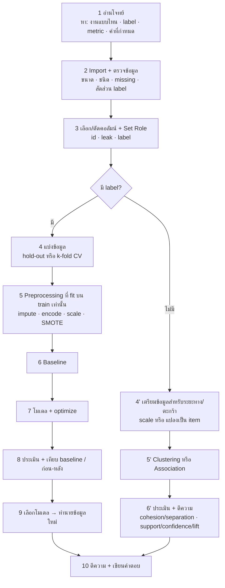

# 🧭 FLOW 00 · START HERE
### อ่านเพื่อ "เข้าใจว่าทำไม" ไม่ใช่แค่ "กดอะไร"

> [!abstract] ชุดนี้คืออะไร
> โน้ตอธิบาย **ลำดับขั้นการแก้โจทย์แต่ละรูปแบบ** และ **เหตุผลของทุกขั้น** (ถ้าข้ามหรือสลับลำดับจะเกิดอะไร)
> ใช้คู่กับ template: Python `final/exam_templates/` (T01–T11) · RapidMiner `final/rm_templates/` (R01–R11) — ทุกขั้นมีลิงก์บอกว่าอยู่ § ไหน
> ตัวเลขตัวอย่างทุกตัวมาจากการรัน template จริงกับข้อมูลตัวอย่าง

## 📚 สารบัญ

| โน้ต | โจทย์แบบ | template |
|---|---|---|
| [[FLOW 01 Data Handling]] | import · ตรวจ · select · filter · join · append · pivot · กราฟ | T01 · R01 |
| [[FLOW 02 Preprocessing & Leakage]] | missing · outlier · encoding · scaling · discretize · sampling · split ไม่ leak | T02 · R02 |
| [[FLOW 03 PCA]] | ลดมิติ · explained variance · loadings · plot 2D | T03 · R03 |
| [[FLOW 04 Imbalanced Classification]] | คลาสไม่สมดุล · SMOTE · under/over · threshold · เลือก metric | T04 · R04 |
| [[FLOW 05 KNN]] | ระยะทาง · k · scale · ทำนาย | T05 · R05 |
| [[FLOW 06 Linear Regression]] | ทำนายตัวเลข · สมการ · MAE/RMSE/R² | T06 · R06 |
| [[FLOW 07 Logistic Regression]] | probability · threshold · odds ratio | T07 · R07 |
| [[FLOW 08 Decision Tree & Random Forest]] | gain/gini · ต้นไม้ · overfit · RF | T08 · R08 |
| [[FLOW 09 Classification Workflow]] ⭐ | baseline → หลายโมเดล → optimize → เทียบ → เลือก → ทำนาย | T09 · R09 |
| [[FLOW 10 Clustering]] | K-Means · เลือก k · centroid · cohesion/separation | T10 · R10 |
| [[FLOW 11 Association Rules]] | transaction · frequent itemsets · support/confidence/lift | T11 · R11 |
| [[FLOW 12 Combined Problems & Writing Answers]] | โจทย์หลายส่วน · โครงเขียนคำตอบ · checklist ก่อนส่ง | ทุกไฟล์ |

---

## 1 · Flow ใหญ่ที่ใช้ได้กับทุกโจทย์

### ทำไมต้องเรียงแบบนี้
| ขั้น | ทำไมต้องมี | ถ้าข้าม / สลับลำดับ |
|---|---|---|
| **1 อ่านโจทย์ก่อน** | งานแบบไหน (classification / regression / clustering / association) กำหนดทุกอย่างที่ตามมา: metric, ต้อง scale ไหม, baseline แบบไหน | เลือก metric ผิด (เช่นใช้ accuracy กับข้อมูลไม่สมดุล) แล้วสรุปผิดทั้งข้อ |
| **2 ตรวจข้อมูล** | รู้ว่ามี missing, ชนิดผิด (ตัวเลขที่อ่านเป็นข้อความเพราะมี `?`), label ไม่สมดุล → ตัดสินใจ preprocessing ได้ถูก | โมเดล error กลางทาง หรือได้ผลดีหลอก ๆ |
| **3 ตัด id / leak** | id ไม่มีความหมายเชิงทำนาย · คอลัมน์ที่รู้ "หลัง" เกิดผล = เฉลยรั่ว | โมเดลจำ id หรือโกงจากคอลัมน์ leak → ผลสูงเกินจริงใช้งานจริงไม่ได้ |
| **4 แบ่งข้อมูลก่อน preprocessing** | test ต้องเป็นตัวแทน "ข้อมูลที่ไม่เคยเห็น" | ค่า mean/std/SMOTE จาก test รั่วเข้า training = **data leakage** |
| **5 preprocessing fit บน train** | กติกาเดียวกับข้อ 4 · ใช้ Pipeline (Python) / Training pane (RapidMiner) | เหมือนข้อ 4 |
| **6 baseline ก่อนโมเดล** | จุดอ้างอิงขั้นต่ำ: "เดาคลาสที่พบบ่อยสุด" ได้เท่าไร โมเดลต้องชนะสิ่งนี้ | พูดไม่ได้ว่าโมเดล "ดี" จริง (accuracy 90% อาจแย่กว่าเดาเฉย ๆ) |
| **7 optimize ด้วย CV บน train** | หา parameter ที่ดีโดยไม่แตะ test | ถ้าเลือก parameter จาก test = test ไม่ใช่ข้อมูลที่ไม่เคยเห็นอีกต่อไป |
| **8 เทียบ** | โจทย์มักถาม "ดีขึ้นไหม เท่าไร เพราะอะไร" | ตอบไม่ครบ |
| **9 fit ทั้งชุดก่อนทำนายจริง** | ใช้ข้อมูลมากสุดเมื่อเลือกโมเดลเสร็จแล้ว | — |
| **10 ตีความ** | ข้อสอบเน้น "การตีความ" ไม่ใช่ syntax | เสียคะแนนส่วนใหญ่ |

---

## 2 · 3 คำถามที่ต้องตอบได้ก่อนเริ่มทุกข้อ

> [!question] ถามตัวเองก่อนแตะคีย์บอร์ด
> 1. **คำตอบ (label) คืออะไร เป็นชนิดไหน?** → ไม่มี = unsupervised · ตัวเลข = regression · คลาส = classification
> 2. **"ผิด" แบบไหนแพงกว่า?** (พลาดคนป่วยจริง FN vs เตือนผิด FP) → เลือก metric: recall / precision / F1 / accuracy / RMSE
> 3. **โจทย์กำหนดอะไรไว้แล้ว?** (seed, k, depth, folds, threshold, min support) → ใส่ตามนั้น ห้ามเลือกเอง

## 3 · วิธีอ่านโน้ตแต่ละบท

แต่ละ FLOW มีหัวข้อเดียวกัน:
1. **โจทย์หน้าตาแบบไหน** — คำที่บอกว่าใช้ flow นี้
2. **แผนภาพ flow**
3. **ทีละขั้น:** ทำอะไร → **ทำไม** → ถ้าไม่ทำ/ทำผิดเกิดอะไร → อยู่ที่ T§ / R§
4. **ตัวอย่างผลจริง** และวิธีอ่าน
5. **กับดัก** ที่เสียคะแนนบ่อย
6. **โครงคำตอบ**
