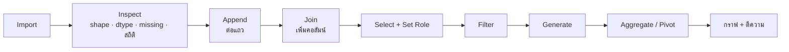

# FLOW 01 · Data Handling & Visualization
> template: Python **T01** · RapidMiner **R01** · กลับ [[FLOW 00 START HERE]]

## โจทย์หน้าตาแบบนี้
*"import และตรวจสอบข้อมูล"* · *"เลือกเฉพาะ…"* · *"กรองเฉพาะลูกค้าที่…"* · *"รวมข้อมูล 2 ไฟล์"* · *"เพิ่มข้อมูลจากตาราง…"* ·
*"สรุปยอดตามกลุ่ม"* · *"สร้าง pivot table"* · *"วาดกราฟและอธิบาย"*

## ทีละขั้น

### ① Import → ② Inspect
- **ทำ:** อ่านไฟล์ → ดูจำนวนแถว/คอลัมน์ · ชนิดข้อมูล · ค่าว่าง · สถิติ (mean, median, min, max) · สัดส่วน label
- **ทำไม:** ทุกการตัดสินใจหลังจากนี้ขึ้นกับสิ่งที่เห็นตรงนี้ เช่น คอลัมน์ตัวเลขที่ถูกอ่านเป็นข้อความ (เพราะมี `?`) จะคำนวณไม่ได้, คอลัมน์ที่ว่าง 80% ควรตัด
- **ดู mean เทียบ median:** mean > median มาก = **เบ้ขวา** (มีค่าสูงผิดปกติดึง mean) → ใช้ median เป็นค่ากลางที่ทนกว่า
- **อยู่ที่:** T01 §1 · R01 res 1 → Statistics

### ③ Append (Concatenate) ก่อน ④ Join
- **Append** = ต่อ **แถว** (ไฟล์คอลัมน์เดียวกัน คนละช่วงเวลา/สาขา) · **Join** = เพิ่ม **คอลัมน์** จากอีกตารางด้วย key
- **ทำไม append ก่อน join:** ถ้า join ทีละไฟล์แล้วค่อยต่อ ต้อง join 2 รอบและเสี่ยงคอลัมน์ไม่ตรงกัน · ต่อแถวให้ครบก่อนแล้ว join ครั้งเดียว
- **ต้องตรวจหลัง append:** คอลัมน์ตรงกันไหม · id ซ้ำไหม (ข้อมูลซ้อนช่วงเวลา)
- **join type เลือกยังไง:**

| join | เก็บอะไร | ใช้เมื่อ |
|---|---|---|
| inner | เฉพาะ key ที่มีทั้งสองฝั่ง | ต้องการเฉพาะแถวที่ข้อมูลครบ |
| **left** | ทุกแถวของตารางหลัก (ไม่เจอคู่ = ว่าง) | **ห้ามแถวหลักหาย** (นิยมสุด) |
| outer | ทุกแถวทั้งสองฝั่ง | อยากเห็นว่าอะไรจับคู่ไม่ได้ |

- **ต้องตรวจหลัง join:** จำนวนแถวเพิ่มขึ้นไหม (ถ้าเพิ่ม = key ในตาราง lookup ซ้ำ → แถวถูกคูณ) · มีกี่แถวที่จับคู่ไม่ได้
- **อยู่ที่:** T01 §4–§5 · R01 Append / Join

### ⑤ Select Attributes + Set Role
- **ตัด:** id (ไม่มีความหมาย) · คอลัมน์ที่รู้หลังเกิดผล (leak) · คอลัมน์ซ้ำซ้อน · ค่าว่างเยอะมาก
- **Set Role:** บอกโปรแกรมว่าคอลัมน์ไหนคือ id (ไว้ติดป้าย) และไหนคือ label (คำตอบ) → โปรแกรมจะไม่ใช้สองอย่างนี้เป็น feature
- **ทำไมสำคัญ:** ถ้าไม่ตั้ง id ใน RapidMiner, k-NN จะเอา id ไปคิดระยะทางด้วย → ผลผิดโดยไม่มี error
- **อยู่ที่:** T01 §2 · R01 §2

### ⑥ Filter → ⑦ Generate
- **Filter** ก่อนสรุป เพราะโจทย์มักถามเฉพาะกลุ่ม ("เฉพาะมื้อเย็น") · ตอบเสมอว่าเหลือกี่แถวจากเท่าไร
- **Generate** สร้างตัวแปรที่ตอบโจทย์ได้ตรงกว่า เช่น `tip_pct = tip / total_bill × 100` (เปรียบเทียบข้ามบิลขนาดต่างกันได้ยุติธรรม)
- **อยู่ที่:** T01 §3, §8 · R01 §3, §8

### ⑧ Aggregate / Pivot
- **Aggregate** = สรุปตามกลุ่ม 1 มิติ (ยอดรวมต่อวัน) · **Pivot** = 2 มิติ (วัน × มื้อ)
- **สัดส่วนคลาส** (เช่น % churn ตาม Contract) → สร้างคอลัมน์ 0/1 แล้ว pivot ด้วย **average** (ค่าเฉลี่ยของ 0/1 = สัดส่วน)
- **อยู่ที่:** T01 §6–§7 · R01 §6–§7

### ⑨ กราฟ + ตีความ
| อยากรู้ | กราฟ | ทำไมกราฟนี้ |
|---|---|---|
| การกระจายของตัวเลข 1 ตัว | histogram / boxplot | เห็นรูปร่าง (เบ้/สมมาตร) และ outlier |
| ตัวเลขเทียบระหว่างกลุ่ม | boxplot แยกกลุ่ม | เห็นทั้งค่ากลางและการกระจายของแต่ละกลุ่ม |
| จำนวน/สัดส่วนในแต่ละหมวด | bar / stacked bar 100% | หมวดหมู่ไม่มีลำดับ ต้องเทียบความสูง |
| ความสัมพันธ์ตัวเลข 2 ตัว | scatter | เห็นทิศทาง ความแรง และรูปแบบไม่เชิงเส้น |
| หลายตัวพร้อมกัน | correlation heatmap | สรุป r ทุกคู่ในภาพเดียว |

> [!warning] correlation ≠ causation · r วัดแค่ความสัมพันธ์ **เชิงเส้น** (r ≈ 0 อาจยังสัมพันธ์แบบโค้งได้)

## ตัวอย่างผลจริง (T01, ข้อมูล tips)
- `total_bill`: mean 19.79 > median 17.80, skew 1.13 → **เบ้ขวา** · outlier (IQR) 9 ค่า
- median ตามวัน: Sun 19.63 สูงสุด · Fri 15.38 ต่ำสุด
- r(total_bill, tip) = 0.676 → สัมพันธ์เชิงบวกค่อนข้างแรง (บิลใหญ่ ทิปมาก) แต่ไม่ได้แปลว่าบิลใหญ่ "ทำให้" ทิปมาก

## กับดัก
- join แล้วแถวเพิ่มโดยไม่สังเกต (key ซ้ำในตาราง lookup)
- ใช้ mean อธิบายข้อมูลเบ้ (ควรอ้าง median ด้วย)
- กราฟเส้นกับหมวดหมู่ที่ไม่มีลำดับ
- ลืมบอกว่ากรองแล้วเหลือกี่แถว

## โครงคำตอบ
> ข้อมูลมี … แถว … คอลัมน์ · รวม 2 ไฟล์ด้วย append ได้ … แถว แล้ว join (left) กับ … ด้วย key … (จับคู่ไม่ได้ … แถว) ·
> กรองเงื่อนไข … เหลือ … แถว · จาก pivot พบว่า … สูงสุดที่ … (…) ต่ำสุดที่ … (…) · กราฟ … แสดงว่า … (รูปร่าง/ค่ากลาง/ความต่างระหว่างกลุ่ม)
