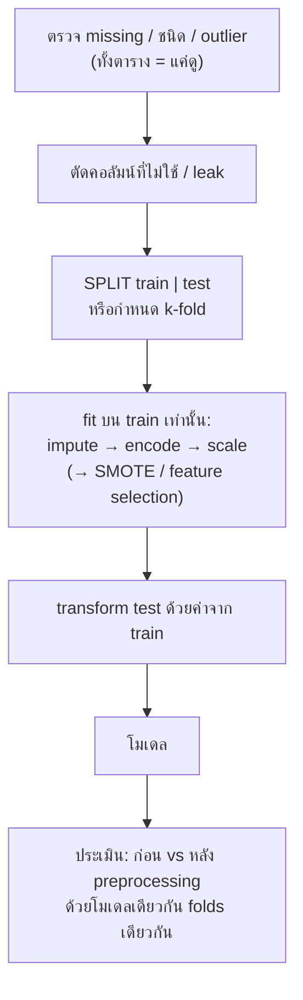

# FLOW 02 · Preprocessing & Data Leakage
> template: Python **T02** · RapidMiner **R02** · กลับ [[FLOW 00 START HERE]]

## โจทย์หน้าตาแบบนี้
*"จัดการ missing values"* · *"encode ตัวแปรหมวดหมู่"* · *"normalize / standardize"* · *"แบ่งช่วง (discretize)"* ·
*"สุ่มตัวอย่าง"* · *"แบ่งข้อมูลโดยไม่เกิด data leakage"* · *"เปรียบเทียบผลก่อนและหลัง preprocessing"*

> [!danger] กฎทองข้อเดียวของบทนี้
> **อะไรที่ "เรียนรู้ค่าจากข้อมูล" (mean, median, std, min/max, หมวดที่มี, PCA, SMOTE, การเลือก feature) ต้อง fit บน train เท่านั้น**
> แล้วเอาค่าที่ได้ไปใช้กับ test · Python ใช้ `Pipeline` · RapidMiner ใส่ใน **Training pane** ของ Cross Validation หรือ Apply Model (preprocessing model) กับ test

## ทีละขั้น

### ① ตรวจ (ทั้งตารางได้ เพราะแค่ "ดู")
- ค่าว่างแฝง: `?`, `-`, ช่องว่าง, **ค่า 0 ที่เป็นไปไม่ได้** (BMI = 0, ความดัน = 0) → ต้องประกาศเป็น missing ก่อน ไม่งั้นโมเดลคิดว่า 0 คือค่าจริง
- ดู % missing ต่อคอลัมน์ → ตัดสินใจวิธีจัดการ
- **อยู่ที่:** T02 §1 · R02 res 1 (Statistics)

### ② เลือกวิธีจัดการ missing
| วิธี | ใช้เมื่อ | ทำไม |
|---|---|---|
| ลบแถว | ว่างน้อยมาก (< 5%) และสุ่ม | ง่าย ไม่บิดข้อมูล แต่เสียแถว |
| ลบคอลัมน์ | ว่างเกินครึ่ง | เติมไปก็เดาเกือบทั้งคอลัมน์ |
| **median** | ตัวเลขเบ้/มี outlier | median ไม่ถูก outlier ดึง |
| mean | ตัวเลขสมมาตร | — |
| mode | หมวดหมู่ | ค่าที่พบบ่อยสุดเป็นการเดาที่ปลอดภัยสุด |
| ตามกลุ่ม | ค่าต่างกันชัดตามกลุ่ม (เช่น น้ำหนักตามสายพันธุ์) | แม่นกว่าค่ากลางรวม |

**ทำไมเติมด้วยค่าจาก train:** median ของทั้งตารางรวมข้อมูล test ไว้ด้วย = test "สอน" โมเดลทางอ้อม · **อยู่ที่:** T02 §2 · R02 §2

### ③ Outlier
- ตรวจด้วย IQR: < Q1 − 1.5·IQR หรือ > Q3 + 1.5·IQR
- **ไม่ต้องลบเสมอ:** outlier ที่เป็นค่าจริง (คนรายได้สูงจริง) มีข้อมูล · ลบเฉพาะที่เป็นข้อผิดพลาด หรือ clip เมื่อโมเดลไวต่อค่าสุดขั้ว (linear, KNN)
- **อยู่ที่:** T02 §3 · R02 §3

### ④ Encoding
| ชนิด | วิธี | ทำไม |
|---|---|---|
| หมวดหมู่ไม่มีลำดับ (สี, เมือง) | **one-hot / dummy** | ถ้าใส่ 1, 2, 3 โมเดลจะคิดว่า "เมือง 3 > เมือง 1" ซึ่งไม่มีความหมาย |
| หมวดหมู่มีลำดับ (low < mid < high) | ordinal 0, 1, 2 | ลำดับมีความหมายจริง |
| 2 ค่า (yes/no) | 0/1 | — |
| linear / logistic regression | dummy **ตัดตัวแรก** (reference) | ไม่งั้นคอลัมน์ dummy รวมกัน = 1 เสมอ → collinear, coefficient ตีความไม่ได้ |

**อยู่ที่:** T02 §4 · R02 §4

### ⑤ Scaling
| วิธี | สูตร | ใช้เมื่อ |
|---|---|---|
| **Standardization (z-score)** | (x − mean) / std → mean 0, std 1 | ค่าเริ่มต้นที่ดี · ทนต่อ outlier กว่า min-max |
| **Normalization (min-max)** | (x − min) / (max − min) → 0..1 | อยากได้ช่วงคงที่ · ข้อมูลไม่มี outlier รุนแรง |

**ทำไมต้อง scale:** โมเดลที่ใช้ **ระยะทาง** (KNN, K-Means) หรือ **gradient/regularization** (logistic) ให้น้ำหนักตามขนาดตัวเลข → ตัวแปรหลักหมื่น (รายได้) จะกลบตัวแปรหลักหน่วย (จำนวนบุตร)
**ไม่ต้อง scale:** Decision Tree / Random Forest (แบ่งด้วย threshold ทีละตัวแปร ไม่ใช้ระยะทาง)
**อยู่ที่:** T02 §5 · R02 §5

### ⑥ Discretization
| วิธี | ผล | ใช้เมื่อ |
|---|---|---|
| equal width | ช่วงกว้างเท่ากัน | ข้อมูลกระจายสม่ำเสมอ · ข้อมูลเบ้ → บางช่วงแทบว่าง |
| **equal frequency** | จำนวนต่อช่วงเท่ากัน | ข้อมูลเบ้ (รายได้) |
| กำหนดเอง | ตามความหมาย (เด็ก/ผู้ใหญ่/สูงอายุ) | มีเกณฑ์ทางธุรกิจ |

**ทำไมต้อง discretize:** association rules ใช้ได้แต่ item (ค่าหมวดหมู่) · บางครั้งทำให้ตีความง่ายขึ้น · **อยู่ที่:** T02 §6 · R02 §6

### ⑦ Sampling
- **random** = สุ่มเฉย ๆ · **stratified** = รักษาสัดส่วนคลาสเท่าเดิม → ใช้เสมอเมื่อ label ไม่สมดุล (ไม่งั้น test อาจแทบไม่มีคลาสส่วนน้อย)
- **อยู่ที่:** T02 §7 · R02 §7

### ⑧ ⭐ Split ไม่ leak + เทียบก่อน/หลัง
- **ลำดับที่ถูก:** split → fit preprocessing บน train → transform test
- **เทียบก่อน/หลัง ต้องคุมตัวแปร:** โมเดลเดียวกัน · folds เดียวกัน (seed เดียวกัน) · ต่างกันแค่ preprocessing → ความต่างของผลมาจาก preprocessing จริง
- **อยู่ที่:** T02 §8 · R02 §8 / §8b

### ⑨ Feature selection (ต้องอยู่ใน pipeline ด้วย)
- เลือก feature ด้วยทั้งตาราง = ใช้ความสัมพันธ์กับ label ใน test ช่วยเลือก → leak · **อยู่ที่:** T02 §9 · R02 §9

## ตัวอย่างผลจริง (T02, penguins, KNN k=5, 5-fold CV, macro F1)
| | F1 |
|---|---|
| Majority baseline | 0.2043 |
| KNN ไม่ scale | 0.7490 |
| KNN + z-score | **0.9904** |
| KNN + min-max | 0.9870 |

**อ่าน:** body_mass_g (หลักพัน) กลบ bill_depth (หลักสิบ) ในระยะทาง → ไม่ scale ได้ 0.749 · scale แล้วทุกตัวแปรมีน้ำหนักเท่ากัน → 0.990

## กับดัก
- `StandardScaler().fit_transform(X)` ทั้งตารางก่อน split → leak (มักดูไม่ต่าง แต่ **ผิดหลัก** = เสียคะแนน)
- ลืมค่า 0 ที่เป็น missing
- one-hot แล้วลืมทำแบบเดียวกันกับข้อมูลใหม่ (คอลัมน์ไม่ตรงกัน) → ใช้ preprocessing model / Pipeline เดิม
- scale label (ไม่ต้อง)

## โครงคำตอบ
> พบ missing ที่ … (…%) และค่า 0 ที่เป็นไปไม่ได้ใน … → เติมด้วย median เพราะ … เบ้ · encode … ด้วย one-hot เพราะไม่มีลำดับ ·
> standardize เพราะใช้ KNN ที่คิดระยะทางและตัวแปรมีหน่วยต่างกัน (… หลักพัน vs … หลักสิบ) · แบ่ง train/test แบบ stratified ก่อน แล้ว fit
> imputer/scaler บน train เท่านั้นเพื่อกัน data leakage · ผล: ก่อน scale F1 … → หลัง … (+…)
