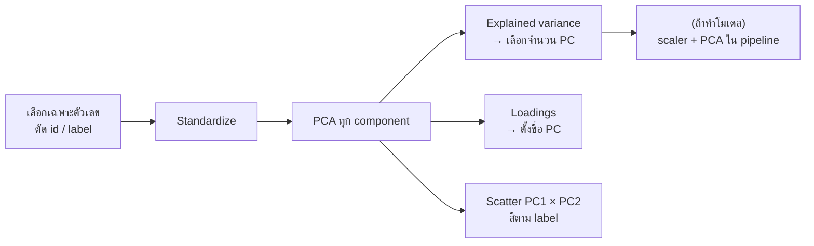

# FLOW 03 · PCA
> template: Python **T03** · RapidMiner **R03** · กลับ [[FLOW 00 START HERE]]

## โจทย์หน้าตาแบบนี้
*"ใช้ PCA ลดมิติ"* · *"ต้องใช้กี่ component จึงอธิบายความแปรปรวนได้ 80/90%"* · *"PC1 มาจากตัวแปรใด (loadings)"* ·
*"plot ข้อมูลใน 2 มิติ"* · *"เปรียบเทียบโมเดลก่อน/หลัง PCA"*

## ทีละขั้น

### ① ใช้เฉพาะตัวเลข และไม่ใส่ label
- **ทำไม:** PCA คำนวณจาก variance/covariance ซึ่งนิยามกับตัวเลขเท่านั้น · label ไม่ควรอยู่ใน PCA เพราะ PCA เป็น unsupervised (ใส่ไปก็เท่ากับเอาคำตอบไปปนใน feature)
- **อยู่ที่:** T03 §1 · R03 Select Attributes (numeric)

### ② Standardize ก่อน PCA (เกือบทุกครั้ง)
- **ทำไม:** PCA หา "ทิศที่ variance มากสุด" → ตัวแปรหน่วยใหญ่ (proline หลักพัน, variance ใหญ่) จะยึด PC1 ไปทั้งตัว ทั้งที่อาจไม่สำคัญ
- ตัวอย่าง T03: std ของตัวแปรตั้งแต่ 0.124 ถึง 314.9 → ไม่ standardize = PC1 ≈ proline อย่างเดียว

### ③ Explained variance → เลือกจำนวน PC
| เกณฑ์ | อ่านยังไง |
|---|---|
| **cumulative ≥ เกณฑ์โจทย์** (80/90/95%) | จำนวน PC น้อยสุดที่สะสมถึงเกณฑ์ |
| Kaiser: eigenvalue > 1 | PC ที่อธิบายได้มากกว่าตัวแปรเดิม 1 ตัว |
| scree plot "ข้อศอก" | จุดที่กราฟเริ่มแบน |

**ทำไมไม่ใช้ทุก PC:** จุดประสงค์คือลดมิติ — PC ท้าย ๆ ส่วนใหญ่เป็น noise · **อยู่ที่:** T03 §2 · R03 Eigenvalues

### ④ Loadings → ตีความ PC
- loading = น้ำหนักของตัวแปรเดิมใน PC · |loading| ใหญ่ = ตัวแปรนั้นขับ PC นั้น · เครื่องหมายบอกทิศ
- ใช้ตั้งชื่อ PC (เช่น "PC1 = ความเข้มของสารฟีนอล") · **อยู่ที่:** T03 §3 · R03 Eigenvectors

### ⑤ Scatter 2D
- PC1 × PC2 ระบายสีตาม label → ดูว่าคลาสแยกกันไหม · **ต้องบอก % variance ของ 2 แกน** (ภาพนี้แทนข้อมูลได้แค่นั้น)
- **อยู่ที่:** T03 §4 · R03 §4 (Visualizations)

### ⑥ PCA ก่อนโมเดล
- scaler + PCA ต้องอยู่ใน pipeline / Training pane → fit บน train fold
- **ทำไมบางครั้ง PCA ไม่ช่วย:** PCA เก็บทิศที่ variance มาก ไม่ใช่ทิศที่แยกคลาสได้ดี → ผลอาจเท่าเดิมหรือแย่ลงเล็กน้อย แต่ได้โมเดลเล็ก/เร็วขึ้น
- **อยู่ที่:** T03 §5 · R03 §5

## ตัวอย่างผลจริง (T03, wine 13 ตัวแปร)
- ต้องใช้ **5 PC** จึงได้ ≥ 80% (80.16%) · Kaiser เก็บ 3 PC · PC1 = 36.2%, PC1+PC2 = 55.4%
- PC1: flavanoids (+0.42), total_phenols (+0.40) → "สารฟีนอล" · PC2: color_intensity (+0.53), alcohol (+0.48) → "สี/แอลกอฮอล์"
- KNN: ทุก feature F1 0.9721 · PCA(2) 0.9679 · PCA(3) 0.9737 → **3 PC ได้ผลเท่ากับ 13 ตัวแปร** = ลดมิติได้โดยไม่เสียความแม่น

## กับดัก
- ไม่ standardize
- ใส่ label หรือ id เข้า PCA
- fit PCA ทั้งตารางก่อน CV (leak)
- บอกว่า "PC1 คือ flavanoids" — PC เป็นผลรวมของหลายตัวแปร ต้องบอกว่า "ขับเคลื่อนโดย"
- ภาพ 2D อธิบายได้ 55% → อย่าสรุปว่า "แยกไม่ได้" จากภาพอย่างเดียว

## โครงคำตอบ
> standardize ก่อนเพราะหน่วยต่างกันมาก (std … ถึง …) · PCA: PC1 อธิบาย …% PC2 …% สะสม …% · ต้องใช้ … PC เพื่อถึง …% ·
> PC1 มี loading สูงที่ … และ … → แทน "…" · ภาพ 2D (…% ของ variance) คลาส … แยกชัด ส่วน … ซ้อนกัน ·
> เมื่อใช้ … PC กับโมเดล ได้ F1 … เทียบกับทุก feature … → ลดมิติจาก … เหลือ … โดยเสียความแม่นเล็กน้อย/ไม่เสีย
