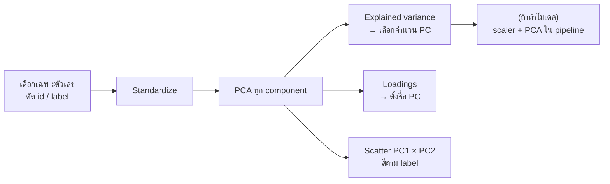

# FLOW 03 · PCA
> template: Python **T03** · RapidMiner **R03** · กลับ [[FLOW 00 START HERE]]

## โจทย์หน้าตาแบบนี้
*"ใช้ PCA ลดมิติ"* · *"ต้องใช้กี่ component จึงอธิบายความแปรปรวนได้ 80/90%"* · *"PC1 มาจากตัวแปรใด (loadings)"* ·
*"plot ข้อมูลใน 2 มิติ"* · *"เปรียบเทียบโมเดลก่อน/หลัง PCA"*



## ทีละขั้น

<!-- RM-CANVAS -->

> [!info]- 🖥️ วิธีอ่านภาพ RapidMiner ใต้แต่ละขั้น (สร้างจาก `R03_pca.rmp` จริง)
> กล่อง = operator (บน: ชื่อบน canvas · ล่าง: ชนิด) · ⧉ = มี subprocess (ดับเบิลคลิกเข้าไป) · ป้ายบนเส้น = port ย่อ (exa = example set · mod = model · pre = preprocessing model · per = performance · lab = labelled data · tra = training set · tes = test set · out = output · par = partition ของ Split Data / parameter set ของ Optimize · thr = threshold · wei = weights · fre = frequent sets · rul = rules) · ◯ res = ต่อออกผลลัพธ์ · กล่องเส้นประ = port ขอบ pane · สี: 🟪 อ่านข้อมูล · 🟦 จัดการข้อมูล · 🟩 preprocessing · 🟧 โมเดล · 🟨 apply · 🟥 ประเมิน/validation · ⬜ utility · มีเฉพาะ operator ของขั้นนั้น (ไฟล์จริงมี operator อื่นต่ออยู่ด้วย)

<!-- /RM-CANVAS -->

### ① ใช้เฉพาะตัวเลข และไม่ใส่ label
- **ทำไม:** PCA คำนวณจาก variance/covariance ซึ่งนิยามกับตัวเลขเท่านั้น · label ไม่ควรอยู่ใน PCA เพราะ PCA เป็น unsupervised (ใส่ไปก็เท่ากับเอาคำตอบไปปนใน feature)
- **อยู่ที่:** T03 §1 · R03 Select Attributes (numeric)

<!-- RM-CANVAS -->

> [!example]+ 🖥️ RapidMiner: เลือกเฉพาะตัวเลข (label ตั้ง role ไว้ → ไม่ถูกใช้ใน PCA)
> ```mermaid
> flowchart LR
>   n0["Read CSV"]:::data
>   n1["Set Role"]:::blend
>   n2["Select Attributes"]:::blend
>   n3["Multiply"]:::util
>   n0 -->|"out"| n1
>   n1 -->|"exa"| n2
>   n2 -->|"exa"| n3
>   classDef data fill:#e8dcf5,stroke:#7b52ab,color:#000
>   classDef blend fill:#dceefb,stroke:#3a7bbf,color:#000
>   classDef clean fill:#d9f2e6,stroke:#2e8b57,color:#000
>   classDef model fill:#ffe7c2,stroke:#d4860b,color:#000
>   classDef score fill:#fff6b3,stroke:#b8a400,color:#000
>   classDef eval fill:#fcd9d9,stroke:#c0392b,color:#000
>   classDef util fill:#eeeeee,stroke:#777,color:#000
>   classDef port fill:#ffffff,stroke:#999,stroke-dasharray:3 3,color:#555
>   classDef res fill:#ffffff,stroke:#333,stroke-width:2px,color:#000
> ```

<!-- /RM-CANVAS -->

### ② Standardize ก่อน PCA (เกือบทุกครั้ง)
- **ทำไม:** PCA หา "ทิศที่ variance มากสุด" → ตัวแปรหน่วยใหญ่ (proline หลักพัน, variance ใหญ่) จะยึด PC1 ไปทั้งตัว ทั้งที่อาจไม่สำคัญ
- ตัวอย่าง T03: std ของตัวแปรตั้งแต่ 0.124 ถึง 314.9 → ไม่ standardize = PC1 ≈ proline อย่างเดียว

<!-- RM-CANVAS -->

> [!example]+ 🖥️ RapidMiner: Normalize → PCA · pre = PCA model (Eigenvalues = §③ · Eigenvectors = §④)
> ```mermaid
> flowchart LR
>   n0["Multiply"]:::util
>   n1["Normalize (pca)<br/><i>Normalize</i>"]:::clean
>   n2["PCA (keep variance)<br/><i>PCA</i>"]:::clean
>   n0 -->|"out 1"| n1
>   n1 -->|"exa"| n2
>   nR0(("res")):::res
>   n2 -->|"exa"| nR0
>   nR1(("res")):::res
>   n2 -->|"pre"| nR1
>   classDef data fill:#e8dcf5,stroke:#7b52ab,color:#000
>   classDef blend fill:#dceefb,stroke:#3a7bbf,color:#000
>   classDef clean fill:#d9f2e6,stroke:#2e8b57,color:#000
>   classDef model fill:#ffe7c2,stroke:#d4860b,color:#000
>   classDef score fill:#fff6b3,stroke:#b8a400,color:#000
>   classDef eval fill:#fcd9d9,stroke:#c0392b,color:#000
>   classDef util fill:#eeeeee,stroke:#777,color:#000
>   classDef port fill:#ffffff,stroke:#999,stroke-dasharray:3 3,color:#555
>   classDef res fill:#ffffff,stroke:#333,stroke-width:2px,color:#000
> ```

<!-- /RM-CANVAS -->

### ③ Explained variance → เลือกจำนวน PC
| เกณฑ์ | อ่านยังไง |
|---|---|
| **cumulative ≥ เกณฑ์โจทย์** (80/90/95%) | จำนวน PC น้อยสุดที่สะสมถึงเกณฑ์ |
| Kaiser: eigenvalue > 1 | PC ที่อธิบายได้มากกว่าตัวแปรเดิม 1 ตัว |
| scree plot "ข้อศอก" | จุดที่กราฟเริ่มแบน |

**ทำไมไม่ใช้ทุก PC:** จุดประสงค์คือลดมิติ — PC ท้าย ๆ ส่วนใหญ่เป็น noise · **อยู่ที่:** T03 §2 · R03 Eigenvalues

### ④ Loadings → ตีความ PC
- loading = น้ำหนักของตัวแปรเดิมใน PC · |loading| ใหญ่ = ตัวแปรนั้นขับ PC นั้น · เครื่องหมายบอกทิศ
- ใช้ตั้งชื่อ PC (เช่น "PC1 = ความเข้มของสารฟีนอล") · **อยู่ที่:** T03 §3 · R03 Eigenvectors

### ⑤ Scatter 2D
- PC1 × PC2 ระบายสีตาม label → ดูว่าคลาสแยกกันไหม · **ต้องบอก % variance ของ 2 แกน** (ภาพนี้แทนข้อมูลได้แค่นั้น)
- **อยู่ที่:** T03 §4 · R03 §4 (Visualizations)

<!-- RM-CANVAS -->

> [!example]+ 🖥️ RapidMiner: PCA 2 components → Visualizations: Scatter pc_1 × pc_2 สีตาม label
> ```mermaid
> flowchart LR
>   n0["Multiply"]:::util
>   n1["Normalize (2D)<br/><i>Normalize</i>"]:::clean
>   n2["PCA (2 components)<br/><i>PCA</i>"]:::clean
>   n0 -->|"out 2"| n1
>   n1 -->|"exa"| n2
>   nR0(("res")):::res
>   n2 -->|"exa"| nR0
>   classDef data fill:#e8dcf5,stroke:#7b52ab,color:#000
>   classDef blend fill:#dceefb,stroke:#3a7bbf,color:#000
>   classDef clean fill:#d9f2e6,stroke:#2e8b57,color:#000
>   classDef model fill:#ffe7c2,stroke:#d4860b,color:#000
>   classDef score fill:#fff6b3,stroke:#b8a400,color:#000
>   classDef eval fill:#fcd9d9,stroke:#c0392b,color:#000
>   classDef util fill:#eeeeee,stroke:#777,color:#000
>   classDef port fill:#ffffff,stroke:#999,stroke-dasharray:3 3,color:#555
>   classDef res fill:#ffffff,stroke:#333,stroke-width:2px,color:#000
> ```

<!-- /RM-CANVAS -->

### ⑥ PCA ก่อนโมเดล
- scaler + PCA ต้องอยู่ใน pipeline / Training pane → fit บน train fold
- **ทำไมบางครั้ง PCA ไม่ช่วย:** PCA เก็บทิศที่ variance มาก ไม่ใช่ทิศที่แยกคลาสได้ดี → ผลอาจเท่าเดิมหรือแย่ลงเล็กน้อย แต่ได้โมเดลเล็ก/เร็วขึ้น
- **อยู่ที่:** T03 §5 · R03 §5

<!-- RM-CANVAS -->

> [!example]+ 🖥️ RapidMiner: เทียบ kNN ก่อน/หลัง PCA ด้วย CV เดียวกัน
> ```mermaid
> flowchart LR
>   n0["Multiply"]:::util
>   n1["Multiply (compare)<br/><i>Multiply</i>"]:::util
>   n2["CV kNN<br/><i>Cross Validation</i><br/>⧉"]:::eval
>   n3["CV kNN + PCA<br/><i>Cross Validation</i><br/>⧉"]:::eval
>   n0 -->|"out 3"| n1
>   n1 -->|"out 1"| n2
>   nR0(("res")):::res
>   n2 -->|"per 1"| nR0
>   n1 -->|"out 2"| n3
>   nR1(("res")):::res
>   n3 -->|"per 1"| nR1
>   classDef data fill:#e8dcf5,stroke:#7b52ab,color:#000
>   classDef blend fill:#dceefb,stroke:#3a7bbf,color:#000
>   classDef clean fill:#d9f2e6,stroke:#2e8b57,color:#000
>   classDef model fill:#ffe7c2,stroke:#d4860b,color:#000
>   classDef score fill:#fff6b3,stroke:#b8a400,color:#000
>   classDef eval fill:#fcd9d9,stroke:#c0392b,color:#000
>   classDef util fill:#eeeeee,stroke:#777,color:#000
>   classDef port fill:#ffffff,stroke:#999,stroke-dasharray:3 3,color:#555
>   classDef res fill:#ffffff,stroke:#333,stroke-width:2px,color:#000
> ```

<!-- /RM-CANVAS -->

<!-- RM-CANVAS -->

> [!example]+ 🖥️ RapidMiner: ข้างใน CV kNN + PCA: Normalize + PCA อยู่ใน Training
> ```mermaid
> flowchart LR
>   subgraph S["CV kNN + PCA · Cross Validation"]
>     direction LR
>     subgraph P0["Training"]
>       direction LR
>       p0x0["Normalize"]:::clean
>       p0x1["PCA"]:::clean
>       p0x2["k-NN"]:::model
>       p0x3["Group Models"]:::model
>       p0xL0(["tra"]):::port
>       p0xL0 --> p0x0
>       p0x0 -->|"exa"| p0x1
>       p0x1 -->|"exa"| p0x2
>       p0x0 -->|"pre"| p0x3
>       p0x1 -->|"pre"| p0x3
>       p0x2 -->|"mod"| p0x3
>       p0xP0(["mod"]):::port
>       p0x3 -->|"mod"| p0xP0
>     end
>     subgraph P1["Testing"]
>       direction LR
>       p1x0["Apply Model"]:::score
>       p1x1["Performance (Classification)"]:::eval
>       p1xL0(["mod"]):::port
>       p1xL0 --> p1x0
>       p1xL1(["tes"]):::port
>       p1xL1 --> p1x0
>       p1x0 -->|"lab"| p1x1
>       p1xP0(["per 1"]):::port
>       p1x1 -->|"per"| p1xP0
>     end
>     P0 ~~~ P1
>   end
>   classDef data fill:#e8dcf5,stroke:#7b52ab,color:#000
>   classDef blend fill:#dceefb,stroke:#3a7bbf,color:#000
>   classDef clean fill:#d9f2e6,stroke:#2e8b57,color:#000
>   classDef model fill:#ffe7c2,stroke:#d4860b,color:#000
>   classDef score fill:#fff6b3,stroke:#b8a400,color:#000
>   classDef eval fill:#fcd9d9,stroke:#c0392b,color:#000
>   classDef util fill:#eeeeee,stroke:#777,color:#000
>   classDef port fill:#ffffff,stroke:#999,stroke-dasharray:3 3,color:#555
>   classDef res fill:#ffffff,stroke:#333,stroke-width:2px,color:#000
> ```

<!-- /RM-CANVAS -->

## ตัวอย่างผลจริง (T03, wine 13 ตัวแปร)
- ต้องใช้ **5 PC** จึงได้ ≥ 80% (80.16%) · Kaiser เก็บ 3 PC · PC1 = 36.2%, PC1+PC2 = 55.4%
- PC1: flavanoids (+0.42), total_phenols (+0.40) → "สารฟีนอล" · PC2: color_intensity (+0.53), alcohol (+0.48) → "สี/แอลกอฮอล์"
- KNN: ทุก feature F1 0.9721 · PCA(2) 0.9679 · PCA(3) 0.9737 → **3 PC ได้ผลเท่ากับ 13 ตัวแปร** = ลดมิติได้โดยไม่เสียความแม่น

## กับดัก
- ไม่ standardize
- ใส่ label หรือ id เข้า PCA
- fit PCA ทั้งตารางก่อน CV (leak)
- บอกว่า "PC1 คือ flavanoids" — PC เป็นผลรวมของหลายตัวแปร ต้องบอกว่า "ขับเคลื่อนโดย"
- ภาพ 2D อธิบายได้ 55% → อย่าสรุปว่า "แยกไม่ได้" จากภาพอย่างเดียว

## โครงคำตอบ
> standardize ก่อนเพราะหน่วยต่างกันมาก (std … ถึง …) · PCA: PC1 อธิบาย …% PC2 …% สะสม …% · ต้องใช้ … PC เพื่อถึง …% ·
> PC1 มี loading สูงที่ … และ … → แทน "…" · ภาพ 2D (…% ของ variance) คลาส … แยกชัด ส่วน … ซ้อนกัน ·
> เมื่อใช้ … PC กับโมเดล ได้ F1 … เทียบกับทุก feature … → ลดมิติจาก … เหลือ … โดยเสียความแม่นเล็กน้อย/ไม่เสีย
