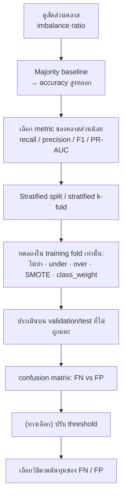

# FLOW 04 · Imbalanced Classification
> template: Python **T04** · RapidMiner **R04** · กลับ [[FLOW 00 START HERE]]

## โจทย์หน้าตาแบบนี้
*"ข้อมูลไม่สมดุล"* · *"คลาส … มีเพียง 10%"* · *"ทำ SMOTE / undersampling / oversampling แล้วเปรียบเทียบ"* ·
*"ทำไม accuracy ไม่เหมาะ"* · *"ทำไมต้องทำ SMOTE เฉพาะ training data"*

## ทีละขั้น

### ① ดูสัดส่วน → ② baseline
- **ทำไมต้องเริ่มที่ baseline:** ข้อมูล 90:10 → เดา "ส่วนใหญ่" ตลอดได้ accuracy 90% โดยไม่เรียนอะไรเลย → พิสูจน์ว่า accuracy ใช้ไม่ได้
- ตัวอย่าง T04: malignant 40 จาก 397 (10.1%) · baseline accuracy **0.8992** แต่ recall **0** · F1 **0**
- **อยู่ที่:** T04 §1–§2 · R04 §1–§2

### ③ เลือก metric
| สถานการณ์ | metric | ทำไม |
|---|---|---|
| พลาดคลาสส่วนน้อยแพง (ป่วยจริงแต่บอกว่าไม่ป่วย = FN) | **recall** | recall = TP/(TP+FN) วัดว่าจับได้กี่ % |
| เตือนผิดแพง (ส่งคนปกติไปผ่าตัด = FP) | **precision** | precision = TP/(TP+FP) วัดว่าที่ทายว่าเป็นถูกกี่ % |
| ต้องการสมดุลทั้งสอง | **F1** | ค่าเฉลี่ยฮาร์มอนิก → ต่ำถ้าตัวใดตัวหนึ่งต่ำ |

### ④ Stratified + resample เฉพาะ training
- **stratified:** ทุก fold มีคลาสส่วนน้อยสัดส่วนเท่ากัน (ไม่งั้นบาง fold อาจไม่มีเลย)
- **ทำไมห้าม resample test:** test ต้องเหมือนโลกจริง (ซึ่งไม่สมดุล) · ถ้า SMOTE ก่อนแบ่ง จุดสังเคราะห์ใน test ถูกสร้างจากจุดใน train → โมเดล "เคยเห็น" ข้อสอบ
- ตัวอย่าง T04 §6: SMOTE ทั้งตารางก่อน CV ได้ F1 **0.9358** vs วิธีถูก **0.7299** → ดีเกินจริง +0.21
- **อยู่ที่:** Python `imblearn.Pipeline` (T04 §4) · RapidMiner ใส่ SMOTE/Sample ใน **Training pane** ของ CV (R04 §4)

### ⑤ เปรียบเทียบวิธี
| วิธี | ทำอะไร | ข้อดี | ข้อเสีย |
|---|---|---|---|
| Undersampling | ลดคลาสส่วนใหญ่ | เร็ว | ทิ้งข้อมูลจริง |
| Oversampling | ทำซ้ำคลาสส่วนน้อย | ไม่ทิ้งข้อมูล | จุดซ้ำเดิม → overfit |
| **SMOTE** | สร้างจุดใหม่ระหว่างจุดคลาสส่วนน้อยกับเพื่อนบ้าน k ตัว | ไม่ซ้ำเดิม | สร้างจุดในบริเวณที่ทับคลาสอื่นได้ → precision ลด |
| class_weight | ให้น้ำหนักความผิดของคลาสส่วนน้อยมากขึ้น | ไม่เปลี่ยนข้อมูล | — |

### ⑥ อ่าน confusion matrix — ไม่ใช่ดูแค่ F1
ตัวอย่างจริง (T04, LogReg, 5-fold CV):

| | recall | precision | F1 | FN | FP |
|---|---|---|---|---|---|
| ไม่ resample | 0.725 | 0.918 | **0.800** | 11 | 3 |
| SMOTE | **0.875** | 0.653 | 0.730 | **5** | 21 |

**อ่าน:** SMOTE **ไม่ได้** ทำให้ F1 ดีขึ้น แต่ทำให้พลาดผู้ป่วยจริงลดจาก 11 เหลือ 5 คน โดยแลกกับเตือนผิดเพิ่มจาก 3 เป็น 21 →
ถ้าโจทย์บอกว่า "พลาดผู้ป่วยแพงกว่า" ควรเลือก SMOTE ทั้งที่ F1 ต่ำกว่า · **การเลือกขึ้นกับต้นทุน ไม่ใช่ตัวเลขเดียว**

### ⑦ Threshold (ทางเลือกที่ไม่ต้อง resample)
- ลด threshold จาก 0.5 → ทายคลาส 1 ง่ายขึ้น → recall ↑ precision ↓
- ตัวอย่าง T04 §7: threshold 0.4 ให้ F1 สูงสุด 0.811 (recall 0.75, precision 0.88)
- **อยู่ที่:** T04 §7 · R07 §5 (Create Threshold)

## กับดัก
- รายงานแค่ accuracy
- SMOTE ก่อน split / ก่อน CV
- ลืมตั้ง positive class = คลาสส่วนน้อย (precision/recall จะคำนวณผิดคลาส)
- สรุปว่า "SMOTE ดีกว่าเสมอ"

## โครงคำตอบ
> คลาส … มีเพียง …% (ratio … : 1) · majority baseline ได้ accuracy … แต่ recall 0 → accuracy ไม่เหมาะ ใช้ F1/recall ของคลาส … ·
> ใช้ stratified k-fold และทำ SMOTE เฉพาะใน training fold (ใน pipeline) เพื่อไม่ให้จุดสังเคราะห์รั่วเข้า validation ·
> ผล: ไม่ resample F1 … recall … · SMOTE F1 … recall … (FN ลดจาก … เป็น … แลกกับ FP เพิ่ม …) ·
> เนื่องจาก … (FN แพงกว่า/FP แพงกว่า) จึงเลือก …
