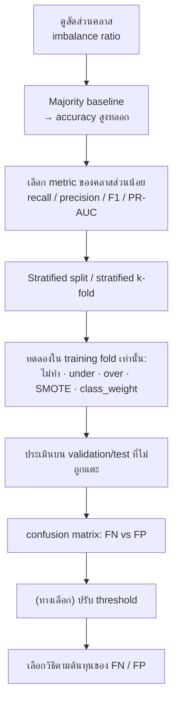

# FLOW 04 · Imbalanced Classification
> template: Python **T04** · RapidMiner **R04** · กลับ [[FLOW 00 START HERE]]

## โจทย์หน้าตาแบบนี้
*"ข้อมูลไม่สมดุล"* · *"คลาส … มีเพียง 10%"* · *"ทำ SMOTE / undersampling / oversampling แล้วเปรียบเทียบ"* ·
*"ทำไม accuracy ไม่เหมาะ"* · *"ทำไมต้องทำ SMOTE เฉพาะ training data"*



## ทีละขั้น

<!-- RM-CANVAS -->

> [!info]- 🖥️ วิธีอ่านภาพ RapidMiner ใต้แต่ละขั้น (สร้างจาก `R04_imbalanced_smote.rmp` จริง)
> กล่อง = operator (บน: ชื่อบน canvas · ล่าง: ชนิด) · ⧉ = มี subprocess (ดับเบิลคลิกเข้าไป) · ป้ายบนเส้น = port ย่อ (exa = example set · mod = model · pre = preprocessing model · per = performance · lab = labelled data · tra = training set · tes = test set · out = output · par = partition ของ Split Data / parameter set ของ Optimize · thr = threshold · wei = weights · fre = frequent sets · rul = rules) · ◯ res = ต่อออกผลลัพธ์ · กล่องเส้นประ = port ขอบ pane · สี: 🟪 อ่านข้อมูล · 🟦 จัดการข้อมูล · 🟩 preprocessing · 🟧 โมเดล · 🟨 apply · 🟥 ประเมิน/validation · ⬜ utility · มีเฉพาะ operator ของขั้นนั้น (ไฟล์จริงมี operator อื่นต่ออยู่ด้วย)

<!-- /RM-CANVAS -->

### ① ดูสัดส่วน → ② baseline
- **ทำไมต้องเริ่มที่ baseline:** ข้อมูล 90:10 → เดา "ส่วนใหญ่" ตลอดได้ accuracy 90% โดยไม่เรียนอะไรเลย → พิสูจน์ว่า accuracy ใช้ไม่ได้
- ตัวอย่าง T04: malignant 40 จาก 397 (10.1%) · baseline accuracy **0.8992** แต่ recall **0** · F1 **0**
- **อยู่ที่:** T04 §1–§2 · R04 §1–§2

<!-- RM-CANVAS -->

> [!example]+ 🖥️ RapidMiner: ดูสัดส่วน (res ของ Multiply → Statistics) · baseline ใน CV
> ```mermaid
> flowchart LR
>   n0["Read CSV"]:::data
>   n1["Set Role"]:::blend
>   n2["Multiply"]:::util
>   n3["CV Baseline<br/><i>Cross Validation</i><br/>⧉"]:::eval
>   n0 -->|"out"| n1
>   n1 -->|"exa"| n2
>   n2 -->|"out 2"| n3
>   nR0(("res")):::res
>   n3 -->|"per 1"| nR0
>   classDef data fill:#e8dcf5,stroke:#7b52ab,color:#000
>   classDef blend fill:#dceefb,stroke:#3a7bbf,color:#000
>   classDef clean fill:#d9f2e6,stroke:#2e8b57,color:#000
>   classDef model fill:#ffe7c2,stroke:#d4860b,color:#000
>   classDef score fill:#fff6b3,stroke:#b8a400,color:#000
>   classDef eval fill:#fcd9d9,stroke:#c0392b,color:#000
>   classDef util fill:#eeeeee,stroke:#777,color:#000
>   classDef port fill:#ffffff,stroke:#999,stroke-dasharray:3 3,color:#555
>   classDef res fill:#ffffff,stroke:#333,stroke-width:2px,color:#000
> ```

<!-- /RM-CANVAS -->

### ③ เลือก metric
| สถานการณ์ | metric | ทำไม |
|---|---|---|
| พลาดคลาสส่วนน้อยแพง (ป่วยจริงแต่บอกว่าไม่ป่วย = FN) | **recall** | recall = TP/(TP+FN) วัดว่าจับได้กี่ % |
| เตือนผิดแพง (ส่งคนปกติไปผ่าตัด = FP) | **precision** | precision = TP/(TP+FP) วัดว่าที่ทายว่าเป็นถูกกี่ % |
| ต้องการสมดุลทั้งสอง | **F1** | ค่าเฉลี่ยฮาร์มอนิก → ต่ำถ้าตัวใดตัวหนึ่งต่ำ |

### ④ Stratified + resample เฉพาะ training
- **stratified:** ทุก fold มีคลาสส่วนน้อยสัดส่วนเท่ากัน (ไม่งั้นบาง fold อาจไม่มีเลย)
- **ทำไมห้าม resample test:** test ต้องเหมือนโลกจริง (ซึ่งไม่สมดุล) · ถ้า SMOTE ก่อนแบ่ง จุดสังเคราะห์ใน test ถูกสร้างจากจุดใน train → โมเดล "เคยเห็น" ข้อสอบ
- ตัวอย่าง T04 §6: SMOTE ทั้งตารางก่อน CV ได้ F1 **0.9358** vs วิธีถูก **0.7299** → ดีเกินจริง +0.21
- **อยู่ที่:** Python `imblearn.Pipeline` (T04 §4) · RapidMiner ใส่ SMOTE/Sample ใน **Training pane** ของ CV (R04 §4)

<!-- RM-CANVAS -->

> [!example]+ 🖥️ RapidMiner: ข้างใน CV SMOTE: SMOTE อยู่ใน Training (exa → ups) · test fold ใน Testing ไม่ถูกแตะ
> ```mermaid
> flowchart LR
>   subgraph S["CV SMOTE · Cross Validation"]
>     direction LR
>     subgraph P0["Training"]
>       direction LR
>       p0x0["SMOTE Upsampling"]:::clean
>       p0x1["Decision Tree"]:::model
>       p0xL0(["tra"]):::port
>       p0xL0 --> p0x0
>       p0x0 -->|"ups"| p0x1
>       p0xP0(["mod"]):::port
>       p0x1 -->|"mod"| p0xP0
>     end
>     subgraph P1["Testing"]
>       direction LR
>       p1x0["Apply Model"]:::score
>       p1x1["Performance (Binominal)"]:::eval
>       p1xL0(["mod"]):::port
>       p1xL0 --> p1x0
>       p1xL1(["tes"]):::port
>       p1xL1 --> p1x0
>       p1x0 -->|"lab"| p1x1
>       p1xP0(["per 1"]):::port
>       p1x1 -->|"per"| p1xP0
>     end
>     P0 ~~~ P1
>   end
>   classDef data fill:#e8dcf5,stroke:#7b52ab,color:#000
>   classDef blend fill:#dceefb,stroke:#3a7bbf,color:#000
>   classDef clean fill:#d9f2e6,stroke:#2e8b57,color:#000
>   classDef model fill:#ffe7c2,stroke:#d4860b,color:#000
>   classDef score fill:#fff6b3,stroke:#b8a400,color:#000
>   classDef eval fill:#fcd9d9,stroke:#c0392b,color:#000
>   classDef util fill:#eeeeee,stroke:#777,color:#000
>   classDef port fill:#ffffff,stroke:#999,stroke-dasharray:3 3,color:#555
>   classDef res fill:#ffffff,stroke:#333,stroke-width:2px,color:#000
> ```

<!-- /RM-CANVAS -->

<!-- RM-CANVAS -->

> [!example]+ 🖥️ RapidMiner: ❌ วิธีผิด: SMOTE ก่อน CV = สร้างจุดก่อนแบ่ง fold → leak
> ```mermaid
> flowchart LR
>   n0["Multiply"]:::util
>   n1["SMOTE (WRONG, before CV)<br/><i>SMOTE Upsampling</i>"]:::clean
>   n2["CV WRONG<br/><i>Cross Validation</i><br/>⧉"]:::eval
>   n0 -->|"out 6"| n1
>   n1 -->|"ups"| n2
>   nR0(("res")):::res
>   n2 -->|"per 1"| nR0
>   classDef data fill:#e8dcf5,stroke:#7b52ab,color:#000
>   classDef blend fill:#dceefb,stroke:#3a7bbf,color:#000
>   classDef clean fill:#d9f2e6,stroke:#2e8b57,color:#000
>   classDef model fill:#ffe7c2,stroke:#d4860b,color:#000
>   classDef score fill:#fff6b3,stroke:#b8a400,color:#000
>   classDef eval fill:#fcd9d9,stroke:#c0392b,color:#000
>   classDef util fill:#eeeeee,stroke:#777,color:#000
>   classDef port fill:#ffffff,stroke:#999,stroke-dasharray:3 3,color:#555
>   classDef res fill:#ffffff,stroke:#333,stroke-width:2px,color:#000
> ```

<!-- /RM-CANVAS -->

### ⑤ เปรียบเทียบวิธี
| วิธี | ทำอะไร | ข้อดี | ข้อเสีย |
|---|---|---|---|
| Undersampling | ลดคลาสส่วนใหญ่ | เร็ว | ทิ้งข้อมูลจริง |
| Oversampling | ทำซ้ำคลาสส่วนน้อย | ไม่ทิ้งข้อมูล | จุดซ้ำเดิม → overfit |
| **SMOTE** | สร้างจุดใหม่ระหว่างจุดคลาสส่วนน้อยกับเพื่อนบ้าน k ตัว | ไม่ซ้ำเดิม | สร้างจุดในบริเวณที่ทับคลาสอื่นได้ → precision ลด |
| class_weight | ให้น้ำหนักความผิดของคลาสส่วนน้อยมากขึ้น | ไม่เปลี่ยนข้อมูล | — |

<!-- RM-CANVAS -->

> [!example]+ 🖥️ RapidMiner: เทียบทุกวิธีด้วย CV ชุดเดียวกัน
> ```mermaid
> flowchart LR
>   n0["Multiply"]:::util
>   n1["CV Baseline<br/><i>Cross Validation</i><br/>⧉"]:::eval
>   n2["CV Tree<br/><i>Cross Validation</i><br/>⧉"]:::eval
>   n3["CV Undersample<br/><i>Cross Validation</i><br/>⧉"]:::eval
>   n4["CV SMOTE<br/><i>Cross Validation</i><br/>⧉"]:::eval
>   n0 -->|"out 2"| n1
>   nR0(("res")):::res
>   n1 -->|"per 1"| nR0
>   n0 -->|"out 3"| n2
>   nR1(("res")):::res
>   n2 -->|"per 1"| nR1
>   n0 -->|"out 4"| n3
>   nR2(("res")):::res
>   n3 -->|"per 1"| nR2
>   n0 -->|"out 5"| n4
>   nR3(("res")):::res
>   n4 -->|"per 1"| nR3
>   classDef data fill:#e8dcf5,stroke:#7b52ab,color:#000
>   classDef blend fill:#dceefb,stroke:#3a7bbf,color:#000
>   classDef clean fill:#d9f2e6,stroke:#2e8b57,color:#000
>   classDef model fill:#ffe7c2,stroke:#d4860b,color:#000
>   classDef score fill:#fff6b3,stroke:#b8a400,color:#000
>   classDef eval fill:#fcd9d9,stroke:#c0392b,color:#000
>   classDef util fill:#eeeeee,stroke:#777,color:#000
>   classDef port fill:#ffffff,stroke:#999,stroke-dasharray:3 3,color:#555
>   classDef res fill:#ffffff,stroke:#333,stroke-width:2px,color:#000
> ```

<!-- /RM-CANVAS -->

<!-- RM-CANVAS -->

> [!example]+ 🖥️ RapidMiner: ข้างใน CV Undersample: Sample (balance_data) ใน Training
> ```mermaid
> flowchart LR
>   subgraph S["CV Undersample · Cross Validation"]
>     direction LR
>     subgraph P0["Training"]
>       direction LR
>       p0x0["Sample"]:::blend
>       p0x1["Decision Tree"]:::model
>       p0xL0(["tra"]):::port
>       p0xL0 --> p0x0
>       p0x0 -->|"exa"| p0x1
>       p0xP0(["mod"]):::port
>       p0x1 -->|"mod"| p0xP0
>     end
>     subgraph P1["Testing"]
>       direction LR
>       p1x0["Apply Model"]:::score
>       p1x1["Performance (Binominal)"]:::eval
>       p1xL0(["mod"]):::port
>       p1xL0 --> p1x0
>       p1xL1(["tes"]):::port
>       p1xL1 --> p1x0
>       p1x0 -->|"lab"| p1x1
>       p1xP0(["per 1"]):::port
>       p1x1 -->|"per"| p1xP0
>     end
>     P0 ~~~ P1
>   end
>   classDef data fill:#e8dcf5,stroke:#7b52ab,color:#000
>   classDef blend fill:#dceefb,stroke:#3a7bbf,color:#000
>   classDef clean fill:#d9f2e6,stroke:#2e8b57,color:#000
>   classDef model fill:#ffe7c2,stroke:#d4860b,color:#000
>   classDef score fill:#fff6b3,stroke:#b8a400,color:#000
>   classDef eval fill:#fcd9d9,stroke:#c0392b,color:#000
>   classDef util fill:#eeeeee,stroke:#777,color:#000
>   classDef port fill:#ffffff,stroke:#999,stroke-dasharray:3 3,color:#555
>   classDef res fill:#ffffff,stroke:#333,stroke-width:2px,color:#000
> ```

<!-- /RM-CANVAS -->

### ⑥ อ่าน confusion matrix — ไม่ใช่ดูแค่ F1
ตัวอย่างจริง (T04, LogReg, 5-fold CV):

| | recall | precision | F1 | FN | FP |
|---|---|---|---|---|---|
| ไม่ resample | 0.725 | 0.918 | **0.800** | 11 | 3 |
| SMOTE | **0.875** | 0.653 | 0.730 | **5** | 21 |

**อ่าน:** SMOTE **ไม่ได้** ทำให้ F1 ดีขึ้น แต่ทำให้พลาดผู้ป่วยจริงลดจาก 11 เหลือ 5 คน โดยแลกกับเตือนผิดเพิ่มจาก 3 เป็น 21 →
ถ้าโจทย์บอกว่า "พลาดผู้ป่วยแพงกว่า" ควรเลือก SMOTE ทั้งที่ F1 ต่ำกว่า · **การเลือกขึ้นกับต้นทุน ไม่ใช่ตัวเลขเดียว**

### ⑦ Threshold (ทางเลือกที่ไม่ต้อง resample)
- ลด threshold จาก 0.5 → ทายคลาส 1 ง่ายขึ้น → recall ↑ precision ↓
- ตัวอย่าง T04 §7: threshold 0.4 ให้ F1 สูงสุด 0.811 (recall 0.75, precision 0.88)
- **อยู่ที่:** T04 §7 · R07 §5 (Create Threshold)

<!-- RM-CANVAS -->

> [!example]+ 🖥️ RapidMiner (จาก `R07_logistic_regression.rmp`): Threshold (จาก R07): Create Threshold (thr) + Apply Threshold → Performance
> ```mermaid
> flowchart LR
>   n0["Multiply (scored test)<br/><i>Multiply</i>"]:::util
>   n1["Create Threshold 0.3<br/><i>Create Threshold</i>"]:::score
>   n2["Apply Threshold 0.3<br/><i>Apply Threshold</i>"]:::score
>   n3["Performance (t=0.3)<br/><i>Performance (Binominal)</i>"]:::eval
>   n0 -->|"out 4"| n2
>   n1 -->|"out"| n2
>   n2 -->|"exa"| n3
>   nR0(("res")):::res
>   n3 -->|"per"| nR0
>   classDef data fill:#e8dcf5,stroke:#7b52ab,color:#000
>   classDef blend fill:#dceefb,stroke:#3a7bbf,color:#000
>   classDef clean fill:#d9f2e6,stroke:#2e8b57,color:#000
>   classDef model fill:#ffe7c2,stroke:#d4860b,color:#000
>   classDef score fill:#fff6b3,stroke:#b8a400,color:#000
>   classDef eval fill:#fcd9d9,stroke:#c0392b,color:#000
>   classDef util fill:#eeeeee,stroke:#777,color:#000
>   classDef port fill:#ffffff,stroke:#999,stroke-dasharray:3 3,color:#555
>   classDef res fill:#ffffff,stroke:#333,stroke-width:2px,color:#000
> ```

<!-- /RM-CANVAS -->

## กับดัก
- รายงานแค่ accuracy
- SMOTE ก่อน split / ก่อน CV
- ลืมตั้ง positive class = คลาสส่วนน้อย (precision/recall จะคำนวณผิดคลาส)
- สรุปว่า "SMOTE ดีกว่าเสมอ"

## โครงคำตอบ
> คลาส … มีเพียง …% (ratio … : 1) · majority baseline ได้ accuracy … แต่ recall 0 → accuracy ไม่เหมาะ ใช้ F1/recall ของคลาส … ·
> ใช้ stratified k-fold และทำ SMOTE เฉพาะใน training fold (ใน pipeline) เพื่อไม่ให้จุดสังเคราะห์รั่วเข้า validation ·
> ผล: ไม่ resample F1 … recall … · SMOTE F1 … recall … (FN ลดจาก … เป็น … แลกกับ FP เพิ่ม …) ·
> เนื่องจาก … (FN แพงกว่า/FP แพงกว่า) จึงเลือก …
