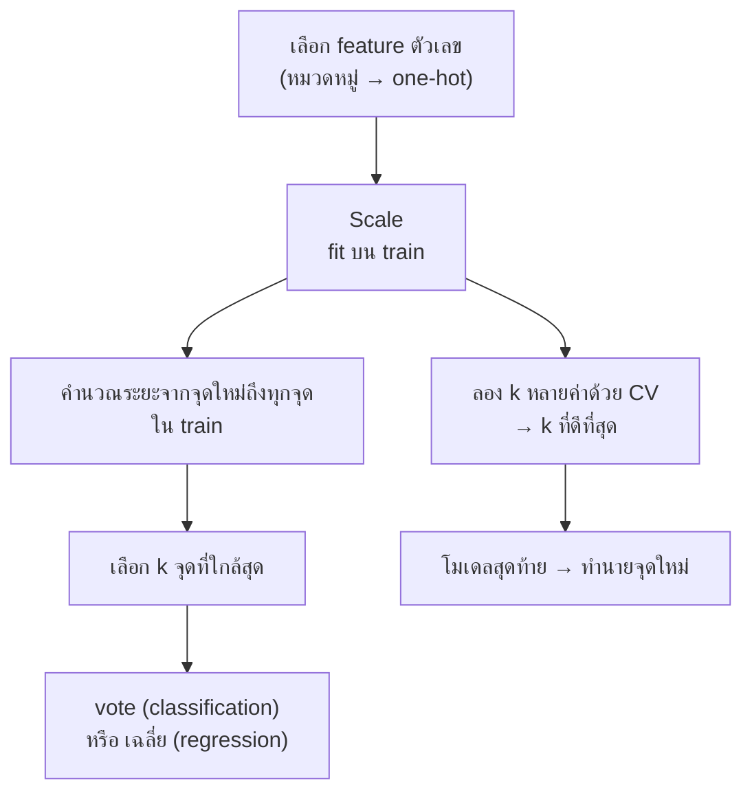

# FLOW 05 · K-Nearest Neighbors
> template: Python **T05** · RapidMiner **R05** · กลับ [[FLOW 00 START HERE]]

## โจทย์หน้าตาแบบนี้
*"คำนวณระยะทางจากจุดใหม่"* · *"หา k เพื่อนบ้านใกล้สุดและทำนาย"* · *"เลือกค่า k ที่ดีที่สุด"* ·
*"เปรียบเทียบก่อนและหลัง normalize"* · *"KNN ทำนายราคา (regression)"*

## หัวใจของ KNN
KNN **ไม่มีการเรียน** (lazy) — เก็บ train ไว้ทั้งหมด · ตอนทำนายจึงคิดระยะทางกับทุกจุด → ทุกอย่างในบทนี้วนอยู่ที่ "ระยะทางวัดถูกไหม" กับ "k เท่าไร"

## ทีละขั้น

### ① เตรียม feature
- KNN ใช้ระยะทาง → ต้องเป็นตัวเลข · หมวดหมู่ → one-hot · ตัด id (id ใกล้กันไม่ได้แปลว่าคล้ายกัน)
- **อยู่ที่:** T05 §1 · R05 Set Role

### ② Scale ⭐
- **ทำไม:** ระยะ Euclidean = √Σ(xᵢ − yᵢ)² → ตัวแปรที่ช่วงค่ากว้างครองผลรวม เช่น Income ช่วง 33–110 (std 19.8) vs Lot_Size ช่วง 14–24 (std 2.4) → ต่าง Income 10 หน่วยมีผลต่อระยะเท่ากับต่าง Lot_Size 10 หน่วย ทั้งที่ 10 หน่วยของ Lot_Size คือเกือบทั้งช่วง
- ค่า mean/std (หรือ min/max) ต้องมาจาก **train** และใช้ค่าเดียวกันกับจุดใหม่
- ตัวอย่าง T05 (riding mowers, k=3, CV F1): ไม่ scale **0.705** · z-score **0.740** · min-max **0.780**
- **อยู่ที่:** T05 §4 · R05 §4

### ③ คำนวณระยะด้วยมือ (โจทย์มักให้ทำ)
| ระยะ | สูตร | ใช้เมื่อ |
|---|---|---|
| Euclidean | √Σ(xᵢ − yᵢ)² | ค่าเริ่มต้น |
| Manhattan | Σ\|xᵢ − yᵢ\| | ทนค่าสุดขั้วกว่า / เดินตามแกน |

- เรียงระยะจากน้อยไปมาก → k ตัวแรก → **vote เสียงข้างมาก** (k คี่ กันเสมอในกรณี 2 คลาส)
- probability = สัดส่วน vote (k=5 ได้ 4 เสียง → 0.8)
- **อยู่ที่:** T05 §2 · R05 §2 (Cross Distances)

### ④ เลือก k
| k | ผล |
|---|---|
| เล็ก (k=1) | ตามจุดใกล้สุดจุดเดียว → ไวต่อ noise → **overfit** (train acc = 1.0 เสมอ) |
| ใหญ่ | เฉลี่ยมาก → ขอบเรียบเกินไป → **underfit** (k = n → ทายคลาสส่วนใหญ่ = baseline) |

- **ทำไมต้องเลือกด้วย CV:** ถ้าเลือกด้วย train จะได้ k=1 เสมอ · ถ้าเลือกด้วย test, test ไม่เป็นกลางอีกต่อไป
- ตัวอย่าง T05: k ที่ดีที่สุด = **11** (CV F1 0.82) · k=1 train 1.000 vs CV 0.580 = overfit ชัด
- **อยู่ที่:** T05 §5 · R05 §5 (Optimize Parameters)

### ⑤ ทำนายจุดใหม่
- scale จุดใหม่ด้วย scaler เดิม → หา k เพื่อนบ้าน → vote · **อยู่ที่:** T05 §6 · R05 §6

### ⑥ KNN regression
- ทำนาย = **ค่าเฉลี่ย** y ของ k เพื่อนบ้าน (หรือถ่วงน้ำหนัก 1/ระยะ) · ประเมินด้วย MAE / RMSE / R²
- ตัวอย่าง T05 §7 (housing): KNN optimized RMSE **4.29** vs mean baseline **9.22**

## กับดัก
- ไม่ scale · scale ด้วยข้อมูลทั้งหมด (leak)
- k คู่ในโจทย์ 2 คลาส (อาจเสมอ)
- ลืมว่าจุดใหม่ต้อง scale ด้วยค่าจาก train
- รวม id / label เข้าไปในระยะทาง

## โครงคำตอบ
> KNN คิดจากระยะทาง จึง normalize (fit บน train) ก่อน เพราะ … มีช่วงค่ากว้างกว่า … · ระยะจากจุดใหม่ถึง 3 จุดใกล้สุด = … (คลาส …) →
> vote ได้ … (probability …) · เลือก k ด้วย 5-fold CV ได้ k = … (F1 …) · k เล็กเกิน overfit (train … vs CV …) ·
> เทียบ baseline F1 … · ก่อน normalize … → หลัง …
