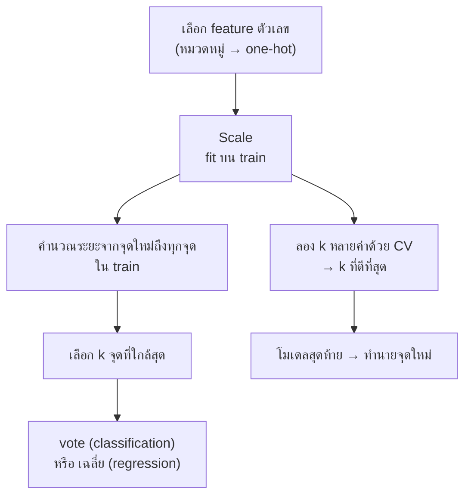

# FLOW 05 · K-Nearest Neighbors
> template: Python **T05** · RapidMiner **R05** · กลับ [[FLOW 00 START HERE]]

## โจทย์หน้าตาแบบนี้
*"คำนวณระยะทางจากจุดใหม่"* · *"หา k เพื่อนบ้านใกล้สุดและทำนาย"* · *"เลือกค่า k ที่ดีที่สุด"* ·
*"เปรียบเทียบก่อนและหลัง normalize"* · *"KNN ทำนายราคา (regression)"*



## หัวใจของ KNN
KNN **ไม่มีการเรียน** (lazy) — เก็บ train ไว้ทั้งหมด · ตอนทำนายจึงคิดระยะทางกับทุกจุด → ทุกอย่างในบทนี้วนอยู่ที่ "ระยะทางวัดถูกไหม" กับ "k เท่าไร"

## ทีละขั้น

<!-- RM-CANVAS -->

> [!info]- 🖥️ วิธีอ่านภาพ RapidMiner ใต้แต่ละขั้น (สร้างจาก `R05_knn.rmp` จริง)
> กล่อง = operator (บน: ชื่อบน canvas · ล่าง: ชนิด) · ⧉ = มี subprocess (ดับเบิลคลิกเข้าไป) · ป้ายบนเส้น = port ย่อ (exa = example set · mod = model · pre = preprocessing model · per = performance · lab = labelled data · tra = training set · tes = test set · out = output · par = partition ของ Split Data / parameter set ของ Optimize · thr = threshold · wei = weights · fre = frequent sets · rul = rules) · ◯ res = ต่อออกผลลัพธ์ · กล่องเส้นประ = port ขอบ pane · สี: 🟪 อ่านข้อมูล · 🟦 จัดการข้อมูล · 🟩 preprocessing · 🟧 โมเดล · 🟨 apply · 🟥 ประเมิน/validation · ⬜ utility · มีเฉพาะ operator ของขั้นนั้น (ไฟล์จริงมี operator อื่นต่ออยู่ด้วย)

<!-- /RM-CANVAS -->

### ① เตรียม feature
- KNN ใช้ระยะทาง → ต้องเป็นตัวเลข · หมวดหมู่ → one-hot · ตัด id (id ใกล้กันไม่ได้แปลว่าคล้ายกัน)
- **อยู่ที่:** T05 §1 · R05 Set Role

### ② Scale ⭐
- **ทำไม:** ระยะ Euclidean = √Σ(xᵢ − yᵢ)² → ตัวแปรที่ช่วงค่ากว้างครองผลรวม เช่น Income ช่วง 33–110 (std 19.8) vs Lot_Size ช่วง 14–24 (std 2.4) → ต่าง Income 10 หน่วยมีผลต่อระยะเท่ากับต่าง Lot_Size 10 หน่วย ทั้งที่ 10 หน่วยของ Lot_Size คือเกือบทั้งช่วง
- ค่า mean/std (หรือ min/max) ต้องมาจาก **train** และใช้ค่าเดียวกันกับจุดใหม่
- ตัวอย่าง T05 (riding mowers, k=3, CV F1): ไม่ scale **0.705** · z-score **0.740** · min-max **0.780**
- **อยู่ที่:** T05 §4 · R05 §4

<!-- RM-CANVAS -->

> [!example]+ 🖥️ RapidMiner: เทียบไม่ normalize vs normalize ด้วย CV เดียวกัน
> ```mermaid
> flowchart LR
>   n0["Multiply"]:::util
>   n1["Multiply (compare)<br/><i>Multiply</i>"]:::util
>   n2["CV Baseline<br/><i>Cross Validation</i><br/>⧉"]:::eval
>   n3["CV kNN raw<br/><i>Cross Validation</i><br/>⧉"]:::eval
>   n4["CV kNN normalized<br/><i>Cross Validation</i><br/>⧉"]:::eval
>   n0 -->|"out 3"| n1
>   n1 -->|"out 1"| n2
>   nR0(("res")):::res
>   n2 -->|"per 1"| nR0
>   n1 -->|"out 2"| n3
>   nR1(("res")):::res
>   n3 -->|"per 1"| nR1
>   n1 -->|"out 3"| n4
>   nR2(("res")):::res
>   n4 -->|"per 1"| nR2
>   classDef data fill:#e8dcf5,stroke:#7b52ab,color:#000
>   classDef blend fill:#dceefb,stroke:#3a7bbf,color:#000
>   classDef clean fill:#d9f2e6,stroke:#2e8b57,color:#000
>   classDef model fill:#ffe7c2,stroke:#d4860b,color:#000
>   classDef score fill:#fff6b3,stroke:#b8a400,color:#000
>   classDef eval fill:#fcd9d9,stroke:#c0392b,color:#000
>   classDef util fill:#eeeeee,stroke:#777,color:#000
>   classDef port fill:#ffffff,stroke:#999,stroke-dasharray:3 3,color:#555
>   classDef res fill:#ffffff,stroke:#333,stroke-width:2px,color:#000
> ```

<!-- /RM-CANVAS -->

<!-- RM-CANVAS -->

> [!example]+ 🖥️ RapidMiner: ข้างใน CV kNN normalized: Normalize ใน Training → Group Models
> ```mermaid
> flowchart LR
>   subgraph S["CV kNN normalized · Cross Validation"]
>     direction LR
>     subgraph P0["Training"]
>       direction LR
>       p0x0["Normalize"]:::clean
>       p0x1["k-NN"]:::model
>       p0x2["Group Models"]:::model
>       p0xL0(["tra"]):::port
>       p0xL0 --> p0x0
>       p0x0 -->|"exa"| p0x1
>       p0x0 -->|"pre"| p0x2
>       p0x1 -->|"mod"| p0x2
>       p0xP0(["mod"]):::port
>       p0x2 -->|"mod"| p0xP0
>     end
>     subgraph P1["Testing"]
>       direction LR
>       p1x0["Apply Model"]:::score
>       p1x1["Performance (Binominal)"]:::eval
>       p1xL0(["mod"]):::port
>       p1xL0 --> p1x0
>       p1xL1(["tes"]):::port
>       p1xL1 --> p1x0
>       p1x0 -->|"lab"| p1x1
>       p1xP0(["per 1"]):::port
>       p1x1 -->|"per"| p1xP0
>     end
>     P0 ~~~ P1
>   end
>   classDef data fill:#e8dcf5,stroke:#7b52ab,color:#000
>   classDef blend fill:#dceefb,stroke:#3a7bbf,color:#000
>   classDef clean fill:#d9f2e6,stroke:#2e8b57,color:#000
>   classDef model fill:#ffe7c2,stroke:#d4860b,color:#000
>   classDef score fill:#fff6b3,stroke:#b8a400,color:#000
>   classDef eval fill:#fcd9d9,stroke:#c0392b,color:#000
>   classDef util fill:#eeeeee,stroke:#777,color:#000
>   classDef port fill:#ffffff,stroke:#999,stroke-dasharray:3 3,color:#555
>   classDef res fill:#ffffff,stroke:#333,stroke-width:2px,color:#000
> ```

<!-- /RM-CANVAS -->

<!-- RM-CANVAS -->

> [!example]+ 🖥️ RapidMiner: Hold-out: Split → Normalize (train) → k-NN → Apply (pre) กับ test → Apply (mod) → Performance
> ```mermaid
> flowchart LR
>   n0["Multiply"]:::util
>   n1["Split Data"]:::blend
>   n2["Normalize (hold-out)<br/><i>Normalize</i>"]:::clean
>   n3["k-NN (hold-out)<br/><i>k-NN</i>"]:::model
>   n4["Apply Model (normalize test)<br/><i>Apply Model</i>"]:::score
>   n5["Apply Model (kNN test)<br/><i>Apply Model</i>"]:::score
>   n6["Performance (hold-out)<br/><i>Performance (Binominal)</i>"]:::eval
>   n0 -->|"out 2"| n1
>   n1 -->|"par 1"| n2
>   n2 -->|"exa"| n3
>   n2 -->|"pre"| n4
>   n1 -->|"par 2"| n4
>   n3 -->|"mod"| n5
>   n4 -->|"lab"| n5
>   n5 -->|"lab"| n6
>   nR0(("res")):::res
>   n6 -->|"per"| nR0
>   nR1(("res")):::res
>   n6 -->|"exa"| nR1
>   classDef data fill:#e8dcf5,stroke:#7b52ab,color:#000
>   classDef blend fill:#dceefb,stroke:#3a7bbf,color:#000
>   classDef clean fill:#d9f2e6,stroke:#2e8b57,color:#000
>   classDef model fill:#ffe7c2,stroke:#d4860b,color:#000
>   classDef score fill:#fff6b3,stroke:#b8a400,color:#000
>   classDef eval fill:#fcd9d9,stroke:#c0392b,color:#000
>   classDef util fill:#eeeeee,stroke:#777,color:#000
>   classDef port fill:#ffffff,stroke:#999,stroke-dasharray:3 3,color:#555
>   classDef res fill:#ffffff,stroke:#333,stroke-width:2px,color:#000
> ```

<!-- /RM-CANVAS -->

### ③ คำนวณระยะด้วยมือ (โจทย์มักให้ทำ)
| ระยะ | สูตร | ใช้เมื่อ |
|---|---|---|
| Euclidean | √Σ(xᵢ − yᵢ)² | ค่าเริ่มต้น |
| Manhattan | Σ\|xᵢ − yᵢ\| | ทนค่าสุดขั้วกว่า / เดินตามแกน |

- เรียงระยะจากน้อยไปมาก → k ตัวแรก → **vote เสียงข้างมาก** (k คี่ กันเสมอในกรณี 2 คลาส)
- probability = สัดส่วน vote (k=5 ได้ 4 เสียง → 0.8)
- **อยู่ที่:** T05 §2 · R05 §2 (Cross Distances)

<!-- RM-CANVAS -->

> [!example]+ 🖥️ RapidMiner: Cross Distances: req = จุดใหม่ · ref = ข้อมูล → ระยะ + k จุดใกล้สุด
> ```mermaid
> flowchart LR
>   n0["Read CSV"]:::data
>   n1["Set Role"]:::blend
>   n2["Multiply"]:::util
>   n3["Read CSV (new point)<br/><i>Read CSV</i>"]:::data
>   n4["Multiply (new)<br/><i>Multiply</i>"]:::util
>   n5["Cross Distances"]:::score
>   n0 -->|"out"| n1
>   n1 -->|"exa"| n2
>   n3 -->|"out"| n4
>   n4 -->|"out 1"| n5
>   n2 -->|"out 1"| n5
>   nR0(("res")):::res
>   n5 -->|"res"| nR0
>   classDef data fill:#e8dcf5,stroke:#7b52ab,color:#000
>   classDef blend fill:#dceefb,stroke:#3a7bbf,color:#000
>   classDef clean fill:#d9f2e6,stroke:#2e8b57,color:#000
>   classDef model fill:#ffe7c2,stroke:#d4860b,color:#000
>   classDef score fill:#fff6b3,stroke:#b8a400,color:#000
>   classDef eval fill:#fcd9d9,stroke:#c0392b,color:#000
>   classDef util fill:#eeeeee,stroke:#777,color:#000
>   classDef port fill:#ffffff,stroke:#999,stroke-dasharray:3 3,color:#555
>   classDef res fill:#ffffff,stroke:#333,stroke-width:2px,color:#000
> ```

<!-- /RM-CANVAS -->

### ④ เลือก k
| k | ผล |
|---|---|
| เล็ก (k=1) | ตามจุดใกล้สุดจุดเดียว → ไวต่อ noise → **overfit** (train acc = 1.0 เสมอ) |
| ใหญ่ | เฉลี่ยมาก → ขอบเรียบเกินไป → **underfit** (k = n → ทายคลาสส่วนใหญ่ = baseline) |

- **ทำไมต้องเลือกด้วย CV:** ถ้าเลือกด้วย train จะได้ k=1 เสมอ · ถ้าเลือกด้วย test, test ไม่เป็นกลางอีกต่อไป
- ตัวอย่าง T05: k ที่ดีที่สุด = **11** (CV F1 0.82) · k=1 train 1.000 vs CV 0.580 = overfit ชัด
- **อยู่ที่:** T05 §5 · R05 §5 (Optimize Parameters)

<!-- RM-CANVAS -->

> [!example]+ 🖥️ RapidMiner: Optimize Parameters ครอบ CV + Log → Log to Data = ตาราง k vs F1
> ```mermaid
> flowchart LR
>   subgraph S["Optimize Parameters (k) · Optimize Parameters (Grid)"]
>     direction LR
>     subgraph P0["ข้างใน"]
>       direction LR
>       p0x0["CV opt<br/><i>Cross Validation</i><br/>⧉"]:::eval
>       p0x1["Log"]:::util
>       p0xL0(["inp 1"]):::port
>       p0xL0 --> p0x0
>       p0x0 -->|"per 1"| p0x1
>       p0xP0(["per"]):::port
>       p0x1 -->|"thr 1"| p0xP0
>     end
>   end
>   classDef data fill:#e8dcf5,stroke:#7b52ab,color:#000
>   classDef blend fill:#dceefb,stroke:#3a7bbf,color:#000
>   classDef clean fill:#d9f2e6,stroke:#2e8b57,color:#000
>   classDef model fill:#ffe7c2,stroke:#d4860b,color:#000
>   classDef score fill:#fff6b3,stroke:#b8a400,color:#000
>   classDef eval fill:#fcd9d9,stroke:#c0392b,color:#000
>   classDef util fill:#eeeeee,stroke:#777,color:#000
>   classDef port fill:#ffffff,stroke:#999,stroke-dasharray:3 3,color:#555
>   classDef res fill:#ffffff,stroke:#333,stroke-width:2px,color:#000
> ```

<!-- /RM-CANVAS -->

<!-- RM-CANVAS -->

> [!example]+ 🖥️ RapidMiner: ข้างใน CV opt
> ```mermaid
> flowchart LR
>   subgraph S["CV opt · Cross Validation"]
>     direction LR
>     subgraph P0["Training"]
>       direction LR
>       p0x0["Normalize"]:::clean
>       p0x1["k-NN"]:::model
>       p0x2["Group Models"]:::model
>       p0xL0(["tra"]):::port
>       p0xL0 --> p0x0
>       p0x0 -->|"exa"| p0x1
>       p0x0 -->|"pre"| p0x2
>       p0x1 -->|"mod"| p0x2
>       p0xP0(["mod"]):::port
>       p0x2 -->|"mod"| p0xP0
>     end
>     subgraph P1["Testing"]
>       direction LR
>       p1x0["Apply Model"]:::score
>       p1x1["Performance (Binominal)"]:::eval
>       p1xL0(["mod"]):::port
>       p1xL0 --> p1x0
>       p1xL1(["tes"]):::port
>       p1xL1 --> p1x0
>       p1x0 -->|"lab"| p1x1
>       p1xP0(["per 1"]):::port
>       p1x1 -->|"per"| p1xP0
>     end
>     P0 ~~~ P1
>   end
>   classDef data fill:#e8dcf5,stroke:#7b52ab,color:#000
>   classDef blend fill:#dceefb,stroke:#3a7bbf,color:#000
>   classDef clean fill:#d9f2e6,stroke:#2e8b57,color:#000
>   classDef model fill:#ffe7c2,stroke:#d4860b,color:#000
>   classDef score fill:#fff6b3,stroke:#b8a400,color:#000
>   classDef eval fill:#fcd9d9,stroke:#c0392b,color:#000
>   classDef util fill:#eeeeee,stroke:#777,color:#000
>   classDef port fill:#ffffff,stroke:#999,stroke-dasharray:3 3,color:#555
>   classDef res fill:#ffffff,stroke:#333,stroke-width:2px,color:#000
> ```

<!-- /RM-CANVAS -->

### ⑤ ทำนายจุดใหม่
- scale จุดใหม่ด้วย scaler เดิม → หา k เพื่อนบ้าน → vote · **อยู่ที่:** T05 §6 · R05 §6

<!-- RM-CANVAS -->

> [!example]+ 🖥️ RapidMiner: จุดใหม่: Normalize ด้วย pre ของ train → Apply Model (k-NN)
> ```mermaid
> flowchart LR
>   n0["Multiply"]:::util
>   n1["Multiply (new)<br/><i>Multiply</i>"]:::util
>   n2["Normalize (final)<br/><i>Normalize</i>"]:::clean
>   n3["k-NN (final)<br/><i>k-NN</i>"]:::model
>   n4["Apply Model (normalize new)<br/><i>Apply Model</i>"]:::score
>   n5["Apply Model (kNN new)<br/><i>Apply Model</i>"]:::score
>   n0 -->|"out 5"| n2
>   n2 -->|"exa"| n3
>   n2 -->|"pre"| n4
>   n1 -->|"out 2"| n4
>   n3 -->|"mod"| n5
>   n4 -->|"lab"| n5
>   nR0(("res")):::res
>   n5 -->|"lab"| nR0
>   classDef data fill:#e8dcf5,stroke:#7b52ab,color:#000
>   classDef blend fill:#dceefb,stroke:#3a7bbf,color:#000
>   classDef clean fill:#d9f2e6,stroke:#2e8b57,color:#000
>   classDef model fill:#ffe7c2,stroke:#d4860b,color:#000
>   classDef score fill:#fff6b3,stroke:#b8a400,color:#000
>   classDef eval fill:#fcd9d9,stroke:#c0392b,color:#000
>   classDef util fill:#eeeeee,stroke:#777,color:#000
>   classDef port fill:#ffffff,stroke:#999,stroke-dasharray:3 3,color:#555
>   classDef res fill:#ffffff,stroke:#333,stroke-width:2px,color:#000
> ```

<!-- /RM-CANVAS -->

### ⑥ KNN regression
- ทำนาย = **ค่าเฉลี่ย** y ของ k เพื่อนบ้าน (หรือถ่วงน้ำหนัก 1/ระยะ) · ประเมินด้วย MAE / RMSE / R²
- ตัวอย่าง T05 §7 (housing): KNN optimized RMSE **4.29** vs mean baseline **9.22**

<!-- RM-CANVAS -->

> [!example]+ 🖥️ RapidMiner: KNN regression: label ตัวเลข → Performance (Regression)
> ```mermaid
> flowchart LR
>   n0["Read CSV (regression)<br/><i>Read CSV</i>"]:::data
>   n1["Set Role (regression)<br/><i>Set Role</i>"]:::blend
>   n2["CV kNN regression<br/><i>Cross Validation</i><br/>⧉"]:::eval
>   n0 -->|"out"| n1
>   n1 -->|"exa"| n2
>   nR0(("res")):::res
>   n2 -->|"per 1"| nR0
>   classDef data fill:#e8dcf5,stroke:#7b52ab,color:#000
>   classDef blend fill:#dceefb,stroke:#3a7bbf,color:#000
>   classDef clean fill:#d9f2e6,stroke:#2e8b57,color:#000
>   classDef model fill:#ffe7c2,stroke:#d4860b,color:#000
>   classDef score fill:#fff6b3,stroke:#b8a400,color:#000
>   classDef eval fill:#fcd9d9,stroke:#c0392b,color:#000
>   classDef util fill:#eeeeee,stroke:#777,color:#000
>   classDef port fill:#ffffff,stroke:#999,stroke-dasharray:3 3,color:#555
>   classDef res fill:#ffffff,stroke:#333,stroke-width:2px,color:#000
> ```

<!-- /RM-CANVAS -->

## กับดัก
- ไม่ scale · scale ด้วยข้อมูลทั้งหมด (leak)
- k คู่ในโจทย์ 2 คลาส (อาจเสมอ)
- ลืมว่าจุดใหม่ต้อง scale ด้วยค่าจาก train
- รวม id / label เข้าไปในระยะทาง

## โครงคำตอบ
> KNN คิดจากระยะทาง จึง normalize (fit บน train) ก่อน เพราะ … มีช่วงค่ากว้างกว่า … · ระยะจากจุดใหม่ถึง 3 จุดใกล้สุด = … (คลาส …) →
> vote ได้ … (probability …) · เลือก k ด้วย 5-fold CV ได้ k = … (F1 …) · k เล็กเกิน overfit (train … vs CV …) ·
> เทียบ baseline F1 … · ก่อน normalize … → หลัง …
