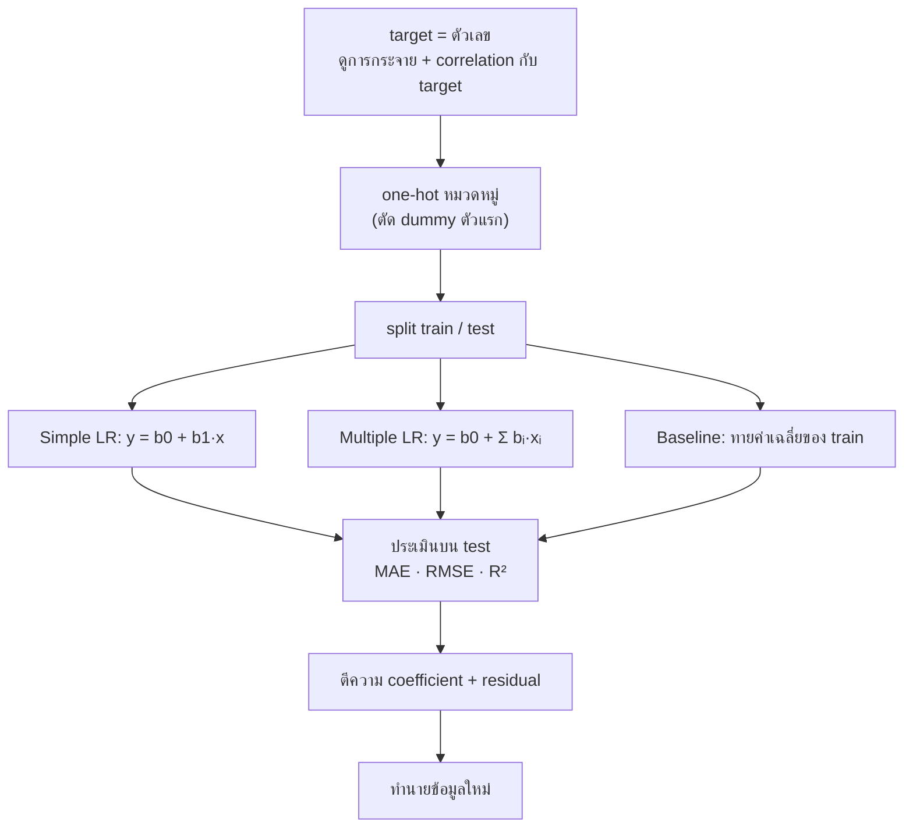

# FLOW 06 · Linear Regression
> template: Python **T06** · RapidMiner **R06** · กลับ [[FLOW 00 START HERE]]

## โจทย์หน้าตาแบบนี้
*"สร้างสมการทำนาย …"* · *"ตีความ coefficient"* · *"ประเมินด้วย MAE / MSE / RMSE / R²"* · *"เทียบกับ baseline"* · *"ทำนายค่าของข้อมูลใหม่"*



## ทีละขั้น

<!-- RM-CANVAS -->

> [!info]- 🖥️ วิธีอ่านภาพ RapidMiner ใต้แต่ละขั้น (สร้างจาก `R06_linear_regression.rmp` จริง)
> กล่อง = operator (บน: ชื่อบน canvas · ล่าง: ชนิด) · ⧉ = มี subprocess (ดับเบิลคลิกเข้าไป) · ป้ายบนเส้น = port ย่อ (exa = example set · mod = model · pre = preprocessing model · per = performance · lab = labelled data · tra = training set · tes = test set · out = output · par = partition ของ Split Data / parameter set ของ Optimize · thr = threshold · wei = weights · fre = frequent sets · rul = rules) · ◯ res = ต่อออกผลลัพธ์ · กล่องเส้นประ = port ขอบ pane · สี: 🟪 อ่านข้อมูล · 🟦 จัดการข้อมูล · 🟩 preprocessing · 🟧 โมเดล · 🟨 apply · 🟥 ประเมิน/validation · ⬜ utility · มีเฉพาะ operator ของขั้นนั้น (ไฟล์จริงมี operator อื่นต่ออยู่ด้วย)

<!-- /RM-CANVAS -->

### ① สำรวจ target และความสัมพันธ์
- **ทำไม:** linear regression สมมติว่า y สัมพันธ์กับ x **เป็นเส้นตรง** → ดู scatter / correlation ก่อนรู้ว่าตัวแปรไหนน่าจะช่วย และมีความสัมพันธ์แบบโค้งไหม
- ตัวอย่าง T06 (insurance): age r = 0.30 สูงสุดในตัวเลข แต่ตัวแปรที่แรงจริงคือ smoker (หมวดหมู่ — correlation ตัวเลขมองไม่เห็น)
- **อยู่ที่:** T06 §1

### ② Encoding: dummy ตัดตัวแรก
- **ทำไมตัดตัวแรก:** ถ้ามีทั้ง smoker_yes และ smoker_no ผลรวม = 1 เสมอ = ซ้ำกับ intercept → แก้สมการไม่ได้ (multicollinearity)
- ตัวที่ตัดคือ **reference** → coefficient ของ dummy = "ต่างจาก reference เท่าไร"
- **อยู่ที่:** T06 CONFIG `DROP_FIRST` · R06 Nominal to Numerical (comparison_groups)

<!-- RM-CANVAS -->

> [!example]+ 🖥️ RapidMiner: Nominal to Numerical (comparison_groups = reference) · pre ใช้ซ้ำกับข้อมูลใหม่
> ```mermaid
> flowchart LR
>   n0["Read CSV"]:::data
>   n1["Set Role"]:::blend
>   n2["Nominal to Numerical"]:::clean
>   n3["Multiply"]:::util
>   n0 -->|"out"| n1
>   n1 -->|"exa"| n2
>   n2 -->|"exa"| n3
>   classDef data fill:#e8dcf5,stroke:#7b52ab,color:#000
>   classDef blend fill:#dceefb,stroke:#3a7bbf,color:#000
>   classDef clean fill:#d9f2e6,stroke:#2e8b57,color:#000
>   classDef model fill:#ffe7c2,stroke:#d4860b,color:#000
>   classDef score fill:#fff6b3,stroke:#b8a400,color:#000
>   classDef eval fill:#fcd9d9,stroke:#c0392b,color:#000
>   classDef util fill:#eeeeee,stroke:#777,color:#000
>   classDef port fill:#ffffff,stroke:#999,stroke-dasharray:3 3,color:#555
>   classDef res fill:#ffffff,stroke:#333,stroke-width:2px,color:#000
> ```

<!-- /RM-CANVAS -->

### ③ Split → fit บน train
- ประเมินบน test ที่ไม่เคยเห็น · **อยู่ที่:** T06 §2 · R06 §4

<!-- RM-CANVAS -->

> [!example]+ 🖥️ RapidMiner: Split Data → Multiply (train)/(test) ให้ทุกโมเดลใช้ชุดเดียวกัน
> ```mermaid
> flowchart LR
>   n0["Multiply"]:::util
>   n1["Split Data"]:::blend
>   n2["Multiply (train)<br/><i>Multiply</i>"]:::util
>   n3["Multiply (test)<br/><i>Multiply</i>"]:::util
>   n0 -->|"out 2"| n1
>   n1 -->|"par 1"| n2
>   n1 -->|"par 2"| n3
>   classDef data fill:#e8dcf5,stroke:#7b52ab,color:#000
>   classDef blend fill:#dceefb,stroke:#3a7bbf,color:#000
>   classDef clean fill:#d9f2e6,stroke:#2e8b57,color:#000
>   classDef model fill:#ffe7c2,stroke:#d4860b,color:#000
>   classDef score fill:#fff6b3,stroke:#b8a400,color:#000
>   classDef eval fill:#fcd9d9,stroke:#c0392b,color:#000
>   classDef util fill:#eeeeee,stroke:#777,color:#000
>   classDef port fill:#ffffff,stroke:#999,stroke-dasharray:3 3,color:#555
>   classDef res fill:#ffffff,stroke:#333,stroke-width:2px,color:#000
> ```

<!-- /RM-CANVAS -->

### ④ สมการ + ตีความ coefficient
- **bᵢ** = เมื่อ xᵢ เพิ่ม 1 หน่วย **โดยตัวแปรอื่นคงที่** y เปลี่ยนเฉลี่ย bᵢ หน่วย
- **b0** = y เมื่อทุก x = 0 (มักไม่มีความหมายจริง เช่น อายุ 0)
- เทียบ "ตัวไหนสำคัญสุด" ต้องดู **standardized coefficient** (หน่วยต่างกันเทียบตรง ๆ ไม่ได้)
- ตัวอย่าง T06: age +240.6 → อายุเพิ่ม 1 ปี ค่าใช้จ่ายเพิ่มเฉลี่ย 240.6 · smoker_yes +23,651 → คนสูบบุหรี่จ่ายมากกว่าคนไม่สูบ ~23,651 (ตัวแปรอื่นเท่ากัน)
- **อยู่ที่:** T06 §3–§4 · R06 §3 (model → Description)

<!-- RM-CANVAS -->

> [!example]+ 🖥️ RapidMiner: Simple LR: Select Attributes (x + label) → Linear Regression → res mod = สมการ
> ```mermaid
> flowchart LR
>   n0["Multiply"]:::util
>   n1["Select Attributes (simple)<br/><i>Select Attributes</i>"]:::blend
>   n2["Linear Regression (simple)<br/><i>Linear Regression</i>"]:::model
>   n0 -->|"out 1"| n1
>   n1 -->|"exa"| n2
>   nR0(("res")):::res
>   n2 -->|"mod"| nR0
>   classDef data fill:#e8dcf5,stroke:#7b52ab,color:#000
>   classDef blend fill:#dceefb,stroke:#3a7bbf,color:#000
>   classDef clean fill:#d9f2e6,stroke:#2e8b57,color:#000
>   classDef model fill:#ffe7c2,stroke:#d4860b,color:#000
>   classDef score fill:#fff6b3,stroke:#b8a400,color:#000
>   classDef eval fill:#fcd9d9,stroke:#c0392b,color:#000
>   classDef util fill:#eeeeee,stroke:#777,color:#000
>   classDef port fill:#ffffff,stroke:#999,stroke-dasharray:3 3,color:#555
>   classDef res fill:#ffffff,stroke:#333,stroke-width:2px,color:#000
> ```

<!-- /RM-CANVAS -->

### ⑤ ประเมิน + baseline
| metric | ความหมาย | อ่าน |
|---|---|---|
| MAE | ค่าเฉลี่ยของ \|error\| | "ทายพลาดเฉลี่ย ± … หน่วย" (หน่วยเดียวกับ y) |
| MSE | ค่าเฉลี่ย error² | ลงโทษ error ใหญ่หนัก · หน่วยเป็นกำลังสอง |
| **RMSE** | √MSE | หน่วยเดียวกับ y · RMSE ≫ MAE = มี error ใหญ่บางจุด |
| **R²** | 1 − SSE/SST | สัดส่วนความแปรปรวนของ y ที่อธิบายได้ (1 = สมบูรณ์, 0 = เท่ากับทายค่าเฉลี่ย) |

- **baseline = ทายค่าเฉลี่ยของ train** (R² ≈ 0) → โมเดลต้อง RMSE ต่ำกว่า
- ตัวอย่าง T06: LR RMSE **5,796** vs baseline **12,466** · R² **0.784** (อธิบายได้ 78.4%) · MAE 4,181
- **อยู่ที่:** T06 §5 · R06 §4–§5

<!-- RM-CANVAS -->

> [!example]+ 🖥️ RapidMiner: baseline (mean) vs Linear Regression บน train/test เดียวกัน
> ```mermaid
> flowchart LR
>   n0["Multiply (train)<br/><i>Multiply</i>"]:::util
>   n1["Multiply (test)<br/><i>Multiply</i>"]:::util
>   n2["Default Model (mean)<br/><i>Default Model</i>"]:::model
>   n3["Linear Regression"]:::model
>   n4["Apply Model (Baseline mean)<br/><i>Apply Model</i>"]:::score
>   n5["Apply Model (Linear Regression)<br/><i>Apply Model</i>"]:::score
>   n6["Performance (Baseline mean)<br/><i>Performance (Regression)</i>"]:::eval
>   n7["Performance (Linear Regression)<br/><i>Performance (Regression)</i>"]:::eval
>   n0 -->|"out 1"| n2
>   n2 -->|"mod"| n4
>   n1 -->|"out 1"| n4
>   n4 -->|"lab"| n6
>   nR0(("res")):::res
>   n6 -->|"per"| nR0
>   n0 -->|"out 2"| n3
>   n3 -->|"mod"| n5
>   n1 -->|"out 2"| n5
>   n5 -->|"lab"| n7
>   nR1(("res")):::res
>   n7 -->|"per"| nR1
>   nR2(("res")):::res
>   n5 -->|"mod"| nR2
>   classDef data fill:#e8dcf5,stroke:#7b52ab,color:#000
>   classDef blend fill:#dceefb,stroke:#3a7bbf,color:#000
>   classDef clean fill:#d9f2e6,stroke:#2e8b57,color:#000
>   classDef model fill:#ffe7c2,stroke:#d4860b,color:#000
>   classDef score fill:#fff6b3,stroke:#b8a400,color:#000
>   classDef eval fill:#fcd9d9,stroke:#c0392b,color:#000
>   classDef util fill:#eeeeee,stroke:#777,color:#000
>   classDef port fill:#ffffff,stroke:#999,stroke-dasharray:3 3,color:#555
>   classDef res fill:#ffffff,stroke:#333,stroke-width:2px,color:#000
> ```

<!-- /RM-CANVAS -->

### ⑥ Residual
- residual = y − ŷ · ควรกระจายสุ่มรอบ 0 · เป็นรูปโค้ง/กรวย/แยกกลุ่ม = ความสัมพันธ์ไม่เชิงเส้นหรือขาด interaction (เช่น smoker × bmi)
- ทำให้เข้าใจว่าทำไม Decision Tree regression ได้ดีกว่า: T06 §6 (5-fold CV บน train) Tree optimized RMSE **4,616** (R² 0.853) < LR **6,143** (R² 0.739) — ต้นไม้จับ interaction ได้เอง · บน test Tree ได้ RMSE 4,593 vs LR 5,796

<!-- RM-CANVAS -->

> [!example]+ 🖥️ RapidMiner: เทียบ LR / kNN / Tree regression ด้วย CV
> ```mermaid
> flowchart LR
>   n0["Multiply"]:::util
>   n1["Multiply (compare)<br/><i>Multiply</i>"]:::util
>   n2["CV LR<br/><i>Cross Validation</i><br/>⧉"]:::eval
>   n3["CV kNN reg<br/><i>Cross Validation</i><br/>⧉"]:::eval
>   n4["CV Tree reg<br/><i>Cross Validation</i><br/>⧉"]:::eval
>   n0 -->|"out 3"| n1
>   n1 -->|"out 1"| n2
>   nR0(("res")):::res
>   n2 -->|"per 1"| nR0
>   n1 -->|"out 2"| n3
>   nR1(("res")):::res
>   n3 -->|"per 1"| nR1
>   n1 -->|"out 3"| n4
>   nR2(("res")):::res
>   n4 -->|"per 1"| nR2
>   classDef data fill:#e8dcf5,stroke:#7b52ab,color:#000
>   classDef blend fill:#dceefb,stroke:#3a7bbf,color:#000
>   classDef clean fill:#d9f2e6,stroke:#2e8b57,color:#000
>   classDef model fill:#ffe7c2,stroke:#d4860b,color:#000
>   classDef score fill:#fff6b3,stroke:#b8a400,color:#000
>   classDef eval fill:#fcd9d9,stroke:#c0392b,color:#000
>   classDef util fill:#eeeeee,stroke:#777,color:#000
>   classDef port fill:#ffffff,stroke:#999,stroke-dasharray:3 3,color:#555
>   classDef res fill:#ffffff,stroke:#333,stroke-width:2px,color:#000
> ```

<!-- /RM-CANVAS -->

### ⑦ ทำนาย
- ข้อมูลใหม่ต้องผ่าน encoding เดียวกัน → แทนค่าในสมการ · **อยู่ที่:** T06 §7 · R06 §7

<!-- RM-CANVAS -->

> [!example]+ 🖥️ RapidMiner: ข้อมูลใหม่: dummy เดิม (pre) → Linear Regression (final)
> ```mermaid
> flowchart LR
>   n0["Nominal to Numerical"]:::clean
>   n1["Multiply"]:::util
>   n2["Linear Regression (final)<br/><i>Linear Regression</i>"]:::model
>   n3["Read CSV (new)<br/><i>Read CSV</i>"]:::data
>   n4["Apply Model (dummy new)<br/><i>Apply Model</i>"]:::score
>   n5["Apply Model (LR new)<br/><i>Apply Model</i>"]:::score
>   n0 -->|"exa"| n1
>   n1 -->|"out 4"| n2
>   n0 -->|"pre"| n4
>   n3 -->|"out"| n4
>   n2 -->|"mod"| n5
>   n4 -->|"lab"| n5
>   nR0(("res")):::res
>   n5 -->|"lab"| nR0
>   classDef data fill:#e8dcf5,stroke:#7b52ab,color:#000
>   classDef blend fill:#dceefb,stroke:#3a7bbf,color:#000
>   classDef clean fill:#d9f2e6,stroke:#2e8b57,color:#000
>   classDef model fill:#ffe7c2,stroke:#d4860b,color:#000
>   classDef score fill:#fff6b3,stroke:#b8a400,color:#000
>   classDef eval fill:#fcd9d9,stroke:#c0392b,color:#000
>   classDef util fill:#eeeeee,stroke:#777,color:#000
>   classDef port fill:#ffffff,stroke:#999,stroke-dasharray:3 3,color:#555
>   classDef res fill:#ffffff,stroke:#333,stroke-width:2px,color:#000
> ```

<!-- /RM-CANVAS -->

## กับดัก
- ตีความ coefficient โดยไม่พูดว่า "ตัวแปรอื่นคงที่"
- เทียบขนาด coefficient ข้ามหน่วย
- ใช้ R² บน train อย่างเดียว
- RapidMiner Linear Regression default = M5 prime (ตัดตัวแปรเอง) → สมการอาจไม่มีบางตัว

## โครงคำตอบ
> สมการ: ŷ = … + …·age + …·bmi + …·smoker_yes … · ตีความ: … เพิ่ม 1 หน่วย ŷ เพิ่ม … (ตัวแปรอื่นคงที่) ·
> test: MAE … RMSE … R² … (อธิบายได้ …%) เทียบ baseline ค่าเฉลี่ย RMSE … → ดีกว่า …% · residual … → …
