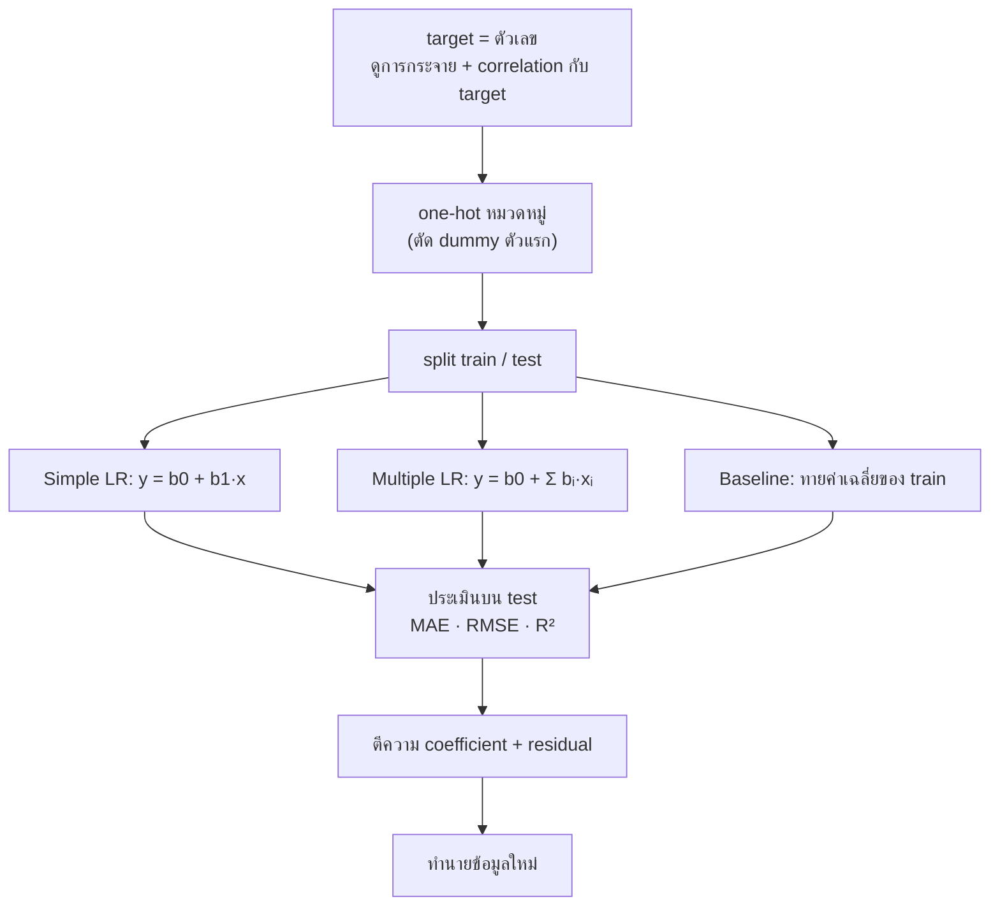

# FLOW 06 · Linear Regression
> template: Python **T06** · RapidMiner **R06** · กลับ [[FLOW 00 START HERE]]

## โจทย์หน้าตาแบบนี้
*"สร้างสมการทำนาย …"* · *"ตีความ coefficient"* · *"ประเมินด้วย MAE / MSE / RMSE / R²"* · *"เทียบกับ baseline"* · *"ทำนายค่าของข้อมูลใหม่"*

## ทีละขั้น

### ① สำรวจ target และความสัมพันธ์
- **ทำไม:** linear regression สมมติว่า y สัมพันธ์กับ x **เป็นเส้นตรง** → ดู scatter / correlation ก่อนรู้ว่าตัวแปรไหนน่าจะช่วย และมีความสัมพันธ์แบบโค้งไหม
- ตัวอย่าง T06 (insurance): age r = 0.30 สูงสุดในตัวเลข แต่ตัวแปรที่แรงจริงคือ smoker (หมวดหมู่ — correlation ตัวเลขมองไม่เห็น)
- **อยู่ที่:** T06 §1

### ② Encoding: dummy ตัดตัวแรก
- **ทำไมตัดตัวแรก:** ถ้ามีทั้ง smoker_yes และ smoker_no ผลรวม = 1 เสมอ = ซ้ำกับ intercept → แก้สมการไม่ได้ (multicollinearity)
- ตัวที่ตัดคือ **reference** → coefficient ของ dummy = "ต่างจาก reference เท่าไร"
- **อยู่ที่:** T06 CONFIG `DROP_FIRST` · R06 Nominal to Numerical (comparison_groups)

### ③ Split → fit บน train
- ประเมินบน test ที่ไม่เคยเห็น · **อยู่ที่:** T06 §2 · R06 §4

### ④ สมการ + ตีความ coefficient
- **bᵢ** = เมื่อ xᵢ เพิ่ม 1 หน่วย **โดยตัวแปรอื่นคงที่** y เปลี่ยนเฉลี่ย bᵢ หน่วย
- **b0** = y เมื่อทุก x = 0 (มักไม่มีความหมายจริง เช่น อายุ 0)
- เทียบ "ตัวไหนสำคัญสุด" ต้องดู **standardized coefficient** (หน่วยต่างกันเทียบตรง ๆ ไม่ได้)
- ตัวอย่าง T06: age +240.6 → อายุเพิ่ม 1 ปี ค่าใช้จ่ายเพิ่มเฉลี่ย 240.6 · smoker_yes +23,651 → คนสูบบุหรี่จ่ายมากกว่าคนไม่สูบ ~23,651 (ตัวแปรอื่นเท่ากัน)
- **อยู่ที่:** T06 §3–§4 · R06 §3 (model → Description)

### ⑤ ประเมิน + baseline
| metric | ความหมาย | อ่าน |
|---|---|---|
| MAE | ค่าเฉลี่ยของ \|error\| | "ทายพลาดเฉลี่ย ± … หน่วย" (หน่วยเดียวกับ y) |
| MSE | ค่าเฉลี่ย error² | ลงโทษ error ใหญ่หนัก · หน่วยเป็นกำลังสอง |
| **RMSE** | √MSE | หน่วยเดียวกับ y · RMSE ≫ MAE = มี error ใหญ่บางจุด |
| **R²** | 1 − SSE/SST | สัดส่วนความแปรปรวนของ y ที่อธิบายได้ (1 = สมบูรณ์, 0 = เท่ากับทายค่าเฉลี่ย) |

- **baseline = ทายค่าเฉลี่ยของ train** (R² ≈ 0) → โมเดลต้อง RMSE ต่ำกว่า
- ตัวอย่าง T06: LR RMSE **5,796** vs baseline **12,466** · R² **0.784** (อธิบายได้ 78.4%) · MAE 4,181
- **อยู่ที่:** T06 §5 · R06 §4–§5

### ⑥ Residual
- residual = y − ŷ · ควรกระจายสุ่มรอบ 0 · เป็นรูปโค้ง/กรวย/แยกกลุ่ม = ความสัมพันธ์ไม่เชิงเส้นหรือขาด interaction (เช่น smoker × bmi)
- ทำให้เข้าใจว่าทำไม Decision Tree regression ได้ดีกว่า: T06 §6 (5-fold CV บน train) Tree optimized RMSE **4,616** (R² 0.853) < LR **6,143** (R² 0.739) — ต้นไม้จับ interaction ได้เอง · บน test Tree ได้ RMSE 4,593 vs LR 5,796

### ⑦ ทำนาย
- ข้อมูลใหม่ต้องผ่าน encoding เดียวกัน → แทนค่าในสมการ · **อยู่ที่:** T06 §7 · R06 §7

## กับดัก
- ตีความ coefficient โดยไม่พูดว่า "ตัวแปรอื่นคงที่"
- เทียบขนาด coefficient ข้ามหน่วย
- ใช้ R² บน train อย่างเดียว
- RapidMiner Linear Regression default = M5 prime (ตัดตัวแปรเอง) → สมการอาจไม่มีบางตัว

## โครงคำตอบ
> สมการ: ŷ = … + …·age + …·bmi + …·smoker_yes … · ตีความ: … เพิ่ม 1 หน่วย ŷ เพิ่ม … (ตัวแปรอื่นคงที่) ·
> test: MAE … RMSE … R² … (อธิบายได้ …%) เทียบ baseline ค่าเฉลี่ย RMSE … → ดีกว่า …% · residual … → …
