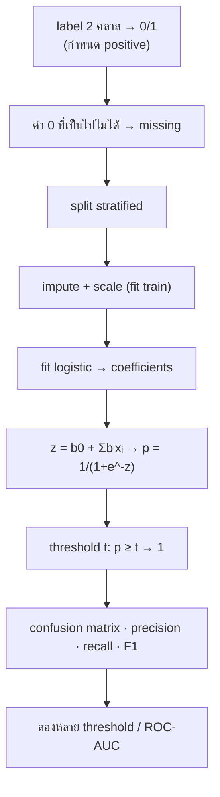

# FLOW 07 · Logistic Regression
> template: Python **T07** · RapidMiner **R07** · กลับ [[FLOW 00 START HERE]]

## โจทย์หน้าตาแบบนี้
*"ความน่าจะเป็นที่ …"* · *"ตีความ coefficient / odds ratio"* · *"เปลี่ยน threshold เป็น 0.3 แล้วเปรียบเทียบ"* · *"ROC / AUC"*



## ทีละขั้น

<!-- RM-CANVAS -->

> [!info]- 🖥️ วิธีอ่านภาพ RapidMiner ใต้แต่ละขั้น (สร้างจาก `R07_logistic_regression.rmp` จริง)
> กล่อง = operator (บน: ชื่อบน canvas · ล่าง: ชนิด) · ⧉ = มี subprocess (ดับเบิลคลิกเข้าไป) · ป้ายบนเส้น = port ย่อ (exa = example set · mod = model · pre = preprocessing model · per = performance · lab = labelled data · tra = training set · tes = test set · out = output · par = partition ของ Split Data / parameter set ของ Optimize · thr = threshold · wei = weights · fre = frequent sets · rul = rules) · ◯ res = ต่อออกผลลัพธ์ · กล่องเส้นประ = port ขอบ pane · สี: 🟪 อ่านข้อมูล · 🟦 จัดการข้อมูล · 🟩 preprocessing · 🟧 โมเดล · 🟨 apply · 🟥 ประเมิน/validation · ⬜ utility · มีเฉพาะ operator ของขั้นนั้น (ไฟล์จริงมี operator อื่นต่ออยู่ด้วย)

<!-- /RM-CANVAS -->

### ① label 0/1 + positive class
- **ทำไม:** logistic ทำนาย P(y = 1) → ต้องรู้ว่า "1" คืออะไร (คลาสที่สนใจ) ไม่งั้น precision/recall คำนวณกลับข้าง
- RapidMiner: label 0/1 → Numerical to Binominal (false/true) · Performance → positive_class = true

<!-- RM-CANVAS -->

> [!example]+ 🖥️ RapidMiner: label 0/1 → Numerical to Binominal (false/true) → Set Role
> ```mermaid
> flowchart LR
>   n0["Read CSV"]:::data
>   n1["Numerical to Binominal"]:::clean
>   n2["Set Role"]:::blend
>   n0 -->|"out"| n1
>   n1 -->|"exa"| n2
>   classDef data fill:#e8dcf5,stroke:#7b52ab,color:#000
>   classDef blend fill:#dceefb,stroke:#3a7bbf,color:#000
>   classDef clean fill:#d9f2e6,stroke:#2e8b57,color:#000
>   classDef model fill:#ffe7c2,stroke:#d4860b,color:#000
>   classDef score fill:#fff6b3,stroke:#b8a400,color:#000
>   classDef eval fill:#fcd9d9,stroke:#c0392b,color:#000
>   classDef util fill:#eeeeee,stroke:#777,color:#000
>   classDef port fill:#ffffff,stroke:#999,stroke-dasharray:3 3,color:#555
>   classDef res fill:#ffffff,stroke:#333,stroke-width:2px,color:#000
> ```

<!-- /RM-CANVAS -->

### ② ค่า 0 ที่เป็นไปไม่ได้
- pima: glucose/BMI = 0 คือไม่ได้วัด → ถ้าปล่อยเป็น 0 โมเดลเรียนว่า "BMI 0 = ไม่เป็นเบาหวาน" · **อยู่ที่:** T07 `ZERO_AS_MISSING` · R07 Declare Missing Value

<!-- RM-CANVAS -->

> [!example]+ 🖥️ RapidMiner: Declare Missing Value: 0 ใน glucose/bmi/… → ว่าง
> ```mermaid
> flowchart LR
>   n0["Set Role"]:::blend
>   n1["Declare Missing Value"]:::clean
>   n2["Multiply"]:::util
>   n0 -->|"exa"| n1
>   n1 -->|"exa"| n2
>   classDef data fill:#e8dcf5,stroke:#7b52ab,color:#000
>   classDef blend fill:#dceefb,stroke:#3a7bbf,color:#000
>   classDef clean fill:#d9f2e6,stroke:#2e8b57,color:#000
>   classDef model fill:#ffe7c2,stroke:#d4860b,color:#000
>   classDef score fill:#fff6b3,stroke:#b8a400,color:#000
>   classDef eval fill:#fcd9d9,stroke:#c0392b,color:#000
>   classDef util fill:#eeeeee,stroke:#777,color:#000
>   classDef port fill:#ffffff,stroke:#999,stroke-dasharray:3 3,color:#555
>   classDef res fill:#ffffff,stroke:#333,stroke-width:2px,color:#000
> ```

<!-- /RM-CANVAS -->

### ③ fit → probability
- z = b0 + b1x1 + … (เหมือน linear) แล้ว **sigmoid** p = 1 / (1 + e^(−z)) บีบให้อยู่ใน 0..1
- **ทำไมไม่ใช้ linear regression:** linear ให้ค่านอก 0..1 ได้ ตีความเป็นความน่าจะเป็นไม่ได้
- **อยู่ที่:** T07 §4 (คำนวณมือจากสมการ ตรวจกับ predict_proba)

<!-- RM-CANVAS -->

> [!example]+ 🖥️ RapidMiner: Split → Replace Missing (train) → Logistic → Apply กับ test (pre ก่อน แล้ว mod)
> ```mermaid
> flowchart LR
>   n0["Multiply"]:::util
>   n1["Split Data"]:::blend
>   n2["Replace Missing Values"]:::clean
>   n3["Logistic Regression"]:::model
>   n4["Apply Model (impute test)<br/><i>Apply Model</i>"]:::score
>   n5["Apply Model (logistic)<br/><i>Apply Model</i>"]:::score
>   n6["Multiply (model)<br/><i>Multiply</i>"]:::util
>   n7["Multiply (scored test)<br/><i>Multiply</i>"]:::util
>   n0 -->|"out 1"| n1
>   n1 -->|"par 1"| n2
>   n2 -->|"exa"| n3
>   n2 -->|"pre"| n4
>   n1 -->|"par 2"| n4
>   n3 -->|"mod"| n5
>   n4 -->|"lab"| n5
>   n5 -->|"mod"| n6
>   nR0(("res")):::res
>   n6 -->|"out 1"| nR0
>   n5 -->|"lab"| n7
>   nR1(("res")):::res
>   n7 -->|"out 1"| nR1
>   classDef data fill:#e8dcf5,stroke:#7b52ab,color:#000
>   classDef blend fill:#dceefb,stroke:#3a7bbf,color:#000
>   classDef clean fill:#d9f2e6,stroke:#2e8b57,color:#000
>   classDef model fill:#ffe7c2,stroke:#d4860b,color:#000
>   classDef score fill:#fff6b3,stroke:#b8a400,color:#000
>   classDef eval fill:#fcd9d9,stroke:#c0392b,color:#000
>   classDef util fill:#eeeeee,stroke:#777,color:#000
>   classDef port fill:#ffffff,stroke:#999,stroke-dasharray:3 3,color:#555
>   classDef res fill:#ffffff,stroke:#333,stroke-width:2px,color:#000
> ```

<!-- /RM-CANVAS -->

### ④ ตีความ: odds ratio
- odds = p / (1 − p) · **e^bᵢ = odds ratio**: xᵢ เพิ่ม 1 หน่วย odds คูณ e^bᵢ (ตัวแปรอื่นคงที่)
- e^b > 1 เพิ่มโอกาส · < 1 ลดโอกาส · b ไม่ได้บอกว่า "probability เพิ่มเท่าไร" ตรง ๆ (sigmoid ไม่เป็นเส้นตรง)
- ตัวอย่าง T07: glucose odds ×1.041 ต่อ 1 หน่วย (+4.1%) · BMI ×1.109 (+10.9%) · pregnancies ×1.124 (+12.4%)
- **อยู่ที่:** T07 §3 · R07 model

### ⑤ Threshold ⭐
- **ทำไมต้องเลือก threshold:** โมเดลให้ probability · การตัดสิน (ป่วย/ไม่ป่วย) เป็นการเลือกของเรา · 0.5 ไม่ได้ดีที่สุดเสมอ โดยเฉพาะคลาสไม่สมดุล
- ลด threshold → ทาย 1 ง่ายขึ้น → **recall ↑, precision ↓, FN ↓, FP ↑**
- ตัวอย่าง T07 (test set): 0.5 → 0.3: recall 0.500 → **0.796** · precision 0.600 → 0.597 · F1 0.546 → **0.683** · FN 27 → **11** · FP 18 → 29
- ⚠️ RapidMiner H2O Logistic Regression ตัดสินที่ threshold ที่ F1 สูงสุด (ไม่ใช่ 0.5) → อยากได้ 0.5 ต้อง Create/Apply Threshold เอง
- **อยู่ที่:** T07 §5 · R07 §5

<!-- RM-CANVAS -->

> [!example]+ 🖥️ RapidMiner: threshold: H2O default vs 0.5 vs 0.3
> ```mermaid
> flowchart LR
>   n0["Multiply (scored test)<br/><i>Multiply</i>"]:::util
>   n1["Performance (H2O default)<br/><i>Performance (Binominal)</i>"]:::eval
>   n2["Create Threshold 0.5<br/><i>Create Threshold</i>"]:::score
>   n3["Apply Threshold 0.5<br/><i>Apply Threshold</i>"]:::score
>   n4["Performance (t=0.5)<br/><i>Performance (Binominal)</i>"]:::eval
>   n5["Create Threshold 0.3<br/><i>Create Threshold</i>"]:::score
>   n6["Apply Threshold 0.3<br/><i>Apply Threshold</i>"]:::score
>   n7["Performance (t=0.3)<br/><i>Performance (Binominal)</i>"]:::eval
>   n0 -->|"out 2"| n1
>   nR0(("res")):::res
>   n1 -->|"per"| nR0
>   n0 -->|"out 3"| n3
>   n2 -->|"out"| n3
>   n3 -->|"exa"| n4
>   nR1(("res")):::res
>   n4 -->|"per"| nR1
>   n0 -->|"out 4"| n6
>   n5 -->|"out"| n6
>   n6 -->|"exa"| n7
>   nR2(("res")):::res
>   n7 -->|"per"| nR2
>   classDef data fill:#e8dcf5,stroke:#7b52ab,color:#000
>   classDef blend fill:#dceefb,stroke:#3a7bbf,color:#000
>   classDef clean fill:#d9f2e6,stroke:#2e8b57,color:#000
>   classDef model fill:#ffe7c2,stroke:#d4860b,color:#000
>   classDef score fill:#fff6b3,stroke:#b8a400,color:#000
>   classDef eval fill:#fcd9d9,stroke:#c0392b,color:#000
>   classDef util fill:#eeeeee,stroke:#777,color:#000
>   classDef port fill:#ffffff,stroke:#999,stroke-dasharray:3 3,color:#555
>   classDef res fill:#ffffff,stroke:#333,stroke-width:2px,color:#000
> ```

<!-- /RM-CANVAS -->

### ⑥ ROC / AUC
- ROC = TPR (recall) vs FPR ทุก threshold · **AUC** = โอกาสที่โมเดลให้คะแนนคน "เป็น" สูงกว่าคน "ไม่เป็น" ที่สุ่มมา (0.5 = เดาสุ่ม, 1 = สมบูรณ์)
- **ทำไมใช้:** วัดความสามารถในการ "เรียงลำดับ" โดยไม่ขึ้นกับ threshold
- ตัวอย่าง T07: AUC **0.813**

### ⑦ baseline + ทำนายข้อมูลใหม่
- baseline majority: accuracy 0.651 แต่ F1 0 · logistic F1 0.636
- ข้อมูลใหม่ → probability 0.549 → ที่ threshold 0.5 และ 0.3 ทาย 1 ทั้งคู่ · **อยู่ที่:** T07 §7 · R07 §7

<!-- RM-CANVAS -->

> [!example]+ 🖥️ RapidMiner: baseline vs Logistic ใน CV
> ```mermaid
> flowchart LR
>   n0["Multiply"]:::util
>   n1["Multiply (CV)<br/><i>Multiply</i>"]:::util
>   n2["CV Baseline<br/><i>Cross Validation</i><br/>⧉"]:::eval
>   n3["CV LogReg<br/><i>Cross Validation</i><br/>⧉"]:::eval
>   n0 -->|"out 2"| n1
>   n1 -->|"out 1"| n2
>   nR0(("res")):::res
>   n2 -->|"per 1"| nR0
>   n1 -->|"out 2"| n3
>   nR1(("res")):::res
>   n3 -->|"per 1"| nR1
>   classDef data fill:#e8dcf5,stroke:#7b52ab,color:#000
>   classDef blend fill:#dceefb,stroke:#3a7bbf,color:#000
>   classDef clean fill:#d9f2e6,stroke:#2e8b57,color:#000
>   classDef model fill:#ffe7c2,stroke:#d4860b,color:#000
>   classDef score fill:#fff6b3,stroke:#b8a400,color:#000
>   classDef eval fill:#fcd9d9,stroke:#c0392b,color:#000
>   classDef util fill:#eeeeee,stroke:#777,color:#000
>   classDef port fill:#ffffff,stroke:#999,stroke-dasharray:3 3,color:#555
>   classDef res fill:#ffffff,stroke:#333,stroke-width:2px,color:#000
> ```

<!-- /RM-CANVAS -->

<!-- RM-CANVAS -->

> [!example]+ 🖥️ RapidMiner: ทำนายข้อมูลใหม่: impute ด้วยค่าเดิม → logistic
> ```mermaid
> flowchart LR
>   n0["Apply Model (impute test)<br/><i>Apply Model</i>"]:::score
>   n1["Multiply (model)<br/><i>Multiply</i>"]:::util
>   n2["Read CSV (new)<br/><i>Read CSV</i>"]:::data
>   n3["Apply Model (impute new)<br/><i>Apply Model</i>"]:::score
>   n4["Apply Model (logistic new)<br/><i>Apply Model</i>"]:::score
>   n0 -->|"mod"| n3
>   n2 -->|"out"| n3
>   n1 -->|"out 2"| n4
>   n3 -->|"lab"| n4
>   nR0(("res")):::res
>   n4 -->|"lab"| nR0
>   classDef data fill:#e8dcf5,stroke:#7b52ab,color:#000
>   classDef blend fill:#dceefb,stroke:#3a7bbf,color:#000
>   classDef clean fill:#d9f2e6,stroke:#2e8b57,color:#000
>   classDef model fill:#ffe7c2,stroke:#d4860b,color:#000
>   classDef score fill:#fff6b3,stroke:#b8a400,color:#000
>   classDef eval fill:#fcd9d9,stroke:#c0392b,color:#000
>   classDef util fill:#eeeeee,stroke:#777,color:#000
>   classDef port fill:#ffffff,stroke:#999,stroke-dasharray:3 3,color:#555
>   classDef res fill:#ffffff,stroke:#333,stroke-width:2px,color:#000
> ```

<!-- /RM-CANVAS -->

## กับดัก
- บอกว่า "coefficient 0.04 = probability เพิ่ม 4%" (ผิด — คือ log-odds)
- ใช้ threshold 0.5 เสมอ / ไม่บอกเหตุผลการเลือก threshold
- ลืม positive class
- RapidMiner: ไม่รู้ว่า H2O ใช้ threshold F1-max

## โครงคำตอบ
> logistic ทำนาย P(… = 1) ผ่าน sigmoid · coefficient ของ … = … → odds ratio e^… = … (เพิ่ม 1 หน่วย odds ×…) ·
> threshold 0.5: recall … precision … · ลดเป็น 0.3: recall … precision … (FN … → …, FP … → …) ·
> เพราะการพลาด … (FN) แพงกว่า จึงเลือก threshold … · AUC … = แยกสองคลาสได้ดี/ปานกลาง
