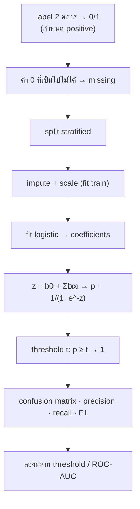

# FLOW 07 · Logistic Regression
> template: Python **T07** · RapidMiner **R07** · กลับ [[FLOW 00 START HERE]]

## โจทย์หน้าตาแบบนี้
*"ความน่าจะเป็นที่ …"* · *"ตีความ coefficient / odds ratio"* · *"เปลี่ยน threshold เป็น 0.3 แล้วเปรียบเทียบ"* · *"ROC / AUC"*

## ทีละขั้น

### ① label 0/1 + positive class
- **ทำไม:** logistic ทำนาย P(y = 1) → ต้องรู้ว่า "1" คืออะไร (คลาสที่สนใจ) ไม่งั้น precision/recall คำนวณกลับข้าง
- RapidMiner: label 0/1 → Numerical to Binominal (false/true) · Performance → positive_class = true

### ② ค่า 0 ที่เป็นไปไม่ได้
- pima: glucose/BMI = 0 คือไม่ได้วัด → ถ้าปล่อยเป็น 0 โมเดลเรียนว่า "BMI 0 = ไม่เป็นเบาหวาน" · **อยู่ที่:** T07 `ZERO_AS_MISSING` · R07 Declare Missing Value

### ③ fit → probability
- z = b0 + b1x1 + … (เหมือน linear) แล้ว **sigmoid** p = 1 / (1 + e^(−z)) บีบให้อยู่ใน 0..1
- **ทำไมไม่ใช้ linear regression:** linear ให้ค่านอก 0..1 ได้ ตีความเป็นความน่าจะเป็นไม่ได้
- **อยู่ที่:** T07 §4 (คำนวณมือจากสมการ ตรวจกับ predict_proba)

### ④ ตีความ: odds ratio
- odds = p / (1 − p) · **e^bᵢ = odds ratio**: xᵢ เพิ่ม 1 หน่วย odds คูณ e^bᵢ (ตัวแปรอื่นคงที่)
- e^b > 1 เพิ่มโอกาส · < 1 ลดโอกาส · b ไม่ได้บอกว่า "probability เพิ่มเท่าไร" ตรง ๆ (sigmoid ไม่เป็นเส้นตรง)
- ตัวอย่าง T07: glucose odds ×1.041 ต่อ 1 หน่วย (+4.1%) · BMI ×1.109 (+10.9%) · pregnancies ×1.124 (+12.4%)
- **อยู่ที่:** T07 §3 · R07 model

### ⑤ Threshold ⭐
- **ทำไมต้องเลือก threshold:** โมเดลให้ probability · การตัดสิน (ป่วย/ไม่ป่วย) เป็นการเลือกของเรา · 0.5 ไม่ได้ดีที่สุดเสมอ โดยเฉพาะคลาสไม่สมดุล
- ลด threshold → ทาย 1 ง่ายขึ้น → **recall ↑, precision ↓, FN ↓, FP ↑**
- ตัวอย่าง T07 (test set): 0.5 → 0.3: recall 0.500 → **0.796** · precision 0.600 → 0.597 · F1 0.546 → **0.683** · FN 27 → **11** · FP 18 → 29
- ⚠️ RapidMiner H2O Logistic Regression ตัดสินที่ threshold ที่ F1 สูงสุด (ไม่ใช่ 0.5) → อยากได้ 0.5 ต้อง Create/Apply Threshold เอง
- **อยู่ที่:** T07 §5 · R07 §5

### ⑥ ROC / AUC
- ROC = TPR (recall) vs FPR ทุก threshold · **AUC** = โอกาสที่โมเดลให้คะแนนคน "เป็น" สูงกว่าคน "ไม่เป็น" ที่สุ่มมา (0.5 = เดาสุ่ม, 1 = สมบูรณ์)
- **ทำไมใช้:** วัดความสามารถในการ "เรียงลำดับ" โดยไม่ขึ้นกับ threshold
- ตัวอย่าง T07: AUC **0.813**

### ⑦ baseline + ทำนายข้อมูลใหม่
- baseline majority: accuracy 0.651 แต่ F1 0 · logistic F1 0.636
- ข้อมูลใหม่ → probability 0.549 → ที่ threshold 0.5 และ 0.3 ทาย 1 ทั้งคู่ · **อยู่ที่:** T07 §7 · R07 §7

## กับดัก
- บอกว่า "coefficient 0.04 = probability เพิ่ม 4%" (ผิด — คือ log-odds)
- ใช้ threshold 0.5 เสมอ / ไม่บอกเหตุผลการเลือก threshold
- ลืม positive class
- RapidMiner: ไม่รู้ว่า H2O ใช้ threshold F1-max

## โครงคำตอบ
> logistic ทำนาย P(… = 1) ผ่าน sigmoid · coefficient ของ … = … → odds ratio e^… = … (เพิ่ม 1 หน่วย odds ×…) ·
> threshold 0.5: recall … precision … · ลดเป็น 0.3: recall … precision … (FN … → …, FP … → …) ·
> เพราะการพลาด … (FN) แพงกว่า จึงเลือก threshold … · AUC … = แยกสองคลาสได้ดี/ปานกลาง
