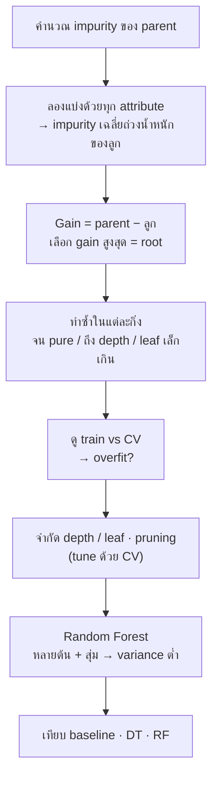

# FLOW 08 · Decision Tree & Random Forest
> template: Python **T08** · RapidMiner **R08** · กลับ [[FLOW 00 START HERE]]

## โจทย์หน้าตาแบบนี้
*"คำนวณ entropy / gini / information gain เลือก root"* · *"สร้างต้นไม้ depth = 3 และเขียนกฎ"* · *"overfitting"* ·
*"ปรับ max_depth / min_samples_leaf"* · *"Random Forest เทียบกับ Decision Tree"*



## ทีละขั้น

<!-- RM-CANVAS -->

> [!info]- 🖥️ วิธีอ่านภาพ RapidMiner ใต้แต่ละขั้น (สร้างจาก `R08_decision_tree_rf.rmp` จริง)
> กล่อง = operator (บน: ชื่อบน canvas · ล่าง: ชนิด) · ⧉ = มี subprocess (ดับเบิลคลิกเข้าไป) · ป้ายบนเส้น = port ย่อ (exa = example set · mod = model · pre = preprocessing model · per = performance · lab = labelled data · tra = training set · tes = test set · out = output · par = partition ของ Split Data / parameter set ของ Optimize · thr = threshold · wei = weights · fre = frequent sets · rul = rules) · ◯ res = ต่อออกผลลัพธ์ · กล่องเส้นประ = port ขอบ pane · สี: 🟪 อ่านข้อมูล · 🟦 จัดการข้อมูล · 🟩 preprocessing · 🟧 โมเดล · 🟨 apply · 🟥 ประเมิน/validation · ⬜ utility · มีเฉพาะ operator ของขั้นนั้น (ไฟล์จริงมี operator อื่นต่ออยู่ด้วย)

<!-- /RM-CANVAS -->

### ① Impurity → เลือก root (โจทย์คำนวณมือ)
| วัด | สูตร | 
|---|---|
| Entropy | −Σ pⱼ log₂ pⱼ (0 = บริสุทธิ์, 1 = 50/50 ใน 2 คลาส) |
| Gini | 1 − Σ pⱼ² (0 = บริสุทธิ์, 0.5 = 50/50) |
| Information Gain | Entropy(parent) − Σ (nₖ/n)·Entropy(childₖ) |
| Gain Ratio | Gain / SplitInfo · SplitInfo = −Σ (nₖ/n) log₂(nₖ/n) |

- **ทำไมเลือก gain สูงสุด:** แบ่งแล้วลูกแต่ละกิ่ง "บริสุทธิ์" ขึ้นมากที่สุด = ลดความไม่แน่นอนได้มากสุดในคำถามเดียว
- **ทำไมมี Gain Ratio:** Information Gain ชอบ attribute ที่มีหลายค่า (เช่น ID → ทุกกิ่งบริสุทธิ์ gain สูงสุดแต่ไร้ประโยชน์) · SplitInfo ลงโทษการแตกกิ่งเยอะ
- ตัวอย่าง T08 §0 (weather): root = **Outlook** ทั้ง 3 เกณฑ์
- **อยู่ที่:** T08 §0 · R08 §0 (Weight by Information Gain / Gain Ratio / Gini)

<!-- RM-CANVAS -->

> [!example]+ 🖥️ RapidMiner: Weight by Information Gain / Gain Ratio / Gini → wei = ค่าของแต่ละ attribute
> ```mermaid
> flowchart LR
>   n0["Read CSV (hand)<br/><i>Read CSV</i>"]:::data
>   n1["Set Role (hand)<br/><i>Set Role</i>"]:::blend
>   n2["Multiply (hand)<br/><i>Multiply</i>"]:::util
>   n3["Weight By Information Gain<br/><i>Weight by Information Gain</i>"]:::clean
>   n4["Weight By Information Gain Ratio<br/><i>Weight by Gain Ratio</i>"]:::clean
>   n5["Weight By Gini Index<br/><i>Weight by Gini Index</i>"]:::clean
>   n0 -->|"out"| n1
>   n1 -->|"exa"| n2
>   n2 -->|"out 1"| n3
>   nR0(("res")):::res
>   n3 -->|"wei"| nR0
>   n2 -->|"out 2"| n4
>   nR1(("res")):::res
>   n4 -->|"wei"| nR1
>   n2 -->|"out 3"| n5
>   nR2(("res")):::res
>   n5 -->|"wei"| nR2
>   classDef data fill:#e8dcf5,stroke:#7b52ab,color:#000
>   classDef blend fill:#dceefb,stroke:#3a7bbf,color:#000
>   classDef clean fill:#d9f2e6,stroke:#2e8b57,color:#000
>   classDef model fill:#ffe7c2,stroke:#d4860b,color:#000
>   classDef score fill:#fff6b3,stroke:#b8a400,color:#000
>   classDef eval fill:#fcd9d9,stroke:#c0392b,color:#000
>   classDef util fill:#eeeeee,stroke:#777,color:#000
>   classDef port fill:#ffffff,stroke:#999,stroke-dasharray:3 3,color:#555
>   classDef res fill:#ffffff,stroke:#333,stroke-width:2px,color:#000
> ```

<!-- /RM-CANVAS -->

### ② สร้างต้นไม้ + อ่านกฎ
- แต่ละเส้นทาง root → leaf = กฎ **IF … AND … THEN class (ความมั่นใจ = สัดส่วนใน leaf)**
- feature importance = ตัวแปรที่ลด impurity รวมมากสุด
- ตัวอย่าง T08: root = cp · สำคัญสุด cp, oldpeak, thal
- **อยู่ที่:** T08 §2 · R08 §2 (Graph / Description)

<!-- RM-CANVAS -->

> [!example]+ 🖥️ RapidMiner: Decision Tree บนข้อมูลทั้งหมด → res mod = Graph / Description (กฎ)
> ```mermaid
> flowchart LR
>   n0["Read CSV"]:::data
>   n1["Numerical to Binominal"]:::clean
>   n2["Set Role"]:::blend
>   n3["Multiply"]:::util
>   n4["Decision Tree (show)<br/><i>Decision Tree</i>"]:::model
>   n0 -->|"out"| n1
>   n1 -->|"exa"| n2
>   n2 -->|"exa"| n3
>   n3 -->|"out 1"| n4
>   nR0(("res")):::res
>   n4 -->|"mod"| nR0
>   classDef data fill:#e8dcf5,stroke:#7b52ab,color:#000
>   classDef blend fill:#dceefb,stroke:#3a7bbf,color:#000
>   classDef clean fill:#d9f2e6,stroke:#2e8b57,color:#000
>   classDef model fill:#ffe7c2,stroke:#d4860b,color:#000
>   classDef score fill:#fff6b3,stroke:#b8a400,color:#000
>   classDef eval fill:#fcd9d9,stroke:#c0392b,color:#000
>   classDef util fill:#eeeeee,stroke:#777,color:#000
>   classDef port fill:#ffffff,stroke:#999,stroke-dasharray:3 3,color:#555
>   classDef res fill:#ffffff,stroke:#333,stroke-width:2px,color:#000
> ```

<!-- /RM-CANVAS -->

### ③ Overfitting ⭐
- ต้นไม้โตเต็ม = แบ่งจนทุก leaf บริสุทธิ์ = **จำ noise** ของ train
- ตัวอย่าง T08: ต้นไม้เต็ม train **1.000** vs CV **0.729** (gap 0.27) · depth 3: CV **0.805** → ต้นไม้เล็กกว่าทำนายข้อมูลใหม่ได้ดีกว่า
- **ทำไมต้องดู train คู่กับ CV:** train สูงอย่างเดียวไม่บอกอะไร · gap ใหญ่ = overfit
- **อยู่ที่:** T08 §3 · R08 §3 vs §6

<!-- RM-CANVAS -->

> [!example]+ 🖥️ RapidMiner: train acc ของต้นไม้เต็ม: train แล้ว Apply กับข้อมูลเดิม
> ```mermaid
> flowchart LR
>   n0["Multiply"]:::util
>   n1["Decision Tree (full)<br/><i>Decision Tree</i>"]:::model
>   n2["Apply Model (train acc)<br/><i>Apply Model</i>"]:::score
>   n3["Performance (train acc)<br/><i>Performance (Binominal)</i>"]:::eval
>   n0 -->|"out 2"| n1
>   n1 -->|"mod"| n2
>   n0 -->|"out 3"| n2
>   n2 -->|"lab"| n3
>   nR0(("res")):::res
>   n3 -->|"per"| nR0
>   classDef data fill:#e8dcf5,stroke:#7b52ab,color:#000
>   classDef blend fill:#dceefb,stroke:#3a7bbf,color:#000
>   classDef clean fill:#d9f2e6,stroke:#2e8b57,color:#000
>   classDef model fill:#ffe7c2,stroke:#d4860b,color:#000
>   classDef score fill:#fff6b3,stroke:#b8a400,color:#000
>   classDef eval fill:#fcd9d9,stroke:#c0392b,color:#000
>   classDef util fill:#eeeeee,stroke:#777,color:#000
>   classDef port fill:#ffffff,stroke:#999,stroke-dasharray:3 3,color:#555
>   classDef res fill:#ffffff,stroke:#333,stroke-width:2px,color:#000
> ```

<!-- /RM-CANVAS -->

### ④ ควบคุมความซับซ้อน (tune ด้วย CV)
| parameter | ผล |
|---|---|
| max_depth ↓ | ต้นไม้ตื้น → overfit น้อยลง (เล็กเกิน = underfit) |
| min_samples_leaf ↑ | leaf ต้องมีข้อมูลพอ → ไม่แตกกิ่งตาม noise |
| criterion | gini / entropy — ผลมักใกล้กัน |
| pruning (RapidMiner default) | ตัดกิ่งที่ไม่ช่วยหลังสร้าง |

**อยู่ที่:** T08 §4 · R08 §4

<!-- RM-CANVAS -->

> [!example]+ 🖥️ RapidMiner: Optimize maximal_depth: ข้างใน Optimize = CV + Log
> ```mermaid
> flowchart LR
>   subgraph S["Optimize Parameters (depth) · Optimize Parameters (Grid)"]
>     direction LR
>     subgraph P0["ข้างใน"]
>       direction LR
>       p0x0["CV opt<br/><i>Cross Validation</i><br/>⧉"]:::eval
>       p0x1["Log"]:::util
>       p0xL0(["inp 1"]):::port
>       p0xL0 --> p0x0
>       p0x0 -->|"per 1"| p0x1
>       p0xP0(["per"]):::port
>       p0x1 -->|"thr 1"| p0xP0
>     end
>   end
>   classDef data fill:#e8dcf5,stroke:#7b52ab,color:#000
>   classDef blend fill:#dceefb,stroke:#3a7bbf,color:#000
>   classDef clean fill:#d9f2e6,stroke:#2e8b57,color:#000
>   classDef model fill:#ffe7c2,stroke:#d4860b,color:#000
>   classDef score fill:#fff6b3,stroke:#b8a400,color:#000
>   classDef eval fill:#fcd9d9,stroke:#c0392b,color:#000
>   classDef util fill:#eeeeee,stroke:#777,color:#000
>   classDef port fill:#ffffff,stroke:#999,stroke-dasharray:3 3,color:#555
>   classDef res fill:#ffffff,stroke:#333,stroke-width:2px,color:#000
> ```

<!-- /RM-CANVAS -->

### ⑤ Random Forest
- หลายต้น แต่ละต้นเห็นข้อมูลสุ่ม (bootstrap) + สุ่ม feature ทุกครั้งที่แบ่ง → vote
- **ทำไมดีกว่าต้นเดียว:** ต้นเดียว variance สูง (ข้อมูลเปลี่ยนนิดเดียวต้นไม้เปลี่ยนมาก) · เฉลี่ยหลายต้นที่ไม่เหมือนกัน → variance ลด → overfit น้อยลง
- ข้อเสีย: ตีความยากกว่า (ไม่มีกฎชุดเดียว) → ใช้ feature importance แทน
- **อยู่ที่:** T08 §5 · R08 §5

<!-- RM-CANVAS -->

> [!example]+ 🖥️ RapidMiner: Random Forest → ทำนายข้อมูลใหม่
> ```mermaid
> flowchart LR
>   n0["Multiply"]:::util
>   n1["Random Forest (final)<br/><i>Random Forest</i>"]:::model
>   n2["Read CSV (new)<br/><i>Read CSV</i>"]:::data
>   n3["Apply Model (new)<br/><i>Apply Model</i>"]:::score
>   n0 -->|"out 6"| n1
>   n1 -->|"mod"| n3
>   n2 -->|"out"| n3
>   nR0(("res")):::res
>   n3 -->|"lab"| nR0
>   classDef data fill:#e8dcf5,stroke:#7b52ab,color:#000
>   classDef blend fill:#dceefb,stroke:#3a7bbf,color:#000
>   classDef clean fill:#d9f2e6,stroke:#2e8b57,color:#000
>   classDef model fill:#ffe7c2,stroke:#d4860b,color:#000
>   classDef score fill:#fff6b3,stroke:#b8a400,color:#000
>   classDef eval fill:#fcd9d9,stroke:#c0392b,color:#000
>   classDef util fill:#eeeeee,stroke:#777,color:#000
>   classDef port fill:#ffffff,stroke:#999,stroke-dasharray:3 3,color:#555
>   classDef res fill:#ffffff,stroke:#333,stroke-width:2px,color:#000
> ```

<!-- /RM-CANVAS -->

### ⑥ เทียบทั้งหมด (CV, heart)
| โมเดล | CV acc | F1 | train acc |
|---|---|---|---|
| Majority baseline | 0.545 | 0.705 | 0.545 |
| Tree เต็ม | 0.729 | 0.755 | 1.000 |
| Tree depth 3 | 0.805 | 0.826 | 0.852 |
| Tree tuned | 0.815 | 0.837 | 0.847 |
| RF 100 ต้น | 0.815 | 0.837 | 1.000 |
| **RF tuned** | **0.842** | **0.863** | 0.922 |

**อ่าน:** baseline F1 ไม่ใช่ 0 เพราะคลาส 1 เป็นคลาสส่วนใหญ่ (54%) · RF train 1.0 แต่ CV ยังดี (ต่างจากต้นไม้เดี่ยว) เพราะการเฉลี่ยลด variance

<!-- RM-CANVAS -->

> [!example]+ 🖥️ RapidMiner: เทียบ baseline / tree เต็ม / depth 3 / RF ด้วย CV เดียวกัน
> ```mermaid
> flowchart LR
>   n0["Multiply"]:::util
>   n1["Multiply (compare)<br/><i>Multiply</i>"]:::util
>   n2["CV Baseline<br/><i>Cross Validation</i><br/>⧉"]:::eval
>   n3["CV Tree full<br/><i>Cross Validation</i><br/>⧉"]:::eval
>   n4["CV Tree d3<br/><i>Cross Validation</i><br/>⧉"]:::eval
>   n5["CV Random Forest<br/><i>Cross Validation</i><br/>⧉"]:::eval
>   n0 -->|"out 4"| n1
>   n1 -->|"out 1"| n2
>   nR0(("res")):::res
>   n2 -->|"per 1"| nR0
>   n1 -->|"out 2"| n3
>   nR1(("res")):::res
>   n3 -->|"per 1"| nR1
>   n1 -->|"out 3"| n4
>   nR2(("res")):::res
>   n4 -->|"per 1"| nR2
>   n1 -->|"out 4"| n5
>   nR3(("res")):::res
>   n5 -->|"per 1"| nR3
>   classDef data fill:#e8dcf5,stroke:#7b52ab,color:#000
>   classDef blend fill:#dceefb,stroke:#3a7bbf,color:#000
>   classDef clean fill:#d9f2e6,stroke:#2e8b57,color:#000
>   classDef model fill:#ffe7c2,stroke:#d4860b,color:#000
>   classDef score fill:#fff6b3,stroke:#b8a400,color:#000
>   classDef eval fill:#fcd9d9,stroke:#c0392b,color:#000
>   classDef util fill:#eeeeee,stroke:#777,color:#000
>   classDef port fill:#ffffff,stroke:#999,stroke-dasharray:3 3,color:#555
>   classDef res fill:#ffffff,stroke:#333,stroke-width:2px,color:#000
> ```

<!-- /RM-CANVAS -->

## กับดัก
- สรุป overfit จาก train acc อย่างเดียว
- Information Gain กับ attribute ที่เป็น ID
- scale ข้อมูลก่อน tree (ไม่ผิดแต่ไม่จำเป็น — บอกได้ว่าทำไมไม่ต้อง)
- RapidMiner default = gain_ratio + pruning · sklearn = gini ไม่ prune → ผลต่างกันได้

## โครงคำตอบ
> Entropy(parent) = … · Gain(Outlook) = … สูงสุด → root · ต้นไม้ depth … ให้กฎ: IF … THEN … ·
> ต้นไม้เต็ม train … vs CV … → overfit · จำกัด depth = … ได้ CV … · RF (… ต้น) CV … ดีกว่าเพราะลด variance ·
> เทียบ baseline … · เลือก … เพราะ … (แม่นสุด / ตีความได้)
