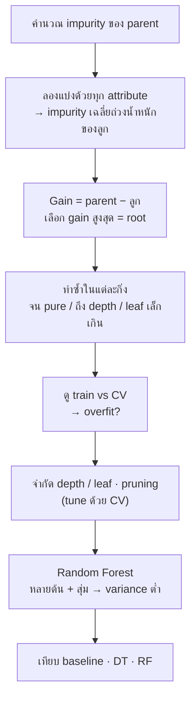

# FLOW 08 · Decision Tree & Random Forest
> template: Python **T08** · RapidMiner **R08** · กลับ [[FLOW 00 START HERE]]

## โจทย์หน้าตาแบบนี้
*"คำนวณ entropy / gini / information gain เลือก root"* · *"สร้างต้นไม้ depth = 3 และเขียนกฎ"* · *"overfitting"* ·
*"ปรับ max_depth / min_samples_leaf"* · *"Random Forest เทียบกับ Decision Tree"*

## ทีละขั้น

### ① Impurity → เลือก root (โจทย์คำนวณมือ)
| วัด | สูตร | 
|---|---|
| Entropy | −Σ pⱼ log₂ pⱼ (0 = บริสุทธิ์, 1 = 50/50 ใน 2 คลาส) |
| Gini | 1 − Σ pⱼ² (0 = บริสุทธิ์, 0.5 = 50/50) |
| Information Gain | Entropy(parent) − Σ (nₖ/n)·Entropy(childₖ) |
| Gain Ratio | Gain / SplitInfo · SplitInfo = −Σ (nₖ/n) log₂(nₖ/n) |

- **ทำไมเลือก gain สูงสุด:** แบ่งแล้วลูกแต่ละกิ่ง "บริสุทธิ์" ขึ้นมากที่สุด = ลดความไม่แน่นอนได้มากสุดในคำถามเดียว
- **ทำไมมี Gain Ratio:** Information Gain ชอบ attribute ที่มีหลายค่า (เช่น ID → ทุกกิ่งบริสุทธิ์ gain สูงสุดแต่ไร้ประโยชน์) · SplitInfo ลงโทษการแตกกิ่งเยอะ
- ตัวอย่าง T08 §0 (weather): root = **Outlook** ทั้ง 3 เกณฑ์
- **อยู่ที่:** T08 §0 · R08 §0 (Weight by Information Gain / Gain Ratio / Gini)

### ② สร้างต้นไม้ + อ่านกฎ
- แต่ละเส้นทาง root → leaf = กฎ **IF … AND … THEN class (ความมั่นใจ = สัดส่วนใน leaf)**
- feature importance = ตัวแปรที่ลด impurity รวมมากสุด
- ตัวอย่าง T08: root = cp · สำคัญสุด cp, oldpeak, thal
- **อยู่ที่:** T08 §2 · R08 §2 (Graph / Description)

### ③ Overfitting ⭐
- ต้นไม้โตเต็ม = แบ่งจนทุก leaf บริสุทธิ์ = **จำ noise** ของ train
- ตัวอย่าง T08: ต้นไม้เต็ม train **1.000** vs CV **0.729** (gap 0.27) · depth 3: CV **0.805** → ต้นไม้เล็กกว่าทำนายข้อมูลใหม่ได้ดีกว่า
- **ทำไมต้องดู train คู่กับ CV:** train สูงอย่างเดียวไม่บอกอะไร · gap ใหญ่ = overfit
- **อยู่ที่:** T08 §3 · R08 §3 vs §6

### ④ ควบคุมความซับซ้อน (tune ด้วย CV)
| parameter | ผล |
|---|---|
| max_depth ↓ | ต้นไม้ตื้น → overfit น้อยลง (เล็กเกิน = underfit) |
| min_samples_leaf ↑ | leaf ต้องมีข้อมูลพอ → ไม่แตกกิ่งตาม noise |
| criterion | gini / entropy — ผลมักใกล้กัน |
| pruning (RapidMiner default) | ตัดกิ่งที่ไม่ช่วยหลังสร้าง |

**อยู่ที่:** T08 §4 · R08 §4

### ⑤ Random Forest
- หลายต้น แต่ละต้นเห็นข้อมูลสุ่ม (bootstrap) + สุ่ม feature ทุกครั้งที่แบ่ง → vote
- **ทำไมดีกว่าต้นเดียว:** ต้นเดียว variance สูง (ข้อมูลเปลี่ยนนิดเดียวต้นไม้เปลี่ยนมาก) · เฉลี่ยหลายต้นที่ไม่เหมือนกัน → variance ลด → overfit น้อยลง
- ข้อเสีย: ตีความยากกว่า (ไม่มีกฎชุดเดียว) → ใช้ feature importance แทน
- **อยู่ที่:** T08 §5 · R08 §5

### ⑥ เทียบทั้งหมด (CV, heart)
| โมเดล | CV acc | F1 | train acc |
|---|---|---|---|
| Majority baseline | 0.545 | 0.705 | 0.545 |
| Tree เต็ม | 0.729 | 0.755 | 1.000 |
| Tree depth 3 | 0.805 | 0.826 | 0.852 |
| Tree tuned | 0.815 | 0.837 | 0.847 |
| RF 100 ต้น | 0.815 | 0.837 | 1.000 |
| **RF tuned** | **0.842** | **0.863** | 0.922 |

**อ่าน:** baseline F1 ไม่ใช่ 0 เพราะคลาส 1 เป็นคลาสส่วนใหญ่ (54%) · RF train 1.0 แต่ CV ยังดี (ต่างจากต้นไม้เดี่ยว) เพราะการเฉลี่ยลด variance

## กับดัก
- สรุป overfit จาก train acc อย่างเดียว
- Information Gain กับ attribute ที่เป็น ID
- scale ข้อมูลก่อน tree (ไม่ผิดแต่ไม่จำเป็น — บอกได้ว่าทำไมไม่ต้อง)
- RapidMiner default = gain_ratio + pruning · sklearn = gini ไม่ prune → ผลต่างกันได้

## โครงคำตอบ
> Entropy(parent) = … · Gain(Outlook) = … สูงสุด → root · ต้นไม้ depth … ให้กฎ: IF … THEN … ·
> ต้นไม้เต็ม train … vs CV … → overfit · จำกัด depth = … ได้ CV … · RF (… ต้น) CV … ดีกว่าเพราะลด variance ·
> เทียบ baseline … · เลือก … เพราะ … (แม่นสุด / ตีความได้)
