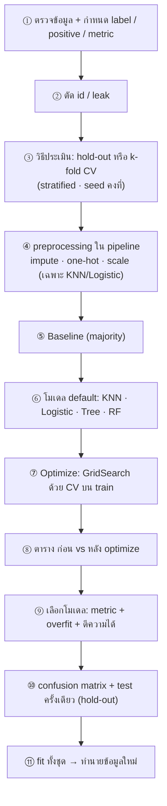

# FLOW 09 · Classification Workflow ครบวงจร ⭐
> template: Python **T09** · RapidMiner **R09** · กลับ [[FLOW 00 START HERE]]
> โจทย์ใหญ่ของ Lab มักเป็นแบบนี้ · บทอื่น (FLOW 04–08) คือการเจาะทีละชิ้นของ flow นี้

## โจทย์หน้าตาแบบนี้
*"สร้าง workflow ตั้งแต่ preprocessing จนถึง evaluation"* · *"สร้าง baseline แล้วเปรียบเทียบ"* · *"ใช้ hold-out หรือ cross-validation"* ·
*"optimize parameters"* · *"เปรียบเทียบก่อนและหลัง optimization"* · *"ควรเลือกโมเดลใด เพราะอะไร"*

## ทีละขั้น

### ① กำหนด label · positive class · metric ก่อนเริ่ม
- **ทำไมก่อน:** metric คือ "กติกาการแข่ง" — ต้องตั้งก่อนเห็นผล ไม่งั้นจะเลือก metric ที่ทำให้โมเดลที่ชอบดูดี
- สมดุล → accuracy ได้ · ไม่สมดุล → F1 / recall · ดู [[FLOW 04 Imbalanced Classification]]

### ② ตัด id / leak · ③ เลือกวิธีประเมิน
| | hold-out | k-fold CV |
|---|---|---|
| ทำ | แบ่ง train/test ครั้งเดียว (เช่น 70/30) | แบ่ง k ส่วน วน k รอบ ทุกแถวเป็น validation 1 ครั้ง |
| ข้อดี | เร็ว · เหมือนสถานการณ์จริง | ค่าเสถียรกว่า · ใช้ข้อมูลคุ้ม · ได้ std |
| ข้อเสีย | ผลขึ้นกับการสุ่มครั้งเดียว | ช้ากว่า k เท่า |
| ใช้เมื่อ | ข้อมูลเยอะ | ข้อมูลน้อย/กลาง |

- **stratified:** รักษาสัดส่วนคลาสในทุกส่วน · **seed คงที่:** ทุกโมเดลถูกประเมินบนการแบ่ง **เดียวกัน** → เทียบกันได้ยุติธรรม
- train / validation / test: train = เรียน · validation = เลือก parameter · test = วัดครั้งสุดท้ายครั้งเดียว (ใน CV, fold ที่ถูกพักคือ validation)

### ④ preprocessing ใน pipeline
- **ทำไม:** ทุก fold ต้อง fit imputer/scaler ใหม่จาก training fold ของตัวเอง (ดู [[FLOW 02 Preprocessing & Leakage]])
- scale เฉพาะโมเดลที่ใช้ระยะทาง/gradient (KNN, Logistic) · Tree/RF ไม่ต้อง

### ⑤ Baseline
- **ทำไม:** ตอบคำถาม "โมเดลเรียนรู้อะไรจริงไหม" · ไม่มี baseline พูดไม่ได้ว่า 85% ดีหรือไม่
- majority = ทายคลาสที่พบบ่อยสุดเสมอ (Python `DummyClassifier`, RapidMiner `Default Model`)
- ตัวอย่าง T09 (bank-data, pep): baseline accuracy **0.543** · F1 **0** (ไม่เคยทาย YES)

### ⑥ โมเดล default
- ใช้ค่าเริ่มต้นก่อน → ได้จุดเทียบสำหรับ "ก่อน optimize"
- ตัวอย่าง T09 (10-fold CV, F1): KNN 0.701 · Logistic 0.561 · Tree 0.833 · RF **0.838**

### ⑦ Optimize (GridSearch + CV บน train)
- ลองทุกชุด parameter → เลือกชุดที่ CV metric ดีที่สุด
- **ทำไมต้อง CV ไม่ใช่ test:** ถ้าเลือก parameter จาก test, ค่า test ที่รายงานจะ "ดีเกินจริง" เพราะเราจูนให้เข้ากับ test แล้ว
- parameter ที่ควร tune: KNN `k`, `weights` · Logistic `C`, `class_weight` · Tree `max_depth`, `min_samples_leaf`, `criterion` · RF `n_estimators`, `max_depth`

### ⑧ ตาราง ก่อน vs หลัง ⭐
ตัวอย่าง T09 (F1):

| โมเดล | ก่อน | หลัง | เปลี่ยน | ค่าที่ได้ |
|---|---|---|---|---|
| KNN | 0.701 | 0.727 | +0.026 | k = 19, distance |
| Logistic | 0.561 | 0.593 | +0.032 | C = 1, balanced |
| **Decision Tree** | 0.833 | **0.876** | **+0.044** | gini, depth 6, leaf 5 |
| Random Forest | 0.838 | 0.842 | +0.004 | leaf 5 |

**อ่าน:** Tree ดีขึ้นมากสุดเพราะต้นไม้ default โตเต็ม (overfit) → จำกัด depth/leaf ช่วยมาก · RF แทบไม่เปลี่ยนเพราะ default ของ RF ดีอยู่แล้ว (การเฉลี่ยลด overfit ให้เอง) ·
Logistic ต่ำสุด → บ่งว่าความสัมพันธ์ใน bank-data น่าจะไม่เป็นเชิงเส้น/มี interaction ระหว่างตัวแปร ซึ่งต้นไม้จับได้เอง แต่ logistic (เส้นตรงใน log-odds) จับไม่ได้

### ⑨ เลือกโมเดล — ไม่ใช่แค่ตัวเลขสูงสุด
1. metric หลักสูงสุด (ต่างกันเกิน std ไหม? ถ้าต่างกันน้อยกว่า std ถือว่าพอ ๆ กัน)
2. ไม่ overfit (train vs validation ไม่ห่างมาก)
3. ตีความได้ (Tree อธิบายได้เป็นกฎ · RF/KNN ยากกว่า)
4. ต้นทุนของ FN/FP ในโจทย์
- ตัวอย่าง T09: เลือก **Decision Tree (optimized)** F1 0.876 — สูงสุดและอธิบายเป็นกฎได้

### ⑩ confusion matrix
- บอกว่าพลาดแบบไหน (FN หรือ FP) → เชื่อมกับโจทย์ธุรกิจ · hold-out: วัดบน test **ครั้งเดียว** ตอนจบ

### ⑪ fit ทั้งชุด → ทำนาย
- เลือกเสร็จแล้วใช้ข้อมูลทั้งหมด train โมเดลสุดท้าย (ได้ข้อมูลมากสุด) · ข้อมูลใหม่ผ่าน pipeline เดียวกันอัตโนมัติ

## กับดัก
- ไม่มี baseline · ใช้ accuracy กับข้อมูลไม่สมดุล
- แต่ละโมเดลใช้ split/seed ต่างกัน → เทียบไม่ได้
- tune ด้วย test · รายงานผล test หลายรอบแล้วเลือกตัวที่ดีสุด
- บอก "โมเดล A ดีกว่า" ทั้งที่ต่างกัน 0.005 แต่ std 0.05

## โครงคำตอบ (4 ขั้น)
1. **Process:** อ่าน → ตัด … → pipeline (impute median/mode + one-hot + z-score) → 10-fold stratified CV (seed …) → baseline + 4 โมเดล → GridSearch
2. **Settings:** metric หลัก F1 เพราะ … · grid: …
3. **Results:** ตาราง default / optimized (ค่าเฉลี่ย ± std)
4. **Interpretation:** baseline F1 … → ทุกโมเดลชนะ · … ดีสุด (…) · optimize ช่วย … มากสุดเพราะ … · เลือก … เพราะ … · confusion matrix: FN … FP … → …
