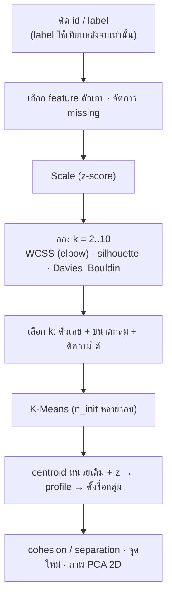

# FLOW 10 · Clustering
> template: Python **T10** · RapidMiner **R10** · กลับ [[FLOW 00 START HERE]]

## โจทย์หน้าตาแบบนี้
*"แบ่งกลุ่มลูกค้า/บริษัท"* · *"เตรียมข้อมูลสำหรับ clustering"* · *"เลือกจำนวน cluster"* · *"อธิบาย/ตั้งชื่อแต่ละกลุ่ม"* ·
*"ข้อมูลใหม่อยู่กลุ่มไหน"* · *"ประเมินด้วย cohesion / separation"* · *"K-Means ทีละรอบจาก centroid เริ่มต้น"*

## หัวใจของ K-Means
1. เลือก centroid เริ่มต้น k จุด → 2. ทุกจุดไปอยู่กับ centroid ที่ใกล้สุด → 3. centroid ใหม่ = ค่าเฉลี่ยของสมาชิก → 4. วนซ้ำจนสมาชิกไม่เปลี่ยน
→ สิ่งที่ K-Means พยายามทำคือ **ลด WCSS** (ผลรวมระยะ² ของทุกจุดถึง centroid ของตัวเอง)

## ทีละขั้น

### ① ตัด id และ label
- **id:** ไม่ใช่คุณสมบัติ ถ้าใส่ไปจะคิดระยะจากเลขรหัส
- **label (ถ้ามี):** clustering คือ unsupervised — ใช้ label เพื่อ "เทียบหลังจบ" เท่านั้น ถ้าใส่ไปจะเป็นการโกง
- **อยู่ที่:** T10 §1 · R10 Set Role (id)

### ② Scale ⭐
- **ทำไม:** K-Means ใช้ระยะ Euclidean → Sales (หลักหมื่น) จะครอบงำ Fixed_charge (หลักหน่วย) จนกลุ่มถูกแบ่งตาม Sales อย่างเดียว
- RapidMiner Normalize (Z) ใช้ std แบบ n−1 · sklearn ใช้ n → ค่าต่างเล็กน้อย ไม่ผิด

### ③ เลือก k
| เกณฑ์ | วัดอะไร | ดี = |
|---|---|---|
| **WCSS (elbow)** | cohesion (ความแน่นในกลุ่ม) | หา "ข้อศอก" ที่การลดเริ่มช้า · WCSS ลดเสมอเมื่อ k เพิ่ม จึงเลือกค่าต่ำสุดไม่ได้ |
| **Silhouette** (−1..1) | cohesion + separation ต่อจุด | สูงสุด |
| **Davies–Bouldin** | การกระจายในกลุ่ม / ระยะระหว่างกลุ่ม | ต่ำสุด (RapidMiner แสดงติดลบ → ใกล้ 0 ดี) |

ตัวอย่าง T10 (utilities 22 บริษัท):

| k | WCSS | silhouette | DB | ขนาดกลุ่ม |
|---|---|---|---|---|
| 3 | 106.6 | 0.230 | 1.367 | 12, 7, 3 |
| **4** | 84.2 | 0.234 | 1.177 | 7, 7, 5, 3 |
| 5 | 70.6 | **0.248** | 1.000 | 7, 6, 5, 3, **1** |

**ทำไมเลือก k = 4 ทั้งที่ silhouette สูงสุดที่ k = 5:** k = 5 มีกลุ่มที่มีสมาชิก **1 บริษัท** (กลุ่มเดี่ยว = outlier ไม่ใช่ segment) และ silhouette ต่างกันแค่ 0.014 · k = 4 ขนาดกลุ่มสมดุลและตีความได้ → **เลือก k ต้องใช้ตัวเลข + ขนาดกลุ่ม + ความหมายทางธุรกิจ**

### ④ K-Means + n_init
- ผลขึ้นกับ centroid เริ่มต้น → รันหลายรอบ (n_init / max runs) เก็บรอบที่ WCSS ต่ำสุด · ตั้ง seed ให้ผลซ้ำได้

### ⑤ Centroid → profile → ตั้งชื่อ
- centroid หน่วยเดิม = อ่านค่าจริง · centroid แบบ z = เทียบกับค่าเฉลี่ยรวม (+ สูงกว่า, − ต่ำกว่า) → ใช้ตั้งชื่อ
- ตัวอย่าง T10: Cluster 3 (3 บริษัท) Cost/Demand_growth/Sales สูง, Nuclear/Fuel_Cost ต่ำ → "บริษัทใหญ่ โตเร็ว ไม่ใช้นิวเคลียร์" · Cluster 2: Nuclear สูง → "กลุ่มนิวเคลียร์"
- **อยู่ที่:** T10 §3 · R10 §3 (Centroid Table) / §3b

### ⑥ Cohesion & Separation
- **cohesion** = ระยะเฉลี่ยในกลุ่ม (ต่ำ = แน่น) · **separation** = ระยะระหว่าง centroid (สูง = แยกชัด)
- silhouette ต่อจุด < 0 = จุดนั้นใกล้กลุ่มอื่นมากกว่ากลุ่มตัวเอง (อาจอยู่ผิดกลุ่ม) — ตัวอย่าง T10: Boston, NY
- **อยู่ที่:** T10 §5 · R10 §3

### ⑦ จุดใหม่
- scale ด้วย scaler เดิม → ระยะถึงทุก centroid → กลุ่มที่ใกล้สุด · ตัวอย่าง T10: อยู่ cluster 0 (ระยะ 1.74)
- **ทำไมต้อง scaler เดิม:** centroid อยู่ในสเกลของข้อมูลชุดที่ fit · scale จุดใหม่ด้วยค่าอื่น = วัดระยะคนละหน่วย

### ⑧ ภาพ / hierarchical
- PCA 2D ใช้ดูภาพ (บอก % variance) · dendrogram ตัดที่ความสูงที่ได้ k กลุ่ม · linkage: single (ใกล้สุด, ได้กลุ่มยาว), complete (ไกลสุด, กลุ่มกลม), average, ward (เพิ่ม WCSS น้อยสุด)

### ⑨ K-Means มือ (โจทย์ให้ seed)
- ทุกรอบ: ตารางระยะทุกจุด → จัดกลุ่ม → centroid ใหม่ → จนสมาชิกไม่เปลี่ยน · ตัวอย่าง T10 §9 (A1–A9, seed A1/A4/A7) converge ที่รอบ 3 · ไม่ scale ตามตำรา

## กับดัก
- ไม่ scale · ใส่ id/label
- เลือก k ที่ WCSS ต่ำสุด (จะได้ k ใหญ่สุดเสมอ)
- ตั้งชื่อกลุ่มจาก centroid หน่วยเดิมโดยไม่เทียบค่าเฉลี่ยรวม
- จุดใหม่ไม่ scale ด้วยค่าเดิม

## โครงคำตอบ
> ตัด … (id) · ใช้ … feature ตัวเลข · z-score เพราะหน่วยต่างกัน (… vs …) · ลอง k 2–8: elbow ที่ k ≈ … · silhouette สูงสุด k = … ·
> เลือก k = … เพราะ … (ขนาดกลุ่ม/ตีความ) · กลุ่ม 0 = … (… สูง … ต่ำ) → "…" … · silhouette เฉลี่ย … (โครงสร้างกลุ่มอ่อน/ปานกลาง) ·
> จุดใหม่อยู่กลุ่ม … (ระยะ …)
