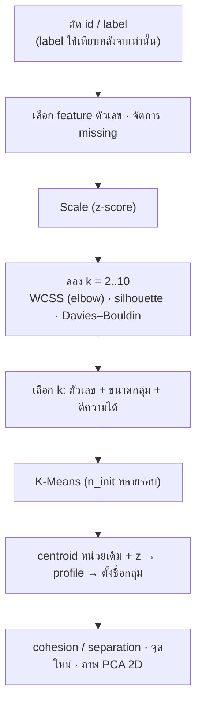

# FLOW 10 · Clustering
> template: Python **T10** · RapidMiner **R10** · กลับ [[FLOW 00 START HERE]]

## โจทย์หน้าตาแบบนี้
*"แบ่งกลุ่มลูกค้า/บริษัท"* · *"เตรียมข้อมูลสำหรับ clustering"* · *"เลือกจำนวน cluster"* · *"อธิบาย/ตั้งชื่อแต่ละกลุ่ม"* ·
*"ข้อมูลใหม่อยู่กลุ่มไหน"* · *"ประเมินด้วย cohesion / separation"* · *"K-Means ทีละรอบจาก centroid เริ่มต้น"*



## หัวใจของ K-Means
1. เลือก centroid เริ่มต้น k จุด → 2. ทุกจุดไปอยู่กับ centroid ที่ใกล้สุด → 3. centroid ใหม่ = ค่าเฉลี่ยของสมาชิก → 4. วนซ้ำจนสมาชิกไม่เปลี่ยน
→ สิ่งที่ K-Means พยายามทำคือ **ลด WCSS** (ผลรวมระยะ² ของทุกจุดถึง centroid ของตัวเอง)

## ทีละขั้น

<!-- RM-CANVAS -->

> [!info]- 🖥️ วิธีอ่านภาพ RapidMiner ใต้แต่ละขั้น (สร้างจาก `R10_clustering.rmp` จริง)
> กล่อง = operator (บน: ชื่อบน canvas · ล่าง: ชนิด) · ⧉ = มี subprocess (ดับเบิลคลิกเข้าไป) · ป้ายบนเส้น = port ย่อ (exa = example set · mod = model · pre = preprocessing model · per = performance · lab = labelled data · tra = training set · tes = test set · out = output · par = partition ของ Split Data / parameter set ของ Optimize · thr = threshold · wei = weights · fre = frequent sets · rul = rules) · ◯ res = ต่อออกผลลัพธ์ · กล่องเส้นประ = port ขอบ pane · สี: 🟪 อ่านข้อมูล · 🟦 จัดการข้อมูล · 🟩 preprocessing · 🟧 โมเดล · 🟨 apply · 🟥 ประเมิน/validation · ⬜ utility · มีเฉพาะ operator ของขั้นนั้น (ไฟล์จริงมี operator อื่นต่ออยู่ด้วย)

<!-- /RM-CANVAS -->

### ① ตัด id และ label
- **id:** ไม่ใช่คุณสมบัติ ถ้าใส่ไปจะคิดระยะจากเลขรหัส
- **label (ถ้ามี):** clustering คือ unsupervised — ใช้ label เพื่อ "เทียบหลังจบ" เท่านั้น ถ้าใส่ไปจะเป็นการโกง
- **อยู่ที่:** T10 §1 · R10 Set Role (id)

### ② Scale ⭐
- **ทำไม:** K-Means ใช้ระยะ Euclidean → Sales (หลักหมื่น) จะครอบงำ Fixed_charge (หลักหน่วย) จนกลุ่มถูกแบ่งตาม Sales อย่างเดียว
- RapidMiner Normalize (Z) ใช้ std แบบ n−1 · sklearn ใช้ n → ค่าต่างเล็กน้อย ไม่ผิด

<!-- RM-CANVAS -->

> [!example]+ 🖥️ RapidMiner: Set Role (id) → Normalize → Multiply
> ```mermaid
> flowchart LR
>   n0["Read CSV"]:::data
>   n1["Set Role"]:::blend
>   n2["Normalize"]:::clean
>   n3["Multiply"]:::util
>   n0 -->|"out"| n1
>   n1 -->|"exa"| n2
>   n2 -->|"exa"| n3
>   classDef data fill:#e8dcf5,stroke:#7b52ab,color:#000
>   classDef blend fill:#dceefb,stroke:#3a7bbf,color:#000
>   classDef clean fill:#d9f2e6,stroke:#2e8b57,color:#000
>   classDef model fill:#ffe7c2,stroke:#d4860b,color:#000
>   classDef score fill:#fff6b3,stroke:#b8a400,color:#000
>   classDef eval fill:#fcd9d9,stroke:#c0392b,color:#000
>   classDef util fill:#eeeeee,stroke:#777,color:#000
>   classDef port fill:#ffffff,stroke:#999,stroke-dasharray:3 3,color:#555
>   classDef res fill:#ffffff,stroke:#333,stroke-width:2px,color:#000
> ```

<!-- /RM-CANVAS -->

### ③ เลือก k
| เกณฑ์ | วัดอะไร | ดี = |
|---|---|---|
| **WCSS (elbow)** | cohesion (ความแน่นในกลุ่ม) | หา "ข้อศอก" ที่การลดเริ่มช้า · WCSS ลดเสมอเมื่อ k เพิ่ม จึงเลือกค่าต่ำสุดไม่ได้ |
| **Silhouette** (−1..1) | cohesion + separation ต่อจุด | สูงสุด |
| **Davies–Bouldin** | การกระจายในกลุ่ม / ระยะระหว่างกลุ่ม | ต่ำสุด (RapidMiner แสดงติดลบ → ใกล้ 0 ดี) |

ตัวอย่าง T10 (utilities 22 บริษัท):

| k | WCSS | silhouette | DB | ขนาดกลุ่ม |
|---|---|---|---|---|
| 3 | 106.6 | 0.230 | 1.367 | 12, 7, 3 |
| **4** | 84.2 | 0.234 | 1.177 | 7, 7, 5, 3 |
| 5 | 70.6 | **0.248** | 1.000 | 7, 6, 5, 3, **1** |

**ทำไมเลือก k = 4 ทั้งที่ silhouette สูงสุดที่ k = 5:** k = 5 มีกลุ่มที่มีสมาชิก **1 บริษัท** (กลุ่มเดี่ยว = outlier ไม่ใช่ segment) และ silhouette ต่างกันแค่ 0.014 · k = 4 ขนาดกลุ่มสมดุลและตีความได้ → **เลือก k ต้องใช้ตัวเลข + ขนาดกลุ่ม + ความหมายทางธุรกิจ**

<!-- RM-CANVAS -->

> [!example]+ 🖥️ RapidMiner: เลือก k: Optimize Parameters (k) → Log to Data
> ```mermaid
> flowchart LR
>   n0["Multiply"]:::util
>   n1["Optimize Parameters (k)<br/><i>Optimize Parameters (Grid)</i><br/>⧉"]:::eval
>   n2["Log to Data (k)<br/><i>Log to Data</i>"]:::util
>   n0 -->|"out 2"| n1
>   nR0(("res")):::res
>   n2 -->|"exa"| nR0
>   classDef data fill:#e8dcf5,stroke:#7b52ab,color:#000
>   classDef blend fill:#dceefb,stroke:#3a7bbf,color:#000
>   classDef clean fill:#d9f2e6,stroke:#2e8b57,color:#000
>   classDef model fill:#ffe7c2,stroke:#d4860b,color:#000
>   classDef score fill:#fff6b3,stroke:#b8a400,color:#000
>   classDef eval fill:#fcd9d9,stroke:#c0392b,color:#000
>   classDef util fill:#eeeeee,stroke:#777,color:#000
>   classDef port fill:#ffffff,stroke:#999,stroke-dasharray:3 3,color:#555
>   classDef res fill:#ffffff,stroke:#333,stroke-width:2px,color:#000
> ```

<!-- /RM-CANVAS -->

<!-- RM-CANVAS -->

> [!example]+ 🖥️ RapidMiner: ข้างใน Optimize: k-Means → Cluster Distance Performance → Log
> ```mermaid
> flowchart LR
>   subgraph S["Optimize Parameters (k) · Optimize Parameters (Grid)"]
>     direction LR
>     subgraph P0["ข้างใน"]
>       direction LR
>       p0x0["Clustering (opt)<br/><i>k-Means</i>"]:::model
>       p0x1["Cluster Distance Performance"]:::eval
>       p0x2["Log"]:::util
>       p0xL0(["inp 1"]):::port
>       p0xL0 --> p0x0
>       p0x0 -->|"clu"| p0x1
>       p0x0 -->|"clu"| p0x1
>       p0x1 -->|"per"| p0x2
>       p0xP0(["per"]):::port
>       p0x2 -->|"thr 1"| p0xP0
>     end
>   end
>   classDef data fill:#e8dcf5,stroke:#7b52ab,color:#000
>   classDef blend fill:#dceefb,stroke:#3a7bbf,color:#000
>   classDef clean fill:#d9f2e6,stroke:#2e8b57,color:#000
>   classDef model fill:#ffe7c2,stroke:#d4860b,color:#000
>   classDef score fill:#fff6b3,stroke:#b8a400,color:#000
>   classDef eval fill:#fcd9d9,stroke:#c0392b,color:#000
>   classDef util fill:#eeeeee,stroke:#777,color:#000
>   classDef port fill:#ffffff,stroke:#999,stroke-dasharray:3 3,color:#555
>   classDef res fill:#ffffff,stroke:#333,stroke-width:2px,color:#000
> ```

<!-- /RM-CANVAS -->

### ④ K-Means + n_init
- ผลขึ้นกับ centroid เริ่มต้น → รันหลายรอบ (n_init / max runs) เก็บรอบที่ WCSS ต่ำสุด · ตั้ง seed ให้ผลซ้ำได้

<!-- RM-CANVAS -->

> [!example]+ 🖥️ RapidMiner: k-Means → Cluster Distance Performance · clu = clustered set · mod = cluster model (centroid)
> ```mermaid
> flowchart LR
>   n0["Multiply"]:::util
>   n1["Clustering<br/><i>k-Means</i>"]:::model
>   n2["Cluster Distance Performance"]:::eval
>   n3["Multiply (clustered)<br/><i>Multiply</i>"]:::util
>   n4["Multiply (cluster model)<br/><i>Multiply</i>"]:::util
>   n0 -->|"out 1"| n1
>   n1 -->|"clu"| n2
>   n1 -->|"clu"| n2
>   n2 -->|"exa"| n3
>   n2 -->|"clu"| n4
>   nR0(("res")):::res
>   n2 -->|"per"| nR0
>   nR1(("res")):::res
>   n3 -->|"out 1"| nR1
>   nR2(("res")):::res
>   n4 -->|"out 1"| nR2
>   classDef data fill:#e8dcf5,stroke:#7b52ab,color:#000
>   classDef blend fill:#dceefb,stroke:#3a7bbf,color:#000
>   classDef clean fill:#d9f2e6,stroke:#2e8b57,color:#000
>   classDef model fill:#ffe7c2,stroke:#d4860b,color:#000
>   classDef score fill:#fff6b3,stroke:#b8a400,color:#000
>   classDef eval fill:#fcd9d9,stroke:#c0392b,color:#000
>   classDef util fill:#eeeeee,stroke:#777,color:#000
>   classDef port fill:#ffffff,stroke:#999,stroke-dasharray:3 3,color:#555
>   classDef res fill:#ffffff,stroke:#333,stroke-width:2px,color:#000
> ```

<!-- /RM-CANVAS -->

### ⑤ Centroid → profile → ตั้งชื่อ
- centroid หน่วยเดิม = อ่านค่าจริง · centroid แบบ z = เทียบกับค่าเฉลี่ยรวม (+ สูงกว่า, − ต่ำกว่า) → ใช้ตั้งชื่อ
- ตัวอย่าง T10: Cluster 3 (3 บริษัท) Cost/Demand_growth/Sales สูง, Nuclear/Fuel_Cost ต่ำ → "บริษัทใหญ่ โตเร็ว ไม่ใช้นิวเคลียร์" · Cluster 2: Nuclear สูง → "กลุ่มนิวเคลียร์"
- **อยู่ที่:** T10 §3 · R10 §3 (Centroid Table) / §3b

<!-- RM-CANVAS -->

> [!example]+ 🖥️ RapidMiner: profile: Aggregate average ตาม cluster
> ```mermaid
> flowchart LR
>   n0["Multiply (clustered)<br/><i>Multiply</i>"]:::util
>   n1["Aggregate (profile)<br/><i>Aggregate</i>"]:::blend
>   n0 -->|"out 2"| n1
>   nR0(("res")):::res
>   n1 -->|"exa"| nR0
>   classDef data fill:#e8dcf5,stroke:#7b52ab,color:#000
>   classDef blend fill:#dceefb,stroke:#3a7bbf,color:#000
>   classDef clean fill:#d9f2e6,stroke:#2e8b57,color:#000
>   classDef model fill:#ffe7c2,stroke:#d4860b,color:#000
>   classDef score fill:#fff6b3,stroke:#b8a400,color:#000
>   classDef eval fill:#fcd9d9,stroke:#c0392b,color:#000
>   classDef util fill:#eeeeee,stroke:#777,color:#000
>   classDef port fill:#ffffff,stroke:#999,stroke-dasharray:3 3,color:#555
>   classDef res fill:#ffffff,stroke:#333,stroke-width:2px,color:#000
> ```

<!-- /RM-CANVAS -->

### ⑥ Cohesion & Separation
- **cohesion** = ระยะเฉลี่ยในกลุ่ม (ต่ำ = แน่น) · **separation** = ระยะระหว่าง centroid (สูง = แยกชัด)
- silhouette ต่อจุด < 0 = จุดนั้นใกล้กลุ่มอื่นมากกว่ากลุ่มตัวเอง (อาจอยู่ผิดกลุ่ม) — ตัวอย่าง T10: Boston, NY
- **อยู่ที่:** T10 §5 · R10 §3

### ⑦ จุดใหม่
- scale ด้วย scaler เดิม → ระยะถึงทุก centroid → กลุ่มที่ใกล้สุด · ตัวอย่าง T10: อยู่ cluster 0 (ระยะ 1.74)
- **ทำไมต้อง scaler เดิม:** centroid อยู่ในสเกลของข้อมูลชุดที่ fit · scale จุดใหม่ด้วยค่าอื่น = วัดระยะคนละหน่วย

<!-- RM-CANVAS -->

> [!example]+ 🖥️ RapidMiner: จุดใหม่: Normalize ด้วย pre เดิม → Apply cluster model
> ```mermaid
> flowchart LR
>   n0["Normalize"]:::clean
>   n1["Multiply (cluster model)<br/><i>Multiply</i>"]:::util
>   n2["Read CSV (new)<br/><i>Read CSV</i>"]:::data
>   n3["Set Role (new)<br/><i>Set Role</i>"]:::blend
>   n4["Apply Model (normalize new)<br/><i>Apply Model</i>"]:::score
>   n5["Apply Model (cluster new)<br/><i>Apply Model</i>"]:::score
>   n2 -->|"out"| n3
>   n0 -->|"pre"| n4
>   n3 -->|"exa"| n4
>   n1 -->|"out 2"| n5
>   n4 -->|"lab"| n5
>   nR0(("res")):::res
>   n5 -->|"lab"| nR0
>   classDef data fill:#e8dcf5,stroke:#7b52ab,color:#000
>   classDef blend fill:#dceefb,stroke:#3a7bbf,color:#000
>   classDef clean fill:#d9f2e6,stroke:#2e8b57,color:#000
>   classDef model fill:#ffe7c2,stroke:#d4860b,color:#000
>   classDef score fill:#fff6b3,stroke:#b8a400,color:#000
>   classDef eval fill:#fcd9d9,stroke:#c0392b,color:#000
>   classDef util fill:#eeeeee,stroke:#777,color:#000
>   classDef port fill:#ffffff,stroke:#999,stroke-dasharray:3 3,color:#555
>   classDef res fill:#ffffff,stroke:#333,stroke-width:2px,color:#000
> ```

<!-- /RM-CANVAS -->

### ⑧ ภาพ / hierarchical
- PCA 2D ใช้ดูภาพ (บอก % variance) · dendrogram ตัดที่ความสูงที่ได้ k กลุ่ม · linkage: single (ใกล้สุด, ได้กลุ่มยาว), complete (ไกลสุด, กลุ่มกลม), average, ward (เพิ่ม WCSS น้อยสุด)

<!-- RM-CANVAS -->

> [!example]+ 🖥️ RapidMiner: PCA 2D ของ clustered set · Hierarchical → Flatten
> ```mermaid
> flowchart LR
>   n0["Multiply (clustered)<br/><i>Multiply</i>"]:::util
>   n1["PCA (2D)<br/><i>PCA</i>"]:::clean
>   n2["Multiply"]:::util
>   n3["Clustering (Agglomerative)<br/><i>Agglomerative Clustering</i>"]:::model
>   n4["Flatten Clustering"]:::model
>   n0 -->|"out 3"| n1
>   nR0(("res")):::res
>   n1 -->|"exa"| nR0
>   n2 -->|"out 3"| n3
>   n3 -->|"clu"| n4
>   n3 -->|"exa"| n4
>   nR1(("res")):::res
>   n4 -->|"exa"| nR1
>   nR2(("res")):::res
>   n4 -->|"fla"| nR2
>   classDef data fill:#e8dcf5,stroke:#7b52ab,color:#000
>   classDef blend fill:#dceefb,stroke:#3a7bbf,color:#000
>   classDef clean fill:#d9f2e6,stroke:#2e8b57,color:#000
>   classDef model fill:#ffe7c2,stroke:#d4860b,color:#000
>   classDef score fill:#fff6b3,stroke:#b8a400,color:#000
>   classDef eval fill:#fcd9d9,stroke:#c0392b,color:#000
>   classDef util fill:#eeeeee,stroke:#777,color:#000
>   classDef port fill:#ffffff,stroke:#999,stroke-dasharray:3 3,color:#555
>   classDef res fill:#ffffff,stroke:#333,stroke-width:2px,color:#000
> ```

<!-- /RM-CANVAS -->

### ⑨ K-Means มือ (โจทย์ให้ seed)
- ทุกรอบ: ตารางระยะทุกจุด → จัดกลุ่ม → centroid ใหม่ → จนสมาชิกไม่เปลี่ยน · ตัวอย่าง T10 §9 (A1–A9, seed A1/A4/A7) converge ที่รอบ 3 · ไม่ scale ตามตำรา

## กับดัก
- ไม่ scale · ใส่ id/label
- เลือก k ที่ WCSS ต่ำสุด (จะได้ k ใหญ่สุดเสมอ)
- ตั้งชื่อกลุ่มจาก centroid หน่วยเดิมโดยไม่เทียบค่าเฉลี่ยรวม
- จุดใหม่ไม่ scale ด้วยค่าเดิม

## โครงคำตอบ
> ตัด … (id) · ใช้ … feature ตัวเลข · z-score เพราะหน่วยต่างกัน (… vs …) · ลอง k 2–8: elbow ที่ k ≈ … · silhouette สูงสุด k = … ·
> เลือก k = … เพราะ … (ขนาดกลุ่ม/ตีความ) · กลุ่ม 0 = … (… สูง … ต่ำ) → "…" … · silhouette เฉลี่ย … (โครงสร้างกลุ่มอ่อน/ปานกลาง) ·
> จุดใหม่อยู่กลุ่ม … (ระยะ …)
