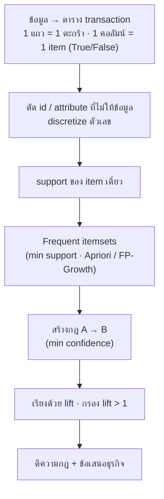

# FLOW 11 · Association Rules
> template: Python **T11** · RapidMiner **R11** · กลับ [[FLOW 00 START HERE]]

## โจทย์หน้าตาแบบนี้
*"สินค้าใดถูกซื้อด้วยกันบ่อย"* · *"หา frequent itemsets ที่ min support …"* · *"สร้างกฎ min confidence …"* ·
*"ตีความ support / confidence / lift"* · *"ถ้าเพิ่ม min support จะเกิดอะไร"* · *"Apriori ทีละขั้น"*

## นิยาม 3 ค่า (ต้องท่องได้)
| ค่า | สูตร | ตอบคำถาม |
|---|---|---|
| **support(A→B)** | P(A ∪ B) = จำนวนตะกร้าที่มีทั้ง A และ B / ทั้งหมด | กฎนี้เกิดบ่อยแค่ไหน (สำคัญพอจะสนใจไหม) |
| **confidence(A→B)** | support(A∪B) / support(A) = P(B \| A) | ถ้าซื้อ A แล้ว มีโอกาสซื้อ B เท่าไร |
| **lift(A→B)** | confidence / support(B) | ซื้อด้วยกันบ่อยกว่า "บังเอิญ" กี่เท่า · >1 บวก · =1 อิสระ · <1 ลบ (ทดแทนกัน) |

## ทีละขั้น

### ① แปลงเป็นตาราง transaction
- **ทำไม:** algorithm นับ "item อยู่ในตะกร้าไหม" → ต้องเป็นตาราง True/False
- รูปแบบที่พบ: ตะกร้าต่อบรรทัด · ตาราง 0/1 · `tid,item` · ตารางลูกค้า (age, income, pep) → item = `attr=value`
- RapidMiner: 0/1 → Numerical to Binominal · yes/no → Nominal to Binominal (`transform_binominal`) · **อยู่ที่:** T11 §1 · R11 A/B/C

### ② ตัด attribute ที่ไม่ให้ข้อมูล + discretize
- **id:** ไม่ซ้ำเลย → support ต่ำทุกค่า ไม่มีทาง frequent
- **ค่าเกือบคงที่** (เช่น current_act = YES 76%): จะโผล่ในกฎเกือบทุกข้อโดยไม่มีความหมาย
- **ตัวเลขต่อเนื่อง:** ทุกค่าแทบไม่ซ้ำ → ต้อง discretize (equal frequency ถ้าเบ้) ก่อน · ดู [[FLOW 02 Preprocessing & Leakage]]

### ③ item เดี่ยว
- ดูว่าอะไรขายดี และกี่ item ผ่าน min support · ตัวอย่าง T11 (groceries 9,835 ตะกร้า): whole milk 25.6% · 110 จาก 169 item ไม่ถึง 2% → ถูกตัดตั้งแต่รอบแรก

### ④ Frequent itemsets (Apriori)
- **Apriori principle:** ถ้า itemset ไม่ frequent → superset ทุกตัวก็ไม่ frequent (support ไม่มีทางเพิ่มเมื่อเพิ่ม item)
- **ทำไมสำคัญ:** ตัดผู้สมัครได้มหาศาล ไม่ต้องนับทุกชุด (169 item มี 2¹⁶⁹ ชุด)
- ลำดับ: C1 (นับ) → L1 (ผ่าน min sup) → C2 = จับคู่จาก L1 → **prune** ชุดที่มี subset ไม่อยู่ใน L → นับ → L2 → …
- FP-Growth ได้ผลเหมือนกันแต่เร็วกว่า (ไม่สร้าง candidate) — RapidMiner ใช้ตัวนี้
- ตัวอย่าง: min support 2% → 122 itemsets (1 item 59 · 2 item 61 · 3 item 2) · **อยู่ที่:** T11 §3, §7 (ทีละขั้น)

### ⑤ สร้างกฎ (min confidence)
- จาก itemset {A, B, C} สร้าง {A,B}→{C}, {A}→{B,C}, … เก็บที่ confidence ≥ min
- **ทำไมสองเกณฑ์:** support กรอง "เกิดบ่อยพอ" · confidence กรอง "เชื่อถือได้พอ"

### ⑥ เรียงด้วย lift ⭐
- **ทำไมไม่พอแค่ confidence:** ถ้า B ขายดีอยู่แล้ว (whole milk 25.6%) กฎ "อะไรก็ได้ → whole milk" จะ confidence สูงโดยไม่ได้สัมพันธ์จริง · lift หารด้วย support(B) ออก
- ตัวอย่าง T11: กฎอันดับ 1 {other vegetables, whole milk} → {root vegetables} · support **0.023** · confidence **0.310** · lift **2.84**

### ⑦ ตีความ (เขียนให้ครบ 3 ค่า)
> ตะกร้า 2.3% มีทั้งสามอย่าง (support) · คนที่ซื้อ other vegetables และ whole milk มี 31% ที่ซื้อ root vegetables ด้วย (confidence) ·
> ซึ่งสูงกว่าโอกาสปกติ 10.9% ถึง 2.84 เท่า (lift) → สัมพันธ์จริง · ข้อเสนอ: วางผักรากใกล้ผัก/นม · ทำโปรโมชันคู่

### ⑧ ผลของ min support / min confidence
| min support | itemsets | rules (conf ≥ 0.3) |
|---|---|---|
| 0.01 | 333 | 125 |
| 0.02 | 122 | 37 |
| 0.04 | 41 | 7 |
| 0.10 | 8 | 0 |

**อ่าน:** min support ↑ → itemset/กฎน้อยลงมาก (เหลือแต่ของขายดี) · ต่ำเกิน → กฎเยอะ ช้า และเป็นกฎของ item หายาก (เชื่อถือน้อย) · min confidence ↑ → กฎน้อยลงแต่น่าเชื่อถือขึ้น

## กับดัก
- รายงานแค่ confidence ไม่ดู lift
- ใส่ id หรือตัวเลขต่อเนื่องโดยไม่ discretize
- สับสน support ของกฎ (A∪B) กับ support ของ A
- min support เป็น "จำนวนครั้ง" แต่ใส่เป็นสัดส่วน (ต้องหารด้วยจำนวนตะกร้า)

## โครงคำตอบ
> แปลงเป็น … transaction × … item · ตัด … เพราะ … · discretize … แบบ equal frequency · min support … ได้ … itemsets · min confidence … ได้ … กฎ ·
> กฎที่ดีที่สุด (lift สูงสุด) {…} → {…}: support … confidence … lift … → (ตีความ 3 ค่า) · ข้อเสนอ … · ถ้าเพิ่ม min support เป็น … เหลือ … กฎ เพราะ …
