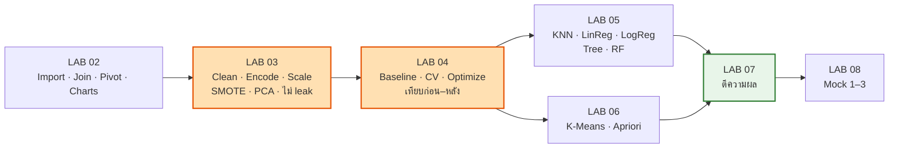

# 🧪 LAB 00 · START HERE
## คลังโน้ตเตรียมสอบ **Lab** (Final) — 01204465

> [!info] ข้อมูลสอบ (จาก `final/69_1_Guideline.pdf`)
> **Lab Examination:** วันจันทร์ที่ **12 ตุลาคม 2569** เวลา **09.00–12.00 น.** ห้อง **E11-S603**
> *"นิสิตสามารถใช้ **RapidMiner หรือ Python** ตามที่กำหนดในข้อสอบ"* → ต้องทำได้ **ทั้งสองเครื่องมือ**
> *"ข้อสอบจะเน้นทั้ง **ความเข้าใจในแนวคิด การเลือกวิธีที่เหมาะสม การสร้าง workflow อย่างถูกต้อง และการตีความผล** ไม่ใช่เพียงการจำคำสั่งหรือ syntax"*
> ชุด Lecture (สอบ 19 ต.ค.) อยู่ที่ [[LEC 00 START HERE]]

> [!danger] ทำก่อนอย่างอื่น → [[LAB 01 Setup & Exam-Day#✅ Checklist คืนนี้ (7 ต.ค.)]]
> ~~ติดตั้ง Operator Toolbox~~ ✅ ติดตั้งแล้ว (ตรวจ 10 ต.ค. — SMOTE recipe รันผ่าน) · ทดสอบ kernel **Python (dm-exam)** · ทดสอบ export PDF

> [!info] 🧭 ใหม่ (11 ต.ค.): **FLOW การแก้โจทย์แต่ละแบบ + เหตุผลของทุกขั้น** (12 บท พร้อม flowchart และผลจริง) → [[FLOW 00 START HERE]]

> [!tip] 🧰 ใหม่ (11 ต.ค.): **Template สอบ Python T01–T11** (เปลี่ยนแค่ CONFIG → Run All → ได้คำตอบ) อยู่ที่ `final/exam_templates/`
> [[exam_templates/00_INDEX|📇 INDEX: โจทย์ถามอะไร → ไฟล์ไหน]] · [[exam_templates/01_MANUAL|📘 คู่มือการใช้ cell]] · [[02_CELL_MAP|🗺️ ทุกจุดที่ต้องแก้]]
> **RapidMiner R01–R11** (process สำเร็จรูป คู่กับ T01–T11) อยู่ที่ `final/rm_templates/` → [[rm_templates/00_INDEX|📇 INDEX (RM)]] · [[rm_templates/01_MANUAL|📘 คู่มือ (RM)]] · [[02_OPERATOR_MAP|🗺️ operator ทุกตัว]]

> [!example] 🏋️ ใหม่ (10 ต.ค.): **โจทย์ฝึก 9 ชุด แบบทำตามทีละขั้น** แยก Python / RapidMiner → [[PR 00 START HERE]]
> ข้อมูลใหม่ (tips, penguins, wine, breast cancer, pima, heart, insurance, groceries) · ผลที่ควรได้ทุกขั้นมาจากการรันจริง

---

## 🗺️ แผนที่บท

| บท | หัวข้อ | guideline Lab | ⭐ |
|---|---|---|---|
| [[LAB 01 Setup & Exam-Day]] | เครื่อง · RapidMiner พื้นฐาน · error ที่เจอบ่อย · แผน 3 ชม. · โครงรายงาน | — | ⭐⭐⭐ |
| [[LAB 02 Data Handling & Visualization]] | import/inspect · **select · filter · set role · join · append · pivot** · กราฟ + ตีความ | Data Handling ทั้ง 4 ข้อ | ⭐⭐⭐ |
| [[LAB 03 Preprocessing Recipes]] | missing · encoding · scaling · discretization · **sampling/SMOTE** · **PCA 2D** · **split ไม่ leak** | Preprocessing ทั้ง 7 ข้อ | ⭐⭐⭐⭐ |
| [[LAB 04 Workflow, Baseline & Evaluation]] | **baseline 2 แบบ** · hold-out vs CV · **optimize** · เทียบก่อน–หลัง · metrics · เลือก metric | Model ข้อ 1–4, 6 | ⭐⭐⭐⭐ |
| [[LAB 05 Supervised Models]] | KNN (class + reg) · Linear Reg · **Logistic + threshold** · Decision Tree · **Random Forest** | Model ข้อ 5 | ⭐⭐⭐⭐ |
| [[LAB 06 Clustering & Association]] | K-Means + เลือก k + ตีความ centroid · Apriori/FP-Growth + support/confidence/lift | Model ข้อ 5 | ⭐⭐⭐ |
| [[LAB 07 Reading & Explaining Results]] | อ่าน output ทุกแบบ + เขียนตีความ 4 ขั้น | Model ข้อ 6 | ⭐⭐⭐⭐ |
| [[LAB 08 Mock Exams]] | ข้อสอบจำลอง 3 ชุด + เฉลยที่รันแล้ว | ทั้งหมด | ⭐⭐⭐⭐ |
| [[LAB 09 Cheat Sheet]] | template · helper · operator chain · default ที่ต่างกัน · ประโยคสำเร็จรูป | ทั้งหมด | ⭐⭐⭐ |



---

## 🎯 ชนิดโจทย์ → ทำอะไร (ตารางตัดสินใจเร็ว)

| โจทย์บอกว่า | ชนิดงาน | โมเดล | metric หลัก | Python | RapidMiner |
|---|---|---|---|---|---|
| ทำนาย **ใช่/ไม่ใช่** (ซื้อ, churn, อนุมัติ) | classification | baseline → KNN / LogReg / Tree / RF | F1 / recall / precision (ไม่สมดุล) · accuracy (สมดุล) | `DummyClassifier`, `cross_validate` | `Default Model`, `Cross Validation`, `Performance (Binominal…)` |
| ทำนาย **ตัวเลข** (ราคา, ยอดขาย) | regression | mean baseline → LinReg / KNN regressor | RMSE / MAE / R² | `DummyRegressor`, `KFold` | `Linear Regression`, `Performance (Regression)` |
| **แบ่งกลุ่ม** ลูกค้า (ไม่มี label) | clustering | K-Means | elbow · silhouette · DB · ตีความ centroid | `KMeans`, `silhouette_score` | `k-Means`, `Cluster Distance Performance` |
| **ซื้ออะไรคู่กัน** / profile ที่นำไปสู่ X | association | Apriori / FP-Growth | support · confidence · **lift** | `apriori`, `association_rules` | `FP-Growth`, `Create Association Rules` |
| **ข้อมูลไม่สมดุล** | classification + resampling | SMOTE/RUS ใน CV | F1/recall ของคลาสส่วนน้อย | `imblearn.Pipeline` | `SMOTE Upsampling` ใน Training pane |
| **ลดมิติ / ดูภาพ 2D** | PCA | — | explained variance · loadings | `PCA` | `Principal Component Analysis` |

---

## 🕳️ Gap ที่ต้องฝึก (จากการไล่งานเก่าทุกชิ้น W5–W14, HW5–HW10)

> [!warning] ไม่เคยทำเลย → ฝึกก่อน
> | เรื่อง | Python | RapidMiner | ฝึกที่ |
> |---|---|---|---|
> | Join / Append / Pivot | ❌ merge, pivot_table, concat แถว | ❌ Append, Pivot (Join เคยแค่ inner) | [[LAB 02 Data Handling & Visualization\|LAB 02]] · Mock 1 A |
> | Majority baseline | ❌ | ❌ Default Model | [[LAB 04 Workflow, Baseline & Evaluation\|LAB 04]] · Mock 1 C, Mock 2 B |
> | Cross Validation / Optimize | ✅ (W12–W14) | ❌ | LAB 04 · `optimize_knn_k.rmp` |
> | Logistic: proba + threshold + odds | ❌ | ❌ | [[LAB 05 Supervised Models\|LAB 05]] · Mock 1 D3 |
> | Random Forest | ❌ | ❌ | LAB 05 · Mock 1 C–D |
> | KNN regressor / ก่อน-หลัง scale | ❌ | ❌ | LAB 05 · Mock 2 C |
> | Discretize / SMOTE / PCA | ✅ บางส่วน | ❌ | [[LAB 03 Preprocessing Recipes\|LAB 03]] |
> | k-Means / FP-Growth | ✅ | ❌ | [[LAB 06 Clustering & Association\|LAB 06]] · Mock 3 |

**จุดแข็งที่ใช้ต่อได้ (งานของคุณเอง):** W13 (Pipeline + GridSearchCV + PCA) · W14 (imblearn Pipeline + SMOTE + `cross_val_predict`) · W12 (tree + StratifiedKFold) · W11/HW9 (K-Means + scaler ทำนายจุดใหม่) · W10/HW8 (fpgrowth/apriori) · W7 (RapidMiner Split → Normalize → k-NN → Apply Model ×2 = แบบที่ไม่ leak)

---

## 📅 ตารางอ่าน (4–5 ชม./วัน)

| วัน | อ่าน | ลงมือ (ทั้ง Python + RapidMiner) |
|---|---|---|
| **พ. 7 ต.ค. (คืนนี้)** | [[LAB 01 Setup & Exam-Day]] | ติดตั้ง Operator Toolbox · import recipe ทั้ง 12 ไฟล์ แล้วกด ▶ ทีละไฟล์ |
| **พฤ. 8 ต.ค.** | [[LAB 02 Data Handling & Visualization]] + [[LAB 03 Preprocessing Recipes]] | Drill ท้ายบท · สร้าง `join_append_pivot` และ `pca_bank` เองใน RapidMiner |
| **ศ. 9 ต.ค.** | [[LAB 04 Workflow, Baseline & Evaluation]] + [[LAB 05 Supervised Models]] | สร้าง CV + Default Model + Optimize + LogReg threshold + RF เองใน RapidMiner |
| **ส. 10 ต.ค.** | [[LAB 06 Clustering & Association]] + [[LAB 07 Reading & Explaining Results]] | **Mock 1 จับเวลา 3 ชม.** (Python + RapidMiner) |
| **อา. 11 ต.ค.** | [[LAB 09 Cheat Sheet]] + ทบทวน "สิ่งที่พลาด" | Mock 2 + Mock 3 (เน้นฝั่ง RapidMiner) · ชาร์จแบต · เช็กเครื่อง |
| **จ. 12 ต.ค.** | 07:30 อ่าน [[LAB 09 Cheat Sheet]] + กับดักใน LAB 01 | สอบ 09:00 |

---

## 🔬 ตรวจสอบแล้วอะไรบ้าง (เชื่อตัวเลขในโน้ตได้)

> [!success] ทุกอย่างในชุดนี้รันจริง
> - **โค้ด Python ทุกบล็อก** ใน LAB 02–09 รันผ่านด้วย `final/.venv` (สคริปต์ `final/obsidian/scripts/run_snippets.py`) และตัวเลขในข้อความมาจาก output จริง
> - **RapidMiner process 14 ไฟล์** (recipe 11 + mock 3) รันจริงด้วย batch runner (`final/mock_lab/run_rm.sh`) — ยกเว้นไฟล์ SMOTE ที่ต้องมี Operator Toolbox
> - **ตัวเลขเทียบกับสไลด์:** Riding Mowers threshold (p.72), Weather IG (p.39), BeautyCo rules (Apriori p.39), Utilities z-score (clustering p.30) ตรงกันทุกค่า
> - **ข้อค้นพบที่ต้องรู้:** RapidMiner z-score ใช้ n−1 · Linear Regression default = M5 prime · Decision Tree default = gain_ratio · Avg. within centroid distance / Davies Bouldin แสดงติดลบ · positive class ต้องตั้งเองใน Performance · `Set Positive Value` ไม่มีผลกับ Performance · pandas 3 ใช้ dtype `str`

**สร้างใหม่ทั้งหมด:**
```bash
cd ~/Projects/"data mining"
final/.venv/bin/python final/data/make_slide_datasets.py          # ข้อมูลจากสไลด์
final/.venv/bin/python final/mock_lab/make_data.py                # ข้อมูล mock
final/.venv/bin/python final/mock_lab/recipes/build_recipes.py    # recipe .rmp
final/.venv/bin/python final/mock_lab/build_mock_rmp.py           # mock .rmp
final/.venv/bin/python final/mock_lab/build_mocks.py              # mock notebooks
bash final/mock_lab/run_rm.sh final/mock_lab/recipes/*.rmp        # ตรวจ RapidMiner (Java 17)
final/.venv/bin/python final/obsidian/scripts/run_snippets.py final/obsidian/lab/*.md
```
