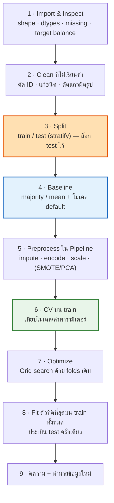

# LAB 04 · Workflow, Baseline & Evaluation
### สร้าง baseline → ประเมินด้วย hold-out / CV → optimize → เทียบก่อน-หลัง

> [!abstract] guideline Lab ข้อ "Model Construction and Evaluation"
> 1. **สร้าง baseline model** → [[#4.3 Baseline 2 แบบ ⭐⭐⭐]]
> 2. **Train และ evaluate ด้วย hold-out หรือ cross-validation** → [[#4.4 Hold-out vs Cross-Validation ⭐⭐⭐]]
> 3. **Optimize model parameters** → [[#4.5 Optimize Parameters ⭐⭐⭐]]
> 4. **เปรียบเทียบผลก่อนและหลัง preprocessing หรือ optimization** → [[#4.6 ตารางเทียบก่อน–หลัง ⭐⭐⭐]]
> 5. สร้างโมเดลแต่ละชนิด → [[LAB 05 Supervised Models]] · [[LAB 06 Clustering & Association]]
> 6. **อ่านและอธิบายผลลัพธ์จากกราฟ ตาราง และ evaluation metrics** → [[#4.7 Metrics — คำนวณและอ่าน ⭐⭐⭐]] + [[LAB 07 Reading & Explaining Results]]

**ลิงก์:** [[LAB 00 START HERE|หน้าหลัก Lab]] · ก่อนหน้า [[LAB 03 Preprocessing Recipes]] · ถัดไป [[LAB 05 Supervised Models]] · ทฤษฎี: [[LEC 05 Model Construction & Evaluation]]

> [!warning] 🕳️ Gap ของคุณในบทนี้
> - **ไม่เคยสร้าง majority-class baseline** (`DummyClassifier` / RapidMiner `Default Model`) — W14 แค่คำนวณ 73.5% ด้วยมือ · W13 sheet ระบุเป็น learning outcome ข้อแรก: *"Distinguish a majority class baseline from a predictive model baseline"*
> - RapidMiner: **ไม่เคยใช้ `Cross Validation` และ `Optimize Parameters (Grid)`** (W7 ใช้แค่ Split Data + accuracy)
> - **ไม่เคยวัดผล "ก่อน vs หลัง scaling"** ในงานใดเลย

---

## 4.1 Workflow มาตรฐาน — จำลำดับนี้ให้ได้ (closed-book)



> ตรงกับ "Steps of Data Classification" ในสไลด์ KNN p.10: Training data → Model Construction → **Model Evaluation (Testing data)** → ถ้าไม่ผ่านวนกลับ → Classification of unseen data

---

## 4.2 Training / Validation / Testing data ⭐⭐

| ชุด | ใช้ทำอะไร | ห้ามทำ |
|---|---|---|
| **Training** | fit โมเดล + fit preprocessing | — |
| **Validation** (หรือ fold ใน CV) | **เลือก** โมเดล / hyperparameter (เช่น k ของ KNN — สไลด์ KNN p.37: *"choose k with lowest error rate in **validation data**"*) | ใช้รายงานผลสุดท้าย (เพราะถูกใช้เลือกแล้ว จึงมองโลกในแง่ดีเกินไป) |
| **Test** | วัดผลครั้งสุดท้ายครั้งเดียว | tune อะไรก็ตามจากผล test |

```python
import numpy as np
import pandas as pd
import matplotlib.pyplot as plt
from sklearn.model_selection import train_test_split

ads = pd.read_csv("W12/Social_Network_Ads_2.csv")
ads["Gender"] = (ads["Gender"] == "Male").astype(int)        # binary → 0/1 ได้เลย
X = ads[["Gender", "Age", "EstimatedSalary"]]
y = ads["Purchased"]
print(y.value_counts(normalize=True).round(4))               # 0: 0.6425 · 1: 0.3575

# hold-out แบบ 3 ชุด: 60 / 20 / 20 — split 2 รอบ
X_tmp, X_test, y_tmp, y_test = train_test_split(X, y, test_size=0.2, stratify=y, random_state=42)
X_train, X_val, y_train, y_val = train_test_split(X_tmp, y_tmp, test_size=0.25, stratify=y_tmp, random_state=42)
print(len(X_train), len(X_val), len(X_test))                  # 240 80 80
```

> **`stratify=y`** = รักษาสัดส่วนคลาสในทุกชุดให้เท่าข้อมูลเดิม — **ใส่ทุกครั้งในงาน classification** (โดยเฉพาะข้อมูลไม่สมดุล)
> RapidMiner `Split Data`: **sampling type** = `stratified sampling` (สไลด์ KNN p.57 ใช้ 0.8/0.2 · seed 1992)

---

## 4.3 Baseline 2 แบบ ⭐⭐⭐

> [!important] ต้องแยกให้ออก (W13 learning outcome ข้อ 1)
> | | **Majority / naive baseline** | **Predictive-model baseline** |
> |---|---|---|
> | คืออะไร | ทาย **คลาสที่พบบ่อยสุด** ทุกแถว (classification) · ทาย **ค่าเฉลี่ย** ทุกแถว (regression) | โมเดลจริงด้วย **ค่าเริ่มต้น** ยังไม่ tune (เช่น KNN k = 5) |
> | ตอบคำถาม | *"โมเดลของเรามีประโยชน์กว่าการไม่ใช้โมเดลเลยไหม"* | *"การ tune / preprocessing เพิ่มทำให้ดีขึ้นจริงไหม"* |
> | สไลด์ | KNN p.39: **"k = n is the same as the naïve rule (classify all records according to majority class)"** | W13 Part I: *"Default KNN Baseline… k = 5, do not optimize any parameter yet"* |
> | Python | `DummyClassifier(strategy="most_frequent")` · `DummyRegressor(strategy="mean")` | `KNeighborsClassifier()` |
> | RapidMiner | **`Default Model`** (method = `mode` / `average` / `median`) | learner ค่า default |

```python
from sklearn.dummy import DummyClassifier
from sklearn.metrics import accuracy_score, precision_score, recall_score, f1_score, confusion_matrix

majority = DummyClassifier(strategy="most_frequent").fit(X_train, y_train)
pred = majority.predict(X_test)
print("accuracy :", accuracy_score(y_test, pred))                       # 0.6375 = สัดส่วนคลาส 0
print("recall   :", recall_score(y_test, pred))                         # 0.0 — ไม่เคยทายคลาส 1 เลย
print("precision:", precision_score(y_test, pred, zero_division=0))     # 0.0 (ไม่มีการทาย 1 → หารศูนย์)
print(confusion_matrix(y_test, pred))
```

> [!important] ⭐ ประโยคที่ต้องเขียนได้
> *"majority baseline ได้ accuracy **63.75%** โดยไม่ได้เรียนรู้อะไรเลย (ทาย 'ไม่ซื้อ' ทุกคน) และ recall ของคลาสซื้อ = **0** → โมเดลที่ดีต้องได้ accuracy **สูงกว่า 63.75% อย่างชัดเจน** และต้องมี recall > 0 · นี่คือเหตุผลที่ accuracy อย่างเดียวหลอกได้ถ้าข้อมูลไม่สมดุล"*

### ⚙️ RapidMiner — `Default Model`
- ใช้แทน learner ใน Training pane ได้เลย (มี port tra → mod เหมือน learner ทั่วไป)
- **method:** `mode` (classification — ทายคลาสบ่อยสุด) · `average` / `median` (regression) · `constant` · `attribute`
- เทียบใน process เดียว: `Multiply` ข้อมูลเป็น 2 ทาง → `Cross Validation (Default Model)` และ `Cross Validation (k-NN)` → ดูผลสองแท็บคู่กัน

---

## 4.4 Hold-out vs Cross-Validation ⭐⭐⭐

| | **Hold-out** | **k-fold Cross-Validation** |
|---|---|---|
| วิธี | แบ่งครั้งเดียว (เช่น 80/20) | แบ่ง k ส่วน · train k−1 ส่วน test 1 ส่วน · วน k รอบ · **เฉลี่ย** |
| ใช้เมื่อ | ข้อมูลเยอะ (สไลด์: *"Hold-out is used when there is a large amount of data"*) | ข้อมูลน้อย–ปานกลาง · ต้องการผลที่เสถียร |
| ข้อดี | เร็ว · ง่าย | ทุกแถวได้เป็น test 1 ครั้ง · ได้ **mean ± std** |
| ข้อเสีย | ผลแกว่งตามการสุ่มแบ่ง | ช้ากว่า k เท่า |
| สไลด์ | KNN p.52 · Tree p.73 | Tree p.73–76 (ตัวอย่าง 5-fold: 80/88/85/78/84 → เฉลี่ย **83%**) · LOOCV = k = n (p.75) |

### 🐍 Python — CV ที่ถูกต้อง

```python
from sklearn.pipeline import Pipeline
from sklearn.preprocessing import StandardScaler
from sklearn.neighbors import KNeighborsClassifier
from sklearn.model_selection import StratifiedKFold, cross_validate, cross_val_predict

cv = StratifiedKFold(n_splits=10, shuffle=True, random_state=42)    # สร้างครั้งเดียว ใช้ซ้ำทุกโมเดล = folds เดียวกัน
knn5 = Pipeline([("scale", StandardScaler()), ("knn", KNeighborsClassifier(n_neighbors=5))])

res = cross_validate(knn5, X, y, cv=cv, scoring=["accuracy", "precision", "recall", "f1"])
summary = pd.DataFrame({m: [res[f"test_{m}"].mean(), res[f"test_{m}"].std()]
                        for m in ["accuracy", "precision", "recall", "f1"]},
                       index=["mean", "std"]).round(4)
print(summary)

# confusion matrix จาก CV — แต่ละแถวถูกทำนายตอนที่มันอยู่ใน test fold (แบบ W14)
cm = confusion_matrix(y, cross_val_predict(knn5, X, y, cv=cv))
print(cm)
```

> ⚠️ RapidMiner 10-fold CV ของ k-NN (k=5, Z-normalize ใน training) บนข้อมูลนี้ได้ accuracy **0.905** precision **0.851** recall **0.894** F1 **0.870** (รันจริงด้วย `final/mock_lab/recipes/knn_cv_normalize.rmp`) — ใกล้กับ Python แต่ไม่เท่าเป๊ะเพราะ folds สุ่มต่างกันและ z-score ใช้ n−1 vs n

### ⚙️ RapidMiner — `Cross Validation`
- **number of folds** = 10 (หรือ 5) · **sampling type** = `stratified sampling` · ✅ use local random seed (ให้ผลซ้ำได้)
- ดับเบิลคลิกเข้าไปข้างใน → มี 2 pane:
  - **Training** (ซ้าย): `tra` → [preprocessing] → learner → `mod`
  - **Testing** (ขวา): `mod` + `tes` → `Apply Model` → `Performance (...)` → `per`
- ผล: **PerformanceVector** แสดง `accuracy: 90.50% +/- 6.10% (micro average: 90.50%)` = **mean ± std ข้าม fold** + confusion matrix รวม
- ต้องการโมเดลสุดท้าย: port **mod** ด้านนอก = โมเดลที่ train บน **ข้อมูลทั้งหมด** หลังจบ CV

---

## 4.5 Optimize Parameters ⭐⭐⭐

**หลักการ:** ลองค่าพารามิเตอร์หลายชุด **ด้วย CV folds เดิม** → เลือกชุดที่ metric หลักดีที่สุด (W13 Part II: *"Keep all folds, preprocessing, seed, and metrics unchanged"*)

```python
from sklearn.model_selection import GridSearchCV

grid = GridSearchCV(knn5, param_grid={"knn__n_neighbors": list(range(1, 31, 2)),
                                      "knn__weights": ["uniform", "distance"]},
                    scoring=["accuracy", "recall", "f1"], refit="f1", cv=cv)
grid.fit(X, y)
print("best:", grid.best_params_, "F1 =", round(grid.best_score_, 4))

# ตาราง 5 อันดับแรก (โจทย์ W13 ขอแบบนี้)
cols = ["param_knn__n_neighbors", "param_knn__weights", "mean_test_accuracy", "mean_test_recall", "mean_test_f1"]
top5 = (pd.DataFrame(grid.cv_results_)[cols]
          .sort_values("mean_test_f1", ascending=False).head(5).round(4))
print(top5.to_string(index=False))
```

```python
# กราฟ "metric vs k" — ใช้อธิบายการเลือก k (เหมือนตาราง error vs k ในสไลด์ KNN p.42–43)
cvres = pd.DataFrame(grid.cv_results_)
uni = cvres[cvres["param_knn__weights"] == "uniform"]
plt.figure(figsize=(6, 3.5))
plt.plot(uni["param_knn__n_neighbors"], uni["mean_test_f1"], marker="o")
plt.xlabel("k"); plt.ylabel("CV F1"); plt.title("Choosing k (uniform weights)")
plt.savefig("/tmp/lab04_k.png", dpi=100)
```

> [!tip] เลือก scoring ให้ตรงโจทย์
> `refit="f1"` = เลือกโมเดลจาก F1 · ถ้าโจทย์บอก *"อยากหาลูกค้าที่จะซื้อให้ได้มากที่สุด"* → **recall** · *"ไม่อยากรบกวนลูกค้าที่ไม่สนใจ"* → **precision** · ข้อมูลสมดุล + ผิดพลาดสองแบบเสียหายพอกัน → accuracy

### ⚙️ RapidMiner — `Optimize Parameters (Grid)`

```
Retrieve → … → Optimize Parameters (Grid)
                └─ ข้างใน: Cross Validation [Training: Normalize → k-NN → Group Models | Testing: Apply Model → Performance]
                           → Log (บันทึกทุกรอบ)
```
1. ลาก `Optimize Parameters (Grid)` → ดับเบิลคลิกเข้าไป → วาง `Cross Validation` (ตัวเดิม) ไว้ข้างใน → ต่อ `per` ของ CV ไปที่ **per** ของขอบขวา
2. กด **Edit Parameter Settings…** → ช่องซ้ายเลือก operator **k-NN** → ช่องกลางเลือกพารามิเตอร์ **k** → กด ➡ → ตั้ง **Min 1 · Max 10 · Steps 9 · Scale linear** (= 1, 2, …, 10) — หรือเลือก **List** แล้วพิมพ์ค่าเอง
3. **metric ที่ใช้เลือก = "main criterion" ของ operator Performance** ใน Testing pane → ตั้ง **main criterion = f_measure** (ถ้าปล่อย `first` จะใช้ตัวแรกที่ติ๊ก ซึ่งมักเป็น accuracy)
4. ดู **ทุกแถว** (ไม่ใช่แค่ตัวดีที่สุด): ใส่ operator **`Log`** ต่อจาก CV ใน Optimize (per → through) → **log → Edit List**: (`k` ← operator *k-NN* · parameter *k*) · (`f_measure` ← operator *Cross Validation* · value **performance main criterion**) → นอก Optimize ใส่ **`Log to Data`** (log name = Log) → ได้ตาราง/กราฟ k vs F1 (แบบเดียวกับสไลด์ clustering p.31) · ไฟล์ที่รันทดสอบแล้ว: `final/mock_lab/recipes/optimize_knn_k.rmp`
5. ผล: **ParameterSet** (ค่าที่ดีที่สุด เช่น `k-NN.k = 7`) + **PerformanceVector** ของค่านั้น

> [!example] ผลจริงจาก RapidMiner (10-fold, seed 42, main criterion = f_measure)
> | k | 1 | 3 | 5 | 6 | 9 | **11** | **12** | 13 | 15 |
> |---|---|---|---|---|---|---|---|---|---|
> | F1 | 0.799 | 0.843 | 0.871 | 0.874 | 0.873 | **0.880** | **0.880** | 0.876 | 0.869 |
>
> RapidMiner เลือก **k = 11** (เสมอกับ 12 → เลือกตัวแรก) · Python เลือก k = 5 (F1 0.880) — **คนละ folds คนละ z-score (n−1 vs n) จึงได้ k ต่างกัน** แต่ F1 ช่วง k = 5–13 ต่างกันไม่ถึง 0.01 → ในรายงานเขียนได้ว่า *"ช่วง k ประมาณ 5–13 ให้ผลใกล้เคียงกัน เลือก k ที่ดีที่สุดตาม CV"*

> [!warning] กับดัก Optimize
> - ถ้า CV อยู่ **นอก** Optimize (หรือใช้ Split Data ชุดเดียว) = เลือก k จาก test set → ผลที่รายงานดีเกินจริง
> - ต้องตั้ง **local random seed ของ CV ให้คงที่** ไม่งั้นแต่ละค่า k ได้ folds คนละแบบ → เทียบกันไม่แฟร์
> - Optimize **2 พารามิเตอร์** (เช่น PCA components × k ใน W13 Part III) = เพิ่มอีกแถวใน Edit Parameter Settings → ลองทุกคู่ (grid)

---

## 4.6 ตารางเทียบก่อน–หลัง ⭐⭐⭐

**helper ที่ใช้ได้ทุกข้อสอบ** — ให้ทุกโมเดลถูกประเมินด้วย folds เดียวกันและ metric ชุดเดียวกัน แล้วต่อแถวลงตาราง

```python
def evaluate(name, model, X, y, cv=cv, settings=""):
    """CV แล้วคืน 1 แถว: mean ของทุก metric — ใช้ต่อกันเป็นตารางเปรียบเทียบ"""
    r = cross_validate(model, X, y, cv=cv, scoring=["accuracy", "precision", "recall", "f1"])
    row = {"model": name, "settings": settings}
    row.update({m: r[f"test_{m}"].mean() for m in ["accuracy", "precision", "recall", "f1"]})
    return row

rows = [
    evaluate("Majority baseline", DummyClassifier(strategy="most_frequent"), X, y),
    evaluate("KNN raw (ไม่ scale)", KNeighborsClassifier(n_neighbors=5), X, y, settings="k=5"),
    evaluate("KNN + StandardScaler", knn5, X, y, settings="k=5"),
    evaluate("KNN optimized", grid.best_estimator_, X, y, settings=str(grid.best_params_)),
]
comparison = pd.DataFrame(rows).round(4)
print(comparison.to_string(index=False))
```

> [!example] ผลจริงจากโค้ดข้างบน (10-fold stratified CV, seed 42)
> | model | settings | accuracy | precision | recall | F1 |
> |---|---|---|---|---|---|
> | Majority baseline | — | 0.6425 | 0.0000 | 0.0000 | 0.0000 |
> | KNN raw (ไม่ scale) | k=5 | 0.8025 | 0.7638 | 0.6629 | 0.7022 |
> | KNN + StandardScaler | k=5 | **0.9125** | **0.8630** | **0.9019** | **0.8804** |
> | KNN optimized | k=5, uniform | 0.9125 | 0.8630 | 0.9019 | 0.8804 |
>
> **เขียนสรุปได้ว่า:** *"ทุกโมเดลดีกว่า majority baseline (accuracy 64.25%, F1 = 0) · **การ standardize ช่วยมากที่สุด** — F1 เพิ่มจาก 0.702 เป็น 0.880 (+0.178) เพราะ EstimatedSalary (หลักหมื่น) ครองระยะทางจน Age แทบไม่มีผล · grid search k = 1–29 ได้ k = 5 ซึ่ง**เท่ากับค่า default** → การ optimize ไม่ได้ทำให้ดีขึ้น (ค่า default เหมาะอยู่แล้ว) · เลือก KNN k = 5 + StandardScaler"*
> ⚠️ **ผล optimize "ไม่ดีขึ้น" ก็เป็นคำตอบที่ถูกได้** (W13: PCA ไม่ช่วย) — สิ่งที่โดนหักคะแนนคือ "ไม่ได้อธิบายว่าทำไม"

> [!important] ⭐ วิธีเขียนสรุปตารางเปรียบเทียบ (โจทย์ "เปรียบเทียบผลก่อนและหลัง…")
> 1. **เทียบกับ baseline:** *"ทุกโมเดลดีกว่า majority baseline (accuracy 64%) อย่างชัดเจน"*
> 2. **ผลของ preprocessing:** *"KNN ที่ไม่ scale ได้ F1 [ต่ำ] เพราะ EstimatedSalary (หลักหมื่น) ครองระยะทาง เมื่อ standardize แล้ว F1 เพิ่มเป็น [x] → scaling จำเป็นสำหรับ KNN"*
> 3. **ผลของ optimization:** *"การ tune k เพิ่ม F1 จาก [a] เป็น [b] (+[b−a]) — ดีขึ้นเล็กน้อย/ชัดเจน"*
> 4. **เลือกโมเดล + เหตุผล:** อิง metric ที่ตรงกับเป้าหมายธุรกิจ · ถ้าต่างกันน้อยมากเลือกตัวที่ง่ายกว่า (parsimony)

---

## 4.7 Metrics — คำนวณและอ่าน ⭐⭐⭐

### Classification

```python
from sklearn.metrics import classification_report, ConfusionMatrixDisplay

best = grid.best_estimator_.fit(X_train, y_train)
pred = best.predict(X_test)
cm = confusion_matrix(y_test, pred, labels=[0, 1])      # แถว = actual · คอลัมน์ = predicted (sklearn)
tn, fp, fn, tp = cm.ravel()
print(f"TN={tn} FP={fp} FN={fn} TP={tp}")
print(classification_report(y_test, pred, digits=3))
ConfusionMatrixDisplay(cm, display_labels=["No (0)", "Buy (1)"]).plot()
plt.savefig("/tmp/lab04_cm.png", dpi=100)
```

| Metric | สูตร | ตอบคำถาม | sklearn |
|---|---|---|---|
| **Accuracy** | $\frac{TP+TN}{TP+TN+FP+FN}$ | ทายถูกกี่ % ทั้งหมด | `accuracy_score` |
| **Precision** | $\frac{TP}{TP+FP}$ | ที่ทายว่า positive ถูกจริงกี่ % | `precision_score` |
| **Recall** | $\frac{TP}{TP+FN}$ | positive จริงทั้งหมด หาเจอกี่ % | `recall_score` |
| **F1** | $\frac{2PR}{P+R}$ | สมดุล P กับ R | `f1_score` |

> [!warning] orientation ของ confusion matrix
> **sklearn:** แถว = actual, คอลัมน์ = predicted, เรียง label จากน้อยไปมาก (0, 1) → `ravel()` ได้ **TN, FP, FN, TP**
> **สไลด์ KNN p.62:** แถว = actual, คอลัมน์ = predicted แต่ **positive ขึ้นก่อน** (a = TP, b = FN, c = FP, d = TN) · p.64 เตือนว่าบางที่สลับแถว/คอลัมน์
> **RapidMiner:** แถว = **pred.**, คอลัมน์ = **true** (กลับกับ sklearn!) → อ่านหัวตารางทุกครั้ง

### Regression

```python
from sklearn.dummy import DummyRegressor
from sklearn.linear_model import LinearRegression
from sklearn.metrics import mean_absolute_error, mean_squared_error, root_mean_squared_error, r2_score

boston = pd.read_csv("W8/boston_r.csv")
Xr, yr = boston.drop(columns="medv"), boston["medv"]
Xr_tr, Xr_te, yr_tr, yr_te = train_test_split(Xr, yr, test_size=0.2, random_state=42)

def reg_row(name, model):
    p = model.fit(Xr_tr, yr_tr).predict(Xr_te)
    return {"model": name, "MAE": mean_absolute_error(yr_te, p), "MSE": mean_squared_error(yr_te, p),
            "RMSE": root_mean_squared_error(yr_te, p), "R2": r2_score(yr_te, p)}

print(pd.DataFrame([reg_row("Mean baseline", DummyRegressor(strategy="mean")),
                    reg_row("Linear Regression", LinearRegression())]).round(3).to_string(index=False))
```

| Metric | สูตร | อ่านว่า |
|---|---|---|
| **MAE** | $\frac{1}{n}\sum\lvert y-\hat y\rvert$ | ทายพลาดเฉลี่ยกี่หน่วย (หน่วยเดียวกับ y) |
| **MSE** | $\frac{1}{n}\sum (y-\hat y)^2$ | หน่วยยกกำลังสอง · ลงโทษ error ใหญ่หนัก |
| **RMSE** | $\sqrt{\text{MSE}}$ | หน่วยเดียวกับ y · ≥ MAE เสมอ |
| **R²** | $1-\frac{SSE}{SST}$ | สัดส่วนความแปรปรวนของ y ที่อธิบายได้ · **mean baseline ได้ R² ≈ 0** (บน test อาจติดลบเล็กน้อย) |

> รายละเอียด + ตัวอย่างคำนวณมือ: [[09 Regression Analysis#9.8 Prediction Errors ⭐⭐⭐ (guideline ข้อ 8.5 "Different types of prediction errors")]] (มิดเทอม)

### ⚙️ RapidMiner — Performance operators

| Operator | ใช้เมื่อ | ติ๊กอะไร |
|---|---|---|
| **`Performance (Binominal Classification)`** | label 2 คลาส | accuracy · precision · recall · **f measure** · AUC · ตั้ง **main criterion** |
| **`Performance (Classification)`** | หลายคลาส | accuracy · kappa · weighted mean recall/precision |
| **`Performance (Regression)`** | label ตัวเลข | **root mean squared error** · **absolute error** (= MAE) · **squared error** (= MSE) · **squared correlation** (≈ R² ของ linear regression) |
| `Performance` (ตัวทั่วไป) | ไม่แน่ใจ | เลือก metric ให้อัตโนมัติตามชนิด label |

> ⚠️ **squared correlation ≠ R² เสมอไป** — เท่ากันเมื่อเป็น linear regression ที่ประเมินบนข้อมูลที่ fit · บน test set ให้คำนวณ R² เองจาก SSE/SST ถ้าโจทย์ถาม "R²" ตรง ๆ (หรือเขียนกำกับว่าใช้ squared correlation แทน)

---

## 4.8 เลือก Metric ให้เหมาะกับปัญหา ⭐⭐⭐

| สถานการณ์ | metric หลัก | เหตุผล |
|---|---|---|
| ข้อมูลสมดุล ผิดสองแบบเสียหายพอกัน | **Accuracy** | — |
| **ข้อมูลไม่สมดุล** (fraud, churn, โรค) | **F1 / Recall / Precision ของคลาสส่วนน้อย** (ไม่ใช่ accuracy) | majority baseline ได้ accuracy สูงโดยไม่มีประโยชน์ (สไลด์ Imbalanced p.11: accuracy 95.5% แต่ recall fraud 25%) |
| พลาด positive แพงมาก (โรค, fraud, **"หาลูกค้าให้ได้มากที่สุด"**) | **Recall** | FN แพง |
| แจ้งเตือนผิดแพง (spam filter, แคมเปญราคาแพง) | **Precision** | FP แพง |
| ต้องการสมดุล | **F1** | สไลด์ KNN p.78: *"A balanced option for imbalanced datasets"* |
| Regression ทั่วไป | **RMSE** (ลงโทษ error ใหญ่) / **MAE** (ตีความง่าย) | R² ไว้บอก "อธิบายได้กี่ %" |

---

## 🏋️ Drills (closed-book)

> [!question]- D1. ข้อมูล fraud 1,000 แถว มี fraud 20 แถว โมเดล A ได้ accuracy 98% โมเดล B ได้ 95.5% ควรสรุปว่า A ดีกว่าไหม ต้องดูอะไรเพิ่ม
> **ยังสรุปไม่ได้** — majority baseline (ทาย legit ทุกแถว) ได้ 980/1000 = **98%** พอดี → A อาจไม่ได้เรียนรู้อะไรเลย ต้องดู **confusion matrix, recall และ F1 ของคลาส fraud** (เคสสไลด์ Imbalanced p.11: B มี recall fraud 25%, A ถ้าเป็น baseline มี 0%)

> [!question]- D2. 5-fold CV ได้ accuracy 0.80, 0.88, 0.85, 0.78, 0.84 รายงานผลอย่างไร
> mean = 4.15/5 = **0.83** · std ≈ 0.037 → *"accuracy 83.0% ± 3.7%"* (สไลด์ Tree p.74: Final Accuracy = ค่าเฉลี่ยของทุกรอบ)

> [!question]- D3. นักศึกษาคนหนึ่ง tune k ของ KNN โดยดู accuracy บน test set ทีละค่า แล้วรายงาน accuracy ที่ดีที่สุดบน test นั้น ผิดอย่างไร แก้อย่างไร
> test set ถูกใช้ **เลือก** k แล้ว จึงไม่ใช่ข้อมูลที่โมเดลไม่เคยเห็นอีกต่อไป → ผลดีเกินจริง (optimistic bias) · แก้: tune ด้วย **CV บน train** (หรือ validation set แยก) แล้วประเมิน test **ครั้งเดียว** ตอนท้าย

> [!question]- D4. (RapidMiner) Optimize Parameters ให้ผลว่า k = 1 ดีที่สุด แต่ performance ที่ใช้เลือกคือ accuracy ทั้งที่โจทย์ต้องการ recall แก้ตรงไหน
> เข้าไปใน Testing pane ของ Cross Validation → operator `Performance (Binominal Classification)` → ติ๊ก recall และตั้ง **main criterion = recall** → รัน Optimize ใหม่ (Optimize ใช้ main criterion ในการเลือก)

> [!question]- D5. confusion matrix: TP = 30, FN = 10, FP = 20, TN = 140 จงหา accuracy, precision, recall, F1
> accuracy = 170/200 = **0.85** · precision = 30/50 = **0.60** · recall = 30/40 = **0.75** · F1 = 2(0.6)(0.75)/(1.35) = **0.667**

---

**ถัดไป →** [[LAB 05 Supervised Models]] · **กลับหน้าหลัก →** [[LAB 00 START HERE]]
