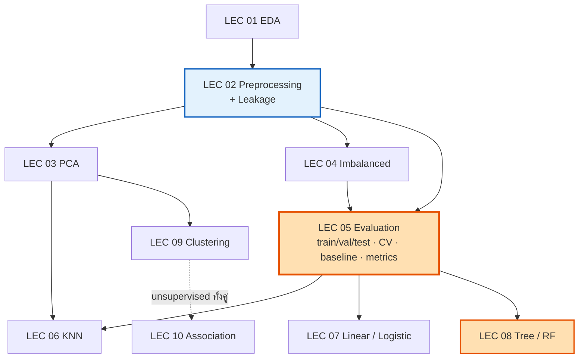

# 📘 LEC 00 · START HERE
## คลังโน้ตเตรียมสอบ **Lecture** (Final) — 01204465

> [!info] ข้อมูลสอบ (จาก `final/69_1_Guideline.pdf`)
> **Lecture Examination:** วันจันทร์ที่ **19 ตุลาคม 2569** เวลา **16.00–19.00 น.** ห้อง **E11-S603**
> guideline มี **6 หมวด** ด้านล่าง · ไม่รู้รูปแบบข้อสอบ → เตรียมทั้ง **แนวคิด · คำนวณ · อ่านตาราง/กราฟ · สถานการณ์ · หาที่ผิด**
> ชุด Lab (สอบ 12 ต.ค.) อยู่ที่ [[LAB 00 START HERE]] — หลายเรื่องซ้ำกัน ทำ Lab แล้วจะได้เปรียบ

---

## 🗺️ แผนที่บท ↔ guideline

| guideline หมวด | บท | สไลด์ต้นทาง | ⭐ |
|---|---|---|---|
| **1. EDA** — summary stats · เลือกกราฟ · correlation + ข้อจำกัด | [[LEC 01 EDA Review]] | EDA (มิดเทอม) | ⭐⭐ |
| **2. Preprocessing** — missing/outlier · scaling · encoding/discretization · feature selection · **leakage** | [[LEC 02 Preprocessing, Feature Selection & Leakage]] | Pre-processing (มิดเทอม) · KNN p.52–60 | ⭐⭐⭐ |
| 2. (ต่อ) **PCA** — concept · #components · explained variance · loadings · visualization | [[LEC 03 PCA]] | DimReduction_and_PCA (27) | ⭐⭐⭐ |
| 2. (ต่อ) **Imbalanced** — under/over/SMOTE · **sampling เฉพาะ train** | [[LEC 04 Imbalanced Classification]] | imbalanced (24) | ⭐⭐⭐ |
| **3. Model construction & evaluation** — workflow · train/val/test · hold-out/CV · **baseline** · metrics · เลือก metric | [[LEC 05 Model Construction & Evaluation]] | KNN p.5–13, 52–78 · Tree p.73–76 | ⭐⭐⭐⭐ |
| **4.1 KNN** — concept · distance · k · class/prediction | [[LEC 06 KNN]] | KNN (78) | ⭐⭐⭐ |
| **4.2–4.3 Linear & Logistic** — equation · coef · prediction · **probability · threshold** | [[LEC 07 Linear & Logistic Regression]] | Regression (มิดเทอม) · KNN p.14–24 | ⭐⭐⭐ |
| **4.4 Tree & Random Forest** — construction · parameters · **overfitting** · evaluation | [[LEC 08 Decision Trees & Random Forest]] | Tree (77) | ⭐⭐⭐⭐ |
| **5. Clustering** — K-Means · เลือก k · cohesion/separation/interpretability | [[LEC 09 Clustering]] | basic_clustering (59) | ⭐⭐⭐ |
| **6. Association** — transaction prep · Apriori · rule generation · support/conf/lift | [[LEC 10 Association Rules]] | apriori_basic (41) · Agrawal_94 | ⭐⭐⭐ |

| เครื่องมือ | ใช้เมื่อ |
|---|---|
| [[LEC 11 Formula Sheet]] | ทวนรอบสุดท้าย — สูตรทั้งหมดในหน้าเดียว |
| [[LEC 12 Glossary EN-TH]] | ศัพท์ + **19 คู่ที่สับสนบ่อย** |
| [[LEC 13 Exam Drills]] | ฝึกจับเวลา: A แนวคิด 18 · B คำนวณ 16 · C อ่านผล 7 · D สถานการณ์ 5 · E หาที่ผิด 12 · กับดัก 15 ข้อ |



---

## 🔥 หัวข้อที่ "ออกแน่" (เรียงตามความมั่นใจ)

> [!important] ระดับ 1 — guideline ระบุชื่อตรง + สไลด์ให้ตัวอย่างตัวเลข
> | หัวข้อ | ไปที่ |
> |---|---|
> | Confusion matrix → accuracy / precision / recall / F1 | [[LEC 05 Model Construction & Evaluation#5.6 Confusion Matrix และ Classification Metrics ⭐⭐⭐⭐]] |
> | เลือก metric สำหรับ imbalanced (accuracy paradox — fraud 95.5% vs 98%) | [[LEC 04 Imbalanced Classification#4.2 ผลกระทบ + Accuracy Paradox ⭐⭐⭐⭐]] |
> | hold-out vs k-fold (5-fold → 83%) · baseline | [[LEC 05 Model Construction & Evaluation#5.3 Hold-out vs k-fold Cross-Validation ⭐⭐⭐]] |
> | **SMOTE เฉพาะ training data** | [[LEC 04 Imbalanced Classification#4.5 Sampling เฉพาะ Training Data ⭐⭐⭐⭐]] |
> | **data leakage** | [[LEC 02 Preprocessing, Feature Selection & Leakage#2.7 Data Leakage ⭐⭐⭐⭐]] |
> | Entropy / IG / Gini (Weather → Outlook 0.247) | [[LEC 08 Decision Trees & Random Forest#8.4 Information Gain — Weather ⭐⭐⭐⭐]] |
> | Overfitting + pruning | [[LEC 08 Decision Trees & Random Forest#8.7 Overfitting & Pruning ⭐⭐⭐⭐]] |
> | KNN distance + เลือก k + scaling | [[LEC 06 KNN#6.2 การคำนวณระยะทาง ⭐⭐⭐⭐]] |
> | Logistic: probability + threshold (0.25 / 0.5 / 0.75) | [[LEC 07 Linear & Logistic Regression#7.3 Probability + Threshold ⭐⭐⭐]] |
> | PCA: normalize ก่อน · explained variance · loadings | [[LEC 03 PCA#3.3 ต้อง Normalize ก่อน PCA ⭐⭐⭐⭐]] |
> | K-Means ทีละรอบ · elbow · cohesion/separation | [[LEC 09 Clustering#9.3 K-Means Algorithm ⭐⭐⭐⭐]] |
> | Apriori trace + support / confidence / lift | [[LEC 10 Association Rules#10.3 Frequent Itemsets & Apriori ⭐⭐⭐⭐]] |

> [!important] ระดับ 2 — อยู่ใน guideline แต่สไลด์ให้น้อย (เติมจาก 📚 นอกสไลด์แล้ว)
> Random Forest (สไลด์ 1 หน้า) · odds ratio / sigmoid · MAE/MSE/RMSE/R² (มาจากมิดเทอม) · silhouette · Gain Ratio · feature selection (filter/wrapper/embedded) · correlation ข้อจำกัด

> [!note] ระดับ 3 — อยู่ในสไลด์แต่ไม่อยู่ใน guideline (รู้จักไว้)
> hierarchical / density clustering · K-Medoids · Davies–Bouldin · AprioriTid / AIS / SETM · multi-dimensional rules · cost matrix · Near-Miss · LOOCV · random sub-sampling · Group Models

---

## 🧮 สิ่งที่ต้อง "คำนวณเป็น"

| # | คำนวณ | ฝึกที่ |
|---|---|---|
| 1 | Euclidean / Manhattan + โหวต KNN (ก่อน/หลัง scale) | [[LEC 13 Exam Drills#Part B · คำนวณ (แสดงวิธีทำ)\|B1–B2]] |
| 2 | Entropy · IG · Gini · Gain Ratio | B3–B5 |
| 3 | confusion matrix → metrics · baseline | B6 |
| 4 | threshold จากตารางความน่าจะเป็น | B7 |
| 5 | logistic z → p · odds ratio | B8 |
| 6 | MAE · MSE · RMSE · R² · CV mean | B9–B10 |
| 7 | PCA explained variance · Kaiser | B11 |
| 8 | K-Means รอบต่อรอบ · SSE · silhouette | B12–B13 |
| 9 | Apriori trace (join/prune) · support/conf/lift · IR | B14–B16 |

---

## 📅 ตารางอ่าน (หลังสอบ Lab · 4–5 ชม./วัน)

| วัน | อ่าน | ทำ |
|---|---|---|
| **อ. 13 ต.ค.** | [[LEC 05 Model Construction & Evaluation]] + [[LEC 06 KNN]] | Self-test ท้ายบท + Drills B1, B2, B6, B7, B9, B10 |
| **พ. 14 ต.ค.** | [[LEC 07 Linear & Logistic Regression]] + [[LEC 08 Decision Trees & Random Forest]] | B3–B5, B8 (คำนวณ entropy ให้คล่อง) |
| **พฤ. 15 ต.ค.** | [[LEC 03 PCA]] + [[LEC 04 Imbalanced Classification]] | B11, B16 + Part E |
| **ศ. 16 ต.ค.** | [[LEC 09 Clustering]] + [[LEC 10 Association Rules]] | B12–B15 (Apriori trace จนคล่อง) |
| **ส. 17 ต.ค.** | [[LEC 01 EDA Review]] + [[LEC 02 Preprocessing, Feature Selection & Leakage]] + [[LEC 12 Glossary EN-TH]] | Part A + Part C |
| **อา. 18 ต.ค.** | [[LEC 13 Exam Drills]] **จับเวลา 2 ชม.** | ทบทวนข้อที่พลาด + Part D |
| **จ. 19 ต.ค.** (ก่อน 16:00) | [[LEC 11 Formula Sheet]] + กับดัก 15 ข้อใน [[LEC 13 Exam Drills#🎯 กับดักที่พลาดบ่อย — อ่านก่อนเข้าห้อง]] | — |

---

## 🐛 สไลด์ที่พิมพ์ผิด (ตรวจแล้ว — ใช้ตอบข้อ "หาที่ผิด")

| สไลด์ | ผิด | ที่ถูก |
|---|---|---|
| Tree p.41 | Gini(N1) 0.194, Gini(N2) 0.528, split 0.333 | **0.408, 0.320, 0.371** (gain 0.129) |
| Tree p.44 | log(mm) | log m |
| Tree p.34 | IG "used in C4.5" | ID3 ใช้ IG · C4.5 ใช้ gain ratio |
| KNN p.36 | $\lvert x_{i2}-x_{jp}\rvert$ · Euclidean ยกกำลัง q | $\lvert x_{i2}-x_{j2}\rvert$ · ยกกำลัง 2 |
| KNN p.42 | best-tie k = 9, 10, 14 | k = 12 ก็ 16.67% |
| KNN p.70 | cutoff 0.5 → 11 records เป็น owner | 13 records (TP 11 + FP 2) |
| KNN p.51 / p.56 | scale test ด้วยค่าตัวเอง / impute ก่อน split | leakage |
| Imbalanced p.20–21 | SMOTE ก่อน CV / split | SMOTE ใน training fold (p.22) |
| Data p.21 | d(x1, x3) = 5.1 | **2.24** |

---

## 🔬 ตรวจสอบแล้วอะไรบ้าง

> [!success] ตัวเลขทุกตัวในชุดนี้คำนวณใหม่
> - `final/obsidian/scripts/lec_numbers.py` คำนวณทุกตัวอย่างจากข้อมูลดิบ (Weather, Tid/Cheat, Car Type, Riding Mowers, cereals, Apriori 3 ชุด, K-Means 9 จุด, fraud, ฯลฯ) — ตรงกับสไลด์ทุกค่า ยกเว้นจุดที่ระบุไว้ในตาราง 🐛
> - ภาพ 12 ภาพ (`final/obsidian/assets/lec_*.png`) สร้างจาก `scripts/figs_lecture.py` ด้วยข้อมูลจริง
> - เนื้อหานอกสไลด์ติดป้าย **📚** พร้อมแหล่ง (scikit-learn User Guide · imbalanced-learn · Breiman 2001 · Chawla et al. 2002 · Rousseeuw 1987 · Arthur & Vassilvitskii 2007 · ISLR / Shmueli *DMBA*)

**สร้างใหม่:**
```bash
cd ~/Projects/"data mining"/final/obsidian/scripts
../../.venv/bin/python lec_numbers.py      # ตัวเลขทุกตัว
../../.venv/bin/python figs_lecture.py     # ภาพทั้งหมด
../../.venv/bin/python check_links.py      # ตรวจลิงก์
```
