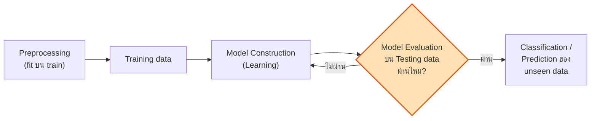

# LEC 05 · Model Construction & Evaluation
### สร้างโมเดลอย่างถูกขั้นตอน และวัดผลให้ถูกตัว

> [!abstract] guideline ข้อ 3 บอกว่าออกอะไร
> 1. ขั้นตอนสร้างโมเดล **preprocessing → training → prediction → evaluation** → [[#5.1 Workflow ของการสร้างโมเดล ⭐⭐]]
> 2. **Training, validation และ testing data** → [[#5.2 Training / Validation / Testing ⭐⭐⭐]]
> 3. **Hold-out และ k-fold cross-validation** → [[#5.3 Hold-out vs k-fold Cross-Validation ⭐⭐⭐]]
> 4. **การสร้างและเลือก baseline model** → [[#5.4 Baseline Model ⭐⭐⭐]]
> 5. **เปรียบเทียบ baseline กับ optimized model** → [[#5.5 Baseline vs Optimized ⭐⭐]]
> 6. **Confusion matrix, Accuracy, Precision, Recall, F1** → [[#5.6 Confusion Matrix และ Classification Metrics ⭐⭐⭐⭐]]
> 7. **MAE, MSE, RMSE, R²** → [[#5.8 Regression Metrics ⭐⭐⭐]]
> 8. **เลือก metric ให้เหมาะกับปัญหา โดยเฉพาะ imbalanced** → [[#5.9 เลือก Metric ให้เหมาะกับปัญหา ⭐⭐⭐⭐]]

**ลิงก์:** [[LEC 00 START HERE|หน้าหลัก Lecture]] · [[LEC 04 Imbalanced Classification]] · [[LEC 06 KNN]] · [[LEC 11 Formula Sheet]] · [[LEC 13 Exam Drills]] · ฝั่ง Lab: [[LAB 04 Workflow, Baseline & Evaluation]]

---

## 5.1 Workflow ของการสร้างโมเดล ⭐⭐

> [!quote] นิยาม Classification (สไลด์ KNN p.5–6, ซ้ำ p.53)
> **"Classification is a supervised learning technique to predict the CATEGORY of new data based on training data."**
> **"Goal: previously UNSEEN records should be assigned a class as accurately as possible. A TEST SET is used to determine the accuracy of the model."**


*(สไลด์ KNN p.10 "Steps of Data Classification")*

**ลำดับที่ถูกต้อง 7 ขั้น (จำได้ใช้ทุกข้อ):**
1. นำเข้า + สำรวจ (EDA) → 2. clean ที่ไม่เรียนค่า (ตัด ID, แก้ชนิด) → 3. **split** train / test (stratify) →
4. **preprocessing ที่เรียนจาก train** (impute, encode, scale, SMOTE, PCA) แล้ว transform test →
5. **train** (+ เลือก hyperparameter ด้วย validation / CV) → 6. **predict** test → 7. **evaluate** ด้วย metric ที่เหมาะ + เทียบ baseline

> [!important] ⭐ Python template ในสไลด์ (KNN p.11, p.50) — สังเกตลำดับ
> ```
> X_train, X_test, y_train, y_test = train_test_split(X, y, test_size=0.25, random_state=0)
> sc = StandardScaler(); X_train = sc.fit_transform(X_train); X_test = sc.transform(X_test)   # fit แค่ train
> classifier.fit(X_train, y_train); y_pred = classifier.predict(X_test)
> cm = confusion_matrix(y_test, y_pred)
> ```
> ⚠️ ใน `transform(X_test)` ไม่มีคำว่า `fit` — นี่คือหัวใจของการกัน **data leakage** (KNN p.60) ดู [[LEC 02 Preprocessing, Feature Selection & Leakage]]

---

## 5.2 Training / Validation / Testing ⭐⭐⭐

| ชุด | หน้าที่ | สไลด์ |
|---|---|---|
| **Training set** | ใช้ **สร้าง (build/fit)** โมเดล + fit preprocessing | *"the larger part is the Training-Set"* (KNN p.52) |
| **Validation set** | ใช้ **เลือก** โมเดล/hyperparameter — *"choose that value of k which has lowest error rate in **validation data**"* (KNN p.37) · ใช้ตัดสินการ prune tree (Tree p.62) | KNN p.42–43 (18 train / 6 validation) |
| **Test set** | วัดผลครั้งสุดท้าย — *"A test set is used to determine the accuracy of the model"* | KNN p.6, 53 |

> [!warning] ทำไมต้องแยก validation ออกจาก test
> ถ้าใช้ test เลือก k / เลือกโมเดล → test ถูก "ใช้ไปแล้ว" ผลบน test จะ **มองโลกในแง่ดีเกินจริง (optimistic bias)** → ไม่ใช่ข้อมูล "unseen" อีกต่อไป
> ใน CV: fold ที่ถูกพักไว้แต่ละรอบทำหน้าที่ validation → test set แยกต่างหากใช้ครั้งเดียวตอนท้าย

---

## 5.3 Hold-out vs k-fold Cross-Validation ⭐⭐⭐

![[lec_kfold.png]]

> [!quote] สไลด์ Tree p.73 (Evaluation Methods) — 4 วิธี
> - **Hold-out:** *"divides the dataset into two parts… the larger part is Training-Set… Hold-out is used when there is a **large amount of data**. Therefore, the characteristics and distribution of Training and Test Sets are similar."*
> - **Random sub-sampling:** *"repeats Hold-out many times… each time different training and test sets… average of multiple hold-outs… Better evaluation than 1-hold-out"*
> - **Cross-validation:** *"divides the dataset into K disjoint subsets, uses K−1 for Training, remaining 1 as Test"* · p.74: *"Repeat this K times, each time using K−1 subsets as training and 1 subset as a different testing data"*
> - **Leave-one-out (LOOCV):** *"In the case of a small amount of data, can use K = N … Use only 1 data as Test"* (p.75)

| | Hold-out | k-fold CV | LOOCV |
|---|---|---|---|
| แบ่ง | 1 ครั้ง (80/20, 75/25, 60/40) | k ส่วนเท่ากัน | k = n |
| รอบ train | 1 | k | n |
| ทุกแถวเป็น test | ไม่ | **1 ครั้งพอดี** | 1 ครั้ง |
| ผลลัพธ์ | ค่าเดียว (แกว่งตามการสุ่ม) | **ค่าเฉลี่ย ± sd** | ค่าเฉลี่ย |
| เหมาะกับ | ข้อมูลเยอะ | ข้อมูลน้อย–กลาง (ทั่วไป) | ข้อมูลน้อยมาก |
| ต้นทุน | ต่ำ | k เท่า | สูงมาก |

> [!example] ⭐ ตัวอย่างสไลด์ Tree p.74–76: 5-fold ได้ accuracy 80%, 88%, 85%, 78%, 84%
> **Final Accuracy = Avg = (80 + 88 + 85 + 78 + 84)/5 = 415/5 = 83%** · sd (n−1) = 4.0%
> → รายงาน *"83.0% ± 4.0%"*

> [!tip] **Stratified** k-fold (สไลด์ Imbalanced p.22: `StratifiedKFold(n_splits=5, shuffle=True, random_state=42)`)
> ทุก fold มีสัดส่วนคลาสเท่าข้อมูลเดิม → **จำเป็นเมื่อข้อมูลไม่สมดุล** (fold ที่บังเอิญไม่มีคลาสส่วนน้อยเลยจะวัด recall ไม่ได้)
> **Group Models** ใน RapidMiner (Tree p.76): มัด preprocessing model + predictive model เป็นก้อนเดียว → test fold ถูก transform แบบเดียวกับ training fold

---

## 5.4 Baseline Model ⭐⭐⭐

> [!important] Baseline คืออะไร ทำไมต้องมี
> **baseline = โมเดลที่ง่ายที่สุดที่ทำได้ เป็น "เส้นขั้นต่ำ"** — โมเดลของเราต้องชนะมันจึงจะมีประโยชน์
>
> | ชนิด | classification | regression |
> |---|---|---|
> | **Majority / naive baseline** | ทาย **คลาสที่พบบ่อยสุด** ทุกแถว | ทาย **ค่าเฉลี่ย (หรือ median)** ทุกแถว |
> | **Predictive-model baseline** | โมเดลจริงด้วยค่า default (เช่น KNN k = 5) | Linear Regression ธรรมดา |
>
> W13 sheet (learning outcome ข้อแรก): **"Distinguish a majority class baseline from a predictive model baseline."**

> [!quote] ในสไลด์ — "naïve rule" (KNN p.39)
> **"k = n is the same as the 'naïve rule' (classify all records according to majority class)"**
> → ตาราง KNN p.43: k = 18 (= n) ได้ validation error **50%** ขณะที่ k = 8 ได้ **16.67%** → KNN ที่เลือก k ดีกว่า naive rule ชัดเจน

> [!example] ⭐ คุณสมบัติของ majority baseline ที่ต้องจำ
> - **accuracy = สัดส่วนคลาสส่วนมาก** (เช่น churn 73.5%, fraud 98%)
> - **recall ของคลาสส่วนน้อย = 0** · precision = นิยามไม่ได้ (ไม่มีการทาย positive)
> - **R² ของ mean baseline = 0** (บน train พอดี · บน test ใกล้ 0 หรือติดลบเล็กน้อย)
> → ถ้าโมเดลได้ accuracy 96% บนข้อมูลที่คลาสส่วนมาก 95% = **แทบไม่ได้เรียนรู้อะไร**

---

## 5.5 Baseline vs Optimized ⭐⭐

**Optimized model** = baseline ที่ผ่านการปรับ (hyperparameter tuning, feature selection, preprocessing เพิ่ม เช่น scaling/PCA/SMOTE)

> [!important] กติกาการเปรียบเทียบให้ "แฟร์" (W13 Part II–III)
> 1. ใช้ **folds / split เดียวกัน** และ **seed เดียวกัน** ทุกโมเดล
> 2. ใช้ **metric ชุดเดียวกัน** และกำหนด metric หลักก่อน
> 3. preprocessing อยู่ **ใน** CV (ไม่ leak)
> 4. tune ด้วย CV/validation — **ห้าม tune ด้วย test**
> 5. รายงานเป็นตาราง: model · settings · metrics → เขียนว่าดีขึ้นเท่าไร **และเพราะอะไร**

> [!example] ตัวอย่างจริง (W13 ของคุณ — Personal Loan, 5-fold)
> | model | accuracy | recall | F1 |
> |---|---|---|---|
> | Default KNN k = 5 | 0.9608 | 0.6229 | 0.7525 |
> | **Optimized KNN k = 1** | 0.9604 | 0.6938 | **0.7706** |
> | Optimized PCA (8 comp) + KNN k = 1 | 0.9568 | 0.6958 | 0.7552 |
> **ข้อสรุป:** tune k ช่วยเพิ่ม F1 (+0.018) · PCA **ไม่ช่วย** (F1 ลดลง) แต่ใช้มิติน้อยกว่า → เลือก optimized KNN โดยไม่ใช้ PCA
> ⚠️ "optimize แล้วไม่ดีขึ้น" ก็เป็นคำตอบที่ถูกได้ ถ้าอธิบายได้

---

## 5.6 Confusion Matrix และ Classification Metrics ⭐⭐⭐⭐

> [!important] ⭐ ตาราง confusion matrix แบบสไลด์ (KNN p.62–63, 67, 75)
> | | **Predicted: Yes** | **Predicted: No** |
> |---|---|---|
> | **Actual: Yes** | **a = TP** | **b = FN** (false dismissal) |
> | **Actual: No** | **c = FP** (false alarm) | **d = TN** |
>
> ⚠️ p.64: *"Sometimes you may see 'predicted' in rows, and 'actual' in columns"* → **อ่านหัวตารางทุกครั้ง** · sklearn: แถว = actual, positive (1) อยู่ **ล่าง** · RapidMiner: แถว = pred.

| Metric | สูตร | สไลด์ | ความหมาย |
|---|---|---|---|
| **Accuracy** | $\dfrac{TP+TN}{TP+TN+FP+FN}=\dfrac{a+d}{a+b+c+d}$ | p.67 | ทายถูกทั้งหมดกี่ % |
| **Error rate** | $1-\text{accuracy}$ | p.65 | *"percent of misclassified records out of total"* |
| **Precision** | $\dfrac{TP}{TP+FP}=\dfrac{a}{a+c}$ | p.75 | ที่ **ทายว่า** positive ถูกจริงกี่ % |
| **Recall** (sensitivity, TPR) | $\dfrac{TP}{TP+FN}=\dfrac{a}{a+b}$ | p.75 | positive **จริง** ทั้งหมด หาเจอกี่ % |
| **F-measure / F1** | $\dfrac{2rp}{r+p}=\dfrac{2a}{2a+b+c}$ | p.77–78 | harmonic mean — *"A balanced option for imbalanced datasets"* |
| 📚 Specificity (TNR) | $\dfrac{TN}{TN+FP}$ | — | negative จริง ทายถูกกี่ % |

> [!quote] ข้อจำกัดของ accuracy (KNN p.73)
> **"Ignores imbalances in class distribution… Might not be suitable for skewed datasets… shouldn't be used alone."**
> เมื่อมี "important class" (KNN p.74 — promotion response, intrusion, delayed flights, tax fraud, credit default): *"willing to tolerate greater overall error, in return for better identifying the important class"*

> [!quote] precision vs recall (KNN p.76)
> - **Precision** สำคัญ *"when false positives are costly (e.g., spam filtering)"*
> - **Recall** สำคัญ *"when missing true positives is unacceptable (e.g., medical diagnosis) — high cost of false negative"*

> [!example]- 🧮 ตัวอย่างหลายคลาส (KNN p.66 — แถว = predicted, คอลัมน์ = actual, 5 ยา)
> | Pred \ Actual | A | B | C | X | Y |
> |---|---|---|---|---|---|
> | drugA | **22** | 0 | 0 | 0 | 3 |
> | drugB | 1 | **16** | 0 | 0 | 1 |
> | drugC | 0 | 0 | **16** | 0 | 4 |
> | drugX | 0 | 0 | 0 | **54** | 2 |
> | drugY | 0 | 0 | 0 | 0 | **81** |
> N = 200 · ถูก = เส้นทแยง 189 → **accuracy 94.5%**
> **precision(drugA)** = 22 / (แถว drugA = 25) = **0.880** · **recall(drugA)** = 22 / (คอลัมน์ A = 23) = **0.957**
> **precision(drugY)** = 81/81 = **1.000** · **recall(drugY)** = 81 / 91 = **0.890** (drugY ถูกทายผิดเป็นยาอื่น 10 ครั้ง)
> ⚠️ ตารางนี้ **แถว = predicted** → precision หารด้วยผลรวมแถว · recall หารด้วยผลรวมคอลัมน์ (กลับกับตารางปกติ)

---

## 5.7 Threshold (Cutoff) ⭐⭐⭐

![[lec_threshold.png]]

> [!quote] สไลด์ KNN p.68–72
> โมเดล (เช่น logistic) ให้ **ความน่าจะเป็น** → ต้องตัดด้วย threshold: **default 0.50** — *"if ≥ 0.50 classify as '1', if < 0.50 classify as '0'"*

> [!example] ⭐ Riding Mowers 24 ราย (positive = owner) — คำนวณยืนยันแล้ว
> | cutoff | TP | FN | FP | TN | accuracy | precision | recall | F1 |
> |---|---|---|---|---|---|---|---|---|
> | 0.25 | 11 | 1 | 4 | 8 | 0.792 | 0.733 | 0.917 | 0.815 |
> | **0.50** | 11 | 1 | 2 | 10 | **0.875** | 0.846 | 0.917 | **0.880** |
> | 0.75 | 7 | 5 | 1 | 11 | 0.750 | **0.875** | 0.583 | 0.700 |
> ตรงกับ confusion matrix ในสไลด์ p.72 (accuracy 0.8750 / 0.7917 / 0.7500) และ RapidMiner p.69
> **threshold ต่ำ → ทาย positive ง่าย → recall ↑ precision ↓** · **threshold สูง → ตรงข้าม**

> [!bug] 🐛 สไลด์ p.70 เขียนว่า *"if cutoff is 0.5, then 11 records classified as owner"*
> นับจากตารางจริงมี **13 records ≥ 0.5** (owner จริง 11 + nonowner 2) ซึ่งตรงกับ confusion matrix p.72 (TP 11 + FP 2) → "11" น่าจะหมายถึง owner ที่ทายถูก · ส่วน *"cutoff 0.8 → 7 records"* ถูกต้อง

> 📚 นอกสไลด์ (scikit-learn User Guide §3.4): **ROC curve** = TPR (recall) vs FPR (1 − specificity) ทุก threshold · **AUC** = พื้นที่ใต้ ROC (0.5 = เดาสุ่ม, 1 = สมบูรณ์) → วัดความสามารถ "จัดอันดับ" โดยไม่ขึ้นกับ threshold (สไลด์ KNN p.61 แค่เอ่ยชื่อ AUC-ROC)

---

## 5.8 Regression Metrics ⭐⭐⭐

> 📚 ไม่อยู่ในสไลด์ final แต่อยู่ในสไลด์ Regression (มิดเทอม) → ทวนเต็ม: [[09 Regression Analysis#9.8 Prediction Errors ⭐⭐⭐ (guideline ข้อ 8.5 "Different types of prediction errors")]] · [[09 Regression Analysis#9.5 R² — Coefficient of Determination ⭐⭐⭐ (guideline ข้อ 8.5)]]

| Metric | สูตร | หน่วย | อ่านว่า |
|---|---|---|---|
| **MAE** | $\frac{1}{n}\sum\lvert y_i-\hat y_i\rvert$ | เดียวกับ y | พลาดเฉลี่ยกี่หน่วย (ไม่สนทิศ) |
| **MSE** | $\frac{1}{n}\sum (y_i-\hat y_i)^2$ | y² | ลงโทษ error ใหญ่หนัก |
| **RMSE** | $\sqrt{\text{MSE}}$ | เดียวกับ y | ≥ MAE เสมอ · ต่างมาก = มี error ก้อนใหญ่ |
| **R²** | $1-\frac{SSE}{SST}=1-\frac{\sum(y-\hat y)^2}{\sum(y-\bar y)^2}$ | ไม่มีหน่วย | สัดส่วนความแปรปรวนของ y ที่อธิบายได้ |

> [!example]- 🧮 ตัวอย่างคำนวณ (y = 3, 5, 2.5, 7 · ŷ = 2.5, 5, 4, 8)
> error = 0.5, 0, −1.5, −1 · |e| = 0.5, 0, 1.5, 1 → **MAE = 3/4 = 0.75**
> e² = 0.25, 0, 2.25, 1 → **MSE = 3.5/4 = 0.875** · **RMSE = √0.875 = 0.935**
> ȳ = 4.375 · SST = 1.891 + 0.391 + 3.516 + 6.891 = 12.6875 · SSE = 3.5 → **R² = 1 − 3.5/12.6875 = 0.724**

---

## 5.9 เลือก Metric ให้เหมาะกับปัญหา ⭐⭐⭐⭐

| สถานการณ์ | metric | เหตุผล |
|---|---|---|
| คลาสสมดุล ความผิดพลาด 2 แบบเสียหายพอกัน | **accuracy** | — |
| **ข้อมูลไม่สมดุล** | **F1 / recall / precision ของคลาสที่สนใจ** (ไม่ใช่ accuracy) | majority ได้ accuracy สูงโดยไม่มีประโยชน์ (Imbalanced p.11: accuracy 95.5% แต่ recall fraud 25%) |
| พลาด positive แพง (โรค, fraud, churn, **"หาให้ได้มากที่สุด"**) | **recall** | FN แพง |
| เตือนผิดแพง (spam, แคมเปญราคาแพง, คุมงบ) | **precision** | FP แพง |
| ต้องการทั้งคู่ | **F1** | balanced |
| ต้นทุนผิดพลาดต่างกันชัดเจน | **cost matrix** | Imbalanced p.14 |
| regression ทั่วไป | **RMSE** (ลงโทษ error ใหญ่) / **MAE** (ตีความง่าย) + R² | — |
| ต้องจัดอันดับความเสี่ยง ไม่ fix threshold | 📚 **AUC** | ไม่ขึ้นกับ threshold |

> [!important] ⭐ โครงตอบ "จงเลือก metric พร้อมเหตุผล"
> *"ปัญหานี้คลาส [X] เป็นส่วนน้อย ([y]%) และการ [พลาด X / เตือนผิด] มีต้นทุนสูงกว่า เพราะ [เหตุผลธุรกิจ] → เลือก [recall/precision/F1] เป็น metric หลัก · ไม่ใช้ accuracy เพราะโมเดลที่ทายคลาสส่วนมากทุกแถวได้ accuracy [z]% โดยหา X ไม่เจอเลย"*

---

## ✅ Self-Test — LEC 05

> [!question]- Q1. ทำไมต้องแบ่ง validation set แยกจาก test set
> validation ใช้ **เลือก** โมเดล/hyperparameter → ผลบน validation ถูก "ปรับให้ดี" แล้ว · ต้องมี test ที่ไม่ถูกใช้ตัดสินใจอะไรเลยเพื่อประมาณผลบนข้อมูลใหม่อย่างไม่ลำเอียง

> [!question]- Q2. 10-fold CV ต่างจาก hold-out 90/10 อย่างไร
> hold-out แบ่งครั้งเดียว ได้ผลค่าเดียว (ขึ้นกับว่าบังเอิญได้ test แบบไหน) · 10-fold ทำ 10 รอบ ทุกแถวเป็น test 1 ครั้ง ได้ **ค่าเฉลี่ย ± sd** ที่เสถียรกว่า แลกกับเวลาคำนวณ 10 เท่า

> [!question]- Q3. ข้อมูล 1,000 แถว positive 50 แถว โมเดลได้ accuracy 95% สรุปได้ไหมว่าดี
> ไม่ได้ — majority baseline ได้ 950/1000 = **95%** เท่ากันพอดี · ต้องดู confusion matrix, recall, F1 ของคลาส positive

> [!question]- Q4. TP = 40, FN = 10, FP = 30, TN = 120 หา accuracy, precision, recall, F1, specificity
> accuracy = 160/200 = **0.80** · precision = 40/70 = **0.571** · recall = 40/50 = **0.80** · F1 = 2(0.571)(0.8)/1.371 = **0.667** · specificity = 120/150 = **0.80**

> [!question]- Q5. ลด threshold จาก 0.5 เป็น 0.3 เกิดอะไรกับ TP, FP, precision, recall
> แถวถูกทายเป็น positive มากขึ้น → TP ↑ (หรือเท่าเดิม), FP ↑, FN ↓ → **recall ↑**, precision มักจะ **↓**

> [!question]- Q6. Majority baseline สำหรับ regression คืออะไร ได้ R² เท่าไร
> ทายค่าเฉลี่ยของ y (จาก train) ทุกแถว → SSE = SST บน train → **R² = 0** · บน test ใกล้ 0 (อาจติดลบเล็กน้อย)

> [!question]- Q7. ทำไม F1 ใช้ harmonic mean ไม่ใช่ค่าเฉลี่ยธรรมดา
> harmonic mean ถูกดึงลงด้วยค่าที่ต่ำ → ถ้า precision หรือ recall ต่ำตัวใดตัวหนึ่ง F1 ต่ำ (เช่น P = 1, R = 0.1 → mean ธรรมดา 0.55 แต่ F1 = 0.18) → บังคับให้ดีทั้งคู่

---

**กลับหน้าหลัก →** [[LEC 00 START HERE]] · **สูตร →** [[LEC 11 Formula Sheet]] · **ฝึก →** [[LEC 13 Exam Drills]]
