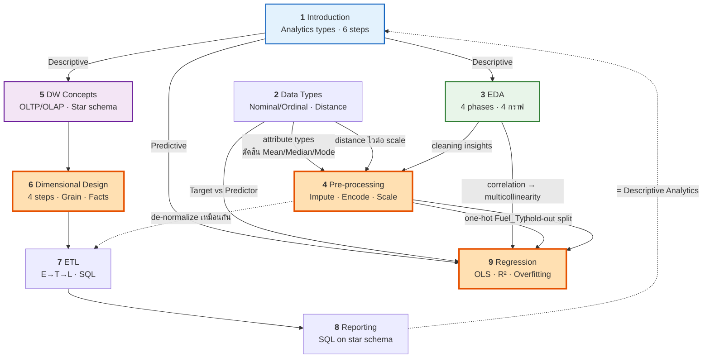

# 🎯 START HERE
## คลังความรู้เตรียมสอบมิดเทอม — 01204465

> [!info] วิชานี้คืออะไร
> **01204465 Introduction to Data Mining, Data Analytics & Knowledge Discovery** · ภาคเรียน **1/2569**
> ภาควิชาวิศวกรรมคอมพิวเตอร์ คณะวิศวกรรมศาสตร์ **มหาวิทยาลัยเกษตรศาสตร์**
> อาจารย์: **รศ. ดร. กฤษณะ ไวยมัย** · TA: **เจตนา สมคำนึง (พี่เจม)**
> เครื่องมือ: **RapidMiner** และ **Python (Jupyter Notebooks)**

> [!important] 📌 มิดเทอม = **Lecture + Lab (On-site)** คิดเป็น **30%** ของเกรด
> **"Lab" แปลว่ามีข้อปฏิบัติด้วย** → นอกจากทฤษฎี ต้องเขียน **SQL** ได้ อ่านโค้ด **Python/pandas/sklearn** ออก และรู้จัก operator ของ **RapidMiner**
>
> **สัดส่วนคะแนนทั้งวิชา:** Group Assignment 20% · **Midterm 30%** · Final 30% · Homework 10% · Quizzes & Participation 10%

---

## ⚠️ อ่านก่อนอย่างอื่น — ขอบเขตข้อสอบจริง

> [!warning] Syllabus กับ guideline **ไม่ตรงกัน** — ต้องยึด guideline
> **Syllabus** ระบุ Week 1–7 ก่อนมิดเทอมว่า:
> Intro → Pre-processing → EDA → DW Design → DW Implementation → **Association Rule Mining** → **Classification (Decision Trees, k-NN)**
>
> แต่ **`guidline.txt`** (ที่อาจารย์ให้เป็นแนวข้อสอบ) **ไม่มี Association Rules และ Classification เลย** — กลับใส่ **Multi-Dimensional Design, ETL, Reporting และ Regression** แทน
>
> **✅ สรุป: ยึด `guidline.txt` เป็น exam blueprint** — และสไลด์ทั้ง 8 ไฟล์ในโฟลเดอร์ `midterm/` ก็ตรงกับ guideline พอดี (ไม่มีสไลด์ Association Rules หรือ Decision Tree อยู่เลย) → ยืนยันว่าคอร์สปรับเนื้อหาจริง

---

## 🗺️ แผนที่เนื้อหา — 9 บท

> [!tip] อ่านตามลำดับนี้ เพราะแต่ละบทต่อยอดจากบทก่อนหน้า
> **สาย Analytics:** 1 → 2 → 3 → 4 → 9
> **สาย Data Warehouse:** 5 → 6 → 7 → 8

| บท | หัวข้อ | guideline ข้อ | สไลด์ (หน้า) | น้ำหนัก |
|---|---|---|---|---|
| **[[01 Introduction to Data Analytics]]** | นิยาม · Data/Info/Knowledge · **4 Types of Analytics** · 6 Steps | **ข้อ 1** | `Analytics_DM_intro_69_1` (61) | ⭐⭐⭐ |
| **[[02 Data and Dataset Types]]** | Attribute types · Stevens scale · Distance & Similarity | *(ฐานของข้อ 3)* | `Data_69_1-3` (31) | ⭐⭐ |
| **[[03 Exploratory Data Analysis (EDA)]]** | 4 Phases · Uni/Bi/Multi-variate · **Histogram, Boxplot, Scatter, Heatmap** | **ข้อ 2** | `EDA_69_1` (57) | ⭐⭐⭐ |
| **[[04 Data Pre-processing]]** | Imputation · **Noise vs Outliers** · Smoothing · Encoding · Discretization · **Scaling** | **ข้อ 3** | `Pre_processing_69_1` (**105**) | ⭐⭐⭐⭐ |
| **[[05 Data Warehouse Concepts]]** | DW 4 คุณลักษณะ · **OLTP vs OLAP** · **Star vs Snowflake** · Fact/Dim | **ข้อ 4** | `Intro_dw_69_1` (61) | ⭐⭐⭐ |
| **[[06 Multi-Dimensional Design]]** | **4-Step Process** · **Grain** · Additivity · Keys · **3 ชนิด Fact Table** · Degenerate/Role-Playing/Factless | **ข้อ 5 + 4.5, 4.6** | `Intro_dw` + `more_design_68_2` (24) | ⭐⭐⭐⭐ |
| **[[07 ETL]]** | ETL workflow · สร้าง Dim/Fact · **Date Dimension** · SQL Scripts | **ข้อ 6** | `ETL_69_1` (35) | ⭐⭐⭐ |
| **[[08 Reporting from Star Schema]]** | SQL บน star schema · Drill-down/Roll-up · เครื่องมือ | **ข้อ 7** | `ETL_69_1` p.33–35 | ⭐⭐ |
| **[[09 Regression Analysis]]** | **OLS** · **R² / Adjusted R²** · Assumptions · **MAE/MAPE/RMSE** · **Overfitting** | **ข้อ 8** | `69_1_Regression_Analysis` (66) | ⭐⭐⭐⭐ |

### 📎 เอกสารสนับสนุน

| หน้า | ใช้เมื่อไหร่ |
|---|---|
| **[[10 Formula Sheet]]** | **ทวนรอบสุดท้ายก่อนเข้าห้องสอบ** — สูตรทั้งหมดในหน้าเดียว |
| **[[11 Glossary EN-TH]]** | เจอศัพท์อังกฤษแล้วนึกไม่ออก · ท้ายหน้ามี **ตารางคู่ศัพท์ที่สับสนบ่อย 14 คู่** |
| **[[12 Exam Drills]]** | **ฝึกทำจริง** — Part A ทฤษฎี · Part B คำนวณ · Part C ออกแบบ/SQL · Part D สถานการณ์ |

---

## 🔥 หัวข้อที่ "ออกแน่" เรียงตามความมั่นใจ

> [!important] ระดับ 1 — เก็งว่าออกแน่นอน (guideline ระบุชื่อเฉพาะเจาะจง)
> | หัวข้อ | ทำไมมั่นใจ | ไปอ่าน |
> |---|---|---|
> | **Data vs Information vs Knowledge** | guideline ระบุตรง + สไลด์ทุ่ม 6 หน้า + มีแบบฝึกหัด "Check Your Understanding" | [[01 Introduction to Data Analytics#1.2 Data vs. Information vs. Knowledge ⭐ ออกสอบแน่]] |
> | **3 (หรือ 4) Types of Analytics** | guideline ระบุครบทั้ง 3 ชื่อ + สไลด์ 13 หน้า | [[01 Introduction to Data Analytics#1.3 Types of Analytics ⭐⭐ ออกสอบแน่นอนที่สุด]] |
> | **Histogram / Boxplot / Scatter / Heatmap** | guideline ระบุ **ชื่อกราฟทั้ง 4 แบบเฉพาะเจาะจง** | [[03 Exploratory Data Analysis (EDA)#🎯 ตารางเลือกกราฟ]] |
> | **Mean / Median / Mode imputation** | guideline เขียนละเอียดถึงขั้นบอกว่า *"Median — especially skewed"* | [[04 Data Pre-processing#🎯 Statistical Imputation — หัวใจของ guideline ข้อ 3.2]] |
> | **Noise vs Outliers** | guideline ระบุคู่นี้ตรง ๆ | [[04 Data Pre-processing#4.3 Noise vs. Outliers ⭐⭐ (guideline ข้อ 3.3 — ระบุชื่อคู่นี้ตรง ๆ)]] |
> | **OLTP vs OLAP** | guideline ระบุ + สไลด์ให้ตารางเทียบครบ 7 ประเด็น | [[05 Data Warehouse Concepts#5.3 OLTP vs OLAP ⭐⭐⭐ (guideline ข้อ 4.2 — ออกแน่นอน)]] |
> | **Star vs Snowflake** | guideline ระบุ | [[05 Data Warehouse Concepts#5.6 Star Schema vs Snowflake Schema ⭐⭐⭐ (guideline ข้อ 4.3)]] |
> | **4-Step Design Process + Grain** | guideline ระบุครบ 4 ขั้น + สไลด์ให้ซ้ำ **4 หน้า** | [[06 Multi-Dimensional Design#6.1 The 4-Step Dimensional Design Process ⭐⭐⭐]] |
> | **3 ชนิดของ Fact Table** | guideline ระบุชื่อครบทั้ง 3 | [[06 Multi-Dimensional Design#6.9 Different Types of Fact Tables ⭐⭐⭐ (guideline ข้อ 4.5 — ออกแน่)]] |
> | **Degenerate / Role-Playing / Factless** | guideline ระบุชื่อครบทั้ง 3 | [[06 Multi-Dimensional Design#6.5 Degenerate Dimension ⭐⭐ (guideline ข้อ 4.6)]] |
> | **R² และ Adjusted R²** | guideline ระบุทั้งคู่ | [[09 Regression Analysis#9.5 R² — Coefficient of Determination ⭐⭐⭐ (guideline ข้อ 8.5)]] |
> | **Linearity + No Multicollinearity** | guideline ระบุ 2 สมมติฐานนี้ชื่อตรง | [[09 Regression Analysis#9.7 Assumptions ⭐⭐ (guideline ข้อ 8.4 — ระบุ 2 ข้อชัดเจน)]] |
> | **Overfitting + Train vs Test** | guideline ระบุ 2 ข้อสุดท้าย | [[09 Regression Analysis#9.10 Overfitting ⭐⭐⭐ (guideline ข้อ 8.7)]] |

> [!important] ระดับ 2 — น่าจะออก (สไลด์ให้พื้นที่มาก แต่ guideline ไม่ระบุตรง)
> **Main Steps of Analytics 6 ขั้น** (สไลด์ซ้ำ 2 deck) · **Hold-out / train_test_split** (ซ้ำ 2 deck) · **Attribute types + Stevens scale** (ฐานของ encoding) · **Feature Scaling 2 สูตร** · **Smoothing by Binning** (คำนวณได้) · **Surrogate Keys 4 ประโยชน์** · **SQL populate fact table**

> [!note] ระดับ 3 — อ่านให้รู้จัก (อยู่ในสไลด์แต่ไม่อยู่ใน guideline)
> Sampling / SMOTE / RUS · PCA · Gini / Entropy / Info-Gain · Filter vs Wrapper · Cosine similarity · Polynomial Regression · Reinforcement learning

---

## 🧮 สิ่งที่ต้อง "คำนวณเป็น" (ไม่ใช่แค่จำ)

> [!important] ⭐ ข้อสอบคำนวณที่เป็นไปได้มากที่สุด 7 แบบ
> | # | คำนวณอะไร | สูตร | ฝึกที่ |
> |---|---|---|---|
> | 1 | **หา outlier ด้วย IQR** | $Q_1-1.5\text{IQR}$ , $Q_3+1.5\text{IQR}$ | [[12 Exam Drills#Part B · การคำนวณ (แสดงวิธีทำ)\|B1]] |
> | 2 | **Smoothing by binning** 3 แบบ | mean / median / boundaries | [[12 Exam Drills\|B2]] |
> | 3 | **Z-score & Min-Max scaling** | $\frac{x-\mu}{\sigma}$ , $\frac{x-\min}{\max-\min}$ | [[12 Exam Drills\|B3]] |
> | 4 | **Binary distance & Jaccard** | $\frac{r+s}{q+r+s}$ , $\frac{q}{q+r+s}$ | [[12 Exam Drills\|B4]] |
> | 5 | **สมการถดถอย $b_0, b_1$ + R²** | สูตร OLS + $1-\frac{\text{SSE}}{\text{SST}}$ | [[12 Exam Drills\|B5]] ⭐ |
> | 6 | **MAE / RMSE / MAPE** | ดู [[10 Formula Sheet]] | [[12 Exam Drills\|B6]] |
> | 7 | **Adjusted R² เทียบ 2 โมเดล** | $1-\frac{(1-R^2)(n-1)}{n-k-1}$ | [[12 Exam Drills\|B7]] |

---

## 🖼️ ภาพประกอบทั้งหมด

> [!note] ทุกภาพสร้างจากสคริปต์ที่คำนวณตัวเลขจริง — ไม่ได้วาดลอย ๆ
> โค้ดอยู่ใน [[scripts/|โฟลเดอร์ scripts]] · ภาพอยู่ใน `assets/`
>
> | ภาพ | สอนอะไร | อยู่ในบท |
> |---|---|---|
> | `analytics_types.png` | 4 ระดับ analytics บนแกน value × complexity | 1 |
> | `distance_measures.png` | Euclidean vs Manhattan + **จับสไลด์พิมพ์ผิด 1 ช่อง** | 2 |
> | `eda_boxplot_anatomy.png` | ส่วนประกอบ boxplot + กฎ 1.5×IQR ด้วยตัวเลขจริง | 3 |
> | `eda_skewness.png` | ทำไม skewed ต้องใช้ Median (Mean วิ่งตามหาง) | 3 |
> | `eda_correlation.png` | อ่านค่า $r$ + **กับดัก $r\approx 0$ ที่สัมพันธ์กันจริง** + heatmap | 3 |
> | `eda_histogram.png` | ผลของจำนวน bin + churn overlay (normalized vs ดิบ) | 3 |
> | `prep_binning.png` | Smoothing 3 แบบบนตัวอย่างมาตรฐาน | 4 |
> | `prep_discretization.png` | Equal Width vs Equal Frequency vs K-means | 4 |
> | `prep_scaling.png` | **scaling พลิกคำตอบ k-NN ได้จริง** | 4 |
> | `dw_star_vs_snowflake.png` | Star vs Snowflake วางเทียบกันบนเคสเดียว | 5 |
> | `dw_fact_types.png` | Fact table 3 ชนิด พร้อมข้อมูลตัวอย่าง | 6 |
> | `etl_fact_build.png` | ETL 4 ขั้น จาก log ดิบ → fact table (ตัวเลขตรงสไลด์) | 7 |
> | `reg_ols_r2_overfit.png` | OLS + residuals · SST/SSE/SSR · กราฟ overfitting | 9 |
>
> **สร้างภาพใหม่ทั้งหมด:**
> ```bash
> cd "midterm/obsidian/scripts"
> for f in fig*.py; do
>   env -u VIRTUAL_ENV uv run --quiet --no-project \
>     --with matplotlib --with numpy --python 3.12 python "$f"
> done
> ```

---

## 📅 แผนอ่าน 5 วัน (ถ้าเหลือเวลาน้อย)

> [!tip] จัดลำดับตามน้ำหนักคะแนน ไม่ใช่ตามลำดับบท
> | วัน | อ่านอะไร | ทำอะไร |
> |---|---|---|
> | **วันที่ 1** | [[04 Data Pre-processing]] (บทใหญ่สุด 105 สไลด์) | ทำ Drill **B2, B3** |
> | **วันที่ 2** | [[09 Regression Analysis]] + [[02 Data and Dataset Types]] | ทำ Drill **B5, B6, B7** ⭐ |
> | **วันที่ 3** | [[05 Data Warehouse Concepts]] + [[06 Multi-Dimensional Design]] | ทำ Drill **A5, A6, C1, C3** |
> | **วันที่ 4** | [[03 Exploratory Data Analysis (EDA)]] + [[07 ETL]] + [[08 Reporting from Star Schema]] | ทำ Drill **B1, C2, C4** |
> | **วันที่ 5** | [[01 Introduction to Data Analytics]] + [[10 Formula Sheet]] + [[11 Glossary EN-TH]] | ทำ Drill **Part D** + อ่าน **12 กับดัก** |

> [!warning] ถ้าเหลือเวลาแค่ 1 วัน
> 1. อ่าน **[[10 Formula Sheet]]** ทั้งหน้า (30 นาที)
> 2. อ่าน **ตารางคู่ศัพท์ที่สับสนบ่อย** ท้าย [[11 Glossary EN-TH]] (15 นาที)
> 3. อ่าน **12 กับดักที่คนพลาดบ่อย** ท้าย [[12 Exam Drills]] (15 นาที)
> 4. ทำ Drill **B5** (regression เต็มรูปแบบ) และ **C1** (ออกแบบ star schema) ให้ได้ (1 ชั่วโมง)
> 5. ทวนหัวข้อ **"ออกแน่ ระดับ 1"** ทั้ง 13 หัวข้อข้างบน

---

## 🔗 แผนผังความเชื่อมโยงระหว่างบท



---

## 📚 แหล่งอ้างอิง

**ตำราของวิชา (จาก Syllabus):**
- Shmueli et al., *Data Mining for Business Intelligence: Concepts, Techniques, and Applications in Data Analytics*, Wiley ← **สไลด์ Regression อ้างอิงเล่มนี้โดยตรง**
- Han, Kamber & Pei, *Data Mining: Concepts and Techniques*, 3rd ed., Morgan Kaufmann ← **สไลด์ Data Types อ้างอิงเล่มนี้**
- Udit Agarwal, *Data Mining and Data Warehousing*, S.K. Katarina & Sons, 2016

**สไลป์ต้นทางทั้งหมด** อยู่ที่ `midterm/*.pdf` (รวม **443 หน้า**)

---

> [!success] โน้ตชุดนี้สร้างจากอะไร
> อ่านสไลด์ทั้ง **8 ไฟล์ / 443 หน้า** ครบทุกหน้า + `guidline.txt` + `Syllabus`
> **ตัวเลขทุกตัวในภาพประกอบคำนวณใหม่ด้วยสคริปต์** เพื่อตรวจสอบกับสไลด์ — และพบว่าสไลด์ `Data_69_1-3.pdf` หน้า 21 **พิมพ์ค่า $d(x_1,x_3)$ ผิด** (ควรเป็น 2.24 ไม่ใช่ 5.1) ดูรายละเอียดที่ [[02 Data and Dataset Types#ตัวอย่าง Data Matrix → Dissimilarity Matrix (สไลด์ p.21)]]
