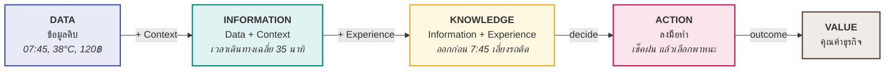
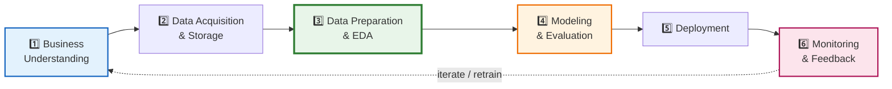
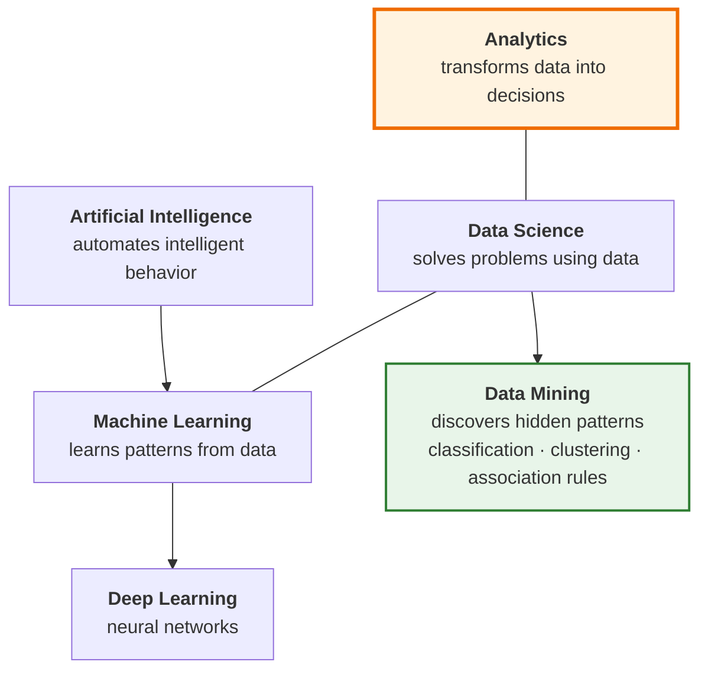

# 01 · Introduction to Data Analytics

> [!abstract] guideline ข้อ 1 บอกว่าออกสอบอะไร
> 1. **Definition and importance** of Data Analytics
> 2. **Data vs. Information vs. Knowledge**
> 3. **Types of Analytics** — Descriptive / Predictive / Prescriptive
>
> 3 หัวข้อนี้คือเป้าหมายหลัก ที่เหลือในบทเป็นบริบทประกอบ (แต่ **Diagnostic** อยู่ในสไลด์ทั้งที่ guideline ไม่ระบุ → ดูหัวข้อ [[#⚠️ กับดัก Diagnostic Analytics]])

**ลิงก์:** [[00 START HERE|กลับหน้าหลัก]] · ถัดไป [[02 Data and Dataset Types]] · [[10 Formula Sheet]] · [[11 Glossary EN-TH]] · [[12 Exam Drills]]

---

## 1.1 Data Analytics คืออะไร และทำไมต้องเรียน

### นิยาม (ท่องให้ได้ — ออกเป็นข้อเขียนบ่อย)

> [!quote] Definition
> **Data Analytics is the process of examining, transforming, and summarizing data with the goal of extracting meaningful insights, informing decisions, and uncovering patterns and knowledge.**
>
> เป้าหมายคือได้ **actionable insights** → นำไปสู่ **smarter decisions** และ **better business outcomes**

แยกคำสำคัญในนิยามออกเป็น 3 กริยา + 1 เป้าหมาย เวลาตอบข้อสอบจะไม่ตกหล่น:

| ส่วน | คำ | ความหมาย |
|---|---|---|
| กริยาที่ 1 | **Examining** | ตรวจสอบ/สำรวจข้อมูล (→ [[03 Exploratory Data Analysis (EDA)\|EDA]]) |
| กริยาที่ 2 | **Transforming** | แปลงรูปข้อมูลให้พร้อมใช้ (→ [[04 Data Pre-processing\|Pre-processing]], [[07 ETL\|ETL]]) |
| กริยาที่ 3 | **Summarizing** | สรุปย่อ (→ สถิติ, dashboard, [[05 Data Warehouse Concepts\|DW]]) |
| เป้าหมาย | **Insight → Decision → Value** | ไม่ใช่ "สร้างโมเดล" |

> [!warning] ประโยคที่อาจารย์ย้ำในสไลด์ (มีโอกาสเป็นข้อสอบ True/False สูงมาก)
> **"The goal of analytics is not building models — it is making better decisions."**
>
> ถ้าเจอข้อสอบว่า *"เป้าหมายของ Data Analytics คือการสร้างแบบจำลองที่แม่นยำที่สุด"* → **ผิด**

### ทำไม analytics ถึงสำคัญ "ตอนนี้" (4 เหตุผล)

สไลด์ p.5 ให้ 4 ข้อ — ข้อสอบชอบถามแบบ "ข้อใด **ไม่ใช่** เหตุผล":

1. **Lots of data is being collected and warehoused** — web/e-commerce, ซื้อของในซูเปอร์, ธุรกรรมบัตรเครดิต, social network, big data, complex data
2. **Computers have become cheaper and more powerful** — ต้นทุนประมวลผลถูกลง
3. **Competitive pressure is strong** — คู่แข่งใช้ ก็ต้องใช้
4. **True value is not the data itself** but the interesting **patterns, information and knowledge** we can extract from those data

> [!tip] จำเป็นภาพ
> เยอะ (data) + ถูก (compute) + บีบ (competition) → แต่ **ค่าไม่ได้อยู่ที่ข้อมูล อยู่ที่ pattern**

### เหตุผลที่องค์กรลงทุน (Business value)

Smarter decisions · Reduce costs · Increase revenue · Improve customer experience · Predict future events · Automate decision-making
→ **The goal is creating business value**

**Benefits 4 กลุ่ม** (สไลด์ p.19) — เวลาข้อสอบให้ยกตัวอย่าง ให้จับคู่แบบนี้:

| กลุ่มประโยชน์ | ตัวอย่างจากสไลด์ |
|---|---|
| **Smarter decisions → faster actions** | ตัดสินใจเร็วขึ้น |
| **Resource & Time Reduction** | ทำนายยอดขาย → ลดต้นทุนสต็อก (inventory optimization), Google Maps เส้นทางดีสุด → ลดเวลาหา, fraud prevention |
| **Value Adding** | product recommendation → ยอดขายเพิ่ม, ทำนายมะเร็งระยะแรก → เตรียมการรักษา, trend detection |
| **Innovation Creation** | รถขับเองได้, AI-powered services (Uber ETA, Spotify mood detection) |

### Data Analytics ในชีวิตประจำวัน

Google Maps (แนะนำเส้นทาง) · Netflix (recommendation) · TikTok/YouTube (content ranking) · Banking apps (fraud detection) · Grab/Uber (ETA prediction + surge pricing) · ChatGPT (conversational analytics)

---

## 1.2 Data vs. Information vs. Knowledge ⭐ ออกสอบแน่

นี่คือหัวข้อที่ guideline ระบุตรง ๆ และสไลด์ทุ่มถึง **6 หน้า** (p.10–16) พร้อมแบบฝึกหัด "Check Your Understanding" → **แทบการันตีว่าออก**

### บันไดคุณค่า (The Analytics Pipeline)

> [!important] สูตรที่ต้องท่อง
> $$\textbf{Information} = \textbf{Data} + \textbf{Context}$$
> $$\textbf{Knowledge} = \textbf{Information} + \textbf{Experience}$$

> [!note] วิชานี้เน้น 3 ขั้นแรก
> สไลด์ p.7 เขียนว่า **"This class focus on the first three stages"** คือ Data → Information → Knowledge (ยังไม่ลงลึกถึง Action/Value)

### ตารางเทียบ 3 ระดับ

| มิติ | **Data** | **Information** | **Knowledge** |
|---|---|---|---|
| **นิยาม** | Raw organized facts and observations | Data ที่ถูกประมวลผลให้มีความหมายกับผู้รับ (มี context) | ชุดของ ideas, rules, procedures ที่ชี้นำการกระทำและการตัดสินใจ |
| **สูตร** | — | Data + **Context** | Information + **Experience** |
| **ตอบคำถาม** | (ไม่ตอบอะไร) | **who, what, when, where** | **What should we do?** |
| **ตัวอย่างสไลด์** | `07:45`, `38°C`, `120 THB`, `4.7 stars` | "เวลาเดินทางเฉลี่ย 35 นาที", "ยอดขายกาแฟเพิ่ม 30% วันฝนตก" | "ออกจากบ้านก่อน 7:45 เพื่อเลี่ยงรถติด", "ฝนตกให้ใช้ BTS แทน Grab" |
| **คุณสมบัติ** | อาจ incomplete/noisy, ไม่มี context → ตีความยาก | มีบริบทแล้ว | ใช้ตัดสินใจได้จริง |

> [!tip] เทคนิคแยกให้ไว (ใช้ในห้องสอบ)
> - เห็น **ตัวเลขลอย ๆ / ค่าเดี่ยว ๆ** → **Data**
> - เห็น **คำว่า เฉลี่ย / รวม / เปอร์เซ็นต์ / แนวโน้ม** (มีการรวบยอด + บอกว่าเป็นของอะไร) → **Information**
> - เห็น **กฎ / ข้อสรุปที่ใช้ตัดสินใจ / ประโยคเงื่อนไข "ถ้า...ควร..."** → **Knowledge**
> - เห็น **คำสั่งให้ทำ (verb) เช่น launch, add, use** → **Action**

### แบบฝึกหัดจากสไลด์ (Check Your Understanding — p.15)

> [!question]- ลองตอบก่อนเปิดเฉลย
> | ข้อความ | ระดับ? |
> |---|---|
> | "92" | ? |
> | "Average exam score is 92" | ? |
> | "Students attending class score above 90" | ? |
> | "Add weekly quizzes to increase attendance" | ? |
>
> **เฉลย:** Data → Information → Knowledge → Action
>
> **สังเกตตรรกะ:** `92` เป็นตัวเลขลอย → Data · เติมว่า "คะแนนสอบเฉลี่ย" (context) → Information · สรุปเป็นกฎที่เชื่อมสองตัวแปร (เข้าเรียน ↔ คะแนน) → Knowledge · สั่งให้ลงมือ (Add quizzes) → Action

### เคสตัวอย่างที่ต้องจำ 2 เคส

> [!example] เคส A — Going to University (เดินทางไปมหาลัย)
> - **Data:** เวลาออกจากบ้าน (7:30 / 8:00 / 8:15), ระยะทาง 12.5 กม., ค่าใช้จ่าย (Grab 80–120฿, BTS 42฿), เวลาเดินทาง 25–45 นาที, สภาพจราจร, สภาพอากาศ
> - **Information:** ช่วง 7:30–8:00 เฉลี่ย 28 นาที / 85฿ · ช่วง 8:00–8:30 เฉลี่ย 40 นาที / 110฿ · วันฝนตก Grab แพงขึ้น 30–40% · BTS คงที่ 25 นาที แต่ต้องเดินเพิ่ม 10 นาที
> - **Knowledge:** ออกก่อน 8:00 ประหยัดทั้งเวลาและเงิน; วันฝนตกควรใช้ BTS เพราะเวลาแน่นอนและถูกกว่า
> - **Action:** เช็คพยากรณ์อากาศแล้วเลือกพาหนะ

> [!example] เคส B — CoffeeConnect
> - **Data:** เวลาที่ซื้อ, สภาพอากาศ, รายการเมนู
> - **Information:** นักศึกษาใช้โปรโมชั่นมากกว่ากลุ่มอื่น
> - **Knowledge:** ควรยิงโปรโมชั่นช่วงบ่ายไปที่นักศึกษา
> - **Action:** เปิดแคมเปญแบบ personalized

---

## 1.3 Types of Analytics ⭐⭐ ออกสอบแน่นอนที่สุด

guideline ระบุชัด 3 ตัว (Descriptive / Predictive / Prescriptive) แต่สไลด์สอน **4 ตัว** (มี Diagnostic ด้วย) → ต้องรู้ทั้ง 4 แต่เน้น 3

### แผนภาพ 4 ระดับ

![[analytics_types.png]]

> [!important] คำถามประจำระดับ — ท่อง 4 คำถามนี้ให้ขึ้นใจ
> | ระดับ | คำถาม | ภาษาไทย |
> |---|---|---|
> | **Descriptive** | **What happened?** | เกิดอะไรขึ้น |
> | **Diagnostic** | **Why did it happen?** | ทำไมถึงเกิด |
> | **Predictive** | **What will happen?** | จะเกิดอะไรขึ้น |
> | **Prescriptive** | **What should we do?** | ควรทำอะไร |
>
> **"Each level provides greater business value"** — ยิ่งลงลึกยิ่งมีมูลค่ามาก (แต่ก็ยากขึ้น)

### ตารางเปรียบเทียบฉบับเต็ม

| | **Descriptive** (เชิงพรรณนา) | **Diagnostic** | **Predictive** (เชิงพยากรณ์) | **Prescriptive** (เชิงแนะนำ) |
|---|---|---|---|---|
| **คำถาม** | What happened? | Why did it happen? | What will happen? | What should we do? |
| **ช่วงเวลา** | อดีต + ปัจจุบัน | อดีต (หาสาเหตุ) | อนาคต | อนาคต + ทางเลือก |
| **เทคนิค** | Data Warehouse, Data Queries, **Reports**, **Dashboard & visualization**, **Descriptive Statistics** | Drill-down, Segmentation, **Correlation analysis** | **Linear Regression**, **Time series analysis & forecasting**, Data Mining, ML | **Recommendation techniques**, **Collaborative filtering**, ML เช่น **Clustering**, Optimization, Simulation |
| **ตัวอย่าง** | sales report, website traffic, KPI | ทำไมยอดขายตก, ทำไมลูกค้า churn | demand forecasting, fraud detection, churn prediction | route optimization, inventory planning, promotions |
| **บทในวิชานี้** | [[03 Exploratory Data Analysis (EDA)]], [[05 Data Warehouse Concepts]], [[08 Reporting from Star Schema]] | [[03 Exploratory Data Analysis (EDA)]] (correlation) | [[09 Regression Analysis]] | (ไม่ได้ลงลึกก่อนมิดเทอม) |

> [!warning] จุดที่คนพลาดบ่อย
> **Predictive analytics estimates probabilities — not certainties.**
> การพยากรณ์ให้ "ความน่าจะเป็น" ไม่ใช่ "ความแน่นอน" → ถ้าข้อสอบบอกว่า predictive ให้คำตอบที่แน่นอน 100% = **ผิด**

### จำแนกให้ถูกด้วย "คีย์เวิร์ดในโจทย์"

> [!tip] Cheat sheet จำแนกประเภท
> - มีคำว่า **was / were / how many (ที่ผ่านมา) / summarize / report / dashboard / average of last year** → **Descriptive**
> - มีคำว่า **why / root cause / เพราะอะไร** → **Diagnostic**
> - มีคำว่า **will / next month / forecast / predict / จะ...ไหม** → **Predictive**
> - มีคำว่า **should / recommend / suggest / which one to choose / ควร** → **Prescriptive**

### ชุดตัวอย่างจากสไลด์แยกตามโดเมน (ข้อสอบชอบหยิบมาถามตรง ๆ)

| โดเมน | Descriptive | Predictive | Prescriptive |
|---|---|---|---|
| **Sale** | ยอดขายเฉลี่ยรายไตรมาส 3 ปีที่แล้ว · ลักษณะลูกค้ากำไรสูงสุด · % ลูกค้าที่เข้าเว็บแล้วกดซื้อ | ยอดขายเดือนหน้าเท่าไหร่ · ลูกค้าคนไหนจะย้ายไปคู่แข่ง · ลูกค้าจะกลับมาซื้อไหม | เดือนหน้าควรสต็อกสินค้าอะไร · แนะนำโปรโมชั่น · ควรวางสินค้าอะไรบนหน้านี้ |
| **Health** | เดือนไหนคนเป็นไข้หวัดใหญ่มากสุด · ช่วงอายุไหนตายจากโควิดมากสุด | เดือนหน้าจะมีเคสโควิดกี่ราย | อาการแบบนี้ น่าจะเป็นโรคอะไรได้บ้าง |
| **Education** | นักเรียนโรงเรียนไหนได้เกรดสูงสุดใน 5 ปี | GPA เทอมหน้าของนักศึกษาคนนี้เท่าไหร่ | ควรไปโปรโมทหลักสูตร SKE-65 ที่โรงเรียนไหน |
| **Agriculture** | ปริมาณส่งออกข้าวหอมมะลิรายไตรมาสปีที่แล้ว | เดือนหน้าจะส่งออกข้าวหอมมะลิกี่ตัน | พิกัดนี้ควรปลูกอะไร |
| **Telecom** | ช่วงสงกรานต์ ผู้โดยสารประเภทไหนชอบไปเชียงใหม่ | สงกรานต์ปีหน้ายอดผู้เสียชีวิตเท่าไหร่ | แนะนำสถานที่เที่ยวที่น่าสนใจให้ฉันหน่อย |

### เคสเดียว ใช้ได้ทั้ง 3 แบบ

> [!important] ประโยคสำคัญ
> **"One business problem often requires various analytics types."**
> ปัญหาธุรกิจหนึ่งมักต้องใช้ analytics หลายประเภทร่วมกัน

> [!example] Online Retail (ธุรกิจค้าปลีกออนไลน์)
> - **Descriptive:** สรุปยอดขายรายเดือน, จำนวนลูกค้าใหม่, สินค้าขายดี, วิเคราะห์ traffic เว็บ → เห็นภาพรวมสถานะปัจจุบัน
> - **Predictive:** พยากรณ์ยอดขาย, ทำนายเทรนด์การซื้อตามฤดูกาล, ประมาณ traffic ช่วงโปรโมชั่น
> - **Prescriptive:** แนะนำกลยุทธ์เพิ่มยอดขาย/กำไร, ออกแบบแผนการตลาด, จัดการสต็อก, เสนอโปรพิเศษให้ลูกค้าประจำ

> [!example] Company Stock Analysis (วิเคราะห์หุ้น)
> - **Descriptive:** ไตรมาสที่ผ่านมาราคาหุ้นขึ้น/ลงอย่างไร · เดือนไหนขึ้น/ลงมากสุด
> - **Predictive:** ไตรมาสหน้าราคาจะเท่าไหร่ · ถ้าค่าเงินบาทแข็งขึ้น หุ้นจะขึ้นหรือลง
> - **Prescriptive:** ควรซื้อหุ้นตัวไหนเพื่อทำกำไรไตรมาสหน้า · ควรขายตัวไหนในพอร์ตตอนนี้เพื่อกำไรสูงสุด

### ⚠️ กับดัก Diagnostic Analytics

guideline **ไม่ได้ระบุ** Diagnostic แต่สไลด์มี 1 หน้าเต็ม (p.28) กลยุทธ์ที่ปลอดภัยที่สุด:
- ถ้าโจทย์ให้เลือก **3 ตัว** → ตอบตาม guideline (Descriptive / Predictive / Prescriptive)
- ถ้าโจทย์ให้เลือก **4 ตัว** หรือถามว่า "Why did it happen?" คือประเภทใด → ตอบ **Diagnostic** (ใช้ drill-down, segmentation, correlation analysis)

---

## 1.4 Main Steps of Analytics (6 ขั้น) ⭐ น่าจะออก

สไลด์ทุ่ม 8 หน้า (p.39–46) และ **หน้าแรกของสไลด์ EDA ก็เอาแผนภาพนี้มาซ้ำ** → เป็นโครงหลักของทั้งวิชา ควรจำได้

| ขั้น | ชื่อ | ทำอะไร | ประโยคเด็ดในสไลด์ |
|---|---|---|---|
| **1** | **Business Understanding** | นิยามปัญหาธุรกิจ, ระบุ stakeholders & objectives, กำหนด success metrics, แปลงเป้าหมายธุรกิจเป็นคำถามเชิง analytics | **"Start with the problem — not the data."** |
| **2** | **Data Acquisition & Storage** | ระบุแหล่งข้อมูล, เก็บทั้ง structured & unstructured, บูรณาการจากหลายระบบ, ดูแลคุณภาพข้อมูล | **"Good analytics starts with good data."** |
| **3** | **Data Preparation & EDA** | ล้าง missing/inconsistent, transform + feature engineering, สำรวจ pattern/ความสัมพันธ์, visualize การกระจาย | **"Data preparation often takes 60–80% of project effort."** |
| **4** | **Modeling & Evaluation** | เลือกอัลกอริทึม, train & validate, วัดผล, เทียบทางเลือก · ครอบคลุม Data Mining (หา pattern) / ML (สร้างโมเดลทำนาย) / Deep Learning, LLM | **"The best model balances performance and interpretability."** |
| **5** | **Deployment** | deploy ผ่าน API/dashboard, ผนวกเข้ากระบวนการธุรกิจ, automate decision support | **"Insights create value only when used."** |
| **6** | **Monitoring & Feedback** | ตรวจ performance, ตรวจ **data drift & concept drift**, เก็บ feedback, retrain ต่อเนื่อง | **"Analytics is a continuous improvement cycle."** |

> [!important] ตัวเลขที่ออกสอบบ่อยมาก
> **Data preparation กินแรงโครงการ 60–80%** → นี่คือเหตุผลว่าทำไม [[04 Data Pre-processing]] ถึงมี 105 สไลด์ (เยอะสุดในวิชา)

> [!note] Analytics Lifecycle — 4 ข้อสรุป
> 1. Analytics projects are **iterative, not linear** (วนซ้ำ ไม่ใช่เส้นตรง)
> 2. ความสำเร็จขึ้นกับ **business understanding**
> 3. **Models alone do not create value** (มีโมเดลเฉย ๆ ไม่เกิดคุณค่า)
> 4. **Deployment and monitoring are essential**

### เมื่อไหร่ที่ *ไม่ควร* ใช้ Analytics (p.47)

- **Ethical risks** — ข้อมูลมีอคติ (biased data), ไม่ได้รับความยินยอม (lack of consent)
- เมื่อ **ความเข้าใจโดเมนไม่พอ**
- เมื่อข้อมูล **คุณภาพแย่หรือไม่พอ**
- **กฎ: Garbage in = Garbage out** (ดู [[04 Data Pre-processing#GIGO — "Garbage In, Garbage Out" ⭐]])

---

## 1.5 ศาสตร์ที่เกี่ยวข้อง — แยกให้ออก

> [!important] เปรียบเทียบตามเป้าหมาย (p.49) — ท่องบรรทัดสั้น ๆ นี้
> | ศาสตร์ | เป้าหมาย |
> |---|---|
> | **Analytics** | → **Supports decisions** |
> | **Data Mining** | → **Discovers patterns** |
> | **Machine Learning** | → **Builds predictive models** |
> | **Data Science** | → **Solves problems using data** |
> | **Artificial Intelligence** | → **Automates intelligent behavior** |
>
> **"Different goals require different techniques."** และ **"disciplines overlap but are not identical"**

**Data Mining** (p.48) — ค้นหา pattern ที่ซ่อนอยู่ในข้อมูล
- ครอบคลุม **classification, clustering, association rules**
- ผสม **statistics + databases + machine learning**
- เป็น **core component ของ Data Science**

**Data Science** — multidisciplinary field ที่รวม Programming (Python, SQL, Spark) + Math & Statistics + Domain Expertise + Communication + Ethical Reasoning

### ทีม Analytics (อาชีพ)

Business Data Analyst (นักวิเคราะห์ข้อมูลธุรกิจ) · Data Engineer (นักวิศวกรรมข้อมูล) · Data Scientist (นักวิทยาศาสตร์ข้อมูล) · Machine Learning Specialist · Software Developer · AI Engineer · AI-enabled System Developer · **Prompt Engineer** (วิศวกรพรอมต์)

| บทบาท | จุดเด่น |
|---|---|
| **Business Data Analyst** | เข้าใจ **domain ธุรกิจ** ลึก (การเงิน เกษตร การศึกษา ขนส่ง สาธารณสุข) · หน้าที่หลักคือ **ตั้งโจทย์เชิงวิเคราะห์** ที่สร้างมูลค่า (ลดต้นทุน เพิ่มกำไร พัฒนาสินค้าใหม่) |
| **Data Scientist** | พื้นฐานแน่นทั้ง computing (programming), modeling (AI/DM/ML), statistics & math · เข้าใจข้อมูลในมุมธุรกิจ · **เลือกโจทย์ที่ถูก** · ทำนายเพื่อช่วยตัดสินใจ · สื่อสารกับทั้งฝั่งธุรกิจและ IT |

> [!quote] คำคมในสไลด์ (p.53)
> "A data scientist is someone who is **better at statistics than any software engineer** and **better at software engineering than any statistician**."

**เครื่องมือในวิชานี้:** **RapidMiner** และ **Python (Jupyter Notebooks)** → มิดเทอมมี **Lab** ด้วย ต้องคุ้นทั้งสองตัว

---

## ✅ Self-Test — บทที่ 1

> [!question]- Q1. จงเติมสูตรความสัมพันธ์ 2 บรรทัด
> Information = Data + **Context** · Knowledge = Information + **Experience**

> [!question]- Q2. จัดประเภทข้อความ: "ไตรมาสหน้าราคาหุ้นบริษัทนี้จะเป็นเท่าไหร่"
> **Predictive Analytics** — มีคำว่า "ไตรมาสหน้า...จะ" = อนาคต และตอบคำถาม *What will happen?*

> [!question]- Q3. "ควรขายหุ้นตัวไหนในพอร์ตตอนนี้เพื่อกำไรสูงสุด" คือ analytics ประเภทใด และใช้เทคนิคอะไร
> **Prescriptive Analytics** — คำถาม *What should we do?* · เทคนิค: recommendation, collaborative filtering, clustering, optimization

> [!question]- Q4. Data preparation ใช้เวลาประมาณกี่ % ของโครงการ
> **60–80%**

> [!question]- Q5. เรียงลำดับ Main Steps of Analytics ทั้ง 6 ขั้น
> 1 Business Understanding → 2 Data Acquisition & Storage → 3 Data Preparation & EDA → 4 Modeling & Evaluation → 5 Deployment → 6 Monitoring & Feedback (แล้ววนกลับ — iterative)

> [!question]- Q6. Data Mining ต่างจาก Machine Learning อย่างไร
> **Data Mining → discovers patterns** (ค้นหารูปแบบที่ซ่อนอยู่ เช่น classification, clustering, association rules) ส่วน **Machine Learning → builds predictive models** (สร้างโมเดลเพื่อทำนาย) — Data Mining เป็น core component ของ Data Science

> [!question]- Q7. ข้อใดผิด: (ก) เป้าหมาย analytics คือสร้างโมเดล (ข) analytics เป็น iterative (ค) predictive ให้ความน่าจะเป็นไม่ใช่ความแน่นอน
> **(ก) ผิด** — สไลด์ระบุ "The goal of analytics is not building models — it is making better decisions"

> [!question]- Q8. ยกเหตุผล 4 ข้อว่าทำไม analytics สำคัญตอนนี้
> 1) ข้อมูลถูกเก็บและ warehouse ไว้มหาศาล 2) คอมพิวเตอร์ถูกลงและแรงขึ้น 3) แรงกดดันจากการแข่งขันสูง 4) คุณค่าจริงไม่ใช่ตัวข้อมูล แต่คือ pattern/information/knowledge ที่สกัดได้

---

**ถัดไป →** [[02 Data and Dataset Types]]
