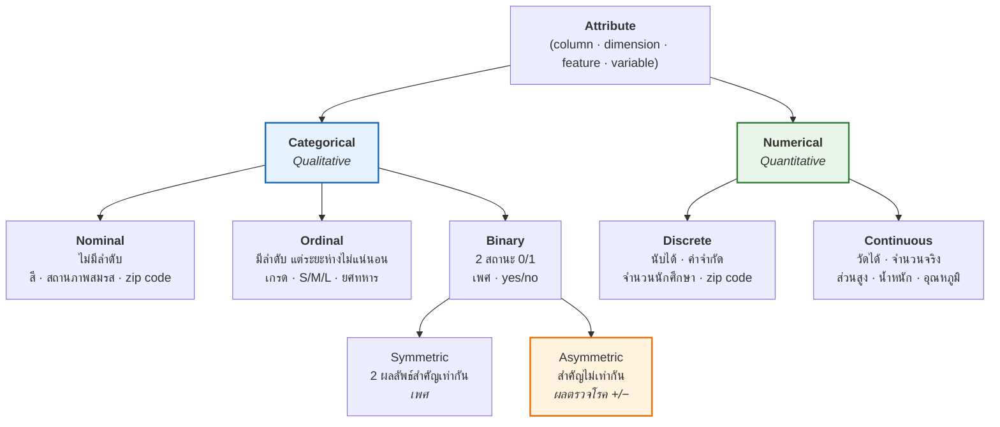

# 02 · Data, Dataset and Their Types

> [!warning] สถานะในข้อสอบ — อ่านก่อน
> บทนี้ **ไม่ปรากฏเป็นหัวข้อแยกใน `guidline.txt`** แต่ **ห้ามข้าม** เพราะเป็นฐานของหัวข้อที่ออกแน่:
> - **Attribute types (Nominal / Ordinal / Binary / Numerical)** → ตัดสินว่าจะใช้ **Mean / Median / Mode** ตัวไหนเติมค่าว่าง และจะใช้ **One-hot vs Label encoding** ตัวไหน ([[04 Data Pre-processing]] = guideline ข้อ 3)
> - **Distance & scale** → เป็นเหตุผลว่าทำไมต้องทำ **Feature Scaling** (guideline ข้อ 3 ระบุตรง ๆ)
> - **Roles of attributes (Target vs Predictor)** → ใช้ใน [[09 Regression Analysis]] (guideline ข้อ 8)
>
> ส่วน **Similarity/Distance formulas** เป็นเนื้อหาสำหรับ k-NN/Clustering ซึ่ง guideline ไม่ระบุ → อ่านแบบ "รู้ไว้ ทำเป็น" พอ แต่ **Euclidean + ผลของ scale ควรทำได้**

**ลิงก์:** [[00 START HERE|หน้าหลัก]] · ก่อนหน้า [[01 Introduction to Data Analytics]] · ถัดไป [[03 Exploratory Data Analysis (EDA)]] · [[10 Formula Sheet]]

---

## 2.1 Data vs. Dataset

| | **Data** | **Dataset** |
|---|---|---|
| **นิยาม** | raw facts, measurements, observations, symbols หรือค่าที่เก็บจากสิ่งต่าง ๆ ในโลกจริง | **collection ของ data objects** ที่จัดระเบียบไว้เพื่อจัดเก็บ ประมวลผล และวิเคราะห์ |
| **ตัวอย่าง** | GPA ของนักศึกษาคนหนึ่ง, อุณหภูมิที่วัดจากเซนเซอร์ | records, transactions, sequences, graphs, images, videos, embeddings |
| **เน้นอะไร** | ตัวค่า | **structure, organization, relationships, temporal dynamics, spatial dependencies** |

> [!important] ศัพท์คู่ที่ต้องแปลงไปมาให้คล่อง
> - **Database rows → data objects** (แถว = ตัวอย่าง/ระเบียน/instance)
> - **Database columns → attributes** (คอลัมน์ = คุณลักษณะ)
>
> คำที่ใช้แทน "attribute" ได้ทั้งหมด: **column, dimension, feature, variable** — ข้อสอบสลับใช้คำพวกนี้ได้ทุกคำ

**ตัวอย่าง dataset:** sales dataset (customers, store items, sales) · medical dataset (patients, treatments) · university dataset (students, professors, courses)

---

## 2.2 Important Characteristics of Datasets ⭐ 5 ตัว

จำด้วยตัวย่อ **"D-S-R-S-D"** หรือจำเป็นคำถาม "กว้างแค่ไหน / ว่างแค่ไหน / ละเอียดแค่ไหน / ใหญ่แค่ไหน / เกาะกลุ่มยังไง"

| ลักษณะ | ความหมาย | ประเด็นที่ตามมา |
|---|---|---|
| **Dimensionality** | จำนวน attribute ในชุดข้อมูล | ข้อมูลมิติสูงทำให้เกิด **curse of dimensionality** → แก้ด้วย [[04 Data Pre-processing#Feature Reduction / PCA\|PCA / Feature Selection]] |
| **Sparsity** | สัดส่วนของค่า **ศูนย์หรือค่าว่าง** ในชุดข้อมูล · "**Only presence counts**" (นับเฉพาะสิ่งที่มี) | เช่น transaction data, term-frequency vector → ใช้ measure แบบ **asymmetric** (Jaccard, Cosine) ไม่ใช่ simple matching |
| **Resolution** | ระดับรายละเอียดของข้อมูล | **"Patterns depend on the scale"** — pattern ที่เห็นเปลี่ยนตามความละเอียด (ข้อมูลรายวินาที vs รายเดือน เห็นคนละเรื่อง) → เชื่อมกับ **grain** ใน [[06 Multi-Dimensional Design]] |
| **Size** | ปริมาณข้อมูล (bytes หรือจำนวน record) | ชนิดการวิเคราะห์ที่ทำได้ขึ้นกับขนาด |
| **Distribution** | ค่ากระจายตัวยังไง เช่น **centrality และ dispersion** | → [[03 Exploratory Data Analysis (EDA)]] (histogram, boxplot, skewness) |

---

## 2.3 Types of Data ≠ Types of Datasets ⭐ ชอบออกเป็นข้อแยกแยะ

> [!important] เส้นแบ่งที่ต้องจำ
> - **Types of DATA** = ธรรมชาติของ **ค่าหรือ attribute แต่ละตัว** (numerical, categorical, ordinal, binary, text, temporal, image, spatial coordinates)
> - **Types of DATASETS** = **collection ถูกจัดระเบียบและเชื่อมโยงกันยังไง** (tabular, transactional, matrix, time-series, graph/network, stream, spatial, multimedia, embedding/vector)
>
> ประโยคปิดท้ายในสไลด์: **"learning algorithms frequently depend more on dataset structure than on individual attribute types"** — อัลกอริทึมมักขึ้นกับ *โครงสร้างของ dataset* มากกว่าชนิดของ attribute รายตัว

### 2 ชนิด dataset ที่สไลด์ขยายความ

| | **Tabular dataset** | **Transactional dataset** |
|---|---|---|
| **โครงสร้าง** | rows = data objects, columns = attributes | รูปแบบพิเศษของ record data — แต่ละ record บรรจุ **เซตของ items** |
| **ตัวอย่าง** | ฐานข้อมูลนักศึกษา, sales records, hospital records | `{milk, bread, eggs, coffee}` |
| **หมายเหตุ** | **โครงสร้างที่พบบ่อยที่สุด** ใน traditional analytics | ความยาวไม่คงที่, sparse มาก |
| **อัลกอริทึมที่เหมาะ** | decision trees, random forests, **XGBoost**, logistic regression | **association rule mining**, recommendation systems, retail analytics, consumer behavior analysis |

---

## 2.4 Attribute Types ⭐⭐ ต้องแม่น (ใช้ต่อในบทที่ 4 และ 9)

### แผนผังการจำแนก

### ตาราง Stevens' scale — 4 ระดับ (Nominal → Ordinal → Interval → Ratio) ⭐

สไลด์ p.14 ให้ตารางนี้ **พร้อมคอลัมน์ Operations** ซึ่งเป็นจุดที่ข้อสอบชอบถาม ("ค่าสถิติใดใช้กับ attribute ประเภทใดได้")

| | **Type** | **คำอธิบาย** | **Operator ที่ใช้ได้** | **ตัวอย่าง** | **สถิติ/Operations ที่ทำได้** |
|---|---|---|---|---|---|
| **Categorical** *(Qualitative)* | **Nominal** | ค่าใช้ **แยกแยะ** ได้อย่างเดียว | `=` , `≠` | zip codes, employee ID, eye color, sex {male, female} | **mode**, entropy, contingency correlation, χ² test |
| | **Ordinal** | ค่าใช้ **เรียงลำดับ** วัตถุได้ด้วย | `<` , `>` | ความแข็งของแร่, {good, better, best}, grades, street numbers | **median**, percentiles, rank correlation |
| **Numeric** *(Quantitative)* | **Interval** | **ผลต่าง** ระหว่างค่ามีความหมาย | `+` , `−` | **ไม่มีศูนย์แท้** เช่น ปฏิทิน, อุณหภูมิ °C/°F | **mean**, standard deviation, Pearson's correlation, t & F tests |
| | **Ratio** | ทั้ง **ผลต่างและอัตราส่วน** มีความหมาย | `×` , `÷` | **มีศูนย์แท้** เช่น น้ำหนัก, จำนวนเงิน, counts, อายุ, มวล, ความยาว | geometric mean, harmonic mean, percent variation |

> [!tip] ตัวชี้ขาด Interval vs Ratio = **"มีศูนย์แท้ (true zero) หรือไม่"**
> - **อุณหภูมิ 40°C ไม่ได้ร้อนเป็น 2 เท่าของ 20°C** → 0°C ไม่ได้แปลว่า "ไม่มีความร้อน" → **Interval**
> - **น้ำหนัก 40 กก. หนักเป็น 2 เท่าของ 20 กก. จริง** → 0 กก. = ไม่มีมวล → **Ratio**
>
> ตารางนี้เป็นของ **S. S. Stevens** (สไลด์ระบุชื่อไว้ — อาจถามได้)

> [!warning] กับดักคลาสสิก: **Zip code**
> เป็น **ตัวเลข** แต่บวกลบไม่มีความหมาย → เป็น **Nominal** (สไลด์เอง list zip code ไว้ทั้งใน Nominal และใน Discrete — เพราะ zip code เป็น *nominal ที่เก็บเป็น discrete integer*) ถ้าโจทย์ถามว่าเป็น "ระดับการวัด" อะไร → ตอบ **Nominal**
>
> กับดักคู่กัน: **Street numbers** สไลด์จัดเป็น **Ordinal** (บ้านเลขที่บอกลำดับตามถนนได้)

### Binary: Symmetric vs Asymmetric ⭐ (จำเป็นสำหรับสูตร distance)

| | **Symmetric binary** | **Asymmetric binary** |
|---|---|---|
| **นิยาม** | ผลลัพธ์ทั้งสอง **สำคัญเท่ากัน** | ผลลัพธ์ **สำคัญไม่เท่ากัน** |
| **ตัวอย่าง** | gender (M/F) | ผลตรวจทางการแพทย์ (positive vs negative) |
| **ธรรมเนียม** | — | **กำหนด 1 ให้กับผลลัพธ์ที่สำคัญกว่า** (เช่น HIV positive = 1) |
| **การนับ `t` (0,0)** | **นับ** | **ไม่นับ** — เพราะ "ทั้งคู่ไม่เป็นโรค" ไม่ได้บอกว่าสองคนนี้เหมือนกัน |

### Discrete vs. Continuous

| | **Discrete** | **Continuous** |
|---|---|---|
| ค่า | เซตจำกัด (finite set of values) | จำนวนจริง (real numbers) |
| ตัวอย่าง | zip codes, profession, เซตของคำในเอกสาร | temperature, height, weight |
| เก็บเป็น | integer variables | **floating-point variables** |
| หมายเหตุ | — | ในทางปฏิบัติวัดและแทนค่าได้ด้วย **จำนวนหลักที่จำกัด** เท่านั้น |

### Roles of Attributes ⭐ (ใช้ต่อในบทที่ 9)

> [!important] ชื่อเรียกที่ต้องรู้ว่าเป็นตัวเดียวกัน
> | บทบาท | ชื่อพ้องทั้งหมด | ตัวอย่างจากสไลด์ |
> |---|---|---|
> | **ตัวที่ต้องการทำนาย (output)** | **Target · Response · Outcome · Dependent variable · Label** | `PlayCricket` |
> | **ตัวที่ใช้ทำนาย (input)** | **Predictor · Independent variable** (บางที่เรียก feature) | `Gender`, `Prev_Exam_Marks`, `Height`, `Weight` |
>
> ใน [[09 Regression Analysis]] จะเรียก $Y$ = dependent, $X$ = independent — คือคู่เดียวกันนี้

---

## 2.5 Data Sources: Primary vs Secondary ⭐ ออกง่าย ตอบง่าย

| | **Primary Data** | **Secondary Data** |
|---|---|---|
| **นิยาม** | ข้อมูลดิบที่ทีมวิเคราะห์ **เก็บเองโดยตรง** จากแหล่ง | ข้อมูลที่ทีม **ไม่ได้เก็บเอง** แต่ได้จากแหล่งที่มีอยู่แล้ว |
| **ตัวอย่าง** | ข้อมูลจากแอป, แบบสอบถาม (surveys), การทดลอง, สัมภาษณ์โดยตรง, เซนเซอร์ | อินเทอร์เน็ต, องค์กรเอกชน, สถาบันวิจัย, หนังสือ, วารสาร, หน่วยงานรัฐ |
| **ข้อดี** | **แม่นยำ** และ **ตรงกับความต้องการ** ของทีมวิเคราะห์ | **พร้อมใช้ทันที** ประหยัดเวลาและค่าใช้จ่าย |
| **ข้อเสีย** | ใช้ **เวลาและค่าใช้จ่ายสูง** | อาจ **ไม่ตรงความต้องการ** เพราะไม่ได้เก็บมาเพื่อจุดประสงค์นี้ |

> [!tip] จำแบบเทียบ
> Primary = ทำกับข้าวเอง (อร่อยตรงใจ แต่เหนื่อย) · Secondary = ซื้อข้าวกล่อง (เร็ว ถูก แต่อาจไม่ถูกปาก)

---

## 2.6 Similarity, Dissimilarity, Proximity

> [!important] 3 คำนี้ต่างกันยังไง
> | คำ | ความหมาย | ทิศทาง | ช่วงค่า |
> |---|---|---|---|
> | **Similarity** | วัดว่า 2 objects **เหมือนกันแค่ไหน** | ค่าสูง = เหมือนมาก | มักอยู่ใน **[0, 1]** |
> | **Dissimilarity** (เช่น distance) | วัดว่า 2 objects **ต่างกันแค่ไหน** | ค่าสูง = ต่างมาก · ค่าต่ำ = เหมือนกัน | ค่าต่ำสุดมักเป็น **0** |
> | **Proximity** | **คำรวม** ของทั้งสองตัวข้างบน — บอก "ความใกล้/ไกล" | — | — |

### Minkowski distance — สูตรแม่

$$d(i,j)=\left(\sum_{k=1}^{p}\left|x_{ik}-x_{jk}\right|^{h}\right)^{1/h}$$

โดย $i=(x_{i1},\dots,x_{ip})$ และ $j=(x_{j1},\dots,x_{jp})$ เป็น objects มิติ $p$ และ $h$ คือ **order** (เรียกว่า **L-h norm**)

![[distance_measures.png]]

| $h$ | ชื่อ | สูตร | ภาพ |
|---|---|---|---|
| **$h=1$** | **Manhattan** (city block, **L1 norm**) | $d(i,j)=\lvert x_{i1}-x_{j1}\rvert+\lvert x_{i2}-x_{j2}\rvert+\dots+\lvert x_{ip}-x_{jp}\rvert$ | เดินตามตารางถนน |
| **$h=2$** | **Euclidean** (**L2 norm**) — *นิยมที่สุด* | $d(i,j)=\sqrt{\lvert x_{i1}-x_{j1}\rvert^{2}+\dots+\lvert x_{ip}-x_{jp}\rvert^{2}}$ | เส้นตรงระหว่างจุด |

> [!note] Hamming distance
> เป็นกรณีพิเศษของ **Manhattan ($h=1$)** — นับ **จำนวนบิตที่ต่างกัน** ระหว่าง binary vector สองตัว

### คุณสมบัติของ metric ⭐ 3 ข้อ

> [!important] distance ที่ครบ 3 ข้อนี้เรียกว่า **metric**
> 1. **Positive definiteness:** $d(i,j)>0$ เมื่อ $i\neq j$ และ $d(i,i)=0$
> 2. **Symmetry:** $d(i,j)=d(j,i)$
> 3. **Triangle Inequality:** $d(i,j)\le d(i,k)+d(k,j)$

### ⚠️ ปัญหาเรื่องสเกล → ทำไมต้อง Normalization

> [!warning] ประโยคสำคัญในสไลด์ (เชื่อมกับ guideline ข้อ 3 โดยตรง)
> **"Problem: Raw distance measures are highly influenced by scale of measurements. Solution: Normalization"**
>
> ถ้า attribute หนึ่งมีหน่วยเป็นบาท (0–1,000,000) อีกตัวเป็นอายุ (0–100) → **ระยะทางจะถูกครอบงำโดยตัวที่สเกลใหญ่** ตัวเล็กแทบไม่มีผล
> → ต้องทำ **Feature Scaling** ก่อน ดู [[04 Data Pre-processing#4.7 Feature Scaling ⭐⭐ (guideline ข้อ 3.7 — สูตรออกแน่)]]

### ตัวอย่าง Data Matrix → Dissimilarity Matrix (สไลด์ p.21)

**Data Matrix**

| point | attribute1 | attribute2 |
|---|---|---|
| x1 | 1 | 2 |
| x2 | 3 | 5 |
| x3 | 2 | 0 |
| x4 | 4 | 5 |

**Dissimilarity Matrix (Euclidean)** — เป็นเมทริกซ์สามเหลี่ยมล่าง เพราะสมมาตรและแนวทแยง = 0

| | x1 | x2 | x3 | x4 |
|---|---|---|---|---|
| **x1** | 0 | | | |
| **x2** | 3.61 | 0 | | |
| **x3** | **2.24** ⚠️ | 5.10 | 0 | |
| **x4** | 4.24 | 1.00 | 5.39 | 0 |

> [!bug] สไลด์พิมพ์ผิด 1 ช่อง — รู้ไว้กันงงในห้องสอบ
> สไลด์พิมพ์ `d(x1,x3) = 5.1` แต่คำนวณจริง:
> $$d(x_1,x_3)=\sqrt{(1-2)^2+(2-0)^2}=\sqrt{1+4}=\sqrt{5}=\mathbf{2.24}$$
> ค่า **5.1 ถูกคัดลอกซ้ำมาจาก $d(x_2,x_3)=\sqrt{(3-2)^2+(5-0)^2}=\sqrt{26}=5.10$**
> อีก 5 ช่องที่เหลือถูกต้องหมด (ตรวจแล้วด้วย `scripts/fig02_distance.py`)
>
> **ถ้าเจอในข้อสอบ ให้คำนวณเอง** อย่าจำตัวเลขจากสไลด์

---

## 2.7 Dissimilarity สำหรับ Nominal Data

**วิธีที่ 1 — Simple matching**

$$d(i,j)=\frac{p-m}{p}$$

โดย $m$ = จำนวน attribute ที่ **ตรงกัน** (matches), $p$ = จำนวน attribute **ทั้งหมด**

> [!example] อ่านสูตรเป็นภาษาคน
> "สัดส่วนของ attribute ที่ **ไม่ตรงกัน**" — ถ้ามี 5 attribute ตรงกัน 3 ตัว → $d = (5-3)/5 = 0.4$

**วิธีที่ 2 —** สร้าง **binary attribute จำนวนมาก** โดยสร้าง binary attribute ใหม่ 1 ตัวต่อ 1 category (จากทั้งหมด $M$ categories)
→ **นี่คือ One-Hot Encoding นั่นเอง** ดู [[04 Data Pre-processing#One-Hot Encoding (Dummy Encoding)]]

---

## 2.8 Dissimilarity / Similarity สำหรับ Binary Data ⭐ ตัวอย่างคำนวณที่ออกได้

### Contingency table

|  | | **Object j** | |
|---|---|---|---|
| | | **1** | **0** |
| **Object i** | **1** | $q$ | $r$ |
| | **0** | $s$ | $t$ |

- $q$ = จำนวน attribute ที่ทั้งคู่เป็น **(1,1)**
- $r$ = **(1,0)** — i มี, j ไม่มี
- $s$ = **(0,1)** — i ไม่มี, j มี
- $t$ = **(0,0)** — ทั้งคู่ไม่มี

### 3 สูตรที่ต้องจำ ⭐

> [!important] ต่างกันแค่ "นับ $t$ หรือไม่"
> **Symmetric binary distance** — นับ $t$ ด้วย (เพราะ 0-0 ก็ถือว่าเหมือนกัน):
> $$d(i,j)=\frac{r+s}{q+r+s+t}$$
>
> **Asymmetric binary distance** — **ตัด $t$ ทิ้ง** (0-0 ไม่มีความหมาย):
> $$d(i,j)=\frac{r+s}{q+r+s}$$
>
> **Jaccard coefficient** — *similarity* สำหรับ asymmetric binary:
> $$\text{Jaccard}(i,j)=\frac{q}{q+r+s}=1-d_{\text{asym}}(i,j)$$

### ตัวอย่างเต็มจากสไลด์ (p.26–27) — โจทย์แนวข้อสอบ

| Name | Gender | Fever | Cough | Test-1 | Test-2 | Test-3 | Test-4 |
|---|---|---|---|---|---|---|---|
| Jack | M | Y | N | P | N | N | N |
| Mary | F | Y | N | P | N | P | N |
| Jim | M | Y | P | N | N | N | N |

**เงื่อนไข:** Gender เป็น **symmetric** · ที่เหลือเป็น **asymmetric binary** · ให้ `Y` และ `P` = **1**, `N` = **0**

แปลงเป็น 0/1 (ใช้เฉพาะ 6 คอลัมน์ asymmetric — **ตัด Gender ออก**):

| Name | Fever | Cough | Test-1 | Test-2 | Test-3 | Test-4 |
|---|---|---|---|---|---|---|
| Jack | 1 | 0 | 1 | 0 | 0 | 0 |
| Mary | 1 | 0 | 1 | 0 | 1 | 0 |
| Jim  | 1 | 1 | 0 | 0 | 0 | 0 |

> [!example]- 🧮 คำนวณทีละคู่ (กดดูวิธีทำ)
> **d(Jack, Mary)**
> - $q$ (1,1): Fever, Test-1 → **2**
> - $r$ (1,0): ไม่มี → **0**
> - $s$ (0,1): Test-3 → **1**
> $$d=\frac{r+s}{q+r+s}=\frac{0+1}{2+0+1}=\frac{1}{3}=\mathbf{0.33}$$
>
> **d(Jack, Jim)**
> - $q$: Fever → **1**
> - $r$: Test-1 (Jack มี, Jim ไม่มี) → **1**
> - $s$: Cough (Jack ไม่มี, Jim มี) → **1**
> $$d=\frac{1+1}{1+1+1}=\frac{2}{3}=\mathbf{0.67}$$
>
> **d(Jim, Mary)**
> - $q$: Fever → **1**
> - $r$: Cough → **1**
> - $s$: Test-1, Test-3 → **2**
> $$d=\frac{1+2}{1+1+2}=\frac{3}{4}=\mathbf{0.75}$$

> [!tip] ตีความผลลัพธ์
> $d(\text{Jack,Mary})=0.33$ **ต่ำสุด** → Jack กับ Mary **คล้ายกันมากที่สุด** (มีโรคคล้ายกัน) ส่วน Jim ต่างจากทั้งคู่
>
> **สังเกตว่าสูตรนี้ไม่แตะ Gender เลย** — Jack กับ Jim เพศเดียวกันแต่ยังต่างกัน 0.67 เพราะ Gender เป็น symmetric จึงถูกแยกออกจากการคำนวณ asymmetric

---

## 2.9 Cosine Similarity ⭐ (สำหรับข้อมูล sparse เช่นเอกสาร)

**บริบท:** เอกสารหนึ่งแทนด้วย attribute เป็นพัน ๆ ตัว แต่ละตัวคือ **ความถี่ของคำ** (term-frequency vector) → vector ยาวมากและ **sparse** (ศูนย์เยอะ)

$$\cos(d_1,d_2)=\frac{d_1\cdot d_2}{\lVert d_1\rVert\,\lVert d_2\rVert}$$

โดย $\cdot$ = **dot product** และ $\lVert d\rVert$ = **ความยาว (norm) ของเวกเตอร์** $=\sqrt{\sum d_k^2}$

**การใช้งาน:** information retrieval, biologic taxonomy, gene feature mapping, micro-array gene features

> [!example]- 🧮 ตัวอย่างจากสไลด์ (p.30) — ทำตามให้ได้
> $d_1 = (5,\,0,\,3,\,0,\,2,\,0,\,0,\,2,\,0,\,0)$
> $d_2 = (3,\,0,\,2,\,0,\,1,\,1,\,0,\,1,\,0,\,1)$
>
> **ขั้นที่ 1 — dot product** (คูณตำแหน่งต่อตำแหน่งแล้วบวก):
> $$d_1\cdot d_2 = 5(3)+0+3(2)+0+2(1)+0+0+2(1)+0+0 = 15+6+2+2 = \mathbf{25}$$
>
> **ขั้นที่ 2 — ความยาวแต่ละเวกเตอร์:**
> $$\lVert d_1\rVert=\sqrt{5^2+3^2+2^2+2^2}=\sqrt{25+9+4+4}=\sqrt{42}=\mathbf{6.481}$$
> $$\lVert d_2\rVert=\sqrt{3^2+2^2+1^2+1^2+1^2+1^2}=\sqrt{9+4+1+1+1+1}=\sqrt{17}=\mathbf{4.12}$$
>
> **ขั้นที่ 3 — หาร:**
> $$\cos(d_1,d_2)=\frac{25}{6.481\times 4.12}=\frac{25}{26.70}=\mathbf{0.94}$$
>
> **ตีความ:** ค่าใกล้ 1 → เอกสารสองฉบับ **คล้ายกันมาก** (ค่า 0 = ตั้งฉาก/ไม่เกี่ยวกันเลย)

> [!tip] ทำไม Cosine ถึงเหมาะกับเอกสาร
> Cosine วัด **มุม** ไม่ใช่ **ขนาด** → เอกสารยาว 10 หน้ากับ 1 หน้าที่พูดเรื่องเดียวกัน จะได้ค่าใกล้ 1 เหมือนกัน (ถ้าใช้ Euclidean จะต่างกันมากเพราะความถี่คำต่างกันเยอะ) และ **ค่าศูนย์ที่ตรงกันไม่ถูกนับ** ในตัวเศษ → เหมาะกับ **sparse data**

### Measure อื่น ๆ ที่สไลด์เอ่ยถึง (รู้ชื่อพอ)

Simple Matching Coefficients (SMC) · **Pearson's Correlation** (→ ใช้ใน [[03 Exploratory Data Analysis (EDA)]] และ [[09 Regression Analysis]]) · Mahalanobis Distance · Coherence similarity · similarity สำหรับข้อมูลที่มี attribute หลายชนิดปนกัน · similarity สำหรับ Complex Data

---

## ✅ Self-Test — บทที่ 2

> [!question]- Q1. `zip code` เป็น attribute ประเภทใดในสเกลของ Stevens และใช้สถิติอะไรได้
> **Nominal** — แม้จะเป็นตัวเลขแต่บวกลบเทียบขนาดไม่มีความหมาย · ใช้ได้เฉพาะ **mode, entropy, contingency correlation, χ² test** (ห้ามใช้ mean)

> [!question]- Q2. อุณหภูมิ °C เป็น Interval หรือ Ratio เพราะอะไร
> **Interval** — เพราะ **ไม่มี true zero** (0°C ไม่ได้แปลว่าไม่มีความร้อน) จึงพูดว่า "40°C ร้อนเป็น 2 เท่าของ 20°C" ไม่ได้ · ทำได้แค่ `+` `−` ไม่ใช่ `×` `÷`

> [!question]- Q3. คำนวณ $d(x_1,x_4)$ แบบ Euclidean และ Manhattan เมื่อ $x_1=(1,2)$, $x_4=(4,5)$
> Euclidean: $\sqrt{(1-4)^2+(2-5)^2}=\sqrt{9+9}=\sqrt{18}=\mathbf{4.24}$
> Manhattan: $|1-4|+|2-5|=3+3=\mathbf{6}$
> (Manhattan ≥ Euclidean เสมอ — เพราะเดินอ้อมย่อมไกลกว่าเส้นตรง)

> [!question]- Q4. ต่างกันยังไงระหว่างสูตร symmetric กับ asymmetric binary distance
> Symmetric: $\dfrac{r+s}{q+r+s+t}$ — **นับ $t$ (0,0)** · Asymmetric: $\dfrac{r+s}{q+r+s}$ — **ไม่นับ $t$**
> เหตุผล: ใน asymmetric การที่ทั้งคู่เป็น 0 (เช่น ทั้งคู่ตรวจไม่พบโรค) ไม่ได้แปลว่าสองคนนี้คล้ายกัน จึงไม่ควรนับเป็นความเหมือน

> [!question]- Q5. Jaccard coefficient สัมพันธ์กับ asymmetric distance อย่างไร
> $\text{Jaccard}=\dfrac{q}{q+r+s}=1-d_{\text{asym}}$ — เป็น **similarity** ส่วน $d$ เป็น **dissimilarity** บวกกันได้ 1

> [!question]- Q6. ทำไมต้องทำ Normalization ก่อนคำนวณระยะทาง
> เพราะ **raw distance ถูกครอบงำโดย attribute ที่มีสเกลใหญ่** — attribute หน่วยบาท (0–1,000,000) จะกลบ attribute หน่วยปี (0–100) ทำให้ระยะทางสะท้อนแค่ตัวแปรเดียว

> [!question]- Q7. 3 คุณสมบัติของ metric คืออะไร
> 1) Positive definiteness: $d(i,j)>0$ เมื่อ $i \neq j$, $d(i,i)=0$ · 2) Symmetry: $d(i,j)=d(j,i)$ · 3) Triangle inequality: $d(i,j)\le d(i,k)+d(k,j)$

> [!question]- Q8. Primary กับ Secondary data ต่างกันอย่างไร ยกข้อดี-ข้อเสียอย่างละ 1
> **Primary** = เก็บเอง (แบบสอบถาม, เซนเซอร์, สัมภาษณ์) → ข้อดี: แม่นยำและตรงความต้องการ / ข้อเสีย: เปลืองเวลาและเงิน
> **Secondary** = ได้จากแหล่งที่มีอยู่ (อินเทอร์เน็ต, หน่วยงานรัฐ, วารสาร) → ข้อดี: พร้อมใช้ ประหยัด / ข้อเสีย: อาจไม่ตรงความต้องการ

> [!question]- Q9. 5 ลักษณะสำคัญของ dataset คืออะไร
> **Dimensionality** (จำนวน attribute → curse of dimensionality), **Sparsity** (สัดส่วนค่าศูนย์/ว่าง), **Resolution** (ระดับรายละเอียด — pattern ขึ้นกับ scale), **Size** (ปริมาณ), **Distribution** (การกระจาย — centrality & dispersion)

---

**ถัดไป →** [[03 Exploratory Data Analysis (EDA)]]
