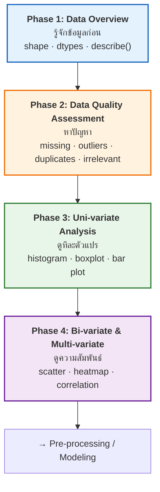

# 03 · Exploratory Data Analysis (EDA)
### การวิเคราะห์ข้อมูลเชิงสำรวจ

> [!abstract] guideline ข้อ 2 บอกว่าออกสอบอะไร
> 1. **Definition and benefits of EDA**
> 2. **EDA procedures:** Data Overview · Data Quality Assessment
> 3. **Levels of analysis:** Univariate · Bivariate · Multivariate
> 4. **Data Visualization & Statistics:** **Histogram · Boxplot · Scatter Plot · Heatmap**
>
> ⚠️ ข้อ 4 ระบุ **ชื่อกราฟ 4 ชนิดเฉพาะเจาะจง** → แทบแน่นอนว่ามีข้อสอบถามว่า "กราฟไหนใช้ตอนไหน" หรือ "ให้โจทย์แล้วเลือกกราฟ" — ดู [[#🎯 ตารางเลือกกราฟ]]

**ลิงก์:** [[00 START HERE|หน้าหลัก]] · ก่อนหน้า [[02 Data and Dataset Types]] · ถัดไป [[04 Data Pre-processing]] · [[10 Formula Sheet]]

---

## 3.1 EDA คืออะไร + ประโยชน์ ⭐ (guideline ข้อ 2.1)

> [!quote] Definition
> **Exploratory Data Analysis (EDA) is the process of exploring and summarizing key characteristics of data using statistics, data visualization, … ⇒ Understanding Data**

### Core Components 5 อย่าง

1. **Statistical summaries** and descriptive analysis
2. **Visual representation** through graphs and charts
3. **Data quality assessment**
4. **Cleaning insights** for next data pre-processing step
5. Advanced techniques …

### Key Benefits 4 ข้อ ⭐ ท่องให้ได้ (ข้อสอบถามตรง ๆ ได้)

| ประโยชน์ | อธิบาย |
|---|---|
| **Helps understand data structure and properties** | เข้าใจโครงสร้างและคุณสมบัติของข้อมูล |
| **Provides essential foundation before building models** | เป็นฐานที่จำเป็น **ก่อน** สร้างโมเดล |
| **Reveals patterns, outliers, and relationships** within the data | เผยรูปแบบ ค่าผิดปกติ และความสัมพันธ์ |
| **Support decision-making for selecting appropriate analysis methods** | ช่วยตัดสินใจว่าจะเลือกวิธีวิเคราะห์แบบไหน |

> [!important] ตำแหน่งของ EDA ในกระบวนการ
> EDA คือ **ขั้นที่ 3** ของ [[01 Introduction to Data Analytics#1.4 Main Steps of Analytics (6 ขั้น) ⭐ น่าจะออก|Main Steps of Analytics]] — "**Data Exploration Analysis (EDA) and Data Preparation**" ซึ่งกินเวลา **60–80%** ของโครงการ
>
> **EDA มาก่อน Pre-processing** — สำรวจให้รู้ปัญหาก่อน แล้วค่อยแก้ ผลลัพธ์ของ EDA คือ "**cleaning insights**" ที่ส่งต่อให้ [[04 Data Pre-processing]]

---

## 3.2 EDA Procedures — 4 Phases ⭐⭐ (guideline ข้อ 2.2)

สไลด์ให้แผนนี้ **ซ้ำ 2 ครั้ง** (p.4 และ p.31) → สัญญาณชัดว่าอาจารย์ต้องการให้จำ



### ตารางสรุป 4 Phases พร้อมคำสั่ง Python (สำหรับ **Lab**)

| Phase | ทำอะไร | คำสั่ง Python ในสไลด์ |
|---|---|---|
| **1. Data Overview** | โหลดข้อมูล + เช็คมิติ | `df.shape` , `df.info()` |
| | ดูชนิดข้อมูล | `df.dtypes` |
| | สรุปสถิติพื้นฐาน | `df.describe()` |
| **2. Data Quality Assessment** | **Missing Values:** ระบุและจัดการ | `df.isnull().sum()` |
| | **Outliers:** หาค่าสุดขั้ว | boxplots, **z-scores**, **IQR** |
| | **Duplicate Records:** หาและลบตัวซ้ำ | `df.duplicated()` / `drop_duplicates()` |
| | **Irrelevant Features:** ทิ้งคอลัมน์ที่ไม่ให้ข้อมูล | เช่น คอลัมน์ **ID** |
| **3. Uni-variate Analysis** | **Numerical:** กราฟการกระจาย | Histogram, boxplot |
| | **Categorical:** นับความถี่ | Value counts, bar-plots |
| | **Temporal:** รูปแบบตามเวลา | time-based patterns, **seasonality** |
| **4. Bi/Multi-variate** | ปฏิสัมพันธ์ระหว่าง feature | scatterplots, **heatmaps** |
| | ความสัมพันธ์กับ target | **correlation**, group means |
| | Advanced | **Segmentation (clustering)**, **Feature Engineering**, **OLAP** |

> [!tip] จำ Phase 2 ด้วยตัวย่อ **"MODI"**
> **M**issing · **O**utliers · **D**uplicates · **I**rrelevant features

---

## 3.3 Phase 1: Statistical Summary ⭐⭐ (สูตรที่ออกแน่)

สไลด์ p.23 ให้ชุดสถิติแบ่งเป็น 4 กลุ่ม — **ต้องจำครบทุกกลุ่ม**

### กลุ่ม 1 · Overview of Data Quality
- Number of records and missing values
- Detection of noises and outliers

### กลุ่ม 2 · Measures of Central Tendency (การวัดแนวโน้มสู่ส่วนกลาง)

| ค่า | นิยาม | สูตร | เหมาะกับ |
|---|---|---|---|
| **Mean** | ผลรวมทุกค่า ÷ จำนวนค่า | $\bar{x}=\dfrac{1}{n}\sum_{i=1}^{n}x_i$ | numerical ที่ **สมมาตร** |
| **Median** | ค่ากลางเมื่อเรียงข้อมูลแล้ว | ตำแหน่งที่ 50% | numerical ที่ **เบ้ (skewed)** หรือมี outlier |
| **Mode** | ค่าที่ปรากฏบ่อยที่สุด | — | **categorical** |

> [!important] นี่คือฐานของ guideline ข้อ 3 (Statistical Imputation)
> Mean → numerical · **Median → numerical โดยเฉพาะที่ skewed** · Mode → categorical
> ดูเหตุผลเชิงภาพที่ [[#3.4 Distribution Shape ⭐ (ทำไม skewed ต้องใช้ Median)]]

### กลุ่ม 3 · Measures of Dispersion (การวัดการกระจาย)

| ค่า | นิยาม | สูตร |
|---|---|---|
| **Range** | Maximum − Minimum | $R = x_{\max}-x_{\min}$ |
| **Variance ($\sigma^2$)** | ค่าเฉลี่ยของผลต่างกำลังสองจากค่าเฉลี่ย | $\sigma^{2}=\dfrac{1}{n}\sum(x_i-\bar{x})^{2}$ |
| **Standard Deviation ($\sigma$)** | รากที่สองของ variance | $\sigma=\sqrt{\sigma^{2}}$ |
| **Coefficient of variation** | SD เทียบกับ mean (ไร้หน่วย → เทียบข้ามชุดข้อมูลได้) | $CV=\dfrac{\sigma}{\bar{x}}$ |

### กลุ่ม 4 · Distribution Analysis ⭐

| ค่า | นิยาม |
|---|---|
| **Quartiles** | **Q1 (25%)** · **Q2 (50% = Median)** · **Q3 (75%)** |
| **IQR (Interquartile Range)** | $\text{IQR}=Q_3-Q_1$ |
| **Skewness** | ใกล้ 0 → เกือบเป็น normal distribution |

> [!important] เกณฑ์ Skewness ในสไลด์ — **ตัวเลขนี้ออกสอบได้ตรง ๆ**
> | เกณฑ์ | ความหมาย |
> |---|---|
> | $\lvert\text{Skewness}\rvert < 0.5$ | **เบ้เล็กน้อย** (Nearly symmetric) |
> | $0.5 \le \lvert\text{Skewness}\rvert < 1$ | **เบ้ปานกลาง** (Moderately skewed) |
> | $\lvert\text{Skewness}\rvert \ge 1$ | **เบ้มาก** (Highly skewed) |

---

## 3.4 Distribution Shape ⭐ (ทำไม skewed ต้องใช้ Median)

![[eda_skewness.png]]

> [!important] ลำดับ Mean / Median / Mode ในแต่ละรูปทรง — ออกสอบบ่อยมาก
> | รูปทรง | ลักษณะ | ความสัมพันธ์ |
> |---|---|---|
> | **Normal** | Bell curve | **Mean ≈ Median** (≈ Mode) |
> | **Skewed Right** (เบ้บวก) | **หางยาวไปทางขวา** | **Mean > Median** (> Mode) |
> | **Skewed Left** (เบ้ลบ) | **หางยาวไปทางซ้าย** | **Mean < Median** (< Mode) |
>
> **วิธีจำ:** **"Mean วิ่งตามหาง"** — หางอยู่ข้างไหน Mean ถูกลากไปข้างนั้น ส่วน Median แทบไม่ขยับ

> [!tip] เชื่อมโยงไปข้อสอบข้อ 3
> เพราะ Mean ถูก outlier/หางลากไปได้ → เวลาข้อมูล **skewed** จึงต้องเติมค่าว่างด้วย **Median** ไม่ใช่ Mean
> ดูตัวเลขจริงในภาพ: skewed right มี Mean = 2.00 แต่ Median = 1.68 (ต่างกัน 19%)

**Key Metrics ของ univariate numerical:** **Skewness** (ความเบ้), **Kurtosis** (ความโด่ง)

**Categorical variables — Frequency Analysis:**

| ตัววัด | ความหมาย |
|---|---|
| **Value Counts** | นับความถี่ของแต่ละ category |
| **Relative Frequency** | สัดส่วน (%) |
| **Cardinality** | นับจำนวนค่าที่ไม่ซ้ำ (unique values) |

> [!important] เกณฑ์ Cardinality ในสไลด์
> **Low Cardinality: < 10 categories (OK)** · **High Cardinality: > 50 categories (quite high)**
> → high cardinality เป็นปัญหาตอนทำ **One-Hot Encoding** เพราะจะเกิดคอลัมน์เป็นร้อย ดูวิธีแก้ที่ [[04 Data Pre-processing#Combine categories]]

---

## 3.5 Phase 2: Data Quality Assessment ⭐⭐

### Missing Values

> [!quote] What is a missing value?
> **Missing values features: features having missing values**
>
> **สาเหตุ 4 อย่างในสไลด์:** "I Don't Know" · **Refusals to respond** (ปฏิเสธที่จะตอบ) · **Questions left blank** (เว้นว่าง) · **Failed measurement** (การวัดล้มเหลว)

**Detection & Assessment**

| ทำอะไร | คำสั่ง |
|---|---|
| นับจำนวนที่หายไป | `df.isnull().sum()` |
| หา **เปอร์เซ็นต์** ที่หายไป | `df.isnull().sum() / len(df) * 100` |
| **มองภาพรูปแบบการหาย** | `sns.heatmap(df.isnull())` หรือ `msno.matrix(df)` |
| ทำรายชื่อ feature ที่มีปัญหา + % | — |

> [!important] Decision Framework — เกณฑ์ตัวเลขที่ต้องจำ ⭐
> | เกณฑ์ | สิ่งที่ทำ |
> |---|---|
> | **> 50% missing** | **Rule of Thumb: พิจารณาทิ้งทั้งคอลัมน์** |
> | **< 5% ของข้อมูลทั้งหมด** | **Delete** (ลบแถวได้) |
> | ระหว่างนั้น | **Impute:** Mean / Median / Mode หรือ **Advanced: KNN Imputation, Multiple Imputation** |
>
> **Key Principle (ประโยคสำคัญ):** **"Always analyze the relationship between missing features and target variable before deciding to eliminate them"** — ต้องวิเคราะห์ความสัมพันธ์ระหว่าง feature ที่หายกับ target ก่อนตัดสินใจทิ้งเสมอ
>
> และ **"Evaluate impact on model performance before elimination"**

### 🎨 Heat Maps — 2 การใช้งานหลัก (guideline ระบุชื่อ Heatmap ตรง ๆ)

> [!quote] นิยาม
> **Heat maps are data visualizations that use color intensity to represent values within a matrix or table.** มีประสิทธิภาพในการแสดง pattern ที่ซับซ้อน ความสัมพันธ์ และความแปรผัน อย่างเข้าใจง่ายด้วยสายตา

> [!important] ⭐ ในบริบท data analytics heatmap มีประโยชน์ **2 อย่าง** (ประโยคนี้มาจากสไลด์ตรง ๆ)
> 1. **Visualizing correlation tables** (ดูตารางสหสัมพันธ์) — ดู [[#3.7 Bivariate: Numerical vs Numerical ⭐⭐]]
> 2. **Visualizing missing values in the data** (ดูค่าที่หายไป) — **BLACK DENOTES MISSING VALUE** (สีดำ = ค่าที่หายไป)

### Outlier Detection ⭐⭐ (สูตรคำนวณได้)

> [!quote] What are Outliers?
> **Data points that differ significantly from the majority of the dataset**

![[eda_boxplot_anatomy.png]]

**Detection Methods — 2 กลุ่ม**

**1) Statistical Methods**

> [!important] IQR Method — สูตรที่ต้องคำนวณเป็น
> จุดข้อมูลเป็น outlier ถ้า
> $$x < Q_1 - 1.5\,(\text{IQR}) \quad\text{หรือ}\quad x > Q_3 + 1.5\,(\text{IQR})$$
> โดย $\text{IQR}=Q_3-Q_1$

> [!important] Z-Score Method
> $$z=\frac{x-\mu}{\sigma}$$
> โดยทั่วไปถือว่า $\lvert z\rvert > 3$ (บางตำราใช้ 2.5 หรือ 2) คือ outlier
> *(สไลด์เขียนแค่ "Z-Score: …" ไม่ให้เกณฑ์ — ถ้าข้อสอบถามให้ระบุเกณฑ์ที่ใช้เสมอ)*

**2) Visual Methods**

| กราฟ | สัญญาณของ outlier |
|---|---|
| **Boxplot** | จุดที่อยู่ **นอกหนวด (whiskers)** |
| **Scatter Plot** | จุดที่อยู่ **ห่างจากกลุ่มหลัก** |
| **Histogram** | **แท่งที่แยกออกมา** จากการแจกแจงหลัก |

> [!important] Handling Strategies — 3 ทางเลือก (ข้อสอบชอบถามว่า "ควรทำอย่างไร")
> | ทางเลือก | ใช้เมื่อ |
> |---|---|
> | **Keep** (เก็บไว้) | มี **valid business case** หรือเป็นค่าสุดขั้วที่ **มีความหมายจริง** (เช่น ลูกค้า VIP ซื้อเยอะจริง) |
> | **Remove** (ลบ) | เป็น **data entry errors** หรือ **measurement mistakes** |
> | **Transform** (แปลง) | **Log, Square root** หรือ transformation อื่น |
>
> ⚠️ **อย่าตอบว่า "ลบทิ้งเสมอ"** — คำตอบที่ถูกคือ "ขึ้นกับว่าเป็นความผิดพลาดหรือค่าจริง"

---

## 3.6 Levels of Analysis ⭐⭐ (guideline ข้อ 2.3)


### ตารางแม่บท: ระดับ × ชนิดตัวแปร → ใช้อะไร ⭐ (ตารางนี้คือหัวใจของข้อสอบข้อนี้)

| ระดับ | ชนิดตัวแปร | เครื่องมือ / กราฟ | สถิติ |
|---|---|---|---|
| **Uni-variate** | Numerical | **Histogram**, **Boxplot**, distribution plot | Mean, Median, SD, **Skewness**, **Kurtosis** |
| | Categorical | **Bar plot**, value counts | Frequency, **Relative frequency (%)**, **Cardinality** |
| | Temporal | **Line plot** | Time-based patterns, **seasonality** |
| **Bi-variate** | **Num × Num** | **Scatter Plot**, **Correlation Heatmap**, **Pairplot** | **Pearson's r** |
| | **Cat × Cat** | **Stacked Bar Chart**, **Grouped Bar Chart**, **Heatmap** | **Contingency Table**, **Chi-Square Test of Independence**, Relative frequencies |
| | **Num × Cat** | **Grouped Boxplot**, **Violin Plot**, Group Histograms, **Density Plot**, Grouped Scatter | **Group Means/Medians**, **t-test** (2 กลุ่ม), **ANOVA** (3+ กลุ่ม) |
| **Multi-variate** | 2 Num + 1 Cat | **Scatter Plot with Color** | — |
| | 3 Num | **Bubble Chart** (x, y, **size**), **3D Scatter Plot** | — |
| | หลายตัว | **Correlation Matrix**, **PCA**, **Feature Interaction (A×B, A+B)** | Feature Importance, Segmentation, Pattern Recognition |

---

## 3.7 Bivariate: Numerical vs Numerical ⭐⭐

**Primary Objectives (จากสไลด์):**
- Identify **strength and direction** of relationships
- Analyze how changes in one variable correspond to changes in another

![[eda_correlation.png]]

### Pearson Correlation Coefficient ($r$) — สูตรเต็ม

$$r=\frac{\text{Cov}(X,Y)}{\sqrt{\text{Var}(X)\cdot\text{Var}(Y)}}$$

โดย

$$\text{Cov}(X,Y)=\frac{\sum(x_i-\bar{x})(y_i-\bar{y})}{n-1}\qquad
\text{Var}(X)=\frac{\sum(x_i-\bar{x})^{2}}{n-1}$$

> [!important] ค่าพิเศษของ $r$ — ท่องให้ได้
> | $r$ | ความหมาย |
> |---|---|
> | $r = 0$ | **no correlation** (ไม่มีความสัมพันธ์**เชิงเส้น**) |
> | $r = -1$ | **perfect negative linear correlation** |
> | $r = +1$ | **perfect positive linear correlation** |
>
> **ช่วงของ $r$ คือ $[-1, +1]$** เสมอ

> [!important] ⭐ เกณฑ์ความแรงจากสไลด์ — ตัวเลขนี้ออกสอบได้
> | ช่วง | ความแรง |
> |---|---|
> | $r > 0.7$ | **Strong positive** |
> | $0.3 < r < 0.7$ | **Moderate** |
> | $r < 0.3$ | **Weak** |
>
> (ฝั่งลบใช้เกณฑ์เดียวกันโดยดูค่าสัมบูรณ์ — สไลด์ระบุว่า "coefficients between 0 and −1 are negative correlations")

### ⚠️ กับดักที่ต้องระวัง 3 ข้อ

> [!warning] 1. Scatter Plot **ไม่บอกความแรง**
> สไลด์เขียนตรง ๆ: **"Scatter Plot — Show relationship between two variables. Not indicates the strength of relationship amongst them."**
> → อยากรู้ความแรงต้องดู **ตัวเลข $r$** ไม่ใช่แค่มองภาพ

> [!warning] 2. $r \approx 0$ **ไม่ได้แปลว่าไม่มีความสัมพันธ์**
> Pearson วัดได้เฉพาะความสัมพันธ์ **เชิงเส้น** — ดูภาพด้านบน (แผงล่างซ้าย): $y=x^2$ มีความสัมพันธ์ชัดเจนมาก แต่ $r \approx 0$

> [!warning] 3. **Correlation ≠ Causation**
> สไลด์ [[04 Data Pre-processing]] มีหน้าชื่อ **"Correlation VS Causation"** โดยตรง — สหสัมพันธ์ไม่ใช่ความเป็นเหตุเป็นผล

### ใช้ประโยชน์จาก $r$ อย่างไร ⭐ (ประเด็นที่ออกสอบได้)

> [!important] ถ้าสองตัวแปร **highly associated** ให้แยก 2 กรณี (สไลด์ p.43)
> **กรณี A — ทั้งคู่เป็น predictors:**
> → **ใช้แค่ตัวใดตัวหนึ่ง** ($x$ หรือ $y$) ในการวิเคราะห์ต่อ
> *(นี่คือรากของปัญหา **Multicollinearity** ใน [[09 Regression Analysis#Assumption 2 · No Multicollinearity ⭐⭐⭐]])*
>
> **กรณี B — ตัวหนึ่งเป็น predictor อีกตัวเป็น target:**
> → target ถูกครอบงำโดย predictor ตัวนี้ **ไม่จำเป็นต้องสร้างโมเดลซับซ้อน**

> [!example] ตัวอย่างรถยนต์จากสไลด์ (เชื่อมกับ Toyota Corolla ใน [[09 Regression Analysis]])
> - **Price และ Age** สัมพันธ์เชิงลบสูง → *สมเหตุสมผล เพราะรถเก่ากว่าย่อมถูกกว่า*
> - **Price และ Kilometers** ก็สัมพันธ์เชิงลบ → *รถวิ่งมากกว่าย่อมถูกกว่า*
>
> ในภาพ heatmap ด้านบน: $r(\text{Price},\text{Age})=-0.95$, $r(\text{Price},\text{KM})=-0.89$, และ $r(\text{Age},\text{KM})=+0.87$ ← **คู่สุดท้ายนี่แหละคือ multicollinearity**

### เครื่องมือมองภาพ 3 ตัว

| เครื่องมือ | จุดเด่น |
|---|---|
| **Scatter Plot** | ดูคู่ตัวแปรทีละคู่ได้ดีที่สุด · เห็นลักษณะความสัมพันธ์ (linear / non-linear) |
| **Correlation Heatmap** | แสดง $r$ ในรูปเมทริกซ์ **ใช้สีบอกค่า** → ดูหลายตัวแปรพร้อมกัน · **"Darker and bluer = stronger positive · Darker & redder = stronger negative"** |
| **Pairplot** (seaborn) | scatter ของทุกคู่ + **histogram บนแนวทแยง** → เห็นภาพรวมทั้งหมด |

---

## 3.8 Bivariate: Categorical vs Categorical

**Visualization:** Stacked Bar Chart (ดูการกระจาย) · Grouped Bar Chart (เทียบระหว่าง category) · Heatmap

### Contingency Table (Cross-tabulation) ⭐

> [!quote] นิยาม
> Matrix ที่แสดงการแจกแจงความถี่ของตัวแปร — แสดงจำนวน observation ที่ตกในแต่ละ **combination ของ categories** ของสองตัวแปร

**ตัวอย่างจากสไลด์:**

| | Target_0 | Target_1 | **Total** |
|---|---|---|---|
| **Group_A** | 150 | 50 | **200** |
| **Group_B** | 75 | 125 | **200** |
| **Total** | **225** | **175** | **400** |

> [!tip] อ่านตารางนี้ให้เป็น
> Group_A: Target_1 = 50/200 = **25%** · Group_B: Target_1 = 125/200 = **62.5%**
> → **Group_B มีโอกาสเป็น Target_1 สูงกว่า Group_A มาก** → สองตัวแปรนี้ **ไม่เป็นอิสระต่อกัน**
>
> ถ้าเป็นอิสระกันจริง แต่ละกลุ่มควรมีสัดส่วนใกล้ 175/400 = 43.75% เท่ากัน

**Chi-Square Test of Independence:** ทดสอบว่ามี **ความสัมพันธ์อย่างมีนัยสำคัญ** ระหว่างตัวแปร categorical สองตัวหรือไม่

**Relative Frequencies:** แสดงสัดส่วนของ observation ในแต่ละ combination เทียบกับทั้งหมด → ช่วยหา trend และ pattern

> [!example] ตัวอย่างจากสไลด์
> **แผนก vs เพศ:** แต่ละแผนกมีชาย-หญิงพอ ๆ กัน · แต่แผนก **developer มีหญิงมากกว่าชาย** · ส่วน **devops มีแต่ชายล้วน**
>
> **International Plan vs Churn:** *"Clearly, those who have selected the International Plan have a greater chance of leaving the company's service than do those who do not."*

---

## 3.9 Bivariate: Numerical vs Categorical

> [!quote] เป้าหมาย
> วิเคราะห์ว่า **ตัวแปร numerical เปลี่ยนไปหรือมีรูปแบบต่างกันหรือไม่ ในแต่ละกลุ่มของตัวแปร categorical**

### Group Comparison Methods

| กลุ่มวิธี | รายละเอียด |
|---|---|
| **Central Tendency** | **Group Means** · **Group Medians** · Median and Percentiles (25th, 75th) |
| **Statistical Tests** | **t-test → เทียบ 2 กลุ่ม** · **ANOVA → เทียบ 3+ กลุ่ม** ⭐ |
| **Visualization** | **Grouped Boxplot** (การกระจายแต่ละกลุ่ม) · **Violin Plot** (= Boxplot + Density curve) · **Group Histograms** · **Density Plot** · **Grouped Scatter Plot** (ใช้สี/รูปทรงแยกกลุ่ม) |

> [!important] จำ t-test vs ANOVA
> **t-test = 2 กลุ่ม** · **ANOVA = 3 กลุ่มขึ้นไป** — ข้อสอบชอบสลับกัน

![[eda_histogram.png]]

> [!example] ตัวอย่างธุรกิจจากสไลด์
> *"Employees in the Marketing department earn an average salary of 45,000 baht, which is higher than the IT department's average of 38,000 baht"*
>
> - **Bar chart ของ group mean:** จัดกลุ่มตามแผนก คำนวณเงินเดือนเฉลี่ยแต่ละกลุ่ม → **marketing มีเงินเดือนเฉลี่ยสูงสุด**
> - **Grouped box plot:** **"marketing มีระดับเงินเดือนสูงกว่าและมีความแปรผันน้อยกว่า"** ← boxplot ให้ข้อมูลมากกว่า bar chart เพราะเห็น **การกระจาย** ด้วย

> [!example] Side-by-side Boxplot — Boston Housing
> ```python
> ax = housing_df.boxplot(column='MEDV', by='CHAS')
> ax.set_ylabel('MEDV')
> plt.suptitle('')   # Suppress the titles
> plt.title('')
> ```
> **ข้อสรุป:** บ้านในย่านที่ติดแม่น้ำ Charles (CHAS = 1) **มีมูลค่าสูงกว่า** ย่านที่ไม่ติด (CHAS = 0)
> → **"Side-by-side boxplots are useful for comparing subgroups"**

> [!example] Histogram with churn overlay ⭐ (ดูภาพด้านบน)
> **ข้อสรุปจากสไลด์:** *"Customers who have called customer service **three times or less** have a **markedly lower churn rate** than customers who have called customer service **four or more times**"*
>
> **ทำไมต้องมีเวอร์ชัน Normalized ด้วย:** เพราะในกราฟนับดิบ ลูกค้าที่โทร ≥ 4 ครั้งมีจำนวนน้อยมาก แท่งจะเตี้ยจนมองไม่เห็นสัดส่วน — พอ normalize เป็นสัดส่วนแล้วรูปแบบจึงชัด

---

## 3.10 Multivariate Analysis

| กลุ่ม | เทคนิค |
|---|---|
| **Visualization** | **Scatter Plot with Color** (2 numerical + 1 categorical) · **Bubble Chart** (3 numerical: x, y, **size**) · **3D Scatter Plot** (3 numerical) |
| **Advanced** | **Correlation Matrix** (ความสัมพันธ์ทุกคู่) · **PCA** (ลดมิติ → [[04 Data Pre-processing#Feature Reduction / PCA]]) · **Feature Interaction** (A × B, A + B) |
| **Target Variable Analysis** | **Feature Importance** (ตัวแปรไหนกระทบ target มากสุด) · **Segmentation** (จัดกลุ่มจากหลาย feature) · **Pattern Recognition** |

> [!example] ตัวอย่างจากสไลด์: NOX vs. LSTAT (Boston Housing)
> ใช้ **scatterplot ที่เติมสี** — สำหรับงาน **classification** ที่มี **2 numerical predictors + 1 categorical outcome**
> **สีแดง = median value ต่ำ · สีน้ำเงิน = median value สูง**

---

## 🎯 ตารางเลือกกราฟ

> [!important] ⭐⭐ ตารางนี้คือคำตอบของข้อสอบแนว "โจทย์แบบนี้ใช้กราฟอะไร"
> | อยากรู้อะไร | ชนิดตัวแปร | ใช้กราฟ |
> |---|---|---|
> | ตัวแปรนี้กระจายตัวยังไง / เบ้ไหม | 1 numerical | **Histogram** |
> | มี outlier ไหม / เทียบการกระจายระหว่างกลุ่ม | 1 numerical (± 1 categorical) | **Boxplot** / Grouped Boxplot |
> | สองตัวเลขนี้สัมพันธ์กันไหม | 2 numerical | **Scatter Plot** |
> | หลายตัวเลขสัมพันธ์กันยังไงพร้อมกันหมด | หลาย numerical | **Correlation Heatmap** |
> | มีค่าหายไปตรงไหนบ้าง | ทั้งตาราง | **Heatmap ของ missing values** (ดำ = หาย) |
> | แต่ละหมวดมีกี่ตัว | 1 categorical | **Bar Chart** |
> | แนวโน้มตามเวลา / seasonality | temporal | **Line Plot** |
> | สองหมวดสัมพันธ์กันไหม | 2 categorical | **Stacked / Grouped Bar Chart**, Heatmap, Contingency Table |
> | 3 ตัวเลขพร้อมกัน | 3 numerical | **Bubble Chart** (x, y, size) หรือ 3D Scatter |
> | 2 ตัวเลข + 1 หมวด | mixed | **Scatter Plot with Color** |

### รายละเอียดกราฟแต่ละชนิด (จากสไลด์)

**Line Plot** — แสดงจุดข้อมูลเป็นเส้นที่ต่อกัน · ใช้แสดง **trend ระหว่างสองตัวแปรตามช่วงเวลาหรือลำดับที่ต่อเนื่อง** · **แกน x = independent variable (มักเป็นเวลา)**, **แกน y = dependent variable** · **"Line graphs are used primarily for showing time series"**

**Bar Chart** — เทียบ **สถิติตัวเดียว** (average, count, percentage) **ข้ามกลุ่ม** · ความสูง (หรือความยาว) ของแท่ง = ค่าของสถิตินั้น · แท่งต่างกัน = กลุ่มต่างกัน

**Scatterplot** — แสดงความสัมพันธ์ระหว่าง **สองตัวแปร numerical** · **"This is an important plot in the prediction task"**

**Distribution Plots** (Histogram + Boxplot) — แสดงว่า **"how many"** ของแต่ละค่ามีเท่าไร หรือสำหรับข้อมูลต่อเนื่อง แสดงว่า **มีกี่ค่าในแต่ละช่วง (bins)** · **boxplot และ histogram แสดงการแจกแจงทั้งหมดของตัวแปร numerical**

> [!important] ประโยชน์ของ Distribution Plot ที่สไลด์เน้น
> **"Distribution plots are useful for determining potential data science methods and variable transformations."**
> ตัวอย่าง: **ตัวแปร numerical ที่ skewed อาจต้อง transform (เช่น เปลี่ยนเป็น logarithmic scale) ถ้าจะใช้กับวิธีที่สมมติ normality (เช่น linear regression, discriminant analysis)**
> → นี่คือสะพานตรงไปยัง [[09 Regression Analysis]]

**Histogram** — แบ่งช่วงค่าออกเป็น **bins (buckets)** แล้วแสดงความถี่ในแต่ละ bin · ความสูงของแท่ง = frequency หรือ percent ของค่าใน bin นั้น
```python
## histogram of MEDV
ax = housing_df.MEDV.hist()
ax.set_xlabel('MEDV'); ax.set_ylabel('count')
```

**Boxplot** — แสดง **key summary statistics** และให้ภาพของ **variability, skewness และ potential outliers** · ส่วนประกอบ: `"min"` → **Q1** → **Median** → **Q3** → `"max"` → **outliers**

---

## ✅ Self-Test — บทที่ 3

> [!question]- Q1. ข้อมูลชุดหนึ่ง Q1 = 20, Q3 = 44 จงหาว่า x = 85 เป็น outlier หรือไม่
> $\text{IQR}=44-20=24$ · รั้วบน $=Q_3+1.5(24)=44+36=\mathbf{80}$
> เนื่องจาก $85 > 80$ → **เป็น outlier** ✓
> (รั้วล่าง $=20-36=-16$)

> [!question]- Q2. Skewness = +1.8 หมายความว่าอย่างไร และควรใช้ Mean หรือ Median เติมค่าว่าง
> $\lvert 1.8\rvert \ge 1$ → **เบ้มาก (Highly skewed)** · เบ้ไปทางขวา (บวก) → หางยาวขวา → **Mean > Median**
> ควรใช้ **Median** เพราะ Mean ถูกหางลากไป

> [!question]- Q3. 4 Phases ของ EDA คืออะไร
> 1) **Data Overview** 2) **Data Quality Assessment** 3) **Uni-variate Analysis** 4) **Bi-variate & Multi-variate Analysis**

> [!question]- Q4. Phase 2 ตรวจอะไรบ้าง 4 อย่าง
> **Missing Values** · **Outliers** · **Duplicate Records** · **Irrelevant Features** (เช่น คอลัมน์ ID)

> [!question]- Q5. คอลัมน์หนึ่งมีค่าว่าง 63% ควรทำอย่างไร และมีเงื่อนไขอะไรก่อนตัดสินใจ
> **> 50% → Rule of Thumb คือพิจารณาทิ้งทั้งคอลัมน์** แต่ **ต้องวิเคราะห์ความสัมพันธ์ระหว่าง feature ที่หายกับ target variable ก่อนเสมอ** และประเมินผลกระทบต่อ model performance ก่อนลบ

> [!question]- Q6. heatmap ใช้ทำอะไรได้ 2 อย่างในบริบท analytics
> 1) **แสดง correlation table** 2) **แสดง missing values** (สีดำ = ค่าที่หายไป)

> [!question]- Q7. $r = 0.05$ แปลว่าสองตัวแปรนี้ไม่เกี่ยวกันเลยใช่หรือไม่
> **ไม่ใช่** — $r$ วัดเฉพาะความสัมพันธ์ **เชิงเส้น** เท่านั้น ความสัมพันธ์แบบโค้ง (เช่น $y=x^2$) จะให้ $r\approx 0$ ทั้งที่สัมพันธ์กันชัดเจน → ต้องดู **scatter plot** ประกอบเสมอ

> [!question]- Q8. อยากเทียบเงินเดือนเฉลี่ยของ 4 แผนก ควรใช้กราฟและสถิติอะไร
> **Num × Cat** → **Grouped Boxplot** (ดีกว่า bar chart เพราะเห็นการกระจายด้วย) หรือ Violin Plot · สถิติ: **Group Means/Medians** และทดสอบด้วย **ANOVA** (เพราะ 3 กลุ่มขึ้นไป — ถ้า 2 กลุ่มใช้ t-test)

> [!question]- Q9. ตัวแปรมี 80 categories ถือว่าอย่างไร และมีปัญหาอะไรตามมา
> **High Cardinality** (เกณฑ์: > 50 categories) → ถ้าทำ **One-Hot Encoding** จะเกิดคอลัมน์ 80 คอลัมน์ → มิติระเบิด (curse of dimensionality) ควร **combine categories** ก่อน

> [!question]- Q10. Pearson r = -0.85 ตีความอย่างไร
> **Strong negative** (เกณฑ์ $|r| > 0.7$) — เมื่อตัวแปรหนึ่งเพิ่ม อีกตัวลดลงอย่างเป็นระบบ เช่น อายุรถกับราคารถ

---

**ถัดไป →** [[04 Data Pre-processing]]
