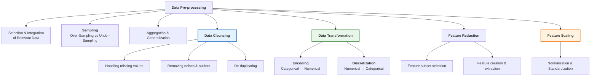
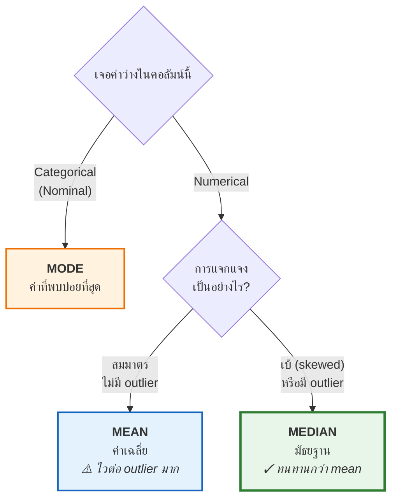
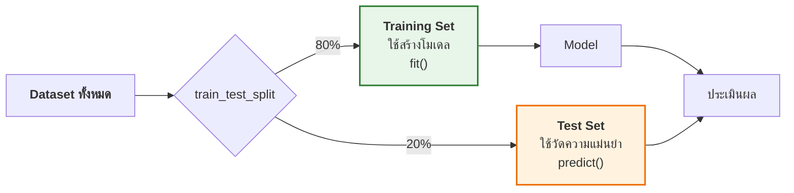

# 04 · Data Pre-processing

> [!abstract] guideline ข้อ 3 บอกว่าออกสอบอะไร
> 1. **Row or column deletion**
> 2. **Statistical imputation:** Mean (numerical) · Median (numerical, especially **skewed**) · Mode (categorical)
> 3. **Noise vs. Outliers**
> 4. **Smoothing techniques**
> 5. **Encoding**
> 6. **Discretization**
> 7. **Feature Scaling**
>
> ⚠️ guideline ข้อนี้ **ละเอียดที่สุดในทุกข้อ** และสไลด์มี **105 หน้า** (มากสุดในวิชา) → **เก็งว่าเป็นหัวข้อที่มีคะแนนเยอะที่สุด**
>
> 📌 หัวข้อที่ **อยู่ในสไลด์แต่ไม่อยู่ใน guideline** (Sampling/SMOTE, PCA, Feature Selection, Gini/Entropy) → อ่านแบบรู้จัก ไม่ต้องท่องลึก แต่ **Train/Test split ต้องรู้** เพราะเชื่อมกับ [[09 Regression Analysis]] (guideline ข้อ 8 ระบุ "Training vs Test performance")

**ลิงก์:** [[00 START HERE|หน้าหลัก]] · ก่อนหน้า [[03 Exploratory Data Analysis (EDA)]] · ถัดไป [[05 Data Warehouse Concepts]] · [[10 Formula Sheet]]

---

## 4.1 ทำไมต้อง Pre-processing

### Reality of Real-World Data ⭐ (4 ปัญหาหลัก)

> [!quote] **"Raw data is rarely perfect."**

| ปัญหา | นิยาม | ตัวอย่างจากสไลด์ |
|---|---|---|
| **Incomplete** | ขาดค่า attribute หรือขาดสิ่งที่สนใจ | ค่าว่าง / null |
| **Noisy** | มี noise หรือ outliers | เซนเซอร์อ่านค่าเพี้ยน |
| **Inconsistent** | รูปแบบข้อมูลหรือ naming convention ต่างกัน | **Address:** `"BKK"`, `"Bangkok"`, `"Krung Thep"` · **Date:** `DD/MM/YYYY` vs `MM-DD-YY` · **Logic Errors:** อายุ 20 แต่ปีเกิด 1980 |
| **อื่น ๆ** | — | **Fake data**, **Duplicate data** |

> [!warning] Inconsistent — สาเหตุและผลกระทบ (ประโยคในสไลด์)
> **สาเหตุ:** **"Merging data from multiple sources without standardization"** (รวมข้อมูลจากหลายแหล่งโดยไม่ทำมาตรฐาน)
> **ผลกระทบ:** **"Makes grouping and aggregation impossible"** (ทำให้จัดกลุ่มและรวมยอดไม่ได้)
> → นี่คือเหตุผลตรง ๆ ว่าทำไมต้องมี **Transform** ใน [[07 ETL]]

### GIGO — "Garbage In, Garbage Out" ⭐

> [!important] หลักการ GIGO
> **"The quality of the input determines the quality of the output."**
> **"No matter how sophisticated your algorithm is, poor data quality leads to:"**
> 1. **Inaccurate predictions** (ทำนายไม่แม่น)
> 2. **Unreliable insights** (insight เชื่อถือไม่ได้)
> 3. **Flawed business decisions** (ตัดสินใจธุรกิจผิดพลาด)

> [!example] ตัวอย่างผลเสียที่เป็นรูปธรรม (สไลด์ p.5)
> โมเดล classification สำหรับ **ตรวจจับผู้กู้ที่มีความเสี่ยง** ถูกสร้างจากข้อมูลคุณภาพต่ำ:
> - **ผู้สมัครที่น่าเชื่อถือถูกปฏิเสธสินเชื่อ** (เสียลูกค้าดี)
> - **ปล่อยกู้ให้คนที่จะเบี้ยวหนี้** (เสียเงิน)
>
> → เห็นได้ว่าผิดได้ **ทั้งสองทาง**

> [!important] Pre-processing มีไว้เพื่อ
> - **Enhance the quality of the data**
> - **Reduce the impact of incomplete and inconsistent data**

> [!important] ตัวเลขที่ต้องจำ ⭐
> **"Data pre-processing often consumes 80% or more of the effort in a Big Data project"**
> (เทียบกับ [[01 Introduction to Data Analytics#1.4 Main Steps of Analytics (6 ขั้น) ⭐ น่าจะออก|บทที่ 1]] ที่บอกว่า data preparation = **60–80%** ของโครงการ — ตัวเลขนี้ออกสอบได้ทั้งคู่)
>
> และ **"Preprocessing is often the most time-consuming yet critical step in the analytical process."**

### แผนที่เทคนิค Pre-processing ทั้งหมด



---

## 4.2 Missing Values ⭐⭐ (guideline ข้อ 3.1 + 3.2)

### Incomplete Data — นิยาม สาเหตุ ผลกระทบ

> [!quote] Definition
> **Data without variable values (missing value)**

**Reasons or Causes (5 ข้อ — ข้อสอบชอบถามให้ยกตัวอย่าง):**
1. **Equipment malfunction** (อุปกรณ์เสีย)
2. **Human error during entry** (คนกรอกผิด)
3. **Users refusing to provide sensitive info** (ผู้ใช้ไม่ยอมให้ข้อมูลอ่อนไหว เช่น อายุ น้ำหนัก)
4. **Information is not collected** (ไม่ได้เก็บ)
5. **Attributes may not be applicable to all cases** — เช่น **"annual income is not applicable to children"** (รายได้ต่อปีใช้กับเด็กไม่ได้)

> [!important] **Impact — 2 ข้อ** ⭐
> 1. **Creates statistical Bias** (ทำให้เกิดความเอนเอียงทางสถิติ)
> 2. **Most algorithms cannot process null values** (อัลกอริทึมส่วนใหญ่ประมวลผลค่า null ไม่ได้)

**Why missing values treatment is required?**
- **Reduce the power / fit of a model** (ลดพลังและความพอดีของโมเดล)
- **Lead to a biased model** → **wrong prediction / classification**

> [!warning] คำเตือนสำคัญในสไลด์
> **"Not that easy to delete because we lost data!"** — ลบไม่ใช่เรื่องง่าย เพราะเราสูญเสียข้อมูล
>
> และ **"Bad treatment of missing values"** — เช่น คอลัมน์ `Gender` ที่ **correlate สูงกับ `Play Cricket`** ถ้าลบทิ้งมั่ว ๆ จะเสียข้อมูลสำคัญไป

### 🎯 Statistical Imputation — หัวใจของ guideline ข้อ 3.2



> [!important] ⭐⭐ ตารางนี้ต้องจำให้ขึ้นใจ — guideline เขียนมาตรง ๆ
> | วิธี | เหมาะกับ | เหตุผล (สไลด์เขียนตรง ๆ) |
> |---|---|---|
> | **Mean (Average)** | **Numerical data** | **"Highly sensitive to Outliers"** ⚠️ |
> | **Median** | **Numerical data with a skewed distribution** | **"More Robust than the mean"** ✓ |
> | **Mode** | **Categorical (Nominal) data** | — |
>
> **ทำไม skewed ต้องใช้ Median:** เพราะหางที่ยาวลาก Mean ตามไป แต่ Median แทบไม่ขยับ — ดูภาพเชิงตัวเลขที่ [[03 Exploratory Data Analysis (EDA)#3.4 Distribution Shape ⭐ (ทำไม skewed ต้องใช้ Median)]]

### วิธีเติมค่าว่างทั้งหมดที่สไลด์ให้ (เรียงจากแย่ไปดี)

| # | วิธี | หมายเหตุ |
|---|---|---|
| 1 | **Manually fill in** (กรอกมือ) | **time consuming** |
| 2 | **Use a global constant** เช่น `"MISSING"`, `0`, empty string | **simple, but can mislead the mining techniques** ⚠️ |
| 3 | **Use a measure of central tendency** — mean / median / mode | มาตรฐานที่ใช้บ่อยที่สุด |
| 4 | **Use mean/median ของ "class เดียวกัน"** กับ object นั้น | ⭐ ดีกว่าข้อ 3 — ตัวอย่างสไลด์: *"if a day in July is missing its temperature value, fill it with the **median temperature in July**"* |
| 5 | **Use frequent values** | สำหรับ categorical → ⚠️ **"lead to imbalanced problem!"** |
| 6 | **Derive values from other attributes** | ใช้ **domain knowledge** |
| 7 | **Estimate missing values** | ใช้ค่าที่ **น่าจะเป็นมากที่สุด** หรือใช้ learning techniques ทำนาย |

### Model-Based Imputation ⭐ (ฉลาดที่สุด)

> [!important] "Using Intelligence to Fill Gaps"
> - **Concept:** ถือว่า **attribute ที่หายไปเป็น Target Variable**
> - **Method:** ใช้ **Regression หรือ Machine Learning** ทำนายค่าที่หายจาก feature อื่น ๆ
> - **Advantage:** **"Preserves relationships between variables much better than simple mean/median imputation"**
> - **⚠️ Note ที่ออกสอบได้:** **"Filling with a mean can lead to Underestimated Variance because it ignores the uncertainty of the missing data"**
>   → เติมด้วย mean ทำให้ **ความแปรปรวนถูกประเมินต่ำเกินจริง** (เพราะทุกค่าที่เติมเหมือนกันหมด ข้อมูลจึงดู "กระจายน้อย" กว่าความเป็นจริง)

### Row or Column Deletion (guideline ข้อ 3.1)

> [!important] เกณฑ์ตัดสินใจ (ผสมจากบท EDA + Pre-processing)
> | สถานการณ์ | ทำอะไร |
> |---|---|
> | คอลัมน์มีค่าว่าง **> 50%** | **พิจารณาลบทั้งคอลัมน์** (Rule of Thumb) |
> | ค่าว่าง **< 5%** ของข้อมูลทั้งหมด | **ลบแถวได้** (Delete rows) |
> | ระหว่างนั้น | **Impute** — mean/median/mode หรือ KNN/Multiple Imputation |
> | คอลัมน์เป็น **Constant Feature (Variance = 0)** | **must be deleted!** (สไลด์ระบุตรง ๆ) |
> | คอลัมน์เป็น **Irrelevant** เช่น student ID | ลบ — *"students' ID is often irrelevant to the task of predicting students' GPA"* |
>
> ⚠️ **แต่ต้องเช็คก่อนเสมอ:** *"Always analyze the relationship between missing features and target variable before deciding to eliminate them"*

### 🐍 Python สำหรับ Lab

| คำสั่ง | ทำอะไร |
|---|---|
| `df.isnull().any()` | เช็คว่า attribute ไหนมีค่า NaN บ้าง |
| `df.isnull().sum()` | นับว่าแต่ละ attribute มีกี่ record ที่เป็น NaN |
| `df.dropna()` | **ลบ** record ที่มี NaN |
| `df.fillna()` | **แทนที่** NaN ด้วยค่าที่ระบุ (มีตัวเลือกเยอะ) |

```python
# ตัวอย่างที่ใช้บ่อยในข้อสอบ Lab
df['Age'].fillna(df['Age'].median(), inplace=True)      # numerical + skewed → median
df['Salary'].fillna(df['Salary'].mean(), inplace=True)  # numerical + สมมาตร → mean
df['City'].fillna(df['City'].mode()[0], inplace=True)   # categorical → mode
```

> [!tip] จำไว้ว่า `mode()` คืน **Series** (เพราะอาจมีหลายฐานนิยม) → ต้องใส่ `[0]` เสมอ

**RapidMiner:** ใช้ operator **`Replace Missing Values`** (ตั้งค่า *attribute filter* + *default* เป็น average / median / minimum / maximum / zero / value)

---

## 4.3 Noise vs. Outliers ⭐⭐ (guideline ข้อ 3.3 — ระบุชื่อคู่นี้ตรง ๆ)

> [!important] ⭐⭐ ตารางเปรียบเทียบ — น่าจะออกเป็นข้อเขียนหรือให้แยกแยะกรณี
> | | **Noise** | **Outliers** |
> |---|---|---|
> | **นิยาม** | **small, random deviations** จาก true underlying signal | data points ที่ **deviate significantly** จากข้อมูลส่วนใหญ่ |
> | **ขนาด** | **เล็ก ๆ สุ่ม ๆ** กระจายทั่วไป | **ใหญ่ ชัดเจน** โดดออกมา — *"clearly distant from the general trend"* |
> | **สาเหตุ** | Faulty/imprecise **sensors** · **Measurement limitations** · Human data entry inaccuracies · **Transmission or environmental interference** | **Data entry mistakes** · Measurement/recording errors · **Rare but real events** · **System malfunctions** |
> | **ผลกระทบ** | **Increases data variability** · **บิดเบือน Mean และ SD** · ทำให้โมเดลเรียนจาก **irrelevant fluctuations** แทน true patterns | **บิดเบือน Mean และ SD อย่างรุนแรง** · **ครอบงำการเทรน (dominate model training)** และทำให้ทำนายเอนเอียง · อาจทำให้วิเคราะห์ผิด |
> | **ตัวอย่าง** | อุณหภูมิจากเซนเซอร์แกว่งเล็กน้อย · คะแนนสอบบันทึกผิดเล็กน้อย · เสียงคนแตกเพราะสัญญาณโทรศัพท์แย่ · **"Snow" บนจอทีวี** | ยอดขายปกติ ~20,000 บาท แต่มี record หนึ่ง **5,000,000 บาท** · รายได้ลูกค้าส่วนใหญ่ < 100,000 แต่มี record หนึ่ง **10,000,000** |
> | **วิธีจัดการ** | **Smoothing** (Binning, Regression, Clustering) | **Keep / Remove / Transform** — ต้องดูบริบท |

> [!important] Noise Interpretation — 2 มุมมอง (สไลด์เน้น)
> - **For attributes:** Noise คือ **small modifications of original values** (ค่าเดิมถูกแก้ไปนิดหน่อย)
> - **For objects:** Noise ปรากฏเป็น **extraneous (irrelevant) objects** (วัตถุแปลกปลอมที่ไม่เกี่ยว)

> [!warning] ⭐ ประโยคที่ต้องจำ 2 ประโยค
> **1. เรื่อง Noise:** *"Noise may be **valid or invalid**, depending on the data context"* — noise อาจถูกหรือผิดก็ได้ ขึ้นกับบริบท
>
> **2. เรื่อง Outliers (Important Note ในสไลด์):**
> **"Outliers should NOT be removed automatically. They must be analyzed using domain knowledge to determine whether they are meaningful"**
> → ถ้าข้อสอบให้เลือก "เจอ outlier ควรทำอย่างไร" **อย่าตอบว่า "ลบทันที"**

### Outliers มี 2 กรณี ⭐ (ประเด็นสำคัญที่ออกได้)

> [!important] Case 1 vs Case 2
> | | **Case 1: Outliers เป็น noise** | **Case 2: Outliers คือเป้าหมาย** |
> |---|---|---|
> | บทบาท | **รบกวนการวิเคราะห์** (interferes with data analysis) | **เป็นสิ่งที่เราต้องการหา!** |
> | ตัวอย่าง | ข้อมูลกรอกผิด, เซนเซอร์เสีย | **Credit card fraud** (ตรวจจับการฉ้อโกงบัตรเครดิต) · **Intrusion detection** (ตรวจจับการบุกรุกระบบ) |
> | ทำอย่างไร | ลบหรือแก้ | **เก็บไว้และวิเคราะห์** |

> [!quote] What is an Outlier?
> **"Outlier is an observation that appears far away and diverges from an overall pattern in a sample."**
> อีกนิยาม: **"Outliers (or Anomalies) are data that is unusual or different from most data"** — objects ที่มีลักษณะแตกต่างอย่างมากจาก objects อื่น ๆ ในชุดข้อมูล

### Outliers Detection Techniques (6 กลุ่ม)

1. **Graphical Approaches** — boxplot, scatter, histogram (ดู [[03 Exploratory Data Analysis (EDA)#Outlier Detection ⭐⭐ (สูตรคำนวณได้)]])
2. **Statistical Approaches** — **IQR**, **Z-score**
3. **Proximity-based** — *"Anomalies are points far away from other points"*
4. **Density-based Approaches**
5. **Clustering-based** — *"Points far away from cluster centers are outliers"* · *"Small clusters are outliers"*
6. Other Approaches

---

## 4.4 Smoothing Techniques ⭐⭐ (guideline ข้อ 3.4 — คำนวณได้แน่)

> [!warning] อันตรายของ Noise
> **"The Danger: Noise causes Overfitting, where the model learns the 'error' rather than the 'pattern'."**
> → เชื่อมกับ [[09 Regression Analysis#9.10 Overfitting ⭐⭐⭐ (guideline ข้อ 8.7)]]

### 3 เทคนิค Smoothing

| เทคนิค | หลักการ |
|---|---|
| **Binning** | **Local smoothing by grouping** — เรียงข้อมูลแล้วแบ่งเป็น bin แล้วแทนค่าด้วยค่าสรุปของ bin |
| **Regression** | **Fitting data to a function** — ปรับข้อมูลให้เข้ากับฟังก์ชัน |
| **Clustering** | **Detecting structural outliers** — หา outlier เชิงโครงสร้าง |

### Smoothing by Binning — ต้องคำนวณเป็น ⭐⭐

> [!quote] Concept
> **"Sort data and partition it into 'bins'. Replace values in the bin with a summary statistic."**
> **Objective:** *"Reduces the impact of minor fluctuations and highlights general trends"*
>
> **"Binning methods smooth a sorted data value by consulting its 'neighborhood', that is, the values around it."**

**3 วิธีย่อย:**

| วิธี | ทำอะไร |
|---|---|
| **Smoothing by bin MEANS** | แทนทุกค่าใน bin ด้วย **ค่าเฉลี่ยของ bin** |
| **Smoothing by bin MEDIANS** | แทนทุกค่าใน bin ด้วย **มัธยฐานของ bin** |
| **Smoothing by bin BOUNDARIES** | หา **min และ max** ของ bin เป็น "ขอบ" แล้วแทนแต่ละค่าด้วย **ขอบที่ใกล้ที่สุด** |

> [!important] กฎที่ออกสอบได้
> **"In general, the larger the width, the greater the effect of the smoothing"**
> — bin ยิ่งกว้าง ผลของการทำ smoothing ยิ่งแรง (ข้อมูลยิ่งเรียบ แต่ยิ่งเสียรายละเอียด)

![[prep_binning.png]]

> [!example]- 🧮 ตัวอย่างคำนวณเต็ม (กดดูวิธีทำทีละขั้น)
> **ข้อมูลที่เรียงแล้ว:** `4, 8, 15, 21, 21, 24, 25, 28, 34`
>
> **ขั้นที่ 1 — แบ่งเป็น 3 bins (equal-frequency, bin ละ 3 ค่า):**
> - Bin 1: `4, 8, 15`
> - Bin 2: `21, 21, 24`
> - Bin 3: `25, 28, 34`
>
> ---
> **(ก) Smoothing by bin MEANS**
> - Bin 1: $(4+8+15)/3 = 27/3 = \mathbf{9}$ → `9, 9, 9`
> - Bin 2: $(21+21+24)/3 = 66/3 = \mathbf{22}$ → `22, 22, 22`
> - Bin 3: $(25+28+34)/3 = 87/3 = \mathbf{29}$ → `29, 29, 29`
>
> **ผลลัพธ์:** `9, 9, 9, 22, 22, 22, 29, 29, 29`
>
> ---
> **(ข) Smoothing by bin MEDIANS**
> - Bin 1: median = **8** → `8, 8, 8`
> - Bin 2: median = **21** → `21, 21, 21`
> - Bin 3: median = **28** → `28, 28, 28`
>
> **ผลลัพธ์:** `8, 8, 8, 21, 21, 21, 28, 28, 28`
>
> ---
> **(ค) Smoothing by bin BOUNDARIES** — แทนด้วยขอบที่ **ใกล้กว่า**
> - Bin 1 (ขอบ = 4 และ 15): `4`→4 · `8`→ ห่างจาก 4 = 4, ห่างจาก 15 = 7 → **4** · `15`→15 ⇒ `4, 4, 15`
> - Bin 2 (ขอบ = 21 และ 24): `21`→21 · `21`→21 · `24`→24 ⇒ `21, 21, 24`
> - Bin 3 (ขอบ = 25 และ 34): `25`→25 · `28`→ ห่างจาก 25 = 3, ห่างจาก 34 = 6 → **25** · `34`→34 ⇒ `25, 25, 34`
>
> **ผลลัพธ์:** `4, 4, 15, 21, 21, 24, 25, 25, 34`

---

## 4.5 Encoding: Categorical → Numerical ⭐⭐ (guideline ข้อ 3.5)

> [!quote] Definition
> **"Data encoding refers to the process of transforming categorical data into a numerical representation."**
> **Categorical Attributes ⇒ Numerical Attributes**

> [!important] ⭐⭐ ตัวชี้ขาดว่าใช้วิธีไหน = **"ข้อมูลมีลำดับหรือไม่"**
> | ชนิดข้อมูล | ใช้ | เหตุผล |
> |---|---|---|
> | **Nominal** (ไม่มีลำดับ) | **One-Hot Encoding** | ถ้าใช้ตัวเลขแทนตรง ๆ โมเดลจะเข้าใจผิดว่ามีลำดับ (เช่น แดง=1 < เขียว=2 < น้ำเงิน=3 ซึ่งไม่จริง) |
> | **Ordinal** (มีลำดับ) | **Label Encoding** | ลำดับมีความหมายจริง (เช่น Low=1 < Medium=2 < High=3) จึงเก็บลำดับไว้ได้ |

### One-Hot Encoding (Dummy Encoding)

> [!quote] นิยาม
> **"Convert categorical variables with multiple categories into a binary vector representation. Each category is transformed into a binary feature, where a value of 1 indicates the presence of that category and 0 indicates the absence."**

> [!example] ตัวอย่าง
> คอลัมน์เดียว `Color` ที่มี 3 ค่า → กลายเป็น **3 คอลัมน์**
>
> | Color | | Color_Red | Color_Green | Color_Blue |
> |---|---|---|---|---|
> | Red | → | **1** | 0 | 0 |
> | Green | → | 0 | **1** | 0 |
> | Blue | → | 0 | 0 | **1** |
> | Red | → | **1** | 0 | 0 |

> [!warning] ⭐ ปัญหาของ One-Hot ที่สไลด์เขียนตัวใหญ่
> **"Problem: Curse of dimensionality!"**
> ถ้า attribute มี 100 categories → เกิด **100 คอลัมน์ใหม่** → มิติระเบิด, ข้อมูลกลายเป็น **sparse** มาก, กินหน่วยความจำ, โมเดลเรียนยาก

### Combine categories

> [!important] วิธีแก้ curse of dimensionality (สไลด์ p.30)
> **"If a categorical attribute has a large number of categories, or some categories occur infrequently ⇒ reduce the number of categories by combining some of them."**
>
> **แปลว่า:** ถ้ามี category เยอะ หรือบาง category เจอน้อยมาก → **รวมบาง category เข้าด้วยกัน**
>
> **ตัวอย่างในทางปฏิบัติ:** เก็บ Top-10 categories ที่พบบ่อย แล้วยุบที่เหลือเป็น `"Other"` เดียว → จาก 100 คอลัมน์เหลือ 11
>
> เชื่อมกับเกณฑ์ **Cardinality** ใน [[03 Exploratory Data Analysis (EDA)]]: **< 10 = OK · > 50 = quite high**

### Label Encoding

> [!quote] นิยาม
> **"Label encoding assigns a unique numeric label to each category in a categorical variable. Each category is mapped to a corresponding integer value."**

> [!example] ตัวอย่าง — Ordinal เท่านั้น
> | Size | → | Size_encoded |
> |---|---|---|
> | Small | → | **1** |
> | Medium | → | **2** |
> | Large | → | **3** |
>
> ตัวเลขที่ได้ **มีความหมายเชิงลำดับจริง** (3 > 2 > 1 = ใหญ่กว่า) → ใช้ได้

> [!bug] ⚠️ กับดักที่ออกสอบแน่
> **ถ้าเอา Label Encoding ไปใช้กับ Nominal จะผิด** เช่น
> `Bangkok=1, Chiang Mai=2, Phuket=3` → โมเดลจะคิดว่า **Phuket > Chiang Mai > Bangkok** และ **ค่าเฉลี่ยของ Bangkok กับ Phuket = Chiang Mai** ซึ่ง**ไม่มีความหมายเลย**
> → Nominal **ต้องใช้ One-Hot**

### 🐍/⚙️ เครื่องมือ

```python
# Python — One-Hot
import pandas as pd
df_encoded = pd.get_dummies(df, columns=['Color'])

# Python — Label Encoding
from sklearn.preprocessing import LabelEncoder
le = LabelEncoder()
df['Size_encoded'] = le.fit_transform(df['Size'])
```

**RapidMiner:** operator **`Nominal to Numerical`** — เลือก *coding type* เป็น **`dummy coding`** (= one-hot) หรือ **`unique integers`** (= label encoding)

---

## 4.6 Discretization: Numerical → Categorical ⭐⭐ (guideline ข้อ 3.6)

> [!quote] นิยาม (ทิศตรงข้ามกับ Encoding)
> **"Discretization transforms continuous numerical data into a categorical or discrete form."**
> **Numerical Attributes ⇒ Categorical (Ordinal) Attributes**
>
> **"Discretization is the process of converting a continuous attribute into an ordinal attribute — a potentially infinite number of values are mapped into a small number of categories"**

> [!important] เป้าหมาย
> **"The goal of discretization is to reduce the number of values a continuous attribute assumes by grouping them into a number, $n$, of intervals (bins)"**
>
> - **"Discretization is often a required pre-processing step for many supervised learning methods"**
> - **"Discretization is used in both unsupervised and supervised settings"**

> [!tip] จำทิศทางให้ไม่สับสน
> **Encoding:** Categorical → Numerical (ตัวหนังสือ → ตัวเลข)
> **Discretization:** Numerical → Categorical (ตัวเลข → ช่วง/หมวด)
> **สองอันนี้เป็นคนละทิศ** — ข้อสอบชอบสลับ

### Supervised vs. Unsupervised Discretization ⭐

| | **Unsupervised** | **Supervised** |
|---|---|---|
| **ใช้ class information?** | **ไม่ใช้** (*"do not take the class information into consideration"*) | **ใช้** |
| **ข้อดี** | **Faster and easier to implement** | ตัดช่วงให้สอดคล้องกับ class |
| **ข้อเสีย** | **"More prone to misclassification errors"** ⚠️ | ซับซ้อนกว่า |
| **อัลกอริทึม** | **Equal Width**, **Equal Frequency**, K-means | Entropy-based, ChiMerge ฯลฯ |

### 3 อัลกอริทึม Unsupervised ⭐

![[prep_discretization.png]]

| อัลกอริทึม | หลักการ (จากสไลด์) |
|---|---|
| **Equal Width** | **"Divides data set into intervals of equal width"** — แต่ละช่วง **กว้างเท่ากัน** |
| **Equal Frequency** | **"Divides data set into intervals of equal frequency (number of data points in interval)"** — แต่ละช่วงมี **จำนวนจุดเท่ากัน** |
| **K-means** | จัดกลุ่มตามการเกาะกลุ่มจริงของข้อมูล แล้วใช้ขอบเขตกลุ่มเป็นขอบ bin |

> [!important] จุดที่ภาพด้านบนสอน — น่าจะออกเป็นข้อวิเคราะห์
> ข้อมูลชุดเดียวกัน (**4 กลุ่ม + outlier 2 จุด** ตามที่สไลด์บรรยาย) ตัด 4 ช่วงเหมือนกัน แต่ได้ผลต่างกันสิ้นเชิง:
> - **Equal Width** → outlier ดึงช่วงให้กว้าง ทำให้ **bin 3 ว่างเปล่า (n = 0)** และ bin 4 มีแค่ outlier 2 จุด → **แย่ที่สุดเมื่อมี outlier**
> - **Equal Frequency** → ทุก bin มี ~60 จุดเท่ากัน แต่ **bin 4 กว้างมหาศาล** เพื่อกลืน outlier → บิดเบือนความหมายของช่วง
> - **K-means** → ตัดตรงกับกลุ่มธรรมชาติมากที่สุด (bin 1–3 = กลุ่ม 1–3 พอดี)
>
> **บทเรียน:** **Equal Width ไวต่อ outlier มาก** — ถ้าโจทย์บอกว่าข้อมูลมี outlier แล้วถามว่าควรใช้อะไร อย่าตอบ Equal Width

### Discretization Steps — 2 ขั้น ⭐

> [!important] **"Any discretization process consists of two basic steps:"**
> **ขั้นที่ 1 — จำนวนช่วง (number of discrete intervals)**
> *"It is usually done by the **user**, although a few discretization algorithms are able to do it on their own"*
> → **ผู้ใช้เป็นคนกำหนด** (มีบางอัลกอริทึมที่หาเองได้)
>
> **ขั้นที่ 2 — ความกว้าง/ขอบเขตของแต่ละช่วง (width/boundary)**
> *"which is often done by a **discretization algorithm** itself"*
> → **อัลกอริทึมเป็นคนหา**

### จำนวนช่วงควรเป็นเท่าไร ⭐ (มีสูตร — ออกสอบได้)

> [!important] Trade-off
> - **จำนวนช่วงมาก** → **"more of the original information is retained"** (เก็บข้อมูลเดิมได้มากกว่า)
> - **จำนวนช่วงน้อย** → **"the new feature is 'easier' for subsequently used learning algorithms"** (ง่ายกว่าสำหรับอัลกอริทึมที่ใช้ต่อ)
>
> **ข้อจำกัด:** **"It should not be smaller than the number of classes one wants to recognize"** (ต้องไม่น้อยกว่าจำนวน class ที่ต้องการจำแนก)

> [!important] ⭐ Rule of Thumb Formula — จำสูตรนี้
> $$\text{จำนวนช่วง} = \frac{M}{3C}$$
> โดย **$M$ = number of training examples** · **$C$ = number of classes**
>
> **ตัวอย่าง:** มีข้อมูลเทรน 900 records จำแนก 3 classes → $900/(3\times3) = \mathbf{100}$ ช่วง

### Effect of Size of Intervals

> [!important] ประโยคในสไลด์: **"If interval size is small ⇒ item support can be low"**
> ตัวอย่างจากสไลด์ (4 records: อายุ 21, 29, 35, 38)
>
> **ช่วงกว้าง 10:**
> | Age | 21–30 | 31–40 |
> |---|---|---|
> | **Support** | **2** | **2** |
>
> **ช่วงกว้าง 5:**
> | Age | 21–25 | 26–30 | 31–35 | 36–40 |
> |---|---|---|---|---|
> | **Support** | **1** | **1** | **1** | **1** |
>
> **ตีความ:** ช่วงยิ่งแคบ → แต่ละช่วงมีข้อมูลน้อยลง → **support ต่ำ** → ถ้าตั้ง **MinSup** ไว้ อาจไม่มีช่วงไหนผ่านเกณฑ์เลย → หา pattern ไม่เจอ

---

## 4.7 Feature Scaling ⭐⭐ (guideline ข้อ 3.7 — สูตรออกแน่)

### Attribute Transformation — ภาพรวม

> [!quote] นิยาม
> **"A function that maps the entire set of values of a given attribute into a new set of replacement values such that each old value can be identified with one of the new values"**
>
> **Simple functions:** $x^k$, $\log(x)$, $e^x$, $|x|$ · **Standardization & Normalization**

### ทำไมต้อง Scale ⭐⭐

> [!important] เหตุผลหลัก (สไลด์เขียนตรง ๆ)
> **"Features with the largest scales would dominate and skew result"**
> — feature ที่สเกลใหญ่ที่สุดจะครอบงำและบิดเบือนผลลัพธ์

![[prep_scaling.png]]

> [!important] ⭐⭐ อัลกอริทึมไหนต้อง scale / ไม่ต้อง — ออกสอบแน่
> | **ต้อง scale** (ใช้ระยะทางหรือ gradient) | **ไม่ต้อง scale** (ใช้การแบ่งตามค่าเกณฑ์) |
> |---|---|
> | **K-Means** | **Decision Trees** |
> | **K-Nearest Neighbors (k-NN)** | **Random Forest** |
> | **Neural Network** | **XGBoost** |
> | **Linear regression???** ← สไลด์ใส่เครื่องหมายคำถามไว้ | |
>
> **ทำไม tree-based ไม่ต้อง:** เพราะมันตัดสินใจด้วยเงื่อนไขแบบ `if x > 50` ทีละ feature — การคูณ/บวกทั้งคอลัมน์ไม่เปลี่ยนลำดับ จึงไม่เปลี่ยนจุดตัด
>
> **ทำไม `Linear regression???` ถึงมีเครื่องหมายคำถาม:** linear regression **ไม่จำเป็น**ต้อง scale เพื่อความถูกต้อง (ค่าสัมประสิทธิ์จะปรับตัวเอง) แต่ **ช่วยเรื่องความเร็วในการ converge** ถ้าใช้ gradient descent และ**ช่วยให้เทียบขนาดสัมประสิทธิ์กันได้** → ถ้าข้อสอบถาม ให้ตอบว่า "ไม่จำเป็นต่อความถูกต้อง แต่มีประโยชน์"

### 2 สูตรหลัก ⭐⭐ ต้องคำนวณเป็น

> [!important] **Standardization (Z-score normalization)**
> $$x_{i,\text{new}}=\frac{x_i-\text{mean}(x)}{\text{stdev}(x)} \;=\; \frac{x_i-\mu}{\sigma}$$
> - **"Subtract mean and divide by standard deviation"**
> - **สมมติฐาน:** *"Normal Distribution for each feature is assumed"*
> - **ผลลัพธ์:** mean = 0, SD = 1 · **ช่วงค่าไม่จำกัด** (ค่าติดลบได้)
> - สไลด์หมายเหตุ: *"Not the best scaling method to use"* (ในบริบทที่ข้อมูลไม่เป็น normal)

> [!important] **Normalization (Min-Max Scaling)**
> **ช่วง [0, 1]** — ถ้าค่าทั้งหมดเป็นบวก:
> $$x_{i,\text{new}}=\frac{x_i-\min(x)}{\max(x)-\min(x)}$$
>
> **ช่วง [−1, 1]** — ถ้ามีค่าติดลบ:
> $$x_{i,\text{new}}=\frac{x_i-\min(x)}{\max(x)-\min(x)}\times 2-1$$
>
> - **"Scale to 0-1 by subtracting minimum and dividing by the range"**
> - **"Shrink the range of data into…"** — บีบช่วงข้อมูลให้อยู่ในกรอบที่กำหนด

### วิธี Scaling ทั้งหมดที่สไลด์เอ่ยถึง

**Normalization: Scaled to fall within a smaller, specified range**
- **z-score normalization (standardization)**
- **min-max normalization**
- **robust scaling**
- **Quantile normalization**

### ⭐ เลือกอันไหนดี — คำตอบตรงจากสไลด์

> [!important] **"Normalization or Standardization?"** (สไลด์ p.56)
> - **"Most of the time ⇒ Standardization is better"**
> - **"However, Normalization (Min-Max) is faster for:"**
>   - **Neural network**
>   - **Linear regression**
>   - Etc.
>
> **จำสั้น ๆ:** *ปกติใช้ Standardization · แต่ Min-Max เร็วกว่าสำหรับ NN และ Linear Regression*

> [!example]- 🧮 ตัวอย่างคำนวณ (กดดูวิธีทำ)
> ข้อมูล: `10, 20, 30, 40, 50`
> $\mu = 30$ · $\sigma = \sqrt{\dfrac{(20)^2+(10)^2+0+(10)^2+(20)^2}{5}} = \sqrt{\dfrac{1000}{5}} = \sqrt{200} \approx 14.14$
> $\min = 10$ · $\max = 50$ · range $= 40$
>
> | $x$ | **Z-score** $\dfrac{x-30}{14.14}$ | **Min-Max** $\dfrac{x-10}{40}$ |
> |---|---|---|
> | 10 | $(10-30)/14.14 = \mathbf{-1.41}$ | $(10-10)/40 = \mathbf{0.00}$ |
> | 20 | $\mathbf{-0.71}$ | $\mathbf{0.25}$ |
> | 30 | $\mathbf{0.00}$ | $\mathbf{0.50}$ |
> | 40 | $\mathbf{+0.71}$ | $\mathbf{0.75}$ |
> | 50 | $\mathbf{+1.41}$ | $\mathbf{1.00}$ |
>
> **สังเกต:** Z-score ให้ mean = 0 · Min-Max ให้ค่าต่ำสุด = 0 และสูงสุด = 1 พอดีเสมอ

### 🐍/⚙️ เครื่องมือ

```python
from sklearn.preprocessing import StandardScaler, MinMaxScaler

scaler = StandardScaler()
X_train_scaled = scaler.fit_transform(X_train)   # fit + transform บน train
X_test_scaled  = scaler.transform(X_test)        # transform อย่างเดียวบน test !
```

> [!bug] ⭐⭐ กับดักที่ออกสอบ Lab ได้แน่
> **ต้อง `fit` บน Training Set เท่านั้น** แล้ว `transform` ทั้ง train และ test ด้วย scaler ตัวเดียวกัน
> **ห้าม `fit_transform` ใหม่บน Test Set** — เพราะจะเป็นการ "แอบดู" สถิติของ test set (**data leakage**) ทำให้ผลประเมินดีเกินจริง
>
> RapidMiner ก็เช่นกัน: สไลด์มีหน้า **"RapidMiner Normalize operator — Feature Scaling on Training set and Test set"** และ **"RapidMiner Normalize operator with k-NN"** → ต้องต่อ operator ให้ถูกลำดับ

---

## 4.8 หัวข้อเสริม (อยู่ในสไลด์ แต่ไม่อยู่ใน guideline)

> [!note] อ่านให้รู้จัก ไม่ต้องท่องลึก
> หัวข้อในส่วนนี้ไม่ปรากฏใน `guidline.txt` แต่มีในสไลด์ → มีโอกาสออกเป็นข้อเลือกตอบสั้น ๆ หรือถามนิยาม

### Sampling

> [!quote] เหตุผลที่ต้อง sample
> **"Statisticians sample because obtaining the entire set of data of interest is too expensive or time-consuming."**
>
> **Key principle:** *"using a sample will work almost as well as using the entire data sets, **if the sample is representative**"*
> **"A sample is representative if it has approximately the same property (of interest) as the original set of data"**

| ชนิด | นิยาม |
|---|---|
| **Simple Random Sampling** | **"There is an equal probability of selecting any particular item"** |
| **Stratified sampling** | แบ่งกลุ่มย่อยให้เป็นตัวแทน **ตามสัดส่วนของประชากร** · *"ensures that each subgroup is adequately represented, reducing potential bias from uneven distribution"* · วิธี: **แบ่งข้อมูลเป็นหลาย partition แล้วสุ่มจากแต่ละ partition** |

### Imbalanced Data → Over-Sampling vs Under-Sampling

| | **Over-Sampling** | **Under-Sampling** |
|---|---|---|
| ทำอะไร | เพิ่มตัวอย่างของ **class ส่วนน้อย** | ลดตัวอย่างของ **class ส่วนมาก** |
| ตัวอย่าง | **SMOTE** (Synthetic Minority Over-sampling — *"Synthetic over sampling with Data Generation"* คือ **สร้างข้อมูลสังเคราะห์ขึ้นใหม่**) | **RUS** (Random Under-Sampling) |

### Aggregation & Generalization

> [!quote] นิยาม
> **"Combining two or more attributes (or objects) ⇒ Single attribute (or object)"**
>
> **Purpose 3 ข้อ:**
> 1. **Data reduction** — ลดจำนวน attribute หรือ object
> 2. **Change of scale** — *"Cities aggregated ⇒ regions, states, countries"* ← **นี่คือแนวคิดเดียวกับ Roll-up ใน OLAP** ดู [[05 Data Warehouse Concepts#OLAP Operations]]
> 3. **More "stable" data** — *"Aggregated data tends to have less variability"*

### Feature Reduction / PCA

**Purpose (5 ข้อ):** Avoid **curse of dimensionality** · ลดเวลาและหน่วยความจำ · **Allow data to be more easily visualized** · อาจช่วยกำจัด irrelevant features หรือลด noise · แบ่งได้เป็น feature extraction & feature selection

| | **Feature Extraction** | **Feature Subset Selection** |
|---|---|---|
| ทำอะไร | **project features เข้าสู่ feature space ใหม่ที่มิติต่ำกว่า** · feature ใหม่มักเป็น **combination ของ feature เดิม** | **เลือก subset เล็ก ๆ ของ feature เดิม** ที่ minimize redundancy และ maximize relevance ต่อ target |
| เทคนิค | Domain specific, **PCA**, **SVD**, Deep learning | Filter, Wrapper, Brute-force |
| feature ที่ได้ | **เป็นตัวใหม่** (ตีความยาก) | **เป็นตัวเดิม** (ตีความง่าย) |

> [!example] PCA Output — ตัวอย่าง Breakfast Cereals ในสไลด์
> ข้อมูลซีเรียล 13 ตัวแปร (calories, protein, fat, sodium, fiber, carbo, sugars, potass, vitamins, shelf, weight, cups, rating)
>
> | Component | 1 | 2 | 3 | 4 | 5 | 6 |
> |---|---|---|---|---|---|---|
> | **Variance** | 7204.16 | 4833.05 | 498.43 | 357.22 | 72.48 | 4.34 |
> | **Variance %** | **55.53** | **37.25** | 3.84 | 2.75 | 0.56 | 0.03 |
> | **Cum %** | 55.53 | **92.78** | 96.62 | 99.38 | 99.93 | 99.97 |
>
> **ข้อสรุปในสไลด์:** **"First 2 capture 93% of the total variation"** ($55.53 + 37.25 = 92.78 \approx 93\%$)
> → ลดจาก 13 ตัวแปรเหลือ **2 components** ยังเก็บความแปรผันไว้ได้ 93%
>
> ⚠️ สังเกตว่า PC1 ถูกครอบงำโดย `sodium` (0.98) และ PC2 โดย `potass` (0.99) — **เพราะยังไม่ได้ normalize!** สองตัวนี้มีสเกลใหญ่สุด → **ตัวอย่างที่ดีว่าทำไม PCA ต้อง scale ก่อน**

### Feature Subset Selection

**นิยามศัพท์ 2 ตัวที่ออกสอบได้:**

| ศัพท์ | นิยาม | ตัวอย่าง |
|---|---|---|
| **Redundant features** | **"duplicate much or all of the information contained in one or more other attributes"** | **Constant Features (Variance = 0) must be deleted!** · ราคาเป็นบาท + ราคาเป็นดอลลาร์ |
| **Irrelevant features** | **"contain no information that is useful for the data mining task at hand"** | **"students' ID is often irrelevant to the task of predicting students' GPA"** |

**เกณฑ์ของ feature selection สำหรับ classification (2 ข้อ):**
1. **"the classification accuracy does not significantly decrease"**
2. **"the resulting class distribution is as close [to] the original class distribution"**

**Brute-force approach:** *"Try all possible feature subsets as input to data mining algorithm"* — ลองทุก subset ที่เป็นไปได้ (แพงมาก: $2^n$ ทางเลือก)

### 2 แนวทาง: Filter vs Wrapper ⭐

| | **Filter approach** | **Wrapper approach** |
|---|---|---|
| หลักการ | คัดกรองด้วย **สถิติ** ก่อน โดยไม่ต้องใช้โมเดล | **"use a specific learning algorithm to evaluate the quality of the selected features"** |
| เกณฑ์ที่ใช้ | **Correlation** · **Impurity Measures** (Gini, Entropy, Info-Gain, Misclassification error, Chi-square) | ผลลัพธ์จริงของโมเดล เช่น **multiple linear regression** |
| ความเร็ว | เร็ว | ช้า (ต้องเทรนโมเดลซ้ำหลายรอบ) |
| ตัวอย่างวิธี | — | **Backward / Forward Selection** → ดู [[09 Regression Analysis#9.11 Reducing Number of Predictors ⭐⭐]] |

### Impurity Measures — Gini & Entropy

> [!quote] Purity vs Impurity
> | | C0: 9, C1: 1 | C0: 5, C1: 5 |
> |---|---|---|
> | | **Homogeneous (Pure)**<br/>**Low degree of impurity** | **Non-homogeneous**<br/>**High degree of impurity** |

> [!important] สูตร GINI
> $$\text{GINI}(t)=1-\sum_{j}\left[p(j\mid t)\right]^{2}$$
> โดย $p(j\mid t)$ = ความถี่สัมพัทธ์ของ class $j$ ที่ dataset $t$
> - **Maximum** เมื่อ records กระจายเท่ากันทุก class → **least interesting information** · ค่าสูงสุด $= 1-\dfrac{1}{N}$ (N = จำนวน class)
> - **Minimum (= 0)** เมื่อ records อยู่ class เดียวหมด → **most interesting information**

> [!important] สูตร Entropy
> $$\text{Entropy}(t)=-\sum_{j}p(j\mid t)\log_{2}p(j\mid t)$$
> - **Maximum ($\log n_c$)** เมื่อกระจายเท่ากันทุก class → least information
> - **Minimum (0.0)** เมื่ออยู่ class เดียวหมด → most information
> - **"Entropy based computations are similar to the GINI index computations"**

> [!example]- 🧮 ตารางค่าที่คำนวณจากสไลด์ (ตรวจสอบแล้ว)
> | การกระจาย | $P(C_1)$ | $P(C_2)$ | **GINI** | **Entropy** |
> |---|---|---|---|---|
> | C1: 0, C2: 6 | 0 | 1 | $1-0-1=\mathbf{0.000}$ | $-0\log 0-1\log 1=\mathbf{0}$ |
> | C1: 1, C2: 5 | 1/6 | 5/6 | $1-(1/6)^2-(5/6)^2=\mathbf{0.278}$ | $\mathbf{0.65}$ |
> | C1: 2, C2: 4 | 2/6 | 4/6 | $1-(2/6)^2-(4/6)^2=\mathbf{0.444}$ | $\mathbf{0.92}$ |
> | C1: 3, C2: 3 | 3/6 | 3/6 | $\mathbf{0.500}$ ← สูงสุด | $\mathbf{1.00}$ ← สูงสุด |
>
> **สังเกตว่าทั้งสองตัววัดพุ่งสูงสุดที่จุดเดียวกัน** (กระจายเท่ากัน 50:50) และต่ำสุดที่จุดเดียวกัน (บริสุทธิ์)

> [!example] Information Gain — ตัวอย่าง Play Tennis ในสไลด์ (14 records)
> ผลลัพธ์ที่สไลด์ให้:
> - **Gain(Outlook) = 0.246** ← **สูงสุด → เลือก Outlook**
> - Gain(Humidity) = 0.151
> - Gain(Windy) = 0.048
> - Gain(Temperature) = 0.029
>
> **ตรวจสอบ Gain(Outlook):** ข้อมูลมี 9 P, 5 N → $\text{Entropy}(S) = -\frac{9}{14}\log_2\frac{9}{14}-\frac{5}{14}\log_2\frac{5}{14} = 0.940$
> แยกตาม Outlook: sunny (2P,3N → 0.971) · overcast (4P,0N → **0**) · rain (3P,2N → 0.971)
> $\text{Gain} = 0.940 - \left[\frac{5}{14}(0.971)+\frac{4}{14}(0)+\frac{5}{14}(0.971)\right] = 0.940-0.694 = \mathbf{0.246}$ ✓
>
> **คำถามหลักในสไลด์:** *"Which attribute allows low degree of impurity?"* → ตัวที่ให้ **Information Gain สูงสุด**

---

## 4.9 Pre-processing for Supervised Learning: Hold-out ⭐

> [!important] Hold-out — เนื้อหานี้ปรากฏ **ทั้งในสไลด์ Pre-processing และสไลด์ Regression** → สัญญาณว่าออกสอบ
> **"Hold-out divides the dataset into two parts."**
> - **ส่วนแรกใหญ่กว่า** ใช้เป็น learning dataset ⇒ **Training-Set** (ใช้ **build the model**)
> - **ส่วนที่สอง** ใช้วัดประสิทธิภาพ ⇒ **Test-Set** (ใช้ **validate** และ **determine the accuracy of the model**)
>
> **เงื่อนไขการใช้:** *"Hold-out is used when there is a **large amount of data**. Therefore, the characteristics and distribution of Training and Test Sets are **similar**"*



```python
from sklearn.model_selection import train_test_split
X_train, X_test, y_train, y_test = train_test_split(
    X, y, test_size=0.2, random_state=42)      # 80% train / 20% test
```

**RapidMiner:** operator **`Split Data`** (ตั้งอัตราส่วน 0.8 / 0.2)

> [!tip] ลำดับที่ถูกต้อง (สำคัญมากในข้อสอบ Lab)
> **1. Split ก่อน → 2. Scale ทีหลัง** (fit บน train เท่านั้น)
> ถ้าทำสลับกัน (scale ทั้งชุดก่อนแล้วค่อย split) จะเกิด **data leakage**

---

## ✅ Self-Test — บทที่ 4

> [!question]- Q1. คอลัมน์ `Salary` มี skewness = 2.3 และมีค่าว่าง ควรเติมด้วยอะไร เพราะอะไร
> **Median** — เพราะ $|2.3| \ge 1$ = **เบ้มาก** และ **Mean ไวต่อ outlier/หางยาวมาก** ในขณะที่ **Median ทนทานกว่า (more robust)**

> [!question]- Q2. Noise ต่างจาก Outlier อย่างไร ตอบให้ครบ 3 มิติ
> **1) ขนาด:** Noise = การเบี่ยงเบนเล็ก ๆ แบบสุ่มจากสัญญาณจริง / Outlier = จุดที่เบี่ยงเบนอย่างมีนัยสำคัญ โดดออกจากแนวโน้มทั่วไปชัดเจน
> **2) สาเหตุ:** Noise = เซนเซอร์ไม่แม่น, ข้อจำกัดการวัด, สัญญาณรบกวน / Outlier = กรอกข้อมูลผิด, ระบบขัดข้อง, **เหตุการณ์หายากแต่จริง**
> **3) การจัดการ:** Noise = **Smoothing** (binning/regression/clustering) / Outlier = **Keep / Remove / Transform** ต้องดูบริบทด้วย domain knowledge

> [!question]- Q3. จงทำ smoothing by bin means กับ `2, 6, 10, 14, 18, 22` โดยแบ่ง 3 bins แบบ equal-frequency
> Bin1 = `2, 6` → mean = **4** → `4, 4`
> Bin2 = `10, 14` → mean = **12** → `12, 12`
> Bin3 = `18, 22` → mean = **20** → `20, 20`
> **ผลลัพธ์:** `4, 4, 12, 12, 20, 20`

> [!question]- Q4. คอลัมน์ `จังหวัด` มี 77 ค่า ควร encode ด้วยวิธีใด และมีปัญหาอะไร แก้อย่างไร
> เป็น **Nominal** (ไม่มีลำดับ) → ต้องใช้ **One-Hot Encoding**
> **ปัญหา:** **Curse of dimensionality** — เกิด 77 คอลัมน์ใหม่ (และเป็น high cardinality เพราะ > 50)
> **แก้:** **Combine categories** — เช่น ยุบเป็นภาค (เหนือ/กลาง/อีสาน/ใต้) หรือเก็บ Top-N จังหวัดที่พบบ่อยแล้วยุบที่เหลือเป็น `"Other"`

> [!question]- Q5. Encoding กับ Discretization ต่างกันอย่างไร
> **ทิศตรงข้ามกัน:** Encoding = **Categorical → Numerical** · Discretization = **Numerical → Categorical (Ordinal)**

> [!question]- Q6. ข้อมูลมี outlier รุนแรง ควรเลือก Equal Width หรือ Equal Frequency discretization
> **ไม่ควรใช้ Equal Width** — เพราะ outlier จะดึงช่วงให้กว้างมาก ทำให้บาง bin **ว่างเปล่า (n = 0)** และข้อมูลจริงกระจุกอยู่ bin เดียว
> ควรใช้ **Equal Frequency** (แต่ละ bin มีจำนวนเท่ากัน) หรือ **K-means** (ตัดตามการเกาะกลุ่มจริง)

> [!question]- Q7. ข้อมูล `5, 10, 15, 20` จงทำ Min-Max normalization
> $\min=5$, $\max=20$, range $=15$
> $5 \to (5-5)/15 = \mathbf{0.00}$ · $10 \to 5/15 = \mathbf{0.33}$ · $15 \to 10/15 = \mathbf{0.67}$ · $20 \to 15/15 = \mathbf{1.00}$

> [!question]- Q8. อัลกอริทึมใดต้อง feature scaling บ้าง และอันไหนไม่ต้อง
> **ต้อง:** K-Means, k-NN, Neural Network (และ Linear regression — ช่วยแต่ไม่จำเป็น)
> **ไม่ต้อง:** Decision Trees, Random Forest, XGBoost
> **เหตุผล:** กลุ่มแรกใช้ **ระยะทาง/gradient** ซึ่งถูกครอบงำโดย feature ที่สเกลใหญ่ · กลุ่มหลังตัดสินใจด้วยเงื่อนไข `if x > threshold` ทีละ feature ซึ่งไม่ขึ้นกับสเกล

> [!question]- Q9. โดยทั่วไปควรใช้ Standardization หรือ Normalization และมีข้อยกเว้นอะไร
> **"Most of the time ⇒ Standardization is better"** · ข้อยกเว้น: **Normalization (Min-Max) เร็วกว่าสำหรับ Neural Network และ Linear regression**

> [!question]- Q10. ทำไมการเติมค่าว่างด้วย Mean ทำให้ variance ถูกประเมินต่ำเกินจริง
> เพราะทุกค่าที่เติมเข้าไป **เหมือนกันหมด (= mean)** ไม่มีความผันแปร → ข้อมูลดูกระจายน้อยกว่าความเป็นจริง — สไลด์เรียกว่า **"Underestimated Variance because it ignores the uncertainty of the missing data"**

> [!question]- Q11. Redundant features กับ Irrelevant features ต่างกันอย่างไร
> **Redundant** = ข้อมูลซ้ำกับ attribute อื่น (เช่น ราคาบาท + ราคาดอลลาร์, หรือ **Constant Feature ที่ Variance = 0** ซึ่งต้องลบ)
> **Irrelevant** = ไม่มีข้อมูลที่เป็นประโยชน์ต่องานนั้นเลย (เช่น **student ID ต่อการทำนาย GPA**)

> [!question]- Q12. มีข้อมูลเทรน 1,200 records จำแนก 4 classes ควรแบ่ง discretization กี่ช่วงตาม rule of thumb
> $\dfrac{M}{3C} = \dfrac{1200}{3\times 4} = \dfrac{1200}{12} = \mathbf{100}$ ช่วง

---

**ถัดไป →** [[05 Data Warehouse Concepts]]
