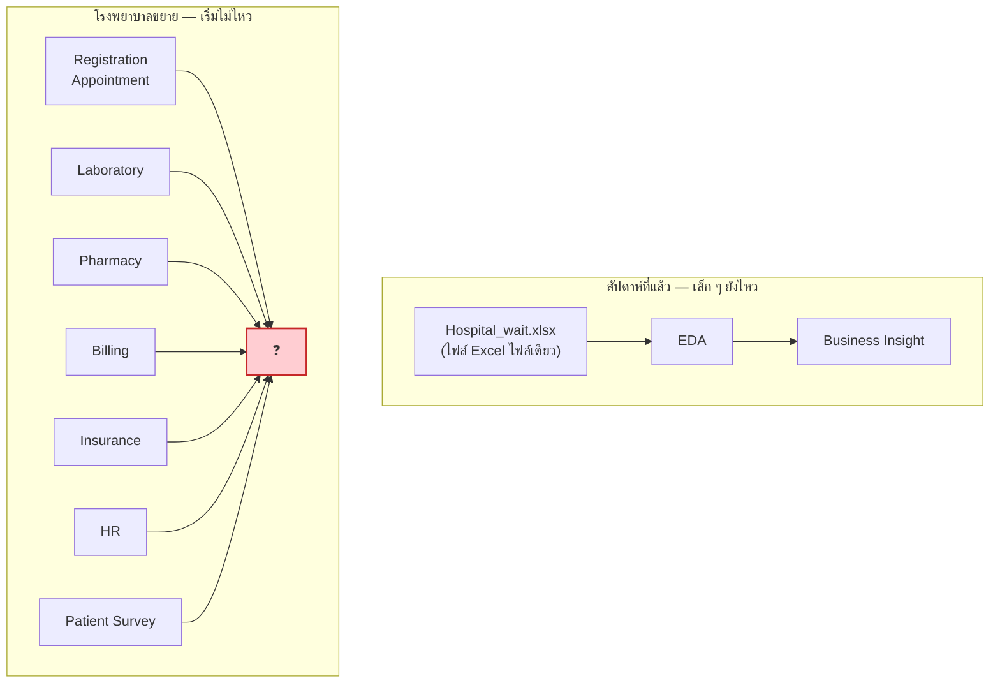

# 05 · Data Warehouse Design Concepts

> [!abstract] guideline ข้อ 4 บอกว่าออกสอบอะไร
> 1. **Fundamental concepts and purpose of a Data Warehouse**
> 2. **OLTP vs. OLAP**
> 3. **Star Schema vs. Snowflake Schema**
> 4. **Fact Tables and Dimension Tables**
> 5. **Different types of Fact Tables:** Transaction · Periodic Snapshot · Accumulating Snapshot
> 6. **Degenerate Dimension, Role-Playing Dimension, Fact-less Fact Table**
>
> 📌 ข้อ 5 และ 6 อยู่ในสไลด์ **`more_design_68_2.pdf`** → ย้ายไปอธิบายที่ [[06 Multi-Dimensional Design]] เพื่อไม่ให้บทนี้ยาวเกินไป (แต่ทั้งคู่คือ guideline ข้อ 4 ต้องอ่านทั้งสองบท)

**ลิงก์:** [[00 START HERE|หน้าหลัก]] · ก่อนหน้า [[04 Data Pre-processing]] · ถัดไป [[06 Multi-Dimensional Design]] · [[07 ETL]] · [[11 Glossary EN-TH]]

---

## 5.1 ทำไมต้องมี Data Warehouse — เคสโรงพยาบาล

สไลด์เปิดด้วยเรื่องเล่าที่ต่อจากคาบก่อน (Hospital Waiting Time EDA) เพื่อสร้างแรงจูงใจ — **ข้อสอบอาจให้สถานการณ์คล้ายกันแล้วถามว่าทำไมต้องมี DW**



**คำถามจาก CEO ที่ตอบไม่ได้ด้วย Excel ไฟล์เดียว:**
- **Revenue by insurance company** (เทียบรายได้ระหว่างบริษัทประกัน)
- **Waiting time by branch** (เทียบสาขา)
- **Doctor performance trend** (วิเคราะห์แนวโน้ม)
- **Patient satisfaction over five years** (KPI dashboard)

> [!important] ⭐ ประโยคเด็ดที่ควรจำ
> **"The problem is NOT Excel. The problem is business complexity."**
> — ปัญหาไม่ใช่ Excel แต่คือ **ความซับซ้อนของธุรกิจ**: แผนกมากขึ้น · ระบบมากขึ้น · รายงานมากขึ้น · ข้อมูลย้อนหลังมากขึ้น

> [!warning] ทำไมไม่แค่ merge ไฟล์ Excel
> วนลูป: **Export → Merge → Clean → Analyze → Repeat**
> **ปัญหา 3 ข้อ:** **Time-consuming** · **Error-prone** · **Inconsistent**

**ทางออก (We Need a Better Solution):**


---

## 5.2 What is a Data Warehouse ⭐⭐ (guideline ข้อ 4.1)

### นิยาม 3 แบบที่สไลด์ให้ (ท่องได้อย่างน้อย 1 แบบ)

> [!quote] นิยามที่ 1 — เชิงบรรยาย
> **"A central database that stores historical business data from multiple systems."**
> - รวมข้อมูลจาก **operational systems ต่าง ๆ ทั่วองค์กร**
> - ข้อมูลถูก **cleaned, organized, and summarized** เพื่อ **Easy Analysis**

> [!quote] นิยามที่ 2 — เชิง repository
> **"A centralized repository that:"**
> 1. **Aggregates data from multiple sources**
> 2. **Creates a single source of truth** ⭐ (แหล่งความจริงหนึ่งเดียว)
> 3. **Stores historical data for analysis**
> 4. **Supports analytics and business intelligence**

> [!quote] ⭐⭐ นิยามที่ 3 — นิยามคลาสสิกของ Inmon (**ออกสอบบ่อยที่สุด**)
> **"A Data Warehouse is a *subject-oriented*, *integrated*, *time-variant* and *non-volatile* collection of data in support of management's decision-making process."**

### Four Key Characteristics ⭐⭐ ต้องท่องให้ได้

> [!important] 4 คุณลักษณะสำคัญ — จำด้วยตัวย่อ **"SITN"**
> | # | คุณลักษณะ | ความหมาย | ขยายความจากสไลด์ |
> |---|---|---|---|
> | **S** | **Subject-Oriented** | **จัดตามหัวข้อธุรกิจ ไม่ใช่ตาม application** | organized by business subjects (**sales, customers, products**) · ใช้เพื่อ decision-support และ analysis |
> | **I** | **Integrated** | **รวมข้อมูลจากหลายแหล่งอย่างสอดคล้องกัน** | data from multiple sources combined **consistently** |
> | **T** | **Time-Variant** | **เก็บข้อมูลย้อนหลังพร้อม time stamps** | **Historical** · **"Time attributes are important"** |
> | **N** | **Non-Volatile** | **ข้อมูลนิ่ง อัปเดตไม่บ่อย** | **"Updates infrequent"** · **"May be append-only"** (เพิ่มอย่างเดียว ไม่แก้/ลบ) |
>
> **วิธีจำแบบไทย:** **จัดตามเรื่อง (S) · หลอมรวม (I) · มีมิติเวลา (T) · ไม่ผันผวน (N)**

### Goals of Data Warehouse (5 ข้อ)

1. **Make an organization's information easily accessible** (เข้าถึงง่าย)
2. **Present the organization's information consistently** (นำเสนออย่างสอดคล้อง)
   > *"Data must be carefully assembled from a variety of sources around the organization, **cleansed**, **quality assured**, and released only when it is **fit for user consumption**"*
3. **Secure and protects information** (ปลอดภัย)
4. **Serves as a foundation for improved decision making** — *"Have the right data"*
5. ⭐ **"Business users must accept the data warehouse if it is to be useful"** (ผู้ใช้ธุรกิจต้องยอมรับ ไม่งั้นไร้ประโยชน์)

### Advantages of Warehousing Approach

| ข้อดี | รายละเอียด |
|---|---|
| **High query performance** | query เร็ว |
| **Doesn't interfere with local processing at sources** ⭐ | **complex queries** ทำที่ **warehouse** ส่วน **OLTP** ทำที่ **operational source systems** → ไม่แย่งทรัพยากรกัน |
| **ที่ฝั่ง warehouse** | **Store historical information** · สามารถ **modify, annotate, summarize, restructure** ได้ · จัดการเรื่อง **security** ได้ |

### Basic Data Warehouse Architecture ⭐


> [!important] 4 ขั้นตอนใต้ภาพสถาปัตยกรรม (สไลด์เขียนไว้)
> **1. Design the Data Warehouse → 2. Populate Data Warehouse → 3. Create OLAP Cubes → 4. Query Data**
>
> ขั้นที่ 1 = [[06 Multi-Dimensional Design]] · ขั้นที่ 2 = [[07 ETL]] · ขั้นที่ 4 = [[08 Reporting from Star Schema]]

### ใครใช้ DW บ้าง (Users of data warehouse)

| อุตสาหกรรม | ใช้ทำอะไร |
|---|---|
| **Retail & e-commerce** | วิเคราะห์และรายงานผลการขาย · สร้าง **ML-assisted recommendations** เพื่อเพิ่มยอดขาย |
| **Healthcare providers** | เข้าถึง insight ล่าสุดเพื่อวินิจฉัยและรักษาผู้ป่วย |
| **Transportation providers** | **Optimize routes, travel times, equipment needs, staffing** |
| **Banking & fin-tech** | **ประเมินความเสี่ยง ตรวจจับ fraud และ cross-sell** |
| **Social media** | วัด **customer sentiment ที่เปลี่ยนตลอดเวลา** ได้เร็ว |
| **Governments** | ใช้ **BI** วิเคราะห์โครงการที่เน้นประชาชนและช่วยตัดสินใจเชิงนโยบาย |

---

## 5.3 OLTP vs OLAP ⭐⭐⭐ (guideline ข้อ 4.2 — ออกแน่นอน)

> [!important] คำเต็มต้องรู้
> **OLTP = OnLine Transaction Processing** (ระบบประมวลผลธุรกรรมออนไลน์)
> **OLAP = OnLine Analytical Processing** (ระบบประมวลผลเชิงวิเคราะห์ออนไลน์)

### ⭐⭐ ตารางเปรียบเทียบฉบับเต็ม (คัดจากสไลด์ p.16 ทุกบรรทัด)

| ประเด็น | **OLTP systems** | **OLAP systems** |
|---|---|---|
| **การดำเนินการหลัก** | **Mostly updates** (เขียนเป็นหลัก) | **Mostly Reads / Read-only access** (อ่านเป็นหลัก) |
| **ชนิด query** | **Mainly Pre-defined queries** (query ที่กำหนดไว้ล่วงหน้า) | **Mainly Ad-Hoc queries** (query เฉพาะกิจ คิดสด) |
| **Data Model** | **Normalized Data Model** | **De-normalized Data Model** |
| **ข้อมูลย้อนหลัง** | **Maintain recent historical data if any** (เก็บย้อนหลังไม่นาน ถ้ามี) | **Maintains historical data for an extended period of time** (เก็บย้อนหลังนาน) |
| **Optimize เพื่อ** | **writes and small queries** | **queries involving a large portion of data in the warehouse** |
| **ลักษณะ transaction** | **Many small transactions** (ธุรกรรมเล็ก ๆ จำนวนมาก) | **Queries are long and complex** (query ยาวและซับซ้อน) |
| **ฐานข้อมูล** | **Based on elementary data** (ข้อมูลระดับพื้นฐาน) | **Based on synthesized data from multiple sources** (ข้อมูลสังเคราะห์จากหลายแหล่ง) |

> [!tip] วิธีจำแบบเทียบภาพ
> - **OLTP = เครื่องคิดเงินหน้าร้าน** — ทำรายการทีละใบ เร็ว ๆ ถูกต้อง เขียนเยอะ
> - **OLAP = ห้องประชุมผู้บริหาร** — เปิดรายงานสรุปย้อนหลัง 5 ปี ถามคำถามใหม่ ๆ ได้ตลอด อ่านอย่างเดียว

### Different Information Worlds ⭐ (คำอธิบายที่ลึกกว่าตาราง)

> [!important] ประโยคคู่ที่ต้องจำ
> - **Operational systems (Database):** **"Where the data is put IN?"** (ข้อมูล **เข้า** ที่ไหน)
> - **Data warehouse (DW):** **"Where we got the data OUT?"** (ข้อมูล **ออก** ที่ไหน)

| | **ผู้ใช้ Operational System** | **ผู้ใช้ Data Warehouse** |
|---|---|---|
| บทบาท | **"Turn the wheels of an organization"** (**หมุน**ล้อขององค์กร) | **"Watch the wheels of the organization turn"** (**เฝ้าดู**ล้อองค์กรหมุน) |
| ขอบเขตข้อมูล | **"Almost always deal with one record at a time"** (ทีละ 1 record) | **"Questions often require hundreds or thousands of rows"** (หลายร้อยหลายพันแถว) |
| ลักษณะงาน | **"Repeatedly perform the same operational tasks over and over"** (ทำงานเดิมซ้ำ ๆ) | **"Continuously change the kinds of questions they ask"** (เปลี่ยนคำถามตลอดเวลา) → **Ad-hoc queries** |

> [!quote] ประโยคสรุป
> **"Data Warehouse users have very different needs than users of operational systems (OLTP)."**

### OLAP & Cube ⭐

> [!important] นิยาม Cube — จำให้ตรงตัว
> **"Cube = Set of pre-computed data at specific periods of time (year, month, week, etc.)"**
> — **ชุดข้อมูลที่คำนวณล่วงหน้าไว้แล้ว** ตามช่วงเวลาที่กำหนด

**ปัญหาที่ Cube แก้:**
> **"Difficulty in analyzing from Large Number of Tables ⇒ Very time-consuming"**
> **"Instant reporting using Cube"** — รายงานได้ทันทีเพราะคำนวณไว้แล้ว

**Analytics tasks ที่ OLAP รองรับ:** **Aggregation, Prediction, Forecasting**

### OLAP Operations

> [!note] ศัพท์ที่โผล่ในสไลด์ (แม้ไม่มีหน้าเฉพาะ)
> สไลด์ [[07 ETL]] และ [[08 Reporting from Star Schema]] มีตัวอย่าง **Drill-down** ชัดเจน (จาก Category → Subcategory)
> - **Drill-down:** จากหยาบ → ละเอียด (Year → Quarter → Month) เช่นจาก `Category='Brass Goods'` ลงไป `Subcategory='Widgets'`
> - **Roll-up:** จากละเอียด → หยาบ (= **Aggregation** ใน [[04 Data Pre-processing#Aggregation & Generalization]] ที่บอกว่า *"Cities aggregated ⇒ regions, states, countries"*)
> - **Slice / Dice:** ตัดเลือกบางมิติ / บางค่า
> - **Pivot:** สลับแกนการมอง

---

## 5.4 Data Warehouse Design: Normalization vs Dimensional ⭐

> [!important] ⭐⭐ ตารางเปรียบเทียบเทคนิคออกแบบ (ออกสอบได้ตรง ๆ)
> | | **OLTP Database Design** | **Data Warehouse Design** |
> |---|---|---|
> | **เทคนิค** | **UML Modeling + Normalization** | **Multi-Dimensional Modeling (De-Normalization)** |
> | **เป้าหมาย** | **"seeks to eliminate data redundancy to quick insert, delete and update operations"** | ออกแบบให้ **query เร็ว** และ **เข้าใจง่าย** |
> | **เป็นประโยชน์ต่อ** | **"transaction processing in relational databases"** | **OLAP analytical systems** |
> | **แทนอะไร** | **"represents business PROCESSES within the enterprise"** — blueprint สำหรับ **OLTP operational database systems** | **"represent SUBJECT AREAS within the enterprise"** — blueprint สำหรับ **OLAP analytical systems** |

> [!warning] Consequent of Normalization — ทำไม OLTP ถึงวิเคราะห์ยาก
> สไลด์ p.26 แสดงฐานข้อมูล OLTP ที่ normalize แล้วของร้านค้าปลีก ประกอบด้วยตารางถึง **11 ตาราง**:
> `Price`, `Product`, `District`, `Store`, `Clerk`, `SoldWithin`, `SalesTransaction`, `Promotion`, `AssociatedWith`, `Brand`, `Category`, `Customer`
>
> **ปัญหา:** จะตอบคำถาม "ยอดขายแบรนด์ X ในเขต Y เดือน Z" ต้อง **join หลายตาราง** → ช้าและเขียนยาก
> → นี่คือเหตุผลตรง ๆ ว่าทำไม DW ต้อง **De-normalize** เป็น Star Schema

---

## 5.5 Dimensional Modeling ⭐⭐

> [!quote] แรงจูงใจจากมุมมองของ CEO (ตัวอย่างที่ดีมากในสไลด์)
> **CEO พูดว่า:** *"We sell **products** in various **stores**, and we measure our **sale figure** over **time**."*
>
> **นักออกแบบ DW ได้ยินเป็น 3 dimensions:**
> 1. We sell **Products** → Dim_Product
> 2. in various **Stores** → Dim_Store
> 3. and measure performance over **time** → Dim_Date
>
> ส่วน **"sale figure"** คือ **Fact / Measure**

> [!important] ทำไมต้องใช้ dimensional model
> **"Management may be interested in examining sales figures in a certain city by product, by time period, by salesperson, and by store."**
> **"The more dimensions involved, the more difficult it is to represent in a single table."**
> — ยิ่งมีมิติมาก ยิ่งแทนด้วยตารางเดียวยาก → จึงต้องแยกเป็น **Fact + Dimensions**

### Facts vs Dimensions ⭐⭐ (guideline ข้อ 4.4)

> [!important] ⭐⭐ ตารางนี้คือหัวใจของบท
> | | **FACTS (Measures)** | **DIMENSIONS** |
> |---|---|---|
> | **คืออะไร** | **"(usually numerical) measures of business"** — ค่าที่ **วัดได้และรวมยอดได้ (aggregated)** | **"Textual descriptions of the business"** — attribute เชิงบรรยายที่ **ให้บริบทกับ facts** |
> | **ตัวอย่าง** | **Sales amount, quantity sold, profit** · sale figures, temperature | **Date, Product, Customer, Store, Employee** |
> | **เก็บที่ไหน** | **Fact table** (**center of star schema** — ใจกลางดาว) | **Dimension tables** (ปลายแฉก) |
> | **ขนาดตาราง** | **"the LARGEST table in the star schema, composed of large volumes of data"** | **"contain relatively SMALL amounts of relatively STATIC data"** |
> | **Normalize?** | — | **"usually NOT-normalized"** |
> | **จำนวนคอลัมน์** | น้อย (FK + measures) | **"Contain LARGE number of attributes for analysis ability"** |
> | **ตอบคำถาม** | **"What are we measuring?"** (วัดอะไร) | **"How do we want to analyze?"** (มองมุมไหน) |

> [!tip] วิธีแยกในห้องสอบ — เห็นคอลัมน์แล้วบอกได้ทันที
> - เป็น **ตัวเลขที่บวกกันแล้วมีความหมาย** (ยอดขาย, จำนวนชิ้น, กำไร) → **Fact / Measure**
> - เป็น **ข้อความ หรือตัวเลขที่บวกกันไม่มีความหมาย** (ชื่อสินค้า, จังหวัด, วันที่, รหัสลูกค้า) → **Dimension attribute**
> - ⚠️ กับดัก: `Year = 2024` เป็นตัวเลข แต่บวกไม่ได้ → เป็น **Dimension attribute**

### Fact Table — รายละเอียด

> [!quote] นิยามจากสไลด์
> - **"Is the primary table in a dimensional model"**
> - **"Facts are numeric measurements (values) that represent a specific business aspect or activity"**
> - **"Fact Table is where numerical measurements of the business are stored"**
> - ⭐ **"Each measurement is taken at the intersection of ALL the dimensions"** (แต่ละค่าวัดถูกเก็บที่ **จุดตัดของทุก dimension**)
> - **"For every query made against the fact table may use hundreds of thousands of individual records to construct an answer set"**

**Fact Table Components (สไลด์ p.43) — โครงสร้าง 2 ส่วน:**

| ส่วน | ตัวอย่างจากสไลด์ `sales_fact` |
|---|---|
| **Foreign Keys** (ชี้ไป dimension) | `customer_key` = 201 · `product_key` = 25 · `time_key` = 134 |
| **Measures** (ค่าที่วัดได้) | `quantity_sales` = 400 · `amount_sales` = 10,789 |

พร้อม dimension tables: `customer_dim` (201 → ALFI, Alfreds) · `product_dim` (25 → 123, Chai) · `time_dim` (134 → 1/1/2000)

### Dimension Table — รายละเอียด

> [!quote] นิยามจากสไลด์
> - **"Are integral companions to a fact table"** (เป็นคู่หูที่ขาดไม่ได้ของ fact table)
> - **"Contain the textual descriptors of the business"**
> - **"Have many columns or attributes"**

> [!example] Product Dimension Table ตัวอย่างจากสไลด์ — สังเกตว่ามี attribute เยอะมาก
> `Product Key (PK)` · `Product Description` · **`SKU Number (Natural key)`** · `Brand Description` · `Category Description` · `Department Description` · `Package Type Description` · `Package Size` · `Fat Content Description` · `Diet Type Description` · `Weight` · `Weight Units of Measure` · `Storage Type` · `Shelf Life Type` · `Shelf Width` · `Shelf Height` · `Shelf Depth` … **and many more**
>
> ⭐ สังเกตคำว่า **Natural key** ที่ `SKU Number` — ต่างจาก **Surrogate key** ที่ `Product Key (PK)` → ดู [[06 Multi-Dimensional Design#6.4 Keys: Primary · Surrogate · Foreign ⭐⭐ (guideline ข้อ 5.4)]]

---

## 5.6 Star Schema vs Snowflake Schema ⭐⭐⭐ (guideline ข้อ 4.3)

![[dw_star_vs_snowflake.png]]

### Star Schema

> [!quote] นิยามจากสไลด์
> **"Star-schema is a graph whose edges are relations between facts and dimensions (mostly un-normalized)"**
> **"Keys are used to connect fact(s) with dimension(s)"**
>
> **"The fact table consisting of numeric measurements is joined to a set of dimension tables filled with descriptive attributes. This characteristic star-like structure is often called a star-schema."**

> [!important] ⭐ คุณสมบัติสำคัญที่ออกสอบได้
> **"All dimensions are symmetrically equal entry points into the fact table — No preferences for any query"**
> — ทุก dimension เป็น **ประตูทางเข้าที่เท่าเทียมกัน** สู่ fact table ไม่มีตัวไหนได้เปรียบ

### Snowflake Schema

> [!quote] นิยามจากสไลด์ (ท่องประโยคนี้)
> **"Snow-flake schemas are NORMALIZED star-schemas"**
> - **"Dimensions tables split into child tables"** (ตาราง dimension ถูกแตกเป็นตารางลูก)
> - **"Don't need to be fully normalized"** (ไม่จำเป็นต้อง normalize เต็มรูป)

### ⭐⭐ ตารางเปรียบเทียบ (คำตอบสำเร็จรูปสำหรับข้อสอบ)

| ประเด็น | **Star Schema** | **Snowflake Schema** |
|---|---|---|
| **Normalization ของ dimension** | **ไม่ normalize** (de-normalized) | **Normalize** — แตกเป็นตารางลูก |
| **จำนวนตาราง** | น้อย (1 fact + n dimensions) | มากกว่า (มีตารางลูกเพิ่ม) |
| **จำนวน JOIN ในการ query** | **น้อย** | **มาก (หลายชั้น)** |
| **ความเร็ว query** | **เร็วกว่า** ✓ | **ช้ากว่า** |
| **ความซ้ำซ้อนของข้อมูล** | **สูง (redundancy)** | **ต่ำ** ✓ |
| **พื้นที่จัดเก็บ** | มากกว่า | **น้อยกว่า** ✓ |
| **ความเข้าใจง่ายสำหรับผู้ใช้ธุรกิจ** | **ง่ายกว่า** ✓ | ซับซ้อนกว่า |
| **การดูแลข้อมูลที่เปลี่ยนบ่อย** | ต้องแก้หลายแถว | **แก้ที่เดียว** ✓ |
| **เหมาะกับ** | **DW/Data mart ทั่วไป** (ค่าเริ่มต้นที่แนะนำ) | เมื่อ dimension ใหญ่มากและมีลำดับชั้นลึก |

> [!tip] ที่มาของชื่อ
> **Star** = fact อยู่กลาง dimension แผ่ออกเป็นแฉก → เหมือน **ดาว**
> **Snowflake** = dimension แตกลูกออกไปอีกชั้น → เหมือน **เกล็ดหิมะ**

---

## 5.7 Example Star-Schema (Retail) — ตัวอย่างเต็มจากสไลด์

> [!example] Sales Fact Table + 6 Dimensions (สไลด์ p.44)
> **Sales Fact Table:**
> `CalendarKey (FK)` · `ProductKey (FK)` · `StoreKey (FK)` · `CustomerKey (FK)` · `ClerkKey (FK)` · `PromotionKey (FK)` · **`DollarsSold`** · **`UnitsSold`**
>
> | Dimension | Attributes |
> |---|---|
> | **Calendar Dimension** | `CalendarKey`, `FullDate`, `DayOfWeek`, `WeekNumber`, `Month`, … |
> | **Product Dimension** | `ProductKey`, `SKU`, `Description`, `Brand`, `Category`, `PackageType`, `Size`, `Flavor`, … |
> | **Store Dimension** | `StoreKey`, `StoreID`, `StoreName`, `Address`, `District`, `FloorType`, … |
> | **Customer Dimension** | `CustomerKey`, `CustomerName`, `PurchaseProfile`, `CreditProfile`, `DemographicType`, `Address`, … |
> | **Clerk Dimension** | `ClerkKey`, `ClerkID`, `ClerkName`, `ClerkGrade`, … |
> | **Promotion Dimension** | `PromotionKey`, `PromotionName`, `PriceType`, `AdType`, `DisplayType`, … |
>
> ⭐ **สังเกต:** ทุก dimension มี **`XxxKey` เป็น surrogate key** และบางตัวมี **`XxxID` เป็น natural key** เก็บคู่ไว้ด้วย (เช่น `StoreKey` + `StoreID`, `ClerkKey` + `ClerkID`)

### SQL บน Star Schema ⭐ (โยงไป [[08 Reporting from Star Schema]])

> [!example] ยอดขายรวมของ category หนึ่ง ในเดือนหนึ่ง
> ```sql
> SELECT Sum(SalesFact.SalesDollars) AS SumOfSalesDollars
> FROM   TimeDimension
>        JOIN (ProductDimension
>              JOIN SalesFact
>              ON ProductDimension.ProductID = SalesFact.ProductID)
>        ON TimeDimension.TimeID = SalesFact.TimeID
> WHERE  ProductDimension.Category = 'Brass Goods'
>   AND  TimeDimension.Month = 3
>   AND  TimeDimension.Year  = 1999;
> ```
>
> **Drill-down ลงไป sub-category** — เปลี่ยนแค่บรรทัด `WHERE`:
> ```sql
> WHERE  ProductDimension.Subcategory = 'Widgets'
>   AND  TimeDimension.Month = 3
>   AND  TimeDimension.Year  = 1999;
> ```
>
> ⭐ **บทเรียน:** โครงสร้าง star schema ทำให้ **drill-down เปลี่ยนแค่เงื่อนไข ไม่ต้องรื้อ query** — นี่คือข้อได้เปรียบที่จับต้องได้

### แบบรายงานที่ได้จาก Star Schema

> [!example] "Dragging and dropping dimensional attributes and facts into simple report" (สไลด์ p.46)
> เลือก **`Store District`** + **`Brand Description`** จาก dimension แล้ว **`Sum(Dollar Sales Amount)`** + **`Sum(Quantity Sold)`** จาก fact:
>
> | District | Brand | Dollar Sales Amount | Quantity Sold |
> |---|---|---|---|
> | Atherton | Clean Fast | 1,233 | 1,370 |
> | Atherton | More Power | 2,239 | 2,035 |
> | Atherton | Zippy | 848 | 707 |
> | Belmont | Clean Fast | 2,097 | 2,330 |
> | Belmont | More Power | 2,428 | 2,207 |
> | Belmont | Zippy | 633 | 527 |
>
> **สังเกตโครงสร้างของทุกรายงาน OLAP:** `dimension attributes` (คอลัมน์ซ้าย ใช้ GROUP BY) + `aggregated measures` (คอลัมน์ขวา ใช้ SUM)

---

## 5.8 Retail Case Study — Dimension Table Attributes

> [!important] ⭐ Date Dimension — จุดที่ออกสอบได้
> **"Date Dimension is the ONE dimension nearly guaranteed to be in EVERY data warehouse — because data [is] mostly time series"**
> → **ทุก DW ต้องมี Date Dimension** ดูวิธีสร้างที่ [[07 ETL#Date Dimension ⭐⭐ (guideline ข้อ 6.5 ระบุตรง ๆ)]]

| Dimension | คำอธิบายจากสไลด์ |
|---|---|
| **Date** | มีอยู่ในแทบทุก DW เพราะข้อมูลส่วนใหญ่เป็น **time series** |
| **Product** | **"Describes every stock keeping unit (SKU) in the grocery store"** |
| **Store** | **"Describes every store in our grocery chain"** · เป็น **primary geographic dimension** · *"Each store can be thought of as a location. We can **roll stores up** to any geographic attribute, such as **ZIP code, county, and state**"* ← **นี่คือ hierarchy สำหรับ roll-up** |
| **Promotion** | ⭐ **"Is potentially the MOST INTERESTING dimension in our schema"** · อธิบายเงื่อนไขโปรโมชั่นตอนขายสินค้า: **temporary price reductions, end-aisle displays, newspaper ads, and coupons** |

> [!quote] คำแนะนำในการออกแบบ
> **"Focus on filling the dimension tables with ROBUST attributes"** — ยัด attribute เข้า dimension ให้เยอะและมีคุณภาพ เพราะ **attribute เหล่านี้คือสิ่งที่ผู้ใช้จะเอาไป filter, group และ sort**

---

## ✅ Self-Test — บทที่ 5

> [!question]- Q1. จงบอกนิยาม Data Warehouse ตามแบบคลาสสิก พร้อมขยายความ 4 คุณลักษณะ
> **"A subject-oriented, integrated, time-variant and non-volatile collection of data in support of management's decision-making process."**
> - **Subject-Oriented:** จัดตามหัวข้อธุรกิจ (sales, customers, products) ไม่ใช่ตาม application
> - **Integrated:** รวมข้อมูลจากหลายแหล่งอย่างสอดคล้อง
> - **Time-Variant:** เก็บข้อมูลย้อนหลังพร้อม time stamp
> - **Non-Volatile:** ข้อมูลนิ่ง อัปเดตไม่บ่อย อาจเป็น append-only

> [!question]- Q2. OLTP กับ OLAP ต่างกันอย่างไร ตอบอย่างน้อย 5 ประเด็น
> 1) **Updates เป็นหลัก** vs **Reads เป็นหลัก** 2) **Pre-defined queries** vs **Ad-hoc queries** 3) **Normalized** vs **De-normalized** 4) **เก็บย้อนหลังไม่นาน** vs **เก็บย้อนหลังนาน** 5) **optimize เพื่อ write + query เล็ก** vs **optimize เพื่อ query ที่กินข้อมูลก้อนใหญ่** 6) **transaction เล็กจำนวนมาก** vs **query ยาวและซับซ้อน** 7) **elementary data** vs **synthesized data จากหลายแหล่ง**

> [!question]- Q3. `Year = 2024` เป็น Fact หรือ Dimension attribute
> **Dimension attribute** — เพราะแม้เป็นตัวเลข แต่ **บวกกันแล้วไม่มีความหมาย** (2024 + 2025 = 4049 ไม่มีความหมาย) และมันทำหน้าที่ **ให้บริบท** ไม่ใช่ค่าที่วัด

> [!question]- Q4. Snowflake schema ต่างจาก Star schema อย่างไร และแต่ละแบบเหมาะกับอะไร
> **Snowflake = star ที่ dimension ถูก normalize แตกเป็นตารางลูก**
> - **Star:** join น้อย → query เร็ว, เข้าใจง่าย แต่ข้อมูลซ้ำซ้อนและกินพื้นที่มากกว่า → **ค่าเริ่มต้นที่แนะนำสำหรับ DW**
> - **Snowflake:** ประหยัดพื้นที่ ลดความซ้ำซ้อน ดูแลง่ายเมื่อข้อมูลเปลี่ยน แต่ต้อง join หลายชั้น → query ช้าและซับซ้อนกว่า

> [!question]- Q5. Fact table กับ Dimension table ต่างกันในแง่ขนาดและจำนวนคอลัมน์อย่างไร
> **Fact table:** เป็น **ตารางที่ใหญ่ที่สุด** ในสคีมา (แถวเยอะมาก) แต่ **คอลัมน์น้อย** (FK + measures)
> **Dimension table:** **ข้อมูลน้อยและค่อนข้างนิ่ง (static)** แต่ **มีคอลัมน์เยอะมาก** เพื่อรองรับความสามารถในการวิเคราะห์

> [!question]- Q6. Cube คืออะไร และแก้ปัญหาอะไร
> **"Set of pre-computed data at specific periods of time (year, month, week, etc.)"** — ชุดข้อมูลที่คำนวณล่วงหน้าไว้ตามช่วงเวลา
> **แก้ปัญหา:** *"Difficulty in analyzing from Large Number of Tables ⇒ Very time-consuming"* → ทำให้ได้ **instant reporting**

> [!question]- Q7. ทำไม DW ถึงต้อง de-normalize ทั้งที่ normalization เป็นหลักการที่ดีในฐานข้อมูล
> เพราะ **เป้าหมายต่างกัน** — OLTP normalize เพื่อ **กำจัดความซ้ำซ้อน ทำให้ insert/delete/update เร็ว** แต่ DW ต้องการ **query เร็วและเข้าใจง่าย** ซึ่ง normalization ทำให้ต้อง **join ตารางจำนวนมาก** (ตัวอย่างในสไลด์: OLTP ร้านค้าปลีกมี 11 ตาราง) → ช้าและเขียนยาก

> [!question]- Q8. dimension ใดที่แทบทุก data warehouse ต้องมี และเพราะอะไร
> **Date Dimension** — เพราะ *"data [is] mostly time series"* ข้อมูลธุรกิจส่วนใหญ่มีมิติเวลาเสมอ

> [!question]- Q9. "All dimensions are symmetrically equal entry points into the fact table" หมายความว่าอย่างไร
> ทุก dimension เป็น **ประตูทางเข้าสู่ fact table ที่เท่าเทียมกัน** — จะเริ่มวิเคราะห์จาก Date, Product, Store หรือ Customer ก็ได้ ไม่มี dimension ไหนได้เปรียบเสียเปรียบ (**"No preferences for any query"**)

---

**ถัดไป →** [[06 Multi-Dimensional Design]]
