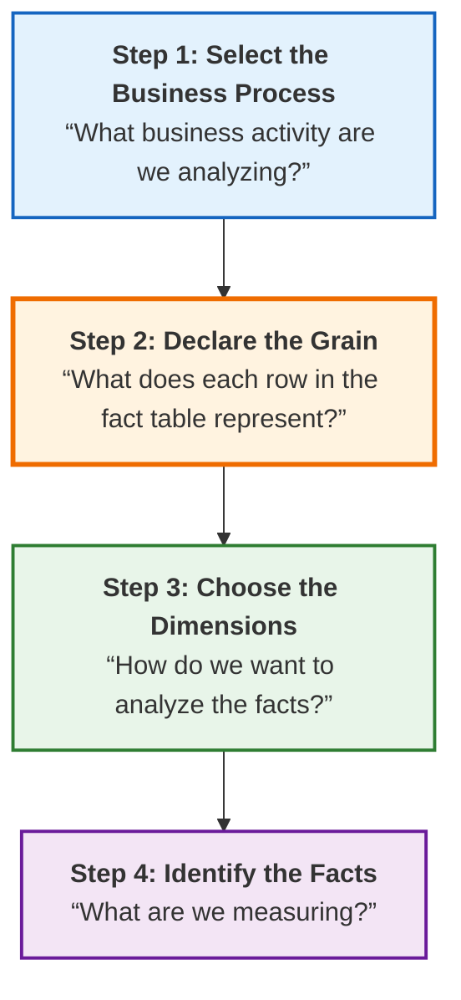
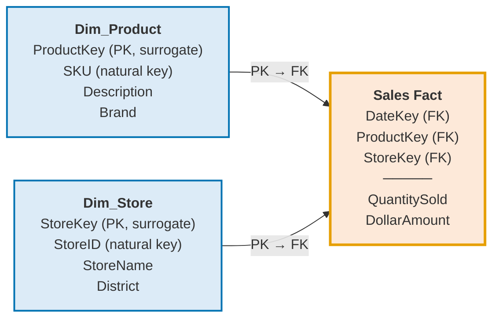

# 06 · Multi-Dimensional Design Process

> [!abstract] guideline ข้อ 5 บอกว่าออกสอบอะไร
> 1. **The 4-Step Design Process:** Business Requirements → Analyzing Source Systems (OLTP) → Star Schema Design → Implementation
> 2. **Defining:** Business Process · **Grain** · Dimensions · Facts / Measures
> 3. **Additive vs Non-additive Measures**
> 4. **Dimension and Fact Table design:** Primary Keys, **Surrogate Keys**, Foreign Keys
>
> **บทนี้ครอบ guideline ข้อ 4.5 และ 4.6 ด้วย:**
> - **Types of Fact Tables:** Transaction · Periodic Snapshot · Accumulating Snapshot
> - **Degenerate Dimension · Role-Playing Dimension · Fact-less Fact Table**

**ลิงก์:** [[00 START HERE|หน้าหลัก]] · ก่อนหน้า [[05 Data Warehouse Concepts]] · ถัดไป [[07 ETL]] · [[11 Glossary EN-TH]]

> [!tip] ไม่มั่นใจว่าเอาหลักการพวกนี้ไปใช้ออกแบบจริงได้ไหม?
> ไปดู **[[13 Star Schema Design Workshop]]** — เดินตัวอย่างซับซ้อนครบทุกขั้นตอน (2 fact tables, role-playing, conformed, degenerate dimension ในเคสเดียว) แล้วมีโจทย์ให้ลองทำเองพร้อมเฉลยทีละขั้น

---

## 6.1 The 4-Step Dimensional Design Process ⭐⭐⭐

> [!important] สไลด์ให้ 4 ขั้นตอนนี้ **ซ้ำถึง 4 หน้า** (p.47–51) → **การันตีว่าออกสอบ ต้องท่องได้ตามลำดับ**



> [!important] ⭐⭐ 4 คำถามประจำขั้น — จำ 4 ประโยคนี้ตอบได้ครึ่งข้อแล้ว
> | ขั้น | ชื่อ | **คำถามหลัก** |
> |---|---|---|
> | **1** | Select the Business Process | **"What business activity are we analyzing?"** |
> | **2** | **Declare the Grain** | **"What does each row in the fact table represent?"** |
> | **3** | Choose the Dimensions | **"How do we want to analyze the facts?"** |
> | **4** | Identify the Facts | **"What are we measuring?"** |

### รายละเอียดแต่ละขั้น

#### Step 1 · Select the Business Process

**ตัวอย่าง business process ในสไลด์:**
- **Sales transactions analysis** · **Order processing** · **Inventory management** · **Customer service calls analysis** · **Website clicks**
- อีกชุด: **raw materials purchasing, orders, shipments, invoicing, inventory**

**ในเวอร์ชันขยาย (Requirement Analysis) ประกอบด้วย:**
- **Identify business factors!**
- **Gather & analyze data sources** ← นี่คือ **"Analyzing Source Systems (OLTP)"** ใน guideline
- **Select the business process**

#### Step 2 · Declare the Grain ⭐⭐ (ขั้นที่สำคัญที่สุด)

> [!important] คำถาม: **"What does each row in the fact table represent?"**
>
> **ตัวอย่าง grain declarations จากสไลด์:**
> - **Individual line item on a sales receipt** (1 บรรทัดสินค้าบนใบเสร็จ)
> - **Daily sales summary by product and store** (สรุปยอดขายรายวันต่อสินค้าต่อสาขา)
> - **Monthly customer account balance** (ยอดคงเหลือรายเดือนต่อลูกค้า)
> - **Individual web page click** (1 คลิก)
> - **"an line item on a bill received from a doctor"** (1 รายการบนใบเสร็จหมอ)
> - **"an individual boarding pass to get on a flight"** (1 ใบขึ้นเครื่อง)

> [!warning] ⭐ ประโยคทองจากสไลด์ `more_design`
> **"Granularity must be clearly defined before design"** — ต้องนิยาม grain ให้ชัดเจน **ก่อน** ออกแบบ
>
> **เหตุผล:** grain กำหนดทุกอย่างที่ตามมา — ถ้า grain คือ "1 บรรทัดใบเสร็จ" ก็จะมี dimension ระดับสินค้าได้ แต่ถ้า grain คือ "ยอดรวมรายเดือนต่อสาขา" จะย้อนกลับไปดูรายสินค้าไม่ได้อีกเลย
>
> **กฎ:** **grain ละเอียดที่สุดเท่าที่ทำได้ = ยืดหยุ่นที่สุด** (roll-up ขึ้นได้เสมอ แต่ drill-down ลงไม่ได้ถ้าไม่ได้เก็บไว้)

#### Step 3 · Choose the Dimensions

> [!important] คำถามที่ต้องถามตัวเอง (สไลด์ให้ 3 ข้อ)
> 1. **"How do business users want to FILTER the data?"**
> 2. **"What attributes do they use to GROUP and SORT?"**
> 3. **"What provides CONTEXT to the measurements?"**

**Very Common dimensions (5W):**

| Dimension | คำถามที่ตอบ |
|---|---|
| **Date/Time** | **When** did it happen? |
| **Product** | **What** was involved? |
| **Customer** | **Who** was involved? |
| **Location** | **Where** did it happen? |
| **Employee** | **Who** handled it? |

**ตัวอย่างอื่นจากสไลด์:** date, product, customer, **transaction type**, **status**

#### Step 4 · Identify the Facts

> [!important] **Facts should be:**
> 1. **Numeric (usually)**
> 2. **Additive (can be summed across dimensions)**
> 3. **Meaningful for business analysis**

---

## 6.2 Additive vs Semi-additive vs Non-additive Measures ⭐⭐ (guideline ข้อ 5.3)

> [!important] ⭐⭐ 3 ชนิดของ measure — ออกสอบแน่นอน
> | ชนิด | นิยาม (สไลด์) | ตัวอย่าง |
> |---|---|---|
> | **Additive** | **"Can be summed across ALL dimensions"** | **sales amount, quantity** · `Sales_Amount = 1,000 บาท` · `Quantity_Sold = 10 ชิ้น` |
> | **Semi-additive** | **"Can be summed across SOME dimensions"** | **account balance** · `Stock_Level = 100 ชิ้น` · `Inventory_Value = 50,000 บาท` |
> | **Non-additive** | **"CANNOT be summed"** | **ratios, percentages** (อัตราส่วน, เปอร์เซ็นต์) |

> [!warning] ⭐⭐ ทำไม Semi-additive ถึงบวกได้แค่บางมิติ — เข้าใจตรงนี้แล้วตอบได้ทุกข้อ
> สไลด์ยกตัวอย่าง `Stock_Level = 100 ชิ้น` แล้วเขียนวงเล็บว่า **"(ไม่สามารถบวกรวมตามเวลาได้)"**
>
> **อธิบาย:** ถ้าสินค้า A มีสต็อก 100 ชิ้นในเดือน ม.ค. และ 100 ชิ้นในเดือน ก.พ.
> - **บวกข้ามสาขาได้:** สาขา 1 มี 100 + สาขา 2 มี 50 = **มีทั้งหมด 150 ชิ้น** ✓ มีความหมาย
> - **บวกข้ามเวลาไม่ได้:** ม.ค. 100 + ก.พ. 100 = **200 ชิ้น?** ✗ **ไม่มีความหมายเลย** — มันคือของ 100 ชิ้นเดิมที่ยังอยู่ในคลัง ไม่ใช่ 200 ชิ้น
>
> → **สำหรับ semi-additive ตามเวลา ต้องใช้ AVG, LAST หรือ MAX แทน SUM**

> [!warning] ทำไม Non-additive ถึงบวกไม่ได้เลย
> **อัตราส่วน/เปอร์เซ็นต์บวกกันไม่ได้** — ถ้า margin ของสาขา A = 20% และสาขา B = 30%
> $20\% + 30\% = 50\%$ ✗ **ผิด** และแม้แต่ $(20+30)/2 = 25\%$ ก็ **ผิด** ถ้าสองสาขามียอดขายไม่เท่ากัน
>
> **วิธีที่ถูก:** เก็บ **ตัวเศษ (profit) และตัวส่วน (revenue) แยกกันเป็น additive measures** แล้วค่อยหารตอน query
> $$\text{Margin}=\frac{\text{SUM}(\text{profit})}{\text{SUM}(\text{revenue})}$$

> [!tip] วิธีทดสอบในห้องสอบ
> ถาม 2 คำถามกับ measure นั้น:
> 1. **"บวกข้าม Product/Store/Customer แล้วมีความหมายไหม"**
> 2. **"บวกข้าม Time แล้วมีความหมายไหม"**
>
> - ตอบใช่ทั้งคู่ → **Additive**
> - ตอบใช่ข้อ 1 แต่ไม่ข้อ 2 → **Semi-additive** (เช่น ยอดคงเหลือ สต็อก headcount)
> - ตอบไม่ทั้งคู่ → **Non-additive** (เช่น %, ratio, average, unit price)

---

## 6.3 Retail Case Study — ตัวอย่างเดินครบ 4 ขั้น ⭐

> [!example] เดินตาม 4 ขั้นจริง (สไลด์ p.52–54)
> **Step 1 · Select the business process → "Sale Analysis"**
> เลือก business process **"POS retail sales"** มาวิเคราะห์ เพื่อตอบว่า:
> - **what products** are selling
> - in **which stores**
> - on **what days**
> - under **what promotional conditions**
> - **How much sale amount** per transaction
>
> **Step 2 · Declare the grain**
> > **"the most granular data is an individual line item on a POS transaction"**
> > = **1 แถว = 1 บรรทัดสินค้าบนใบเสร็จ POS**
>
> **Step 3 · Choose the dimensions**
> > *"Once the grain [of] the fact table has been chosen, the **date, product, and store** primary dimensions **fall out immediately**"*
> > *"It is possible to add more dimensions to the basic grain... such as the **promotion** under which the product is sold"*
>
> ⭐ **สังเกตประโยค "fall out immediately"** — พอ grain ชัด dimension หลักจะ **โผล่ออกมาเอง** นี่คือเหตุผลว่าทำไม grain ต้องมาก่อน
>
> **Step 4 · Identify the facts (measures)**
> → `Quantity Sold`, `Dollar Sales Amount` เป็นต้น

### Dimension Table Attributes ในเคสนี้

| Dimension | จุดเด่นที่สไลด์เน้น |
|---|---|
| **Date** | **"the ONE dimension nearly guaranteed to be in EVERY data warehouse"** — เพราะข้อมูลส่วนใหญ่เป็น time series |
| **Product** | **"Describes every stock keeping unit (SKU) in the grocery store"** |
| **Store** | **primary geographic dimension** · *"We can **roll stores up** to any geographic attribute, such as **ZIP code, county, and state**"* |
| **Promotion** | **"potentially the MOST INTERESTING dimension"** · เก็บ **temporary price reductions, end-aisle displays, newspaper ads, coupons** |

---

## 6.4 Keys: Primary · Surrogate · Foreign ⭐⭐ (guideline ข้อ 5.4)

### Surrogate Keys — นิยาม

> [!quote] นิยามจากสไลด์
> Surrogate Keys คือคีย์ที่ใช้ **แทน operational production codes (= natural keys)**
> - เรียกอีกอย่างว่า: **"meaningless keys, integer keys, non-natural keys, artificial keys, synthetic keys"**
> - **"are INTEGERS that are assigned SEQUENTIALLY as needed to populate a dimension"** (เป็นจำนวนเต็มที่ไล่เลขตามลำดับ)

> [!important] ⭐⭐ กฎเหล็กจากสไลด์
> **"EVERY join between dimension and fact tables should be based on meaningless integer surrogate keys"**
>
> **เหตุผล 2 ข้อ:**
> 1. **"We want to avoid embedding intelligence in the data warehouse keys — because any assumptions that we make eventually may be invalidated"**
>    (ไม่ควรฝังความหมายไว้ในคีย์ เพราะสมมติฐานที่ตั้งไว้อาจใช้ไม่ได้ในอนาคต)
> 2. **"Queries and data access applications should not have any built-in dependency on the keys — because the logic also would be vulnerable to invalidation"**
>    (query และแอปไม่ควรพึ่งพาโครงสร้างคีย์)

### ⭐ Surrogate Keys Benefits — 4 ข้อ (ออกสอบได้ตรง ๆ)

| # | ประโยชน์ | อธิบาย |
|---|---|---|
| **1** | **"buffer the data warehouse environment from operational changes"** | เป็นกันชนจากการเปลี่ยนแปลงของระบบต้นทาง · **"allow the data warehouse team to integrate data from MULTIPLE operational source systems"** (ระบบ A ใช้รหัส `CUST-001` ระบบ B ใช้ `10023` → DW ให้ surrogate key เดียว) |
| **2** | **"as small an integer as possible while ensuring that it will accommodate maximum number of rows"** | เลือกชนิด integer ที่เล็กที่สุดที่ยังพอ → **join เร็ว ประหยัดพื้นที่** |
| **3** | **"used to record dimension conditions that may NOT have an operational code"** | ⭐ รองรับกรณีพิเศษที่ระบบต้นทางไม่มีรหัสให้ เช่น **"Date to be Determined"** หรือ **"Date Not Applicable"** → **ใช้แทน NULL ได้** |
| **4** | **"Treating the surrogate DATE key as a date SEQUENCE NUMBER will allow the fact table to be physically PARTITIONED on the basis of the date key"** | ทำให้แบ่งพาร์ทิชัน fact table ตามวันได้ · *"highly effective because it allows old data and new data to be loaded and indexed **without disturbing the rest of the fact table**"* |

> [!important] ⭐ Natural Key vs Surrogate Key — ต้องแยกให้ออก
> | | **Natural Key** (Business/Production key) | **Surrogate Key** |
> |---|---|---|
> | มาจากไหน | ระบบปฏิบัติการ (OLTP) | **DW สร้างขึ้นเอง** |
> | ตัวอย่าง | `SKU Number`, `StoreID`, `ClerkID`, เลขบัตรประชาชน | `ProductKey`, `StoreKey`, `ClerkKey` = 1, 2, 3, … |
> | มีความหมายในตัวไหม | **มี** (เข้ารหัสข้อมูลไว้) | **ไม่มี** (meaningless) |
> | ใช้ join fact–dim ไหม | **ไม่** | **ใช่** ← กฎเหล็ก |
> | เก็บใน dimension ไหม | **เก็บไว้เป็น attribute** (เพื่อ trace กลับไปต้นทาง) | เก็บเป็น **PK** |
>
> ในตัวอย่าง star schema ของสไลด์จะเห็นทั้งคู่: `StoreKey` (surrogate PK) + `StoreID` (natural key) และ `ClerkKey` + `ClerkID`

### สรุปโครงสร้างคีย์ในสคีมา



> [!important] กฎที่ต้องรู้
> - **Dimension table:** `XxxKey` เป็น **Primary Key (PK)** — เป็น surrogate key ไม่ซ้ำ
> - **Fact table:** `XxxKey` ทุกตัวเป็น **Foreign Key (FK)** ชี้กลับไปหา dimension
> - **Primary Key ของ Fact table** = **ผลรวมของ FK ทั้งหมด** (composite key) — และบางครั้งต้องพึ่ง **Degenerate Dimension** ช่วยด้วย (ดูหัวข้อถัดไป)

---

## 6.5 Degenerate Dimension ⭐⭐ (guideline ข้อ 4.6)

> [!quote] ⭐ นิยามที่ต้องท่อง
> **"Degenerate dimensions (that is, DIMENSION KEYS WITHOUT CORRESPONDING DIMENSION TABLES) in fact tables"**
> = **dimension key ที่อยู่ใน fact table แต่ไม่มี dimension table รองรับ**
>
> อีกประโยค: **"Degenerate dimensions are dimensions WITHOUT dimension tables"**

> [!important] คุณสมบัติสำคัญ
> - **"often play an integral role in the fact table's PRIMARY KEY"** (มักเป็นส่วนสำคัญของ PK ของ fact table)
> - เกิดจาก **Operational control numbers** เช่น **order numbers**, **invoice numbers**
> - **"Those numbers usually give rise to EMPTY dimensions and are represented as degenerate"**
> - ตัวอย่างในสไลด์: **Transaction Number**

> [!tip] ทำไมถึงไม่ทำ dimension table ให้มัน
> ถ้าทำตาราง `Dim_Transaction` ขึ้นมา ตารางนั้นจะมีแค่คอลัมน์เดียว = `TransactionNumber` **ไม่มี attribute อื่นให้บรรยายเลย** และมีจำนวนแถวเท่ากับ fact table พอดี
> → **ไร้ประโยชน์** สู้เก็บเลขนั้นไว้ใน fact table ตรง ๆ ดีกว่า

> [!example] ตัวอย่างที่เห็นภาพ
> ```
> Sales_Fact
> ├── DateKey (FK)        → Dim_Date      ✓ มีตาราง
> ├── ProductKey (FK)     → Dim_Product   ✓ มีตาราง
> ├── StoreKey (FK)       → Dim_Store     ✓ มีตาราง
> ├── TransactionNumber   → (ไม่มีตาราง)  ← DEGENERATE DIMENSION
> ├── QuantitySold        (measure)
> └── DollarAmount        (measure)
> ```
> **ประโยชน์จริง:** `TransactionNumber` ยังใช้ **จัดกลุ่มสินค้าที่ซื้อพร้อมกันในใบเสร็จเดียว** ได้ (เป็นข้อมูลสำคัญสำหรับ market basket analysis) → **มีค่าเชิงวิเคราะห์ แม้ไม่มี attribute ประกอบ**

---

## 6.6 Role-Playing Dimension ⭐⭐ (guideline ข้อ 4.6)

> [!quote] ⭐ นิยามที่ต้องท่อง
> **"A role-playing dimension is a dimension in a star schema that has ONE PHYSICAL REPRESENTATION (one underlying physical table) but is referred to MORE THAN ONCE (different roles) by the fact table."**
>
> **"Role Playing dimension refers to a dimension [that] can play different roles in a fact table depending on the context."**

> [!example] ตัวอย่างจากสไลด์ — Date Dimension ที่เล่นหลายบท
> **"the Date dimension can be used for the ordered date, scheduled shipping date, shipment date, and invoice date in an order line fact"**
>
> ```
> Order_Line_Fact
> ├── OrderDateKey (FK)             ──┐
> ├── ScheduledShipDateKey (FK)     ──┤
> ├── ShipmentDateKey (FK)          ──┼──→  Dim_Date  (ตารางจริงมีแค่ตารางเดียว!)
> ├── InvoiceDateKey (FK)           ──┘
> └── measures...
> ```

> [!important] ⭐ ประเด็นเชิงเทคนิคที่สไลด์เน้น — น่าจะออกสอบ
> - **"Each of [the] date should be a FOREIGN KEY in the fact table"** (แต่ละวันต้องเป็น FK แยกกันใน fact table)
> - **"We CANNOT literally join to [a] single date dimension table."**
> - **"Create the ILLUSION of two independent date table[s] by using VIEWS"** ⭐
>
> **แปลว่า:** ทางกายภาพมี `Dim_Date` แค่ตารางเดียว แต่ตอน query ต้อง **สร้าง VIEW** ขึ้นมาหลายตัว (เช่น `Dim_OrderDate`, `Dim_ShipDate`) เพื่อ join แยกกันได้โดยไม่ชนกัน

```sql
-- สร้าง "ภาพลวงตา" ของ dimension สองตัวจากตารางเดียว
CREATE VIEW Dim_OrderDate AS SELECT * FROM Dim_Date;
CREATE VIEW Dim_ShipDate  AS SELECT * FROM Dim_Date;

SELECT od.Month AS OrderMonth, sd.Month AS ShipMonth, SUM(f.Amount)
FROM   Order_Line_Fact f
JOIN   Dim_OrderDate od ON f.OrderDateKey    = od.DateKey
JOIN   Dim_ShipDate  sd ON f.ShipmentDateKey = sd.DateKey
GROUP BY od.Month, sd.Month;
```

> [!tip] วิธีจำ
> **Role-playing = นักแสดงคนเดียว เล่นหลายบทในละครเรื่องเดียวกัน** — ตัวจริงมีคนเดียว (1 physical table) แต่ปรากฏหลายบทบาท (หลาย FK)

---

## 6.7 Factless Fact Table ⭐⭐ (guideline ข้อ 4.6)

> [!quote] ⭐ นิยามที่ต้องท่อง
> - **"Event tables often have NO OBVIOUS NUMERIC FACTS (measures) associated with them"**
> - **"NO facts (Measures) in the fact table"**
> - **"Used as a method for RECORDING EVENTS in a data warehouse when there is NO NATURAL NUMERIC MEASUREMENT associated with the event"**

> [!example] ตัวอย่างที่เข้าใจง่าย
> **การเช็คชื่อนักศึกษาเข้าเรียน:**
> ```
> Attendance_Fact  (factless)
> ├── DateKey (FK)      → Dim_Date
> ├── StudentKey (FK)   → Dim_Student
> ├── CourseKey (FK)    → Dim_Course
> ├── RoomKey (FK)      → Dim_Room
> └── (ไม่มี measure เลย!)
> ```
> **"นักศึกษาคนนี้ มาเรียนวิชานี้ ในวันนี้ ที่ห้องนี้"** — ไม่มีตัวเลขอะไรให้วัด แค่บันทึกว่า **เหตุการณ์เกิดขึ้น**

> [!tip] แล้วจะวิเคราะห์อะไรได้ ถ้าไม่มี measure
> **นับแถว!** `COUNT(*)` คือ measure โดยปริยาย
> ```sql
> SELECT c.CourseName, COUNT(*) AS AttendanceCount
> FROM   Attendance_Fact f JOIN Dim_Course c ON f.CourseKey = c.CourseKey
> GROUP BY c.CourseName;
> ```
> และที่ทรงพลังกว่านั้น: **วิเคราะห์สิ่งที่ "ไม่เกิดขึ้น"** — เช่น สินค้าที่มีโปรโมชั่นแต่ไม่มีใครซื้อ (เอา promotion coverage factless fact ไป LEFT JOIN กับ sales fact แล้วหาแถวที่ไม่ match)

**ตัวอย่างอื่นที่พบบ่อย:** การเข้าชมเว็บเพจ · เหตุการณ์ที่สินค้าอยู่ในโปรโมชั่น (promotion coverage) · การลงทะเบียนเรียน

---

## 6.8 Multiple Fact Tables — เมื่อไหร่ต้องมีมากกว่า 1 ⭐

> [!quote] เหตุผลหลัก
> **"Multiple fact tables is needed because different business processes have fundamentally different characteristics that CAN'T be efficiently combined into a single table."**

### 3 เหตุผลที่ต้องแยก fact table ⭐

| # | เหตุผล | รายละเอียดจากสไลด์ |
|---|---|---|
| **1** | **Different Granularities** | *"different business events occur at different levels of detail"* · **Sales transactions** = ระดับ item · **Daily inventory snapshots** = วันละครั้งต่อสินค้า · **Monthly budget allocations** = ระดับแผนกรายเดือน |
| **2** | **Non-Shared Dimensions** | *"different business processes often involve completely different dimensional contexts"* · **Sales:** Customer, Product, Store, Salesperson · **Manufacturing:** Machine, Operator, Shift, Production Line · **HR:** Employee, Department, Position, Performance Rating |
| **3** | **Different Measure Types** | **Transactional measures** (sales amount, quantity) = **additive events** · **Snapshot measures** (account balance, inventory level) = **states at points in time** · **Accumulated measures** (order lifecycle) = **track progress through stages** |

> [!important] Conformed vs Unique Dimensions (สไลด์ใช้สีบอก)
> สไลด์หน้า "Different business process" ใช้รหัสสี:
> - 🔵 **Blue boxes: Standard dimensions**
> - 🟢 **Green boxes: SHARED dimensions across multiple fact tables** ← เรียกว่า **Conformed Dimensions**
> - 🟠 **Orange boxes: UNIQUE dimensions for specific business processes**
>
> ตัวอย่าง: `Sales_Fact` ใช้ Customer, Product, Store, Salesperson · `Production_Fact` ใช้ Machine, Operator, Shift, Factory · `HR_Fact` ใช้ Employee, Department, Position
> **Dim_Date มักเป็น conformed dimension ที่ทุก fact table ใช้ร่วมกัน**

---

## 6.9 Different Types of Fact Tables ⭐⭐⭐ (guideline ข้อ 4.5 — ออกแน่)

![[dw_fact_types.png]]

### ⭐⭐ ตารางเปรียบเทียบ 3 ชนิด (คัดทุกบรรทัดจากสไลด์)

| ประเด็น | **① Transaction Fact** | **② Periodic Snapshot Fact** | **③ Accumulating Snapshot Fact** |
|---|---|---|---|
| **Captures** | **"The most granular events (one row per transaction)"** · *"Captures detailed business events"* | **"Periodic summary of data at specific points in time"** · *"Captures data at regular time intervals"* | **"The lifecycle of a process (single row UPDATED as progress occurs)"** · *"Tracks lifecycle of a process"* |
| **1 แถว = ?** | **1 เหตุการณ์ / 1 ธุรกรรม** | **1 เอนทิตี × 1 งวดเวลา** | **1 instance ของกระบวนการ** |
| **Granularity** | **High granularity (ละเอียดที่สุด)** | **"ไม่เก็บรายละเอียดของแต่ละ transaction"** | ระดับกระบวนการ |
| **การเขียนข้อมูล** | **INSERT** ทุกครั้งที่เกิดเหตุ (ไม่แก้แถวเก่า) | **INSERT** ทุกงวดตามปฏิทิน (แม้ไม่มีอะไรเกิดขึ้น) | **INSERT ครั้งเดียว แล้ว UPDATE ซ้ำ ๆ** เมื่อขั้นตอนสำเร็จ |
| **Dimensions เด่น** | Customer, Product, Date, Employee | **Time-oriented dimensions (Month, Quarter)** · Month, Store, Region | ⭐ **"Lot of Date dimensions (OrderDate, ShipDate, etc.)"** · *"Dimensions for tracking processes such as **milestone dates**"* |
| **Typical Use Case** | **Retail sales, e-commerce, financial transactions** | **Inventory tracking, account balance history, HR headcount reporting** | **ติดตามคำสั่งซื้อ, กระบวนการสมัครงาน, การอนุมัติสินเชื่อ** |
| **ชนิด measure ที่พบ** | มัก **Additive** | มัก **Semi-additive** | มัก **lag/duration** (จำนวนวันระหว่างขั้น) |

### Example Business Questions (ตัวชี้ขาดว่าจะใช้ชนิดไหน) ⭐

> [!important] ① **Transaction Fact** ตอบคำถามแบบนี้
> - **"What was the total sale from each online order last month?"**
> - **"Which products were purchased together most frequently?"**
> - **"How much did customer #C123 spend in Q1?"**
>
> 🔑 **สังเกต:** ถามถึง **เหตุการณ์รายตัว** และ **ผลรวมของเหตุการณ์**

> [!important] ② **Periodic Snapshot Fact** ตอบคำถามแบบนี้
> - **"What was the inventory level for each product at the END OF each month?"**
> - **"How many open support tickets were there at the START OF each day?"** (จำนวนเคสที่ยังไม่ได้ปิด ณ ตอนเช้าของแต่ละวันมีเท่าใด)
> - **"What was the balance of each bank account EVERY MONDAY?"** (ยอดเงินในบัญชีของลูกค้าในทุกวันจันทร์เป็นอย่างไร)
>
> 🔑 **สังเกตคำสำคัญ:** **"ณ สิ้นเดือน" / "ตอนเช้าของแต่ละวัน" / "ทุกวันจันทร์"** = **ถามสถานะ ณ จุดเวลาหนึ่ง ซ้ำ ๆ ตามรอบ**

> [!important] ③ **Accumulating Snapshot Fact** ตอบคำถามแบบนี้
> - **"What is the average time to close a customer support case?"** (เวลาที่ใช้เฉลี่ยในการปิดเคสบริการลูกค้าคือกี่วัน)
> - **"What percentage of orders were delivered within 3 days?"** (กี่เปอร์เซ็นต์ของคำสั่งซื้อที่จัดส่งได้ภายใน 3 วัน)
> - **"How long does it typically take to onboard a new employee?"** (ระยะเวลาเฉลี่ยในการอบรมพนักงานใหม่คือเท่าใด)
>
> 🔑 **สังเกตคำสำคัญ:** **"ใช้เวลานานแค่ไหน" / "กี่ % ที่เสร็จภายใน N วัน"** = **ถามระยะเวลาระหว่างขั้นตอน**

> [!tip] ⭐ Cheat sheet เลือกชนิด fact table ในห้องสอบ
> | โจทย์พูดว่า | ตอบ |
> |---|---|
> | "ทุกครั้งที่ขาย / แต่ละธุรกรรม / รายการบนใบเสร็จ" | **Transaction** |
> | "ณ สิ้นเดือน / ทุกวันจันทร์ / ยอดคงเหลือ / ระดับสต็อก / headcount" | **Periodic Snapshot** |
> | "ใช้เวลากี่วัน / จาก...ถึง... / lifecycle / milestone / มี Date หลายคอลัมน์" | **Accumulating Snapshot** |

---

## ✅ Self-Test — บทที่ 6

> [!question]- Q1. เรียง 4 ขั้นตอนของ Dimensional Design Process พร้อมคำถามประจำขั้น
> 1. **Select the Business Process** — *"What business activity are we analyzing?"*
> 2. **Declare the Grain** — *"What does each row in the fact table represent?"*
> 3. **Choose the Dimensions** — *"How do we want to analyze the facts?"*
> 4. **Identify the Facts** — *"What are we measuring?"*

> [!question]- Q2. ทำไม grain ต้องประกาศก่อนเลือก dimension
> เพราะ **grain กำหนดว่า dimension ใดใช้ได้** — สไลด์บอกว่า *"Once the grain has been chosen, the date, product, and store primary dimensions **fall out immediately**"*
> และ **"Granularity must be clearly defined before design"** · ถ้า grain หยาบเกินไป (เช่น สรุปรายเดือน) จะ **drill-down ลงไปดูรายสินค้าไม่ได้อีกเลย** เพราะไม่ได้เก็บข้อมูลระดับนั้นไว้

> [!question]- Q3. `Stock_Level` เป็น measure ชนิดใด และเพราะอะไร
> **Semi-additive** — บวกข้ามสาขา/สินค้าได้ (สาขา A 100 + สาขา B 50 = มีทั้งหมด 150 ชิ้น ✓) แต่ **บวกข้ามเวลาไม่ได้** (ม.ค. 100 + ก.พ. 100 ≠ 200 ชิ้น เพราะเป็นของ 100 ชิ้นเดิม) → ตามเวลาต้องใช้ **AVG / LAST** แทน SUM

> [!question]- Q4. `Profit Margin (%)` เป็น measure ชนิดใด และควรออกแบบอย่างไร
> **Non-additive** — เปอร์เซ็นต์บวกกันไม่ได้ และเฉลี่ยตรง ๆ ก็ผิดถ้าฐานไม่เท่ากัน
> **ควรออกแบบ:** เก็บ **profit และ revenue เป็น additive measures แยกกัน** แล้วคำนวณ $\text{Margin}=\text{SUM(profit)}/\text{SUM(revenue)}$ ตอน query

> [!question]- Q5. Degenerate Dimension คืออะไร ยกตัวอย่าง และบอกว่าทำไมไม่สร้าง dimension table ให้มัน
> **"dimension keys without corresponding dimension tables"** — dimension key ที่อยู่ใน fact table แต่**ไม่มีตาราง dimension รองรับ**
> **ตัวอย่าง:** Transaction Number, Order Number, Invoice Number (operational control numbers)
> **ทำไมไม่สร้างตาราง:** เพราะตารางนั้นจะมีแค่คอลัมน์เดียวและมีจำนวนแถวเท่ากับ fact table → ไร้ประโยชน์ · สไลด์เรียกว่า *"give rise to empty dimensions"*
> **หมายเหตุ:** มัน *"often play an integral role in the fact table's primary key"*

> [!question]- Q6. Role-Playing Dimension คืออะไร และมีปัญหาทางเทคนิคอะไร แก้อย่างไร
> **"a dimension that has ONE physical representation but is referred to MORE THAN ONCE (different roles) by the fact table"**
> **ตัวอย่าง:** Dim_Date ถูกใช้เป็น OrderDate, ScheduledShipDate, ShipmentDate, InvoiceDate ในตารางเดียวกัน
> **ปัญหา:** *"We cannot literally join to [a] single date dimension table"* — join ตารางเดียวหลายครั้งพร้อมกันไม่ได้ตรง ๆ
> **แก้:** **"Create the illusion of two independent date tables by using VIEWS"** — สร้าง VIEW แยกสำหรับแต่ละบทบาท

> [!question]- Q7. Factless Fact Table คืออะไร แล้ววิเคราะห์อะไรได้ถ้าไม่มี measure
> **fact table ที่ไม่มี measure เลย** — ใช้ *"recording events... when there is no natural numeric measurement associated with the event"*
> **ตัวอย่าง:** การเช็คชื่อเข้าเรียน (นักศึกษา × วิชา × วัน × ห้อง)
> **วิเคราะห์ได้:** ใช้ **`COUNT(*)`** เป็น measure โดยปริยาย (นับจำนวนครั้งที่เหตุการณ์เกิด) และวิเคราะห์ **สิ่งที่ไม่เกิดขึ้น** ได้ด้วย (เช่น สินค้าที่มีโปรฯ แต่ไม่มีคนซื้อ)

> [!question]- Q8. ธนาคารต้องการรู้ "ยอดเงินคงเหลือของทุกบัญชีในทุกวันจันทร์" ควรใช้ fact table ชนิดใด
> **Periodic Snapshot Fact** — เพราะถาม **สถานะ ณ จุดเวลาหนึ่ง ซ้ำ ๆ ตามรอบเวลาที่กำหนด** (ทุกวันจันทร์) · measure ที่ได้ (`Balance`) เป็น **semi-additive**

> [!question]- Q9. "กี่ % ของคำสั่งซื้อที่จัดส่งได้ภายใน 3 วัน" ควรใช้ fact table ชนิดใด และมีลักษณะอะไรพิเศษ
> **Accumulating Snapshot Fact** — เพราะถาม **ระยะเวลาระหว่างขั้นตอน** ของ lifecycle
> **ลักษณะพิเศษ:** มี **Date dimension หลายตัว** (OrderDate, ShipDate, DeliveryDate = milestone dates) และ **แถวเดิมถูก UPDATE** เมื่อกระบวนการคืบหน้า (ค่า NULL ค่อย ๆ ถูกเติม)

> [!question]- Q10. เหตุผล 3 ข้อที่ต้องมี fact table หลายตัวคืออะไร
> 1) **Different Granularities** — เหตุการณ์ธุรกิจต่างกันเกิดที่ระดับรายละเอียดต่างกัน
> 2) **Non-Shared Dimensions** — แต่ละกระบวนการใช้ dimension คนละชุด (Sales ใช้ Customer/Product/Store, Manufacturing ใช้ Machine/Operator/Shift)
> 3) **Different Measure Types** — transactional (additive) vs snapshot (states) vs accumulated (progress)

> [!question]- Q11. ทำไมต้องใช้ Surrogate Key แทน Natural Key ในการ join
> **กฎ:** *"Every join between dimension and fact tables should be based on meaningless integer surrogate keys"*
> **เหตุผล:** 1) หลีกเลี่ยงการฝังความหมายไว้ในคีย์ เพราะสมมติฐานอาจใช้ไม่ได้ในอนาคต 2) query/แอปไม่ควรพึ่งพาโครงสร้างคีย์
> **ประโยชน์:** เป็นกันชนจากการเปลี่ยนแปลงของระบบต้นทาง · **รวมข้อมูลจากหลายระบบต้นทางได้** · เป็น integer เล็ก join เร็ว · **รองรับกรณีที่ไม่มีรหัสจากระบบ เช่น "Date to be Determined"** · ทำ **partition** fact table ตามวันได้

---

**ถัดไป →** [[07 ETL]]
