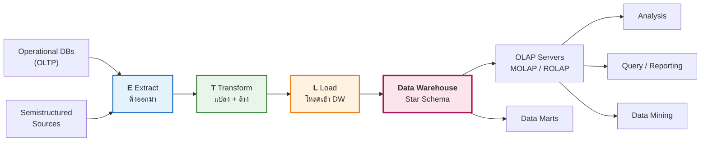

# 07 · ETL — Extraction, Transformation & Loading
### Data Warehouse Implementation

> [!abstract] guideline ข้อ 6 บอกว่าออกสอบอะไร
> 1. **ETL definition and workflow**
> 2. **Extract, Transform, and Load processes**
> 3. **Practical implementation using:** RapidMiner · SQL Scripts
> 4. **Transforming OLTP data into Dimension and Fact tables**
> 5. **Creating derived structures such as a Date Dimension**
> 6. **Loading Dimension and Fact tables**
>
> ⚠️ guideline เน้นคำว่า **"Practical implementation"** และมิดเทอมมี **Lab** → **ต้องอ่าน SQL เป็นและเขียนได้**

**ลิงก์:** [[00 START HERE|หน้าหลัก]] · ก่อนหน้า [[06 Multi-Dimensional Design]] · ถัดไป [[08 Reporting from Star Schema]] · [[10 Formula Sheet]]

---

## 7.1 ETL คืออะไร ⭐⭐ (guideline ข้อ 6.1)

> [!quote] ⭐ นิยามที่ต้องท่อง
> **"ETL is a process that**
> 1. **reads data from one or more SOURCES,**
> 2. **TRANSFORMS the data to make it compatible with the destination system,**
> 3. **LOADS it into the target data warehouse."**



> [!important] The Basic Elements of DW (สไลด์ p.3) — คำที่อยู่บนลูกศร
> **extract · transform · load · refresh · etc.**
> → สังเกตว่ามี **refresh** ด้วย เพราะ ETL ไม่ใช่งานครั้งเดียวจบ ต้องทำซ้ำเป็นรอบ

### ETL Main Tasks — 9 งาน ⭐ (ข้อสอบอาจถามให้ยกมา 3–5 ข้อ)

| # | งาน | รายละเอียดจากสไลด์ |
|---|---|---|
| 1 | **Data Extraction** | **"Extract data from various source systems"** |
| 2 | **Data Cleansing** | **"Clean data for clarification, meaningfulness, and accuracy"** |
| 3 | **Data Transformation** | **"Transform source data into the format and structure for analytics"** |
| 4 | **Data Integration** | **"Integrate & map data from all selected sources to the defined analytical data"** |
| 5 | **Metadata Management** | **"Update metadata used for ETL mappings & rules"** |
| 6 | **Measure deviation & Summarization** | **"Calculate measures based on defined formula"** |
| 7 | **Incremental & Continuous Data Loading** | **"Iterative approach"** (โหลดเพิ่มทีละส่วน ไม่ใช่ทำใหม่ทั้งหมด) |
| 8 | **Schedule Run** | ตั้งเวลารัน |
| 9 | **Data Quality** | ควบคุมคุณภาพข้อมูล |

### ⚠️ ความท้าทายของ ETL Process — 6 ข้อ ⭐

> [!important] **"ETL process consumes 70–80% of project time"** ← ตัวเลขนี้ออกสอบได้
> | ความท้าทาย | อธิบาย |
> |---|---|
> | **Heterogeneous Source Systems** | ระบบต้นทางหลากหลายชนิด |
> | **Little or no control over source systems** | เราคุมระบบต้นทางไม่ได้ (เปลี่ยนโครงสร้างเมื่อไหร่ก็ได้) |
> | **Source systems scattered** | ระบบต้นทางกระจัดกระจาย |
> | **Different currencies, measurement units** | สกุลเงินและหน่วยวัดต่างกัน |
> | **Ensuring data quality** | ต้องประกันคุณภาพข้อมูล |
>
> **Typical functions:** *Define source, query (run SQL) · Define transformation, define target · Verify transformation · Schedule run, audit report*

> [!tip] เชื่อมโยง 3 ตัวเลข "80%" ที่เจอในวิชานี้
> - **Data preparation** = 60–80% ของโครงการ analytics ([[01 Introduction to Data Analytics]])
> - **Data pre-processing** = 80%+ ของโครงการ Big Data ([[04 Data Pre-processing]])
> - **ETL process** = 70–80% ของเวลาโครงการ DW (บทนี้)
>
> **แก่นเดียวกัน: การเตรียมข้อมูลกินเวลามากกว่าการวิเคราะห์เสมอ**

---

## 7.2 Data Sources: Lots of Dirty Data ⭐⭐

สไลด์ p.7 แสดงข้อมูลต้นทางจริงที่มีปัญหาเต็มไปหมด — **นี่คือหน้าที่ข้อสอบชอบหยิบมาถามว่า "จงระบุปัญหาคุณภาพข้อมูลในตารางนี้"**

> [!example] ⭐ ปัญหาที่ซ่อนอยู่ในข้อมูลตัวอย่าง (ไล่ทีละตาราง)
> **`Sales_log`**
> - `T01 K21 B01 9902 **-30** 2` → **ราคาติดลบ!** (invalid value)
> - มีแถวซ้ำ ๆ ที่ต้อง aggregate
>
> **`Store_Desc`**
> - `Koneig` → สะกดผิด ควรเป็น **`Koenig`** (**inconsistent naming / typo**)
> - `999999` เป็นชื่อร้าน → ควรเป็น **`South`** (**placeholder/garbage value**)
> - เบอร์โทร `345-6678` ขาดรหัสพื้นที่ · `(512)399-1245` vs `512-399-1245` → **inconsistent format**
>
> **`Customer_Desc`**
> - `age = **223**` → เป็นไปไม่ได้ ควรเป็น **23** (**outlier / data entry error**)
> - `sex = **20**` → นอกโดเมน ควรเป็น **2** (Female)
> - `34 34 Greystone` → **ข้อความซ้ำ**
> - `TESAS` → สะกดผิด ควรเป็น **`TX`**
> - `9 King (North)` vs `9 King` → **inconsistent**
> - บางแถว **ขาด zip code**
>
> → เทียบกับ [[04 Data Pre-processing#Reality of Real-World Data ⭐ (4 ปัญหาหลัก)|4 ปัญหาของข้อมูลจริง]]: **Incomplete · Noisy · Inconsistent · Fake/Duplicate** ครบทุกข้อ

---

## 7.3 Target Star Schema ที่จะสร้าง

> [!example] Star Schema เป้าหมายในสไลด์ p.8
> ```
>              Time                    Product
>           ┌──────────────┐        ┌──────────────┐
>           │ time_k       │        │ product_k    │
>           │ day, month   │        │ Product_ID   │
>           │ quarter,year │        │ name, brand  │
>           │ season       │        │ subcategory  │
>           └──────┬───────┘        │ category     │
>                  │                └──────┬───────┘
>              ┌───┴────────── Sales ──────┴───┐
>              │  time_k, product_k,           │
>              │  store_k, customer_k          │
>              │  ─────────────────            │
>              │  amount, cost   ← measures    │
>              └───┬───────────────────────┬───┘
>           ┌──────┴───────┐        ┌──────┴───────┐
>           │  Store       │        │  Customer    │
>           │ store_k      │        │ customer_k   │
>           │ Store_ID     │        │ Customer_ID  │
>           │ name, zip    │        │ name, age    │
>           │ region,state │        │ gender       │
>           │ manager      │        │ education    │
>           │ phone        │        │ income       │
>           └──────────────┘        │ address      │
>                                   └──────────────┘
> ```
> ⭐ สังเกต: ทุก dimension มี **`xxx_k` (surrogate key)** และ **`Xxx_ID` (natural key จากระบบต้นทาง)** ตามหลักใน [[06 Multi-Dimensional Design#6.4 Keys: Primary · Surrogate · Foreign ⭐⭐ (guideline ข้อ 5.4)]]

---

## 7.4 Building Dimension Tables — 3 รูปแบบ ⭐⭐

> [!important] ⭐ จุดที่ต้องจำ: การสร้าง dimension แต่ละตัวใช้เทคนิคต่างกัน
> | Dimension | เทคนิคที่ใช้ | รายละเอียด |
> |---|---|---|
> | **Store-Dim** | **JOIN (id–sid)** | รวม `Store_Desc` + `Manager` → ได้ dimension เดียวที่มีทั้งข้อมูลร้านและชื่อผู้จัดการ |
> | **Product-Dim** | **Importing External Information** | `Item_Code` มีแค่ `pcode, name, brand` → **ต้องนำเข้าข้อมูลจากภายนอก** เพื่อเพิ่ม `subcategory` และ `category` |
> | **Customer-Dim** | **Joining with Code Tables** | `Customer_Desc` เก็บ `education=1`, `sex=1` → join กับ `Education_Code` และ `Gender_Code` เพื่อแปลงเป็น `Graduate`, `Male` |

### ① Store-Dim — Join

```
Store_Desc (id, name, zip, region, state, phone)
        +  Manager (sid, name)          ── join on id = sid
        ↓
Store-Dim (store_id, name, zip, region, state, manager, phone)
```

### ② Product-Dim — Importing External Information

**ปัญหา:** ระบบต้นทางมีแค่ `pcode, name, brand` แต่เราต้องการ **hierarchy** สำหรับ roll-up/drill-down

**ลำดับชั้นที่สร้างขึ้นใหม่ (จากภาพในสไลด์):**
```
merchandise
├── house_goods ── detergent ── Power_Clean
│               ├── kitchen_tools ── Henkel_Knife
│               └── hardware
├── soft_drink  ── carbonated ── Coke_Classic, Sprite, Coke_Diet, Pepper
│               ├── mineral
│               └── diary-based
└── electronics …
```

**ผลลัพธ์:**

| pcode | name | brand | **subcategory** | **category** |
|---|---|---|---|---|
| K21 | Power_Clean | Cleaners | **detergent** | **house_goods** |
| Q33 | Coke_Classic | Cola | **carbonated** | **soft_drink** |
| Q34 | Coke_Diet | Cola | **carbonated** | **soft_drink** |
| P67 | Sprite | Coolers | **carbonated** | **soft_drink** |

> [!tip] ทำไมต้องมี hierarchy
> เพราะ hierarchy คือสิ่งที่ทำให้ **Roll-up / Drill-down** ทำได้ — จาก `Coke_Classic` → `carbonated` → `soft_drink` → `merchandise`

### ③ Customer-Dim — Joining with Code Tables

**ก่อน:** `education = 1`, `sex = 1` (ตัวเลขรหัส อ่านไม่รู้เรื่อง)

| Code | Education_Code | | Code | Gender_Code |
|---|---|---|---|---|
| 1 | Graduate | | 1 | Male |
| 2 | College | | 2 | Female |
| 3 | High School | | | |
| 4 | Others | | | |

**หลัง:** `education = Graduate`, `gender = Male` (**อ่านรู้เรื่อง = de-normalization ที่ตั้งใจ**)

> [!important] นี่คือ **De-normalization ในทางปฏิบัติ**
> OLTP เก็บรหัสตัวเลข + ตาราง lookup แยก (normalize) แต่ DW **แปะข้อความจริงลงไปเลย** เพื่อให้ผู้ใช้ query ได้โดยไม่ต้อง join เพิ่ม — ตรงกับหลักใน [[05 Data Warehouse Concepts#5.4 Data Warehouse Design: Normalization vs Dimensional ⭐]]

---

## 7.5 Building Sales-Fact Table — 3 ขั้น ⭐⭐⭐ (จุดที่ออกสอบแน่)

![[etl_fact_build.png]]

> [!important] ⭐⭐ 3 ขั้นที่ต้องท่องตามลำดับ
> | ขั้น | ทำอะไร | คำอธิบายในสไลด์ |
> |---|---|---|
> | **(1/3)** | **JOIN** | **"Join (time_tag, pid, sid)"** — รวม `Sales_log` กับ `Cost` ด้วยคีย์ 3 ตัว เพื่อดึง `unit_cost` เข้ามา |
> | **(2/3)** | **COMPUTATION** | **"amount = price × qty"** และ **"cost = unit_cost × qty"** |
> | **(3/3)** | **GROUPING + AGGREGATION** | **"Grouping (time_tag, pid, sid, cid) and Aggregation (amount, cost)"** |

> [!example]- 🧮 ตรวจสอบตัวเลขทีละแถว (กดดูวิธีคิด)
> **ขั้น 2 — คำนวณ measures:**
> `T01 Q33 A01 9901` price=10, qty=2, u_cost=5 → **amount = 10×2 = 20** · **cost = 5×2 = 10**
> `T01 Q33 A01 9901` price=10, qty=3, u_cost=5 → **amount = 30** · **cost = 15**
>
> **ขั้น 3 — รวมกลุ่ม:** สองแถวข้างบนมี `(time, pid, sid, cid)` เหมือนกันทุกตัว → **ยุบเป็นแถวเดียว**
> $$\text{amount} = 20+30 = \mathbf{50} \qquad \text{cost} = 10+15 = \mathbf{25}$$
>
> **อีกกลุ่มที่ยุบเยอะ:** `T01 K21 A02 9903` มี 4 แถว (qty = 2, 3, 4, 1 ที่ราคา 5 บาท ต้นทุน 2 บาท)
> amount = 10+15+20+5 = **50** · cost = 4+6+8+2 = **20**
>
> **สรุป: 14 แถวดิบ → 10 แถวใน fact table**

> [!bug] ⭐ จุดที่มักถูกมองข้าม — Data Cleansing เกิดขึ้นตรงไหน
> ใน `Sales_log` ดิบ (สไลด์ p.7) แถวนี้คือ `T01 K21 B01 9902 **-30** 2` — **ราคาติดลบ**
> แต่พอถึงขั้น Building Sales-Fact (สไลด์ p.12) แถวเดียวกันกลายเป็น `T01 K21 B01 9902 **30** 2`
>
> → **ราคาติดลบถูกล้างระหว่างทาง** นี่คือ **Data Cleansing** (ETL Main Task ข้อ 2) ที่เกิดขึ้นจริงในตัวอย่าง

> [!warning] Grain ของ fact table นี้คืออะไร
> **1 แถว = 1 (วัน × สินค้า × ร้าน × ลูกค้า)** — ไม่ใช่ระดับ transaction แล้ว เพราะถูก aggregate
> → **ยอดขายรายบรรทัดใบเสร็จหายไป** เป็นตัวอย่างจริงว่า **"grain ที่เลือกกำหนดว่าจะตอบคำถามอะไรได้บ้าง"** ([[06 Multi-Dimensional Design#Step 2 · Declare the Grain ⭐⭐ (ขั้นที่สำคัญที่สุด)]])

---

## 7.6 SQL Scripts: สร้างและโหลด Star Schema ⭐⭐ (guideline ข้อ 6.3, 6.6)

สไลด์ใช้เคส **AllElectronics-OLTP** เดินตาม 4-step design แล้วเขียน SQL จริง

### Step 1 — สร้าง Dimension Tables พร้อม Surrogate Keys

> [!important] ⭐ ต่างกันที่ไวยากรณ์ auto-increment ระหว่าง 2 ระบบ
> | | **MySQL** | **SQL Server** |
> |---|---|---|
> | Auto surrogate key | **`INT AUTO_INCREMENT`** | **`int IDENTITY(1,1)`** |
> | ข้อความ | `VARCHAR(50)` | `nvarchar(50)` |
> | ทศนิยม/เงิน | `DOUBLE` / `DECIMAL(10,2)` | `float` / `money` |

```sql
-- ══════════ MySQL ══════════
-- Customer Dimension
CREATE TABLE CustomerDim (
  CustomerKey    INT AUTO_INCREMENT NOT NULL,   -- ⭐ surrogate key
  CustomerID     INT NOT NULL,                  -- ⭐ natural key จาก OLTP
  CustomerName   VARCHAR(50) NOT NULL,
  CustomerAge    INT NOT NULL,
  CustomerIncome DOUBLE NOT NULL,
  CustomerCredit VARCHAR(50) NOT NULL,
  PRIMARY KEY (CustomerKey)
);

-- Product Dimension
CREATE TABLE ProductDim (
  ProductKey        INT AUTO_INCREMENT NOT NULL,
  ProductID         INT NOT NULL,
  ProductName       VARCHAR(50) NOT NULL,
  ProductCategory   VARCHAR(50) NOT NULL,
  SupplierName      VARCHAR(50) NOT NULL,       -- ← มาจาก join Suppliers
  ProductBrand      VARCHAR(50) NOT NULL,
  ProductPrice      DECIMAL(10, 2) NOT NULL,
  ProductType       VARCHAR(50) NOT NULL,
  ProductPlace_made VARCHAR(50) NOT NULL,
  PRIMARY KEY (ProductKey)
);
```

```sql
-- ══════════ SQL Server ══════════
CREATE TABLE CustomerDim (
  CustomerKey    int IDENTITY(1,1) NOT NULL,    -- ⭐ ต่างกันตรงนี้
  CustoMerID     int NOT NULL,
  CustomerName   nvarchar(50) NOT NULL,
  CustomerAge    int NOT NULL,
  CustomerIncome float NOT NULL,
  CustomerCredit nvarchar(50) NOT NULL
);
```

### Date Dimension ⭐⭐ (guideline ข้อ 6.5 ระบุตรง ๆ)

> [!important] ทำไม Date Dimension ต้องสร้างเอง ไม่ใช่ดึงจาก OLTP
> เพราะ OLTP เก็บแค่ **วันที่ดิบ (`2026-08-18`)** แต่การวิเคราะห์ต้องการ **`Quarter`, `IsWeekend`, `FiscalYear`, `DayOfWeekName`** ฯลฯ ซึ่ง **ต้องคำนวณขึ้นมาใหม่**
> → นี่คือความหมายของคำว่า **"derived structures"** ใน guideline

**เวอร์ชันย่อ:**
```sql
CREATE TABLE DateDim (
  DateKey INT AUTO_INCREMENT NOT NULL,
  Day     INT NOT NULL,
  Month   VARCHAR(50) NOT NULL,
  Year    VARCHAR(50) NOT NULL,
  TheDate DATETIME NOT NULL,
  PRIMARY KEY (DateKey)
);
```

**เวอร์ชันเต็มที่สไลด์ให้ — จัดกลุ่ม attribute เป็น 8 หมวด** (ตัวอย่างที่ดีของคำว่า *"robust attributes"*)

| หมวด | Attributes |
|---|---|
| **Day attributes** | `Day`, `DayOfWeek`, `DayOfWeekName`, `DayOfWeekShort`, `DayOfYear` |
| **Week attributes** | `WeekOfYear`, `WeekOfMonth` |
| **Month attributes** | `Month`, `MonthName`, `MonthShort` |
| **Quarter attributes** | `Quarter`, `QuarterName` |
| **Year attributes** | `Year` |
| **Business day flags** | `IsWeekday`, `IsWeekend`, `IsHoliday` |
| **Fiscal period** | `FiscalYear`, `FiscalQuarter`, `FiscalMonth` |
| **Relative date helpers** | `IsCurrentDay`, `IsCurrentMonth`, `IsCurrentYear` |
| **Formatted dates** | `DateFormatMMDDYYYY`, `DateFormatDDMMYYYY`, `DateFormatYYYYMMDD` |

```sql
CREATE TABLE DateDim (
  DateKey  INT AUTO_INCREMENT NOT NULL,
  TheDate  DATE NOT NULL,
  FullDate DATETIME NOT NULL,
  -- Day / Week / Month / Quarter / Year attributes …
  IsWeekday BOOLEAN NOT NULL,
  IsWeekend BOOLEAN NOT NULL,
  IsHoliday BOOLEAN DEFAULT FALSE,
  FiscalYear INT NOT NULL, FiscalQuarter INT NOT NULL, FiscalMonth INT NOT NULL,
  PRIMARY KEY (DateKey),
  UNIQUE KEY UK_TheDate (TheDate)      -- ⭐ กันวันที่ซ้ำ
);
```

**การ populate Date Dimension** — ใช้ฟังก์ชันวันที่ของ MySQL ล้วน ๆ:

```sql
INSERT INTO DateDim (TheDate, FullDate, Day, DayOfWeek, DayOfWeekName, …)
SELECT DISTINCT                              -- ⭐ DISTINCT กันวันซ้ำ
  DATE(p.Date)                     AS TheDate,
  p.Date                           AS FullDate,
  DAY(p.Date)                      AS Day,
  DAYOFWEEK(p.Date)                AS DayOfWeek,
  DAYNAME(p.Date)                  AS DayOfWeekName,
  LEFT(DAYNAME(p.Date), 3)         AS DayOfWeekShort,
  DAYOFYEAR(p.Date)                AS DayOfYear,
  WEEK(p.Date, 3)                  AS WeekOfYear,
  CEILING(DAY(p.Date) / 7)         AS WeekOfMonth,     -- ⭐ คำนวณเอง
  MONTH(p.Date)                    AS Month,
  MONTHNAME(p.Date)                AS MonthName,
  LEFT(MONTHNAME(p.Date), 3)       AS MonthShort,
  QUARTER(p.Date)                  AS Quarter,
  CONCAT('Q', QUARTER(p.Date))     AS QuarterName,     -- ⭐ 'Q1', 'Q2', …
  YEAR(p.Date)                     AS Year,
  DAYOFWEEK(p.Date) NOT IN (1, 7)  AS IsWeekday,       -- ⭐ 1=อาทิตย์ 7=เสาร์
  DAYOFWEEK(p.Date) IN (1, 7)      AS IsWeekend,
  FALSE                            AS IsHoliday,
  YEAR(p.Date)  AS FiscalYear, QUARTER(p.Date) AS FiscalQuarter,
  MONTH(p.Date) AS FiscalMonth
FROM AllElectronics.Purchases p;
```

> [!tip] เกร็ดที่ออกสอบได้
> ใน MySQL **`DAYOFWEEK()` คืน 1 = Sunday ถึง 7 = Saturday** → เสาร์-อาทิตย์คือ `IN (1, 7)` จึงเป็นสูตรหา weekend

### Step 2 — สร้าง Fact Table ⭐⭐

```sql
-- ══════════ MySQL ══════════
CREATE TABLE ElectFact (
  ProductKey  INT NOT NULL,
  CustomerKey INT NOT NULL,
  TimeKey     INT NOT NULL,
  unit_sold   INT NOT NULL,                    -- measure
  total       DECIMAL(10, 2) NOT NULL,         -- measure

  -- ⭐⭐ PK ของ fact = composite ของ FK ทุกตัว = grain ของตาราง!
  PRIMARY KEY (ProductKey, CustomerKey, TimeKey),

  CONSTRAINT FK_ElectFact_Product
    FOREIGN KEY (ProductKey)  REFERENCES ProductDim(ProductKey),
  CONSTRAINT FK_ElectFact_Customer
    FOREIGN KEY (CustomerKey) REFERENCES CustomerDim(CustomerKey),
  CONSTRAINT FK_ElectFact_Date
    FOREIGN KEY (TimeKey)     REFERENCES DateDim(DateKey)
);

-- Optional: Add indexes for better query performance
CREATE INDEX IDX_ElectFact_Product  ON ElectFact(ProductKey);
CREATE INDEX IDX_ElectFact_Customer ON ElectFact(CustomerKey);
CREATE INDEX IDX_ElectFact_Date     ON ElectFact(TimeKey);
```

> [!important] ⭐⭐ 3 จุดที่ต้องสังเกตใน DDL ของ fact table (ออกสอบได้ทุกจุด)
> 1. **`PRIMARY KEY (ProductKey, CustomerKey, TimeKey)`** = **composite key จาก FK ทั้งหมด** — และมันคือ **การประกาศ grain ในภาษา SQL** นั่นเอง (1 แถวต่อ 1 สินค้า × 1 ลูกค้า × 1 วัน)
> 2. **`FOREIGN KEY … REFERENCES`** ทุกตัวชี้กลับไปหา **surrogate key ของ dimension** (ไม่ใช่ natural key) ตามกฎใน [[06 Multi-Dimensional Design#6.4 Keys: Primary · Surrogate · Foreign ⭐⭐ (guideline ข้อ 5.4)]]
> 3. **`CREATE INDEX` บนทุก FK** — เพราะทุก query จะ join ผ่านคีย์เหล่านี้

```sql
-- ══════════ SQL Server (แยกประกาศ PK ทีหลัง) ══════════
CREATE TABLE ElectFact (
  ProductKey int NOT NULL, CustomerKey int NOT NULL, TimeKey int NOT NULL,
  unit_sold int NOT NULL,  total money NOT NULL
);
ALTER TABLE ElectFact WITH NOCHECK ADD
  CONSTRAINT PK_Sales_fact PRIMARY KEY NONCLUSTERED(ProductKey, CustomerKey, TimeKey);
```

### Step 3 — Populate Dimensions ⭐

```sql
-- ① Customer Dimension: ดึงตรงจาก OLTP (ไม่ต้อง join)
INSERT INTO CustomerDim (CustomerID, CustomerName, CustomerAge,
                         CustomerIncome, CustomerCredit)
SELECT c.CustomerID, c.Name, c.Age, c.Income, c.Credit
FROM   AllElectronics.Customers c;
```

```sql
-- ② Product Dimension: ต้อง JOIN Suppliers เพื่อดึงชื่อ supplier มา de-normalize
INSERT INTO ProductDim (ProductID, ProductName, ProductCategory, SupplierName,
                        ProductBrand, ProductPrice, ProductType, ProductPlace_made)
SELECT i.ItemID, i.ItemName, i.Category, s.SupplierName,
       i.Brand, i.Price, i.Type, i.PlaceMade
FROM   AllElectronics.Items i
INNER JOIN AllElectronics.Suppliers s ON i.SupplierID = s.SupplierID;
```

> [!important] ⭐ สังเกตความต่างของสอง INSERT ข้างบน
> - **CustomerDim** ดึงจากตารางเดียว → **ไม่มี JOIN**
> - **ProductDim** ต้อง **JOIN Suppliers** เพื่อ **แปะ `SupplierName` ลงในตาราง Product เลย** = **De-normalization**
>   → ผลลัพธ์: ตอน query ยอดขายตาม supplier ไม่ต้อง join ตาราง Suppliers อีกแล้ว
>
> ⭐ **ไม่มีการ INSERT ค่า `CustomerKey` / `ProductKey`** — เพราะเป็น `AUTO_INCREMENT` ฐานข้อมูลสร้าง surrogate key ให้เอง

### Step 4 — Populate Fact Table ⭐⭐⭐ (query สำคัญที่สุดในบท)

```sql
INSERT INTO ElectFact (ProductKey, CustomerKey, TimeKey, unit_sold, total)
SELECT
    pd.ProductKey,                          -- ① surrogate key ไม่ใช่ ItemID
    cd.CustomerKey,
    dd.DateKey,
    SUM(s.Qty)             AS unit_sold,    -- ② aggregate measures
    SUM(i.Price * s.Qty)   AS total
FROM       AllElectronics.Item_sold s
INNER JOIN AllElectronics.Purchases p ON s.TransID = p.TransID   -- ③ join OLTP
INNER JOIN AllElectronics.Items     i ON s.ItemID  = i.ItemID
INNER JOIN ProductDim  pd ON pd.ProductID  = i.ItemID            -- ④ lookup surrogate
INNER JOIN CustomerDim cd ON cd.CustomerID = p.CustID
INNER JOIN DateDim     dd ON dd.TheDate    = DATE(p.Date)
GROUP BY pd.ProductKey, cd.CustomerKey, dd.DateKey;              -- ⑤ = grain
```

> [!important] ⭐⭐⭐ อ่าน query นี้ให้ออกทีละส่วน — น่าจะเป็นข้อสอบเต็ม ๆ ข้อหนึ่ง
> | ส่วน | หน้าที่ | ทำไมสำคัญ |
> |---|---|---|
> | **①** `SELECT pd.ProductKey` | เลือก **surrogate key** ของ dimension ไม่ใช่ `i.ItemID` | fact table ต้องเก็บ surrogate key เท่านั้น |
> | **②** `SUM(s.Qty)`, `SUM(i.Price * s.Qty)` | **คำนวณ measures** | `total` เป็น **derived measure** (price × qty) ไม่ได้มีอยู่ใน OLTP |
> | **③** join OLTP 3 ตาราง (`Item_sold`, `Purchases`, `Items`) | **ประกอบข้อมูลจากระบบต้นทางที่ normalize ไว้** | นี่คือเหตุผลที่ DW ต้อง de-normalize |
> | **④** join `ProductDim`/`CustomerDim`/`DateDim` | ⭐ **"Surrogate Key Lookup"** — แปลง natural key (`ItemID`, `CustID`, `Date`) → surrogate key (`ProductKey`, `CustomerKey`, `DateKey`) | **ขั้นตอนหัวใจของการโหลด fact table** |
> | **⑤** `GROUP BY` 3 คีย์ | **กำหนด grain** ของ fact table | ต้องตรงกับ `PRIMARY KEY` ที่ประกาศไว้ตอน `CREATE TABLE` เป๊ะ ๆ |

> [!warning] ⭐ ลำดับการโหลดที่ห้ามสลับ
> **ต้อง populate Dimensions ให้เสร็จก่อน แล้วค่อย populate Fact**
> เพราะ fact table ต้อง **lookup surrogate key** จาก dimension — ถ้า dimension ยังว่าง `INNER JOIN` จะไม่เจอแถวไหนเลย และ **Foreign Key constraint จะ error**


---

## 7.7 ETL Tools ⭐ (guideline ข้อ 6.3)

> [!important] รายชื่อจากสไลด์ (อาจถามว่า "ข้อใดเป็น/ไม่เป็น ETL tool")
> **DataStage** · **Informatica** · **SAS ETL Server** · **Information Builder's Data Migrator / ETL Manager tool suite** · **Sunopsis** · **SQL-Server BI** · **Power-BI** · **Rapid-Miner**
>
> ⭐ **RapidMiner และ Power BI อยู่ในรายการนี้ด้วย** — ตรงกับที่ guideline ระบุว่าใช้ **RapidMiner** ในภาคปฏิบัติ

> [!tip] RapidMiner สำหรับ ETL (สำหรับ Lab)
> operator หลักที่ต้องรู้จัก:
> - **`Read Database` / `Read CSV` / `Read Excel`** → **Extract**
> - **`Join`, `Aggregate`, `Generate Attributes`, `Replace Missing Values`, `Rename`, `Filter Examples`** → **Transform**
> - **`Write Database`** → **Load**

### 🖥️ ตัวอย่างที่เป็นรูปธรรม: RapidMiner Canvas สำหรับเคส AllElectronics ⭐

สไลด์ไม่มีภาพ RapidMiner ให้ดูเลย มีแค่ชื่ออยู่ในลิสต์เครื่องมือ — ภาพด้านล่างจำลอง **"หน้าตาจริง"** ของ operator บน canvas ให้ตรงกับ SQL scripts ใน §7.6 ทีละบรรทัด เพื่อให้เห็นว่า **การลาก operator ต่อกัน = การเขียน SQL ทีละท่อน** เพียงแค่เปลี่ยนไวยากรณ์

![[etl_rapidminer_canvas.png]]

> [!important] อ่านภาพนี้อย่างไร — จับคู่กับ SQL ที่มีอยู่แล้ว
> | แถวใน Canvas | เทียบเท่า SQL block ใน §7.6 | อธิบาย |
> |---|---|---|
> | **แถว 1** Read Customers → Replace Missing Values → Write CustomerDim | `INSERT INTO CustomerDim SELECT … FROM AllElectronics.Customers` | **ไม่มี Join** — operator `Replace Missing Values` ทำหน้าที่แทน `df.fillna()` ที่เห็นใน [[04 Data Pre-processing]] |
> | **แถว 2** Read Items+Suppliers → Join → Write ProductDim | `INSERT INTO ProductDim … INNER JOIN Suppliers` | operator **`Join`** = คำสั่ง `INNER JOIN` ตรง ๆ — ผลคือ `SupplierName` ถูก **de-normalize** เข้า ProductDim |
> | **แถว 3** Read Purchases → Generate Attributes → Write DateDim | `INSERT INTO DateDim … DAY(p.Date), MONTH(p.Date), …` | operator **`Generate Attributes`** ใช้สูตรคำนวณเอง (เหมือน `DAY()`, `QUARTER()` ใน SQL) เพื่อสร้าง **derived structure** |
> | **แถว 4** (ยาวสุด) Read 3 ตาราง → Join ×3 → Aggregate → Surrogate Lookup → Write ElectFact | `INSERT INTO ElectFact SELECT pd.ProductKey, … SUM(s.Qty) … GROUP BY …` | **`Aggregate`** = `GROUP BY` + `SUM()` · **`Surrogate Lookup`** (เส้นประ) = การ join ย้อนกลับไปหา 3 Dimension ที่โหลดเสร็จแล้ว เพื่อแปลง natural key → surrogate key — **ขั้นตอนเดียวกับที่อธิบายไว้ใน [[07 ETL#Step 4 — Populate Fact Table ⭐⭐⭐ (query สำคัญที่สุดในบท)]]** |
>
> ⭐ **ข้อสังเกตสำคัญ:** เส้นประ (dashed) ที่ลากจากทั้ง 3 Dimension เข้าหา operator `Surrogate Lookup` ในแถวล่าง คือภาพที่แสดงกฎ **"ต้อง populate Dimensions ให้เสร็จก่อน แล้วค่อย populate Fact"** ([[07 ETL#Step 3 — Populate Dimensions ⭐]]) — ถ้าลาก operator ผิดลำดับใน RapidMiner (เอา Fact ไปวางก่อน Dimension) จะหา key ไม่เจอเหมือนกับตอน SQL ที่ join ไม่ match

---

## 7.8 Why Do We Still Use the Star Schema? (สไลด์ทบทวนหน้า 2)

> [!important] 4 เหตุผลที่ star schema ยังสำคัญ (ออกสอบได้ตรง ๆ)
> 1. **Fast query performance** (optimized for OLAP workloads)
> 2. **Simple and intuitive structure** (easy to understand and maintain)
> 3. **Clear relationships** between facts and dimensions
> 4. **Well supported by BI tools and dashboards**
>
> **Core Idea:** *"The Star Schema is a fundamental data warehouse design that supports **efficient analytical queries** while remaining **simple and intuitive**."*

| Key Component | หน้าที่ (จากสไลด์ ETL หน้า 2) |
|---|---|
| **Fact Table** | **"Stores business transactions and measures"** · **"Contains mostly numeric values"** (sales amount, quantity) · **"Links to dimension tables via foreign keys"** |
| **Dimension Tables** | **"Store descriptive attributes that provide context"** · **"Answer analytical questions such as WHO, WHAT, WHERE, and WHEN"** · Examples: Time, Product, Customer, Location |

---

## ✅ Self-Test — บทที่ 7

> [!question]- Q1. ETL ย่อมาจากอะไร และแต่ละขั้นทำอะไร
> **Extraction, Transformation & Loading**
> - **Extract:** อ่านข้อมูลจากแหล่งหนึ่งหรือหลายแหล่ง
> - **Transform:** แปลงข้อมูลให้เข้ากันได้กับระบบปลายทาง (รวมถึงล้างข้อมูล คำนวณ measure)
> - **Load:** โหลดเข้า target data warehouse

> [!question]- Q2. ETL กินเวลากี่ % ของโครงการ และมีความท้าทายอะไรบ้าง
> **70–80% ของเวลาโครงการ**
> **ความท้าทาย:** ระบบต้นทางหลากหลาย (heterogeneous) · **ควบคุมระบบต้นทางไม่ได้** · ระบบกระจัดกระจาย · สกุลเงินและหน่วยวัดต่างกัน · ต้องประกันคุณภาพข้อมูล

> [!question]- Q3. 3 ขั้นในการสร้าง Sales-Fact Table จากสไลด์คืออะไร
> **(1) Join** บน `(time_tag, pid, sid)` เพื่อดึง unit_cost มา → **(2) Computation** `amount = price × qty`, `cost = unit_cost × qty` → **(3) Grouping** บน `(time_tag, pid, sid, cid)` แล้ว **Aggregation** ของ amount และ cost

> [!question]- Q4. ทำไม Customer-Dim ต้อง join กับ Code Tables
> เพราะ OLTP เก็บเป็น **รหัสตัวเลข** (`education = 1`, `sex = 1`) ซึ่งอ่านไม่รู้เรื่อง → ต้อง join กับ `Education_Code` และ `Gender_Code` เพื่อแปลงเป็นข้อความจริง (`Graduate`, `Male`)
> **นี่คือ de-normalization ที่ตั้งใจ** เพื่อให้ผู้ใช้ query ได้โดยไม่ต้อง join lookup table เพิ่ม

> [!question]- Q5. ทำไมต้องสร้าง Date Dimension เอง ทั้งที่ OLTP มีวันที่อยู่แล้ว
> เพราะ OLTP เก็บแค่ **วันที่ดิบ** แต่การวิเคราะห์ต้องการ attribute ที่ต้อง **คำนวณขึ้นมาใหม่** เช่น `Quarter`, `DayOfWeekName`, `WeekOfYear`, `IsWeekend`, `IsHoliday`, `FiscalYear` → เรียกว่า **derived structure**

> [!question]- Q6. ใน `CREATE TABLE ElectFact` ทำไม PRIMARY KEY ถึงเป็น `(ProductKey, CustomerKey, TimeKey)`
> เพราะ **PK ของ fact table = composite ของ FK ทั้งหมด** และมันคือ **การประกาศ grain ในภาษา SQL** — บอกว่า **1 แถว = 1 สินค้า × 1 ลูกค้า × 1 วัน** และต้องตรงกับ `GROUP BY` ตอน populate เป๊ะ ๆ

> [!question]- Q7. ในคำสั่ง populate fact table ทำไมต้อง join กับ ProductDim / CustomerDim / DateDim ด้วย ทั้งที่ join OLTP มาแล้ว
> เพื่อทำ **Surrogate Key Lookup** — แปลง **natural key** จาก OLTP (`ItemID`, `CustID`, `Date`) ให้เป็น **surrogate key** ของ DW (`ProductKey`, `CustomerKey`, `DateKey`) เพราะ fact table ต้องเก็บเฉพาะ surrogate key เท่านั้น

> [!question]- Q8. ลำดับการโหลดที่ถูกต้องคืออะไร และทำไมสลับไม่ได้
> **CREATE Dimensions → CREATE Fact → POPULATE Dimensions → POPULATE Fact**
> สลับไม่ได้เพราะการโหลด fact ต้อง **lookup surrogate key จาก dimension** — ถ้า dimension ยังว่าง `INNER JOIN` จะไม่ match แถวไหนเลย และ **FK constraint จะ error**

> [!question]- Q9. MySQL กับ SQL Server ประกาศ surrogate key ต่างกันอย่างไร
> **MySQL:** `INT AUTO_INCREMENT` · **SQL Server:** `int IDENTITY(1,1)`
> (และชนิดข้อมูลต่างกัน: `VARCHAR`/`DOUBLE`/`DECIMAL` vs `nvarchar`/`float`/`money`)

> [!question]- Q10. จงระบุปัญหาคุณภาพข้อมูลอย่างน้อย 5 ข้อจากตาราง Data Sources ในสไลด์
> 1) **`price = -30`** ราคาติดลบ (invalid value) 2) **`age = 223`** อายุเป็นไปไม่ได้ (outlier/typo) 3) **`sex = 20`** ค่านอกโดเมน 4) **`TESAS`** สะกดผิด ควรเป็น `TX` 5) **`Koneig`** สะกดผิด ควรเป็น `Koenig` 6) **`999999`** เป็นชื่อร้าน (placeholder/garbage) 7) **เบอร์โทรรูปแบบไม่สม่ำเสมอ** `(512)399-1245` vs `512-399-1245` และบางเบอร์ขาดรหัสพื้นที่ 8) **`34 34 Greystone`** ข้อความซ้ำ 9) **ขาด zip code** ในบางแถว

---

**ถัดไป →** [[08 Reporting from Star Schema]]
