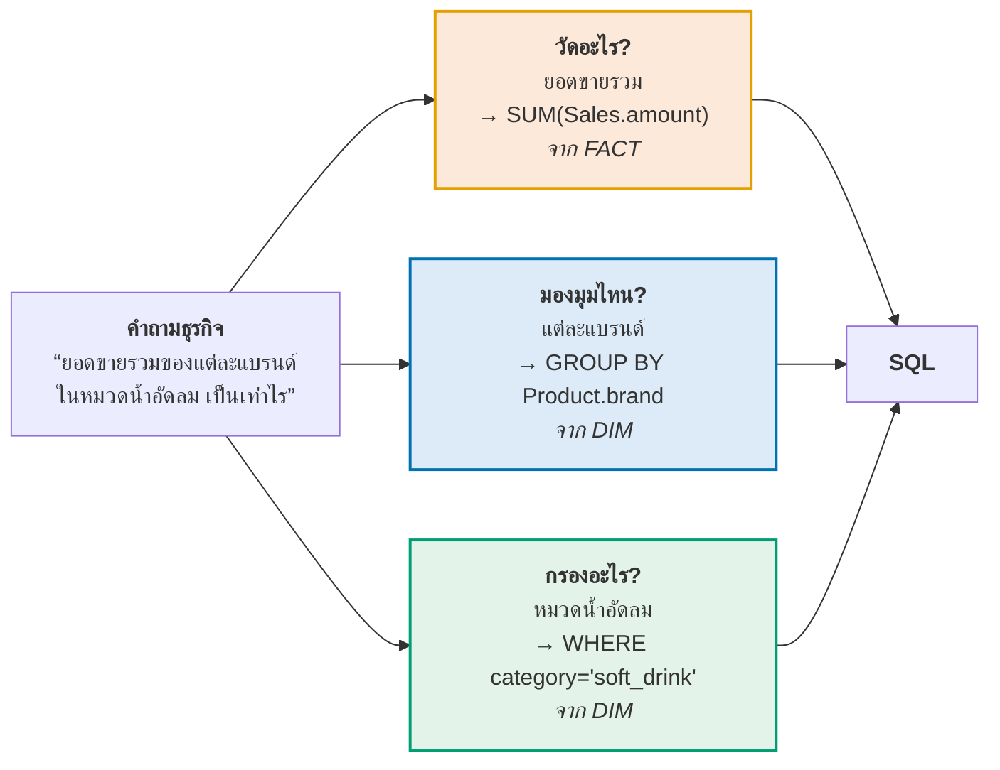

# 08 · Reporting from a Star Schema

> [!abstract] guideline ข้อ 7 บอกว่าออกสอบอะไร
> 1. **Generating reports and analytical results from a Star Schema**
> 2. **Possible tools:** SQL · RapidMiner · Python · Other reporting / visualization tools
>
> 📌 guideline ข้อนี้ **สั้นที่สุด** และสไลด์ก็ให้พื้นที่น้อย (ETL p.33–35 + DW p.45–46) → คาดว่าออกเป็น **"ให้เขียน SQL ตอบคำถามธุรกิจจาก star schema ที่ให้มา"** มากกว่าจะถามทฤษฎี
>
> ➡️ **นี่คือหัวข้อที่ Lab น่าจะออกมากที่สุด** เพราะเป็นสิ่งเดียวที่ทดสอบได้ว่าเข้าใจ star schema จริงหรือไม่

**ลิงก์:** [[00 START HERE|หน้าหลัก]] · ก่อนหน้า [[07 ETL]] · ถัดไป [[09 Regression Analysis]] · [[05 Data Warehouse Concepts]] · [[10 Formula Sheet]]

---

## 8.1 แม่แบบของทุก Query บน Star Schema ⭐⭐⭐

> [!important] ⭐⭐⭐ ท่องแม่แบบนี้ไว้ แล้วเติมช่องว่าง — ตอบได้แทบทุกข้อ
> ```sql
> SELECT      <dimension attributes>,          -- ① มองมุมไหน (จาก DIM)
>             <AGGREGATE(measures)>            -- ② วัดอะไร   (จาก FACT)
> FROM        <fact_table> f
> JOIN        <dim_1> d1 ON f.<d1_key> = d1.<d1_key>     -- ③ join ผ่าน surrogate key
> JOIN        <dim_2> d2 ON f.<d2_key> = d2.<d2_key>
> WHERE       <filter on dimension attributes>  -- ④ กรอง (จาก DIM เสมอ)
> GROUP BY    <dimension attributes>            -- ⑤ ต้องตรงกับ ① ทุกตัว
> ORDER BY    <measure or attribute> [DESC];    -- ⑥ เรียง
> ```
>
> **กฎ 3 ข้อที่ทำให้เขียนไม่ผิด:**
> 1. **สิ่งที่ SUM/COUNT/AVG มาจาก fact table เสมอ**
> 2. **สิ่งที่ GROUP BY และ WHERE มาจาก dimension table เสมอ**
> 3. **ทุกคอลัมน์ใน SELECT ที่ไม่ได้อยู่ในฟังก์ชัน aggregate ต้องอยู่ใน GROUP BY**



---

## 8.2 ตัวอย่างที่ 1 — Query บน Dimension Table อย่างเดียว

> [!example] "Find customers who are more than 50 years old, and earn more than $70,000"
> ```sql
> SELECT *
> FROM   Customer
> WHERE  age > 50 AND income > 70000;
> ```
>
> **ผลลัพธ์:**
>
> | customer_k | name | age | gender | education | income | address |
> |---|---|---|---|---|---|---|
> | 9902 | Nathan | 55 | Male | Graduate | 100,000 | 23 Wood #21, Houston TX 71010 |
> | 9903 | Jane | 55 | Female | College | 95,000 | 12 Central, New York NY 10200 |
>
> ⭐ **ประเด็น:** ไม่ต้องแตะ fact table เลย — เพราะคำถามนี้ถามถึง **คุณสมบัติของลูกค้า** ไม่ได้ถามถึง **ค่าที่วัดได้**
> **นี่คือประโยชน์ของ de-normalization:** `gender` และ `education` เป็นข้อความอ่านรู้เรื่องอยู่แล้ว ไม่ต้อง join code table

---

## 8.3 ตัวอย่างที่ 2 — Query ข้าม Fact + Dimension ⭐⭐

> [!example] "Find the total amount of sales for each brand of soft drink?"
> ```sql
> SELECT   Product.brand, sum(Sales.amount)
> FROM     Product, Sales
> WHERE    Sales.product_k = Product.product_k        -- ← join condition แบบเก่า
>   AND    Product.category = 'soft_drink'            -- ← filter
> GROUP BY Product.brand;
> ```
>
> **ผลลัพธ์:**
>
> | brand | amount |
> |---|---|
> | Cola | 160 |
> | Coolers | 4 |

> [!example]- 🧮 ตรวจสอบตัวเลขจาก fact table (กดดูวิธีคิด)
> Product dimension: `Q33 Coke_Classic → Cola / soft_drink` · `Q34 Coke_Diet → Cola / soft_drink` · `P67 Sprite → Coolers / soft_drink` · `K21 Power_Clean → Cleaners / house_goods` *(ถูกกรองออกเพราะไม่ใช่ soft_drink)*
>
> แถวใน Sales-Fact ที่เป็น soft_drink:
> - `T01 Q33 A01 → 50` · `T01 Q33 A03 → 10` · `T02 Q33 A01 → 100` ⇒ **brand Cola = 50 + 10 + 100 = 160** ✓
> - `T05 P67 A01 → 4` ⇒ **brand Coolers = 4** ✓
>
> **สังเกต:** `K21 Power_Clean` (Cleaners) ถูกตัดออกด้วย `WHERE category = 'soft_drink'` แม้จะมียอดขายรวม 148 บาท

> [!important] ⭐ สังเกตไวยากรณ์ 2 แบบที่สไลด์ใช้ปนกัน — ต้องอ่านออกทั้งคู่
> **แบบเก่า (implicit join):** ใส่เงื่อนไข join ไว้ใน `WHERE`
> ```sql
> FROM  Product, Sales
> WHERE Sales.product_k = Product.product_k AND Product.category = 'soft_drink'
> ```
>
> **แบบใหม่ (explicit join) — แนะนำให้ใช้:** แยก join กับ filter ออกจากกัน
> ```sql
> FROM  Sales
> JOIN  Product ON Sales.product_k = Product.product_k
> WHERE Product.category = 'soft_drink'
> ```
> ทั้งสองให้ผลเหมือนกัน แต่แบบใหม่ **อ่านง่ายกว่าและลืม join condition ยากกว่า** (ถ้าลืมในแบบเก่าจะได้ **cartesian product** ผลลัพธ์บวมมหาศาลโดยไม่มี error)

---

## 8.4 ตัวอย่างที่ 3–5 — จากเคส AllElectronics ⭐

### ยอดขายรวมของแต่ละสินค้า (เรียงมาก→น้อย)

```sql
SELECT   pd.ProductName,
         SUM(f.total) AS Total_Sales
FROM     dbo.ElectFact f
JOIN     dbo.ProductDim pd ON f.ProductKey = pd.ProductKey
GROUP BY pd.ProductName
ORDER BY Total_Sales DESC;
```

### ยอดขายรวมของแต่ละหมวด เฉพาะสินค้าที่ supplier เป็น "Exotic Liquids"

```sql
SELECT   pd.ProductCategory,
         SUM(f.total) AS Total_Sales
FROM     dbo.ElectFact f
JOIN     dbo.ProductDim pd ON f.ProductKey = pd.ProductKey
WHERE    pd.SupplierName = 'Exotic Liquids'          -- ⭐ filter บน dimension
GROUP BY pd.ProductCategory
ORDER BY Total_Sales DESC;
```

> [!important] ⭐ ทำไมข้อนี้ถึงเป็นตัวอย่างที่ดีของ De-normalization
> `SupplierName` **ถูกแปะไว้ใน `ProductDim` ตั้งแต่ตอน ETL** ([[07 ETL#Step 3 — Populate Dimensions ⭐]] ที่ join กับตาราง `Suppliers`)
> → ตอน query **ไม่ต้อง join ตาราง Suppliers อีกเลย** — join แค่ 2 ตาราง (fact + 1 dim)
>
> ถ้าเป็น **snowflake schema** จะต้อง join เพิ่มอีกชั้นเป็น `ElectFact → ProductDim → SupplierDim` = **3 ตาราง**
> → **นี่คือข้อได้เปรียบของ star schema ที่จับต้องได้** ([[05 Data Warehouse Concepts#5.6 Star Schema vs Snowflake Schema ⭐⭐⭐ (guideline ข้อ 4.3)]])

---

## 8.5 Drill-down / Roll-up ในภาษา SQL ⭐⭐

> [!important] ⭐ ตัวอย่างจากสไลด์ DW p.45 — **drill-down คือการเปลี่ยนแค่บรรทัดเดียว**
> **ระดับหยาบ (Category):**
> ```sql
> SELECT Sum(SalesFact.SalesDollars) AS SumOfSalesDollars
> FROM   TimeDimension
>        JOIN (ProductDimension JOIN SalesFact
>              ON ProductDimension.ProductID = SalesFact.ProductID)
>        ON TimeDimension.TimeID = SalesFact.TimeID
> WHERE  ProductDimension.Category = 'Brass Goods'      -- ← ระดับ Category
>   AND  TimeDimension.Month = 3 AND TimeDimension.Year = 1999;
> ```
>
> **Drill-down ลงไประดับ Sub-category:**
> ```sql
> WHERE  ProductDimension.Subcategory = 'Widgets'       -- ← เปลี่ยนแค่บรรทัดนี้
>   AND  TimeDimension.Month = 3 AND TimeDimension.Year = 1999;
> ```
>
> **บทเรียน:** เพราะ dimension เก็บ **hierarchy ไว้ในตารางเดียว** (category → subcategory → product) การ drill-down จึงเป็นแค่การ **เปลี่ยนคอลัมน์ที่ใช้** ไม่ต้องรื้อโครงสร้าง query

### ตารางเทียบ OLAP operation ↔ SQL ⭐

| OLAP Operation | ความหมาย | ทำใน SQL อย่างไร |
|---|---|---|
| **Roll-up** | จากละเอียด → หยาบ | เปลี่ยน `GROUP BY` ไปใช้ **attribute ที่หยาบกว่า** เช่น `GROUP BY Month` → `GROUP BY Quarter` |
| **Drill-down** | จากหยาบ → ละเอียด | เปลี่ยน `GROUP BY` / `WHERE` ไปใช้ **attribute ที่ละเอียดกว่า** เช่น `Category` → `Subcategory` |
| **Slice** | ตัดมิติเดียวออกมาดู | เพิ่ม `WHERE <dim> = <ค่าเดียว>` เช่น `WHERE Year = 1999` |
| **Dice** | ตัดหลายมิติพร้อมกัน | `WHERE <dim1> IN (…) AND <dim2> IN (…)` |
| **Pivot** | สลับแกนการมอง | สลับลำดับคอลัมน์ใน `GROUP BY` หรือใช้ `CASE WHEN … THEN` ทำ cross-tab |

---

## 8.6 รูปแบบรายงานที่ได้จาก Star Schema

> [!example] "Dragging and dropping dimensional attributes and facts into simple report" (DW p.46)
> ลาก **`Store District`** + **`Brand Description`** (จาก dimension) และ **`Dollar Sales Amount`** + **`Quantity Sold`** (จาก fact) มาวาง:
>
> | District | Brand | Sum of Dollar Sales Amount | Sum of Quantity Sold |
> |---|---|---|---|
> | Atherton | Clean Fast | 1,233 | 1,370 |
> | Atherton | More Power | 2,239 | 2,035 |
> | Atherton | Zippy | 848 | 707 |
> | Belmont | Clean Fast | 2,097 | 2,330 |
> | Belmont | More Power | 2,428 | 2,207 |
> | Belmont | Zippy | 633 | 527 |
>
> **SQL ที่เทียบเท่ากับรายงานนี้:**
> ```sql
> SELECT   s.StoreDistrict, p.BrandDescription,
>          SUM(f.DollarSalesAmount) AS DollarSales,
>          SUM(f.QuantitySold)      AS QuantitySold
> FROM     DailySalesFacts f
> JOIN     StoreDimension   s ON f.StoreKey   = s.StoreKey
> JOIN     ProductDimension p ON f.ProductKey = p.ProductKey
> GROUP BY s.StoreDistrict, p.BrandDescription
> ORDER BY s.StoreDistrict, p.BrandDescription;
> ```
>
> ⭐ **โครงสร้างสากลของรายงาน OLAP ทุกฉบับ:**
> **`[dimension attributes]` (คอลัมน์ซ้าย = GROUP BY)** + **`[aggregated measures]` (คอลัมน์ขวา = SUM/COUNT/AVG)**

---

## 8.7 เครื่องมือทำรายงาน (guideline ข้อ 7.2)

| เครื่องมือ | ใช้ทำอะไร | หมายเหตุ |
|---|---|---|
| **SQL** | เขียน query ตรงบน DW | พื้นฐานที่สุด และเป็นสิ่งที่สไลด์เน้น |
| **RapidMiner** | อ่านจากฐานข้อมูล + `Aggregate` + `Pivot` + visualization | เป็นทั้ง ETL tool และ reporting tool (อยู่ในรายชื่อ *Some ETL Tools*) |
| **Python** | `pandas` (`groupby`, `pivot_table`), `matplotlib`/`seaborn`, notebook | ต่อยอดไป [[09 Regression Analysis]] ได้ทันที |
| **Power-BI** | dashboard เชิงโต้ตอบ | อยู่ในรายชื่อ *Some ETL Tools* ในสไลด์ด้วย |

### 🖥️ ตัวอย่างที่เป็นรูปธรรม: คำถามเดียวกัน ตอบด้วย 3 เครื่องมือ ⭐

เอาโจทย์จาก [[08 Reporting from Star Schema#8.3 ตัวอย่างที่ 2 — Query ข้าม Fact + Dimension ⭐⭐|§8.3]] มาตอบซ้ำด้วย SQL, RapidMiner และ Python เพื่อพิสูจน์ว่า **แนวคิดเดียวกันทุกเครื่องมือ** — ต่างกันแค่ไวยากรณ์ ผลลัพธ์ต้องตรงกันเป๊ะ

![[reporting_three_tools.png]]

> [!important] แนวคิดเดียวกัน คนละไวยากรณ์ — จับคู่ operation ให้ออก
> | สิ่งที่ต้องทำ | SQL | RapidMiner | Python (pandas) |
> |---|---|---|---|
> | **รวมตาราง** | `JOIN … ON` | operator **`Join`** | `.merge(on=…)` |
> | **จัดกลุ่ม** | `GROUP BY` | operator **`Aggregate`** (ตั้ง *group by*) | `.groupby(…)` |
> | **รวมยอด** | `SUM(...)` | ใน `Aggregate` ตั้ง *aggregation function* = sum | `['amount'].sum()` |
> | **เรียงลำดับ** | `ORDER BY … DESC` | operator **`Sort`** | `.sort_values(ascending=False)` |
>
> ⭐ **บทเรียนสำคัญ:** ทั้ง 3 ทางได้ **`soft_drink = 164`, `house_goods = 148`** ตรงกันทุกตัวเลข — เพราะทั้งหมดทำสิ่งเดียวกันทางคณิตศาสตร์ (join แล้ว group แล้ว sum) แค่ **RapidMiner ใช้การลาก operator แทนการพิมพ์โค้ด** ส่วน SQL กับ Python ยังต้องเขียนคำสั่ง — เวลาข้อสอบ Lab ให้เลือกเครื่องมือที่โจทย์ระบุ แล้ว **แปลคำถามเป็น 4 ขั้นนี้เสมอ: join → group → aggregate → sort**

> [!example] เทียบ SQL ↔ pandas (สำหรับ Lab ที่ใช้ Python)
> ```python
> # เทียบเท่ากับ: SELECT brand, SUM(amount) FROM sales JOIN product …
> #               WHERE category='soft_drink' GROUP BY brand
> df = sales.merge(product, on='product_k')                 # JOIN
> report = (df[df['category'] == 'soft_drink']              # WHERE
>             .groupby('brand', as_index=False)['amount']   # GROUP BY
>             .sum()                                        # SUM
>             .sort_values('amount', ascending=False))      # ORDER BY DESC
> ```

> [!important] วงจรครบ — บทนี้คือปลายทางของทุกบท
> ```
> OLTP → [[07 ETL|ETL]] → Star Schema ([[06 Multi-Dimensional Design|design]]) → รายงาน (บทนี้)
>                                                    ↓
>                              Descriptive Analytics ([[01 Introduction to Data Analytics|บทที่ 1]])
>                                     "What happened?"
> ```
> **การทำรายงานจาก star schema = Descriptive Analytics** ซึ่งเป็นระดับแรกใน 4 ระดับของ analytics

---

## ✅ Self-Test — บทที่ 8

> [!question]- Q1. เขียน SQL ตอบ: "ยอดขายรวมของแต่ละหมวดสินค้า ในปี 2025" จาก star schema (`Sales` fact + `Product`, `Time` dims)
> ```sql
> SELECT   p.category, SUM(s.amount) AS total_sales
> FROM     Sales s
> JOIN     Product p ON s.product_k = p.product_k
> JOIN     Time    t ON s.time_k    = t.time_k
> WHERE    t.year = 2025
> GROUP BY p.category
> ORDER BY total_sales DESC;
> ```
> **หลักคิด:** วัดอะไร → `SUM(amount)` จาก fact · มองมุมไหน → `category` จาก dim · กรองอะไร → `year` จาก dim

> [!question]- Q2. กฎ 3 ข้อในการเขียน query บน star schema คืออะไร
> 1) **สิ่งที่ aggregate (SUM/COUNT/AVG) มาจาก fact table เสมอ**
> 2) **สิ่งที่ GROUP BY และ WHERE มาจาก dimension table เสมอ**
> 3) **ทุกคอลัมน์ใน SELECT ที่ไม่ได้อยู่ในฟังก์ชัน aggregate ต้องอยู่ใน GROUP BY**

> [!question]- Q3. Drill-down กับ Roll-up ทำใน SQL อย่างไร
> **Drill-down** = เปลี่ยน `GROUP BY`/`WHERE` ไปใช้ attribute **ที่ละเอียดกว่า** (Category → Subcategory, Year → Month)
> **Roll-up** = เปลี่ยนไปใช้ attribute **ที่หยาบกว่า** (Month → Quarter → Year)
> ทำได้เพราะ dimension เก็บ **hierarchy ไว้ในตารางเดียว**

> [!question]- Q4. ทำไม query บน star schema ถึงเร็วกว่าบน snowflake
> เพราะ star schema **de-normalize** — attribute ที่ต้องใช้ (เช่น `SupplierName`) ถูกแปะไว้ใน dimension table เดียวกันแล้วตั้งแต่ตอน ETL → **join แค่ 2 ตาราง (fact + dim)**
> ส่วน snowflake ต้อง join ต่อไปยังตารางลูก (`fact → ProductDim → SupplierDim`) = **3 ตารางขึ้นไป**

> [!question]- Q5. ถ้าลืมใส่ join condition ในแบบ implicit join (`FROM A, B`) จะเกิดอะไรขึ้น
> จะได้ **Cartesian product** (ทุกแถวของ A จับคู่กับทุกแถวของ B) → ผลลัพธ์บวมมหาศาลและ **ตัวเลขผิดโดยไม่มี error แจ้ง** — เป็นเหตุผลที่ควรใช้ **explicit `JOIN … ON`** แทน

> [!question]- Q6. รายงาน OLAP ทุกฉบับมีโครงสร้างอย่างไร
> **`[dimension attributes]` (คอลัมน์ทางซ้าย — มาจาก GROUP BY)** + **`[aggregated measures]` (คอลัมน์ทางขวา — มาจาก SUM/COUNT/AVG)**

> [!question]- Q7. การทำรายงานจาก star schema จัดเป็น analytics ประเภทใด
> **Descriptive Analytics** — ตอบคำถาม **"What happened?"** ด้วย reports, dashboards และ descriptive statistics ([[01 Introduction to Data Analytics#1.3 Types of Analytics ⭐⭐ ออกสอบแน่นอนที่สุด]])

---

**ถัดไป →** [[09 Regression Analysis]]
