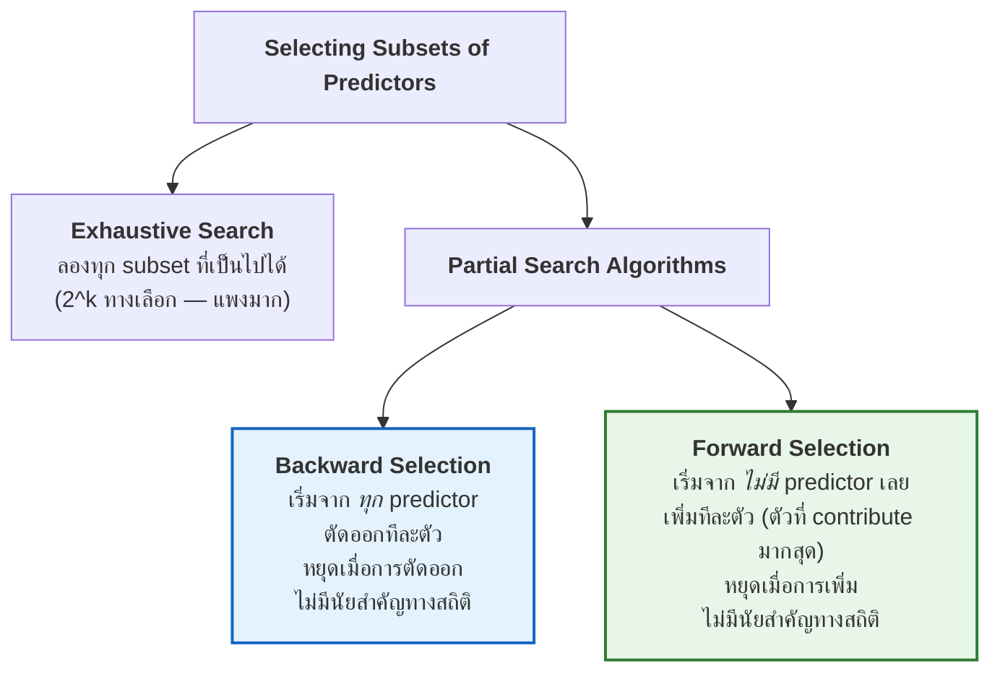

# 09 · Regression Analysis
### Predictive Analytics — การวิเคราะห์การถดถอย

> [!abstract] guideline ข้อ 8 บอกว่าออกสอบอะไร
> 1. **Simple Linear Regression**
> 2. **Multiple Linear Regression**
> 3. **Interpretation of regression coefficients** ⭐
> 4. **Key assumptions:** **Linearity** · **No Multicollinearity**
> 5. **Model Evaluation:** **R-Squared ($R^2$)** · **Adjusted R-Squared** · **Different types of prediction errors**
> 6. **Training vs Test performance**
> 7. **Overfitting**
>
> ⚠️ บทนี้เป็นบทเดียวใน guideline ที่มี **สูตรคำนวณชัดเจน** → เตรียมคำนวณ $b_0, b_1, R^2$, MAE, RMSE ให้ได้

**ลิงก์:** [[00 START HERE|หน้าหลัก]] · ก่อนหน้า [[08 Reporting from Star Schema]] · [[10 Formula Sheet]] · [[12 Exam Drills]]

---

## 9.1 บริบท: Regression อยู่ตรงไหนของ Machine Learning ⭐

### Types of Learning Methods — 4 ชนิด

> [!important] ⭐ ตารางนี้ออกสอบได้ (ข้อสอบชอบให้จำแนกว่าโจทย์เป็น learning แบบไหน)
> | ชนิด | มีอะไร | เป้าหมาย | ข้อมูล |
> |---|---|---|---|
> | **Supervised learning** | **INPUT และ desired OUTPUT** | เรียนความสัมพันธ์ระหว่าง input กับ output | **Labeled Data** (รู้ label) |
> | **Un-supervised learning** | **INPUT อย่างเดียว ไม่มี OUTPUT** | **"discover hidden or un-known patterns"** · *"We do not really know what we are looking for"* | **Un-Labeled Data** (ไม่รู้ class) |
> | **Semi-Supervised learning** | ใช้ทั้ง INPUT และ OUTPUT | ใช้ทั้ง **labeled และ un-labeled data** ร่วมกัน | ผสม |
> | **Reinforcement learning** | **GOAL และ available ACTION** | ให้ agent บรรลุเป้าหมายด้วย action ที่มี **โดยไม่ต้องมีคนคอยสอน** · เป็น **Trial and Error** · มี **Reward ผูกกับ action** | **"Data is created during the learning step"** (สร้างข้อมูลระหว่างเรียน) |

> [!quote] Regression อยู่ตรงไหน
> **"Regression is a specific type of SUPERVISED learning that focuses on CONTINUOUS outcomes."**
>
> เทียบกับ **Classification** = supervised learning ที่ output เป็น **categorical**

### Steps of Supervised Learning + Hold-out ⭐

> [!important] Hold-out (เนื้อหาซ้ำกับ [[04 Data Pre-processing#4.9 Pre-processing for Supervised Learning: Hold-out ⭐]] → ออกสอบแน่)
> **"Usually, the given data set is divided into TRAINING and TEST set, with training set used to BUILD the model and test set used to VALIDATE it."**
> **"A test set is used to determine the ACCURACY of the model."**
>
> ```python
> from sklearn.model_selection import train_test_split
> X_train, X_test, y_train, y_test = train_test_split(X, y, test_size=0.2)  # 80/20
> ```
> ในตัวอย่าง Toyota Corolla สไลด์ใช้ **"60% training data / 40% test data"**

> [!important] ⭐ Goal of Predictive Modeling — 4 บรรทัดที่สไลด์ให้ **ซ้ำ 2 ครั้ง**
> 1. **Model Goal: Optimize predictive accuracy**
> 2. **Train model on training data**
> 3. **Assess performance on test (hold-out) data**
> 4. **Explaining role of predictors is very useful**

---

## 9.2 Regression Analysis คืออะไร ⭐

> [!quote] นิยาม
> **"A statistical technique that analyzes the 'relationship' between variables ⇒ Predict value of Y using value of X"**
>
> **It helps us:**
> - **Predict numerical values**
> - **Understand relationships between variables**
> - **Quantify the effect of each feature on the outcome** ← ข้อนี้คือที่มาของ "Interpretation of coefficients"

> [!important] ⭐ สมการแม่บทที่ต้องรู้
> $$Y = f(X) + \varepsilon$$
> | สัญลักษณ์ | ความหมาย | ชื่อพ้อง (ต้องรู้ทุกคำ) |
> |---|---|---|
> | $Y$ | **Dependent variable** | value being predicted, **target**, **response**, **label** |
> | $f(X)$ | ฟังก์ชันที่อธิบายความสัมพันธ์ | — |
> | $X$ | **Independent variable** | **predictor**, **feature** |
> | $\varepsilon$ | **error term** | **noise** |
>
> → ตรงกับ **Roles of Attributes** ใน [[02 Data and Dataset Types#Roles of Attributes ⭐ (ใช้ต่อในบทที่ 9)]]

**Simple Examples จากสไลด์:** ทำนายเงินเดือนจากปีประสบการณ์ · ทำนายราคาบ้านจากขนาดพื้นที่ (ตร.ม.) · ทำนายคะแนนสอบจากชั่วโมงอ่านหนังสือ · ทำนายยอดขายจากงบการตลาด

> [!example] ตัวอย่างทำนายราคาบ้าน (สไลด์ p.8)
> *"Regression models capture the underlying relationship between **house features (independent variables)** and **price (dependent variable)**, enabling us to not only **estimate the price of a new house** but also **understand how different features influence the price**."*
>
> ⭐ สังเกตว่ามี **2 ประโยชน์**: (1) **ทำนาย** และ (2) **เข้าใจว่าอะไรมีผลต่ออะไร** — นี่คือความต่างระหว่าง *predictive modeling* กับ *explanatory modeling*

### Regression techniques ทั้งหมดที่สไลด์เอ่ยถึง

**Simple Linear Regression** · **Multiple Linear Regression** · **Polynomial Regression** · Decision Tree Regression · Random Forest Regression · Neural Networks

> [!important] "Linear" หมายความว่าอะไร ⭐ (ประเด็นละเอียดที่ออกสอบได้)
> **"Linear Regression: a regression model where the relationship between input variables and output is LINEAR IN PARAMETERS."**
> **"Linear ⇒ Y can be expressed in terms of linear combination of the COEFFICIENTS of X"**
> - Straight-line relationship
> - **Parameters appear linearly**
> - **Easy to interpret**
>
> ⚠️ **จุดสำคัญ:** "linear" หมายถึง **เชิงเส้นในพารามิเตอร์** ไม่ใช่เชิงเส้นใน $x$ — ดังนั้น **Polynomial Regression ($y = \beta_0+\beta_1x+\beta_2x^2$) ก็ยังเป็น linear model** เพราะ $\beta$ ปรากฏเชิงเส้น!

---

## 9.3 Simple Linear Regression ⭐⭐

> [!important] ⭐⭐ สมการที่ต้องท่อง
> $$y = \beta_0 + \beta_1 x$$
> | สัญลักษณ์ | ชื่อ | ความหมาย |
> |---|---|---|
> | $y$ | **dependent variable** | สิ่งที่ต้องการทำนาย |
> | $x$ | **independent variable** | สิ่งที่ส่งผลต่อ $y$ |
> | $\beta_0$ | **y-intercept** | **"The intersection with y axis"** = **ค่าของ $y$ เมื่อ $x = 0$** |
> | $\beta_1$ | **slope** | **"indicates DIRECTION and STRENGTH of relationship"** |

> [!important] ⭐ ความหมายของเครื่องหมาย slope — ออกสอบเป็นภาพได้
> | | ความหมาย | ภาพ |
> |---|---|---|
> | $\beta_1 > 0$ | $x$ เพิ่ม → $y$ **เพิ่ม** | เส้นเอียงขึ้น ↗ |
> | $\beta_1 < 0$ | $x$ เพิ่ม → $y$ **ลด** | เส้นเอียงลง ↘ |
> | $\beta_1 = 0$ | $x$ **ไม่มีผล** ต่อ $y$ | เส้นแนวนอน → |

> [!quote] เป้าหมายของการทำ regression
> **"Linear regression analysis estimate[s] the relationship between an independent variable (Experience) and a dependent variable (Salary) by FITTING A STRAIGHT LINE to the data. Draw the BEST straight line to the data."**

### Use of Linear Regression for Predictive Modeling — 4 ขั้น ⭐

| ขั้น | ทำอะไร |
|---|---|
| **1. Define the equation** | เริ่มจาก $y = \beta_0 + \beta_1 x$ |
| **2. Linear Regression Model Learning** | **"Based on your TRAINING data, estimate the values of $\beta_1$ and $\beta_0$ that make the line BEST FIT the data points"** |
| **3. Evaluate Model on TESTING data** | ประเมินด้วย **R-squared** และ **p-value** |
| **4. Make predictions** | ใช้โมเดลที่ fit แล้วทำนาย $y$ สำหรับ $x$ ใหม่ |

---

## 9.4 The Least Square Method (OLS) ⭐⭐⭐ (สูตรที่ต้องคำนวณเป็น)

![[reg_ols_r2_overfit.png]]

> [!quote] แนวคิด (สไลด์อธิบายจาก "วิธีเดาด้วยสายตา" ก่อน)
> **"Our judgmental approach and our eyes tried to MINIMIZE THE DIFFERENCE between observed values and values obtained on the estimated regression line."**
> **"We may implement the same approach in algebra by: MINIMIZE Sum of the SQUARE of the difference between observed values and values on the regression line."**
> ⇒ **The Least Square Method** (หรือ **Ordinary Least Square, OLS**)

> [!important] ⭐ ฟังก์ชันที่ต้องทำให้น้อยที่สุด
> $$\min Z=\sum_{i=1}^{n}\left(y_i-\hat{y}_i\right)^{2}=\sum_{i=1}^{n}\left(y_i-b_0-b_1x_i\right)^{2}$$
>
> **Classic Minimization:** *"to find the minimum value we should get the DERIVATIVE and set it EQUAL TO ZERO"* — หาอนุพันธ์เทียบ $b_0$ และ $b_1$ แล้วตั้งให้เท่ากับ 0

> [!important] ⭐⭐⭐ สูตรที่ต้องจำและคำนวณได้ (สไลด์ให้ตรง ๆ)
> $$b_1=\frac{\sum xy-\dfrac{\left(\sum x\right)\left(\sum y\right)}{n}}{\sum x^{2}-\dfrac{\left(\sum x\right)^{2}}{n}}$$
> $$b_0=\bar{y}-b_1\bar{x}$$
>
> **ลำดับการทำ:** หา $b_1$ ก่อนเสมอ แล้วค่อยเอาไปแทนในสูตร $b_0$

> [!example]- 🧮 ตัวอย่างคำนวณเต็ม (กดดูวิธีทำทีละขั้น — ใช้ตัวเลขในภาพด้านบน)
> **โจทย์:** ประสบการณ์ $x$ (ปี) และเงินเดือน $y$ (พันบาท)
>
> | $x$ | 1 | 2 | 3 | 4 | 5 |
> |---|---|---|---|---|---|
> | $y$ | 30 | 35 | 45 | 55 | 60 |
>
> **ขั้นที่ 1 — สร้างตารางผลรวม (ทำในกระดาษทดเสมอ)**
>
> | $x$ | $y$ | $xy$ | $x^2$ |
> |---|---|---|---|
> | 1 | 30 | 30 | 1 |
> | 2 | 35 | 70 | 4 |
> | 3 | 45 | 135 | 9 |
> | 4 | 55 | 220 | 16 |
> | 5 | 60 | 300 | 25 |
> | **Σ = 15** | **Σ = 225** | **Σ = 755** | **Σ = 55** |
>
> $n = 5$ · $\bar{x} = 15/5 = 3$ · $\bar{y} = 225/5 = 45$
>
> **ขั้นที่ 2 — หา $b_1$**
> $$b_1=\frac{755-\dfrac{(15)(225)}{5}}{55-\dfrac{15^{2}}{5}}=\frac{755-675}{55-45}=\frac{80}{10}=\mathbf{8}$$
>
> **ขั้นที่ 3 — หา $b_0$**
> $$b_0=45-8(3)=45-24=\mathbf{21}$$
>
> **สมการที่ได้:** $\boxed{\hat{y}=21+8x}$
>
> **ขั้นที่ 4 — คำนวณค่าทำนายและ residual**
>
> | $x$ | $y$ | $\hat{y}=21+8x$ | residual $(y-\hat{y})$ | $(y-\hat{y})^2$ | $(y-\bar{y})^2$ |
> |---|---|---|---|---|---|
> | 1 | 30 | 29 | **+1** | 1 | 225 |
> | 2 | 35 | 37 | **−2** | 4 | 100 |
> | 3 | 45 | 45 | **0** | 0 | 0 |
> | 4 | 55 | 53 | **+2** | 4 | 100 |
> | 5 | 60 | 61 | **−1** | 1 | 225 |
> | | | | **Σ = 0** ✓ | **SSE = 10** | **SST = 650** |
>
> ⭐ **เช็คงานตัวเอง: ผลรวมของ residual ต้องเป็น 0 เสมอ** (คุณสมบัติของ OLS)
>
> **ขั้นที่ 5 — หา $R^2$**
> $$R^{2}=1-\frac{\text{SSE}}{\text{SST}}=1-\frac{10}{650}=1-0.0154=\mathbf{0.9846}$$
>
> **ตีความ:** **98.46% ของความแปรผันในเงินเดือน อธิบายได้ด้วยจำนวนปีประสบการณ์**
>
> **ขั้นที่ 6 — ตีความ $b_1$**
> **ประสบการณ์เพิ่มขึ้น 1 ปี → เงินเดือนเพิ่มขึ้นเฉลี่ย 8,000 บาท**

---

## 9.5 R² — Coefficient of Determination ⭐⭐⭐ (guideline ข้อ 8.5)

> [!quote] คำถามที่ $R^2$ ตอบ
> **"How well does the estimated regression line FIT the data?"**
> **"$r^2$: Coefficient of determination is a measure for GOODNESS OF FIT."**

> [!important] ⭐⭐ นิยามศัพท์ที่ต้องแยกให้ออก
> | ศัพท์ | นิยามจากสไลด์ | สูตร |
> |---|---|---|
> | **Residual** | **"$(y_i - \hat{y}_i)$ is called residual. It is the ERROR in using $\hat{y}_i$ to estimate $y_i$"** | $e_i = y_i - \hat{y}_i$ |
> | **SSE** | **"Sum of Squared Errors = sum of the squared residuals"** | $\text{SSE}=\sum(y_i-\hat{y}_i)^{2}$ |
> | **SST** | **"Sum of Squared Total = sum of the squared deviations of the dependent variable FROM ITS MEAN"** | $\text{SST}=\sum(y_i-\bar{y})^{2}$ |
> | **SSR** | ส่วนที่โมเดล **อธิบายได้** | $\text{SSR}=\sum(\hat{y}_i-\bar{y})^{2}=\text{SST}-\text{SSE}$ |

> [!important] ⭐⭐⭐ สูตร $R^2$
> $$R^{2}=1-\frac{\text{SSE}}{\text{SST}}$$
>
> **ช่วงค่า:** $$0 \le R^{2}\le 1$$

> [!important] ⭐ วิธีตีความ $R^2$ (ท่องประโยคนี้)
> **"$R^2$ tells you WHAT PERCENTAGE OF THE VARIATION IN THE TARGET can be explained by the predictors."**
>
> **"$r^2$ determines the PROPORTION OF VARIANCE in the dependent variable that can be explained by the independent variables."**
>
> **ตัวอย่างในสไลด์:** $r^2 = 0.9027$ → *"In other words, **90% of variations in y can be explained by the regression line**"*

> [!tip] วิธีจำสูตรแบบเข้าใจ (ดูภาพแผงกลางประกอบ)
> - **SST** = ความแปรผันทั้งหมดของ $y$ ถ้าเราไม่มีโมเดลเลย (ใช้แค่ค่าเฉลี่ยทำนาย)
> - **SSE** = ความแปรผันที่ **ยังเหลืออยู่** หลังใช้โมเดลแล้ว
> - $\dfrac{\text{SSE}}{\text{SST}}$ = **สัดส่วนที่อธิบายไม่ได้** → $1 - \dfrac{\text{SSE}}{\text{SST}}$ = **สัดส่วนที่อธิบายได้**
>
> - SSE = 0 → โมเดลทำนายเป๊ะทุกจุด → $R^2 = 1$
> - SSE = SST → โมเดลไม่ดีไปกว่าการใช้ค่าเฉลี่ย → $R^2 = 0$

### Adjusted R² ⭐⭐ (guideline ระบุตรง ๆ)

> [!warning] ปัญหาของ $R^2$ ธรรมดา
> **$R^2$ จะเพิ่มขึ้น (หรืออย่างน้อยไม่ลด) เสมอ เมื่อเพิ่ม predictor** — แม้จะเพิ่มตัวแปรที่ไม่มีความหมายเลย (เช่น เลขสุ่ม) $R^2$ ก็ยังขยับขึ้น
> → **ใช้ $R^2$ เปรียบเทียบโมเดลที่มีจำนวน predictor ต่างกันไม่ได้!**

> [!important] ⭐ สูตร Adjusted R²
> $$R^{2}_{\text{adj}}=1-\frac{(1-R^{2})(n-1)}{n-k-1}$$
> โดย $n$ = จำนวนข้อมูล · $k$ = จำนวน predictors
>
> **หลักการ:** มี **"บทลงโทษ" (penalty) ตามจำนวน predictor** — เพิ่มตัวแปรที่ไม่ช่วยอะไร $R^2_{\text{adj}}$ จะ **ลดลง**
> → **ใช้ $R^2_{\text{adj}}$ เปรียบเทียบโมเดลที่มีจำนวนตัวแปรต่างกันได้**
>
> ⭐ **ประโยคจากสไลด์หน้า "Diagnostics for the 12 models":** **"Good model has: HIGH adj-$R^2$"**
>
> *(หมายเหตุ: หน้า Adjusted $R^2$ ในสไลด์เป็นรูปภาพ ข้อความจึงสกัดไม่ออก — สูตรข้างบนคือสูตรมาตรฐานที่ใช้กันทั่วไป)*

> [!important] เปรียบเทียบ $R^2$ vs Adjusted $R^2$
> | | **$R^2$** | **Adjusted $R^2$** |
> |---|---|---|
> | เพิ่ม predictor ที่ไร้ประโยชน์ | **เพิ่มขึ้นเสมอ** ⚠️ | **ลดลง** ✓ |
> | ใช้เทียบโมเดลคนละขนาด | **ไม่ได้** | **ได้** ✓ |
> | ค่าสูงสุด | 1 | ≤ $R^2$ เสมอ (อาจติดลบได้) |

---

## 9.6 Multiple Linear Regression ⭐⭐

> [!important] สมการ
> $$y=\beta_0+\beta_1x_1+\beta_2x_2+\dots+\beta_kx_k+\varepsilon$$

### 🎯 Interpretation of Regression Coefficients ⭐⭐⭐ (guideline ข้อ 8.3)

> [!important] ⭐⭐⭐ ประโยคมาตรฐานที่ต้องเขียนตอบให้เป็น
> **"เมื่อ $x_j$ เพิ่มขึ้น 1 หน่วย $y$ จะเปลี่ยนไป $\beta_j$ หน่วย โดยที่ตัวแปรอื่น ๆ คงที่ (holding all other variables constant / ceteris paribus)"**
>
> ⚠️ **วรรค "โดยที่ตัวแปรอื่นคงที่" ห้ามลืม** — เป็นจุดที่แยก multiple regression ออกจาก simple regression และมักเป็นจุดหักคะแนน

> [!example] ⭐ ตัวอย่างจริง: Toyota Corolla (สไลด์ p.42–48, 58–61)
> **โจทย์:** *"predict prices of used Toyota Corollas based on their specification"* · **ข้อมูล: ราคารถ Toyota Corolla มือสอง 1,442 คัน**
>
> **ตัวแปรที่ใช้:**
>
> | ตัวแปร | หน่วย |
> |---|---|
> | **Price** | in **Euros** ← **นี่คือ target** |
> | **Age** | in **months** as of August 2004 |
> | **KM** | accumulated kilometers |
> | **Fuel Type** | (diesel, petrol, CNG) ← **categorical → ต้อง encode!** |
> | **HP** | horsepower |
> | **Metallic color** | (1 = yes, 0 = no) |
> | **Automatic transmission** | (1 = yes, 0 = no) |
> | **CC** | cylinder volume |
> | **Doors** | number of doors |
> | **Quarterly_Tax** | road tax |
> | **Weight** | in kg |
>
> ⭐ **สังเกตหมายเหตุในสไลด์:** *"Categorical, must be transformed into BINARY VARIABLES"* → `Fuel_Type` ถูกแปลงเป็น `Fuel_Type_Diesel` และ `Fuel_Type_Petrol` = **One-Hot Encoding** จาก [[04 Data Pre-processing#One-Hot Encoding (Dummy Encoding)]] นั่นเอง!

**โมเดลเต็ม 11 predictors — The Fitted Regression Model:**

| Input variable | **Coefficient** | Std. Error | **p-value** |
|---|---|---|---|
| Constant term | **−3608.42** | 1458.62 | 0.0137 |
| **Age_08_04** | **−123.83** | 3.37 | **0** ⭐ |
| **KM** | **−0.0175** | 0.00175 | **0** ⭐ |
| Fuel_Type_Diesel | +210.99 | 474.99 | **0.657** ⚠️ |
| **Fuel_Type_Petrol** | **+2522.07** | 463.66 | **0.00000008** ⭐ |
| **HP** | **+20.71** | 4.67 | **0.00001152** ⭐ |
| Met_Color | −50.49 | 97.86 | **0.606** ⚠️ |
| Automatic | +178.15 | 212.05 | **0.401** ⚠️ |
| cc | +0.0139 | 0.0932 | **0.882** ⚠️ |
| Doors | +20.02 | 51.09 | **0.695** ⚠️ |
| **Quarterly_Tax** | **+16.77** | 2.09 | **0** ⭐ |
| **Weight** | **+15.42** | 1.40 | **0** ⭐ |

> [!important] ⭐⭐ อ่านตารางนี้ให้ออก — น่าจะเป็นข้อสอบเต็ม ๆ ข้อหนึ่ง
> **การตีความ coefficient:**
> - **`Age_08_04 = −123.83`** → **รถเก่าขึ้น 1 เดือน ราคาลดลง €123.83 โดยที่ตัวแปรอื่นคงที่** (เครื่องหมายลบ = สมเหตุสมผล)
> - **`KM = −0.0175`** → **วิ่งเพิ่ม 1 กม. ราคาลด €0.0175** (หรือวิ่งเพิ่ม 10,000 กม. ราคาลด **€175**)
> - **`HP = +20.71`** → **แรงม้าเพิ่ม 1 hp ราคาเพิ่ม €20.71**
> - **`Weight = +15.42`** → **น้ำหนักเพิ่ม 1 kg ราคาเพิ่ม €15.42**
> - **`Fuel_Type_Petrol = +2522.07`** → **รถเบนซินแพงกว่ากลุ่มอ้างอิง (CNG) €2,522** *(ตัวแปร dummy ตีความเทียบกับ baseline category ที่ถูกตัดออก)*
>
> **การอ่าน p-value:**
> - **p-value ≈ 0** (Age, KM, Fuel_Type_Petrol, HP, Quarterly_Tax, Weight) → **มีนัยสำคัญทางสถิติ = ตัวแปรนี้สำคัญจริง** ⭐
> - **p-value สูง** (`cc` = 0.882, `Doors` = 0.695, `Met_Color` = 0.606, `Automatic` = 0.401, `Fuel_Type_Diesel` = 0.657) → **ไม่มีนัยสำคัญ = อาจตัดทิ้งได้** ⚠️
>
> 🔑 **นี่คือเหตุผลว่าทำไมสไลด์จึงตัดเหลือ 6 predictors ในหน้าถัดไป** — ตัวที่ p-value สูงถูกตัดออกหมด

**โมเดลย่อ 6 predictors — Model with only 6 predictors:**

| Input variable | **Coefficient** | p-value |
|---|---|---|
| Constant term | −3874.49 | 0.0064 |
| Age_08_04 | **−123.44** | 0 |
| KM | **−0.0175** | 0 |
| Fuel_Type_Petrol | **+2409.15** | 0 |
| HP | **+19.70** | 0.00000394 |
| Quarterly_Tax | **+16.89** | 0 |
| Weight | **+15.92** | 0 |

> [!tip] ⭐ สังเกตว่า coefficient แทบไม่เปลี่ยน
> `Age`: −123.83 → −123.44 · `KM`: −0.01748 → −0.01750 · `Weight`: 15.42 → 15.92
> → **การตัด 5 ตัวแปรที่ไม่มีนัยสำคัญออก แทบไม่กระทบตัวแปรที่เหลือเลย** = ตัวแปรพวกนั้นไม่ได้ให้ข้อมูลเพิ่ม จริง ๆ

---

## 9.7 Assumptions ⭐⭐ (guideline ข้อ 8.4 — ระบุ 2 ข้อชัดเจน)

### Assumption 1 · Linearity

> [!important] Simple Linear Regression
> **"Make sure that there is a LINEAR RELATIONSHIP between the dependent variable (Y) and the independent variable (X)"**

> [!important] Multiple Linear Regression
> **"Linearity: make sure that there is a linear relationship between the dependent variable (Y) and EACH independent variable ($X_i$)"**
> ⭐ **สังเกตคำว่า "EACH"** — ต้องเช็คทีละตัวทุกตัว

**วิธีตรวจ:** **Scatterplot** และ **Correlation** ([[03 Exploratory Data Analysis (EDA)#3.7 Bivariate: Numerical vs Numerical ⭐⭐]])

### Assumption 2 · No Multicollinearity ⭐⭐⭐

> [!quote] นิยาม
> **"No Multi-collinearity: Predictors are NOT correlated with EACH OTHER"**
> **"Predictors should not be HIGHLY CORRELATED with one another"**

> [!important] ⭐⭐ ประโยคทองที่สรุปทุกอย่าง (ท่องประโยคนี้ประโยคเดียวพอ)
> **"The IDEAL is for all of the independent variables to be CORRELATED WITH THE DEPENDENT VARIABLE but NOT WITH EACH OTHER!"**
>
> = **ตัวแปรอิสระควรสัมพันธ์กับ Y แรง ๆ แต่ไม่สัมพันธ์กันเอง**

**ทำไมถึงเกิด (จากสไลด์):**
- **"Adding more independent variables to a multiple regression create[s] more relationships among them"**
- **"Not only [are] the independent variables potentially related to the dependent variable, they [are] also potentially related to each other"**

> [!example] ⭐ ตัวอย่างทำนายราคาบ้าน (สไลด์ p.39) — เคสที่ออกสอบได้ตรง ๆ
> **Predictors:**
> - $X_1$ = **House size (sq.m.)**
> - $X_2$ = **Number of bedrooms**
> - $X_3$ = **Number of bathrooms**
>
> **The problem:** *"bigger houses tend to have more bedrooms and more bathrooms — so $X_1$, $X_2$, and $X_3$ are all **highly correlated with each other**"*
>
> **What to do:** *"Ask yourself — **which variable best explains house price on its own?**"*
> - ✅ **Keep $X_1$ (House size)** — *"it directly measures space and strongly predicts price"*
> - ❌ **Drop $X_2$ and $X_3$** — *"they don't add much new information beyond what house size already tells us"*

> [!important] ⭐⭐ Solving Multi-collinearity — 3 วิธี (ออกสอบแน่)
> | วิธี | รายละเอียดจากสไลด์ |
> |---|---|
> | **1. Remove a variable** | **"Drop the redundant one. Keep the variable that adds the MOST UNIQUE INFORMATION"** |
> | **2. Combine variables** | **"Merge correlated variables into one"** — เช่น *"create a 'total living space' score from size + bedrooms"* |
> | **3. Use Regularization** | **"Apply RIDGE or LASSO regression to reduce the effect of multi-collinearity while KEEPING ALL VARIABLES in the model"** |

### Pre-process steps for Multiple Linear Regression ⭐

> [!important] เช็กลิสต์ก่อนทำ multiple regression (สไลด์ p.40)
> 1. **สำหรับ independent variable แต่ละตัว → เช็ค linearity กับ dependent variable**
>    - **Scatterplot** · **Correlation**
> 2. **เช็คความสัมพันธ์ระหว่าง independent variables ด้วยกันเอง เพื่อกำจัด co-linear features**
>    - **Scatterplot** · **Correlation**
> 3. **Feature subset selection**
>
> ⭐ **สังเกตว่าใช้เครื่องมือชุดเดียวกันทั้งสองขั้น (scatterplot + correlation) แต่ต่างกันที่ "ดูคู่ไหน"**
> - ขั้น 1: **X กับ Y** → อยากได้ correlation **สูง**
> - ขั้น 2: **X กับ X** → อยากได้ correlation **ต่ำ**
>
> → นี่คือ **Correlation Heatmap** ใน [[03 Exploratory Data Analysis (EDA)#3.7 Bivariate: Numerical vs Numerical ⭐⭐]] ใช้จริงในงาน

---

## 9.8 Prediction Errors ⭐⭐⭐ (guideline ข้อ 8.5 "Different types of prediction errors")

> [!important] ⭐⭐⭐ 3 สูตรที่ต้องจำและคำนวณได้
> | ตัววัด | สูตร | คำอธิบายจากสไลด์ | หน่วย |
> |---|---|---|---|
> | **MAE**<br/>Mean Absolute Error | $\text{MAE}=\dfrac{1}{n}\sum\lvert y_i-\hat{y}_i\rvert$ | **"evaluate the average prediction error of a model, REGARDLESS OF THE DIRECTION of that error"** (ความแตกต่างเฉลี่ยโดยไม่พิจารณาทิศทาง บวกหรือลบ) | **เดียวกับ $y$** |
> | **MAPE**<br/>Mean Absolute **Percentage** Error | $\text{MAPE}=\dfrac{1}{n}\sum\left\lvert\dfrac{y_i-\hat{y}_i}{y_i}\right\rvert\times 100\%$ | **"expresses the error as a PERCENTAGE of the actual value"** · **"useful when dealing with data where values have DIFFERENT SCALES"** | **%** (ไร้หน่วย) |
> | **RMSE**<br/>Root Mean Squared Error | $\text{RMSE}=\sqrt{\dfrac{1}{n}\sum(y_i-\hat{y}_i)^{2}}$ | **"measures the average magnitude of the error"** · **"เน้นข้อผิดพลาดใหญ่กว่าข้อผิดพลาดเล็ก เนื่องจากการยกกำลังสอง"** | **เดียวกับ $y$** |

> [!important] ⭐ ความต่างที่สำคัญที่สุด — MAE vs RMSE
> **RMSE ยกกำลังสองก่อน → ลงโทษ error ใหญ่หนักกว่า MAE มาก**
>
> ตัวอย่าง: มี error 2 ชุดที่ MAE เท่ากัน
> - ชุด A: errors = $[10, 10, 10, 10]$ → MAE = 10 · RMSE = $\sqrt{400/4}=\mathbf{10}$
> - ชุด B: errors = $[0, 0, 0, 40]$ → MAE = 10 · **RMSE = $\sqrt{1600/4}=\mathbf{20}$** ← สูงกว่า 2 เท่า!
>
> **สรุป: RMSE ≥ MAE เสมอ** และยิ่งต่างกันมาก แปลว่ายิ่งมี error ก้อนใหญ่ ๆ กระจุกอยู่

> [!tip] เลือกใช้ตัวไหน
> - อยากรู้ **error เฉลี่ยตรงไปตรงมา** → **MAE**
> - อยาก **ลงโทษ error ใหญ่ ๆ เป็นพิเศษ** → **RMSE**
> - อยาก **เทียบข้ามชุดข้อมูลที่สเกลต่างกัน** (เช่น ทำนายราคาบ้าน vs ราคารถ) → **MAPE** (เป็น %)
> - ⚠️ **MAPE ใช้ไม่ได้ถ้า $y_i = 0$** (หารด้วยศูนย์)

### Residuals ในตัวอย่าง Toyota Corolla

> [!quote] นิยามจากสไลด์
> **"Residuals = difference between actual and predicted prices"**
>
> | Predicted Value | Actual Value | **Residual** |
> |---|---|---|
> | 15863.87 | 13750 | **−2113.87** |
> | 16285.93 | 13950 | **−2335.93** |
> | 16222.95 | 16900 | **+677.05** |
> | 16178.77 | 18600 | **+2421.23** |
> | 19276.03 | 20950 | **+1673.97** |
>
> ⚠️ **ระวังทิศทาง:** ในตารางนี้ residual = **actual − predicted** → **ค่าลบ = โมเดลทำนาย *สูงเกินจริง* (over-predict)** · **ค่าบวก = ทำนาย *ต่ำเกินจริง* (under-predict)**

---

## 9.9 Training vs Test Performance ⭐⭐ (guideline ข้อ 8.6)

> [!important] ⭐⭐ ผลจริงจากสไลด์ — เคสที่สอนบทเรียนสำคัญ
> **โมเดลเต็ม (11 predictors):**
> | ชุดข้อมูล | Total SSE | **RMS Error** | Average Error |
> |---|---|---|---|
> | **Training** | 1,514,553,377 | **1325.527** | −0.000426 |
> | **Validation** | 1,021,587,500 | **1334.080** | 116.373 |
>
> **โมเดลย่อ (6 predictors):**
> | ชุดข้อมูล | Total SSE | **RMS Error** | Average Error |
> |---|---|---|---|
> | **Training** | 1,516,825,972 | **1326.521** | −0.000144 |
> | **Validation** | 1,021,510,219 | **1334.029** | 118.448 |

> [!important] ⭐⭐⭐ อ่านตัวเลขให้ออก — นี่คือหัวใจของ "Parsimony"
> เทียบโมเดล 11 ตัวแปร → 6 ตัวแปร:
> - **Training RMSE: 1325.527 → 1326.521 (แย่ลงนิดเดียว +0.99)**
> - **Validation RMSE: 1334.080 → 1334.029 (ดีขึ้น −0.05)** ✓
>
> **บทเรียน:** ตัด predictor ออก 5 ตัว ทำให้ **fit บน training แย่ลงเล็กน้อย** (คาดหวังได้ เพราะตัวแปรน้อยลง) แต่ **ทำนายข้อมูลใหม่ได้ดีขึ้น**
> → **โมเดลที่ง่ายกว่าแต่ทำนายได้เท่าเดิม (หรือดีกว่า) คือโมเดลที่ดีกว่า**

> [!important] สังเกต Average Error
> - **Training Average Error ≈ 0** (−0.000426, −0.000144) — **ไม่ใช่เรื่องบังเอิญ** เป็นคุณสมบัติทางคณิตศาสตร์ของ OLS: residual บน training set รวมกันได้ 0 เสมอ
> - **Validation Average Error = +116 ถึง +118** — **ไม่เป็น 0** → โมเดล **ทำนายต่ำกว่าความจริงอย่างเป็นระบบ** บนข้อมูลใหม่
>
> ⭐ **นี่คือเหตุผลว่าทำไมห้ามประเมินโมเดลด้วย training data** — Average Error บน training แทบไม่มีความหมายเลย

---

## 9.10 Overfitting ⭐⭐⭐ (guideline ข้อ 8.7)

> [!quote] ⭐ นิยามที่ต้องท่อง
> **"Overfitting occurs when your model MEMORIZES the training data too well."**
> **"This makes the model perform EXTREMELY WELL ON THE TRAINING DATA, but POORLY ON UNSEEN DATA."**

> [!important] ⭐ สาเหตุ 2 ข้อ (สไลด์ระบุชัด)
> **"Adding more independent variables to a multiple regression [does] not mean the regression will be better [or] offer better predictions"**
> 1. **Too many independent variables:** *"Too many variables increases the model complexity"*
> 2. **Non-linear relationships:** *"If the relationships between variables are non-linear, a linear regression model might overfit by trying to create a complex linear fit, **capturing noise instead of the true pattern**"*
>
> **⇒ Reduce number of predictors**

> [!tip] วิธีตรวจว่า overfitting หรือไม่ (ดูภาพแผงขวาประกอบ)
> **Training error ต่ำมาก แต่ Test error สูง และช่องว่างระหว่างสองเส้นกว้างขึ้นเรื่อย ๆ**
> - Training error **ลดลงเรื่อย ๆ เสมอ** เมื่อเพิ่มความซับซ้อน (โมเดลจำได้มากขึ้น)
> - Test error เป็น **รูปตัว U** — ลดลงถึงจุดหนึ่งแล้ว **กลับสูงขึ้น**
> - **จุดต่ำสุดของ Test error = ความซับซ้อนที่เหมาะสมที่สุด**
>
> เชื่อมกับ [[04 Data Pre-processing#4.4 Smoothing Techniques ⭐⭐ (guideline ข้อ 3.4 — คำนวณได้แน่)]]: *"Noise causes Overfitting, where the model learns the 'error' rather than the 'pattern'"*

---

## 9.11 Reducing Number of Predictors ⭐⭐

> [!important] ⭐ Goal (สไลด์เขียนซ้ำ 2 หน้า)
> **"Find the SIMPLEST model that performs SUFFICIENTLY WELL"**

**เหตุผล 4 ข้อที่ควรมี predictor น้อย:**

| # | เหตุผลจากสไลด์ |
|---|---|
| 1 | **"Not feasible to collect full predictors for future predictions"** (เก็บข้อมูลครบทุกตัวในอนาคตไม่ไหว) |
| 2 | **"Few accurate predictors"** (ตัวที่แม่นจริงมีไม่กี่ตัว) |
| 3 | **"More predictors ⇒ higher chance to missing values"** (ยิ่งตัวแปรเยอะ ยิ่งเจอค่าว่างมาก) |
| 4 | ⭐ **"Good model is a PARSIMONY Model ⇒ More insight with few predictors"** (โมเดลที่ดีคือโมเดลประหยัด — ได้ insight มากด้วยตัวแปรน้อย) |

**ประโยชน์เพิ่ม:** **"More robust"** · **"Higher predictive accuracy"**

### วิธีเลือก subset ⭐⭐



> [!important] ⭐ จำความต่างของสองวิธีให้แม่น (ข้อสอบชอบสลับ)
> | | **Backward Selection** | **Forward Selection** |
> |---|---|---|
> | **เริ่มจาก** | **ทุก predictor** (all predictors) | **ไม่มี predictor เลย** (no predictors) |
> | **ทำอะไร** | **Delete them one by one** | **Add them one by one** (เพิ่มตัวที่ *largest contribution*) |
> | **หยุดเมื่อ** | **"the suppression is not statistically significant"** | **"the addition is not statistically significant"** |
>
> **จำ:** **Back = ถอยจากเต็ม (ลบ)** · **Forward = เดินหน้าจากศูนย์ (เพิ่ม)**

> [!important] เกณฑ์เลือกโมเดล
> **"Diagnostics for the 12 models: Good model has HIGH adj-$R^2$"**
> → เทียบโมเดลที่มีจำนวน predictor ต่างกัน **ต้องใช้ Adjusted $R^2$** ไม่ใช่ $R^2$ ธรรมดา

---

## 9.12 Polynomial Regression

> [!note] สไลด์มี 2 หน้าแต่เป็นรูปภาพ — เนื้อหาหลักที่ควรรู้
> $$y=\beta_0+\beta_1x+\beta_2x^{2}+\dots+\beta_dx^{d}+\varepsilon$$
>
> ⭐ **ยังนับเป็น *linear* model** เพราะ **linear in parameters** ($\beta$ ปรากฏเชิงเส้น) — แค่ feature เป็นกำลังของ $x$
> ใช้เมื่อความสัมพันธ์เป็นเส้นโค้ง (สมมติฐาน Linearity ไม่ผ่าน)
> ⚠️ **degree สูงเกินไป → overfitting ทันที** (นี่คือกรณีคลาสสิกของกราฟ train/test ในภาพด้านบน)

---

## 9.13 Summary จากสไลด์ ⭐ (หน้าสรุปที่ให้มา 2 ครั้ง)

> [!important] ⭐⭐ 5 บรรทัดสรุปทั้งบท — เหมาะกับตอบข้อเขียนปลายเปิด
> 1. **"Linear regression models are very popular tools, not only for EXPLANATORY modeling, but also for PREDICTIVE modeling."**
> 2. **"Prediction models are built using a TRAINING data set, and evaluated on a separate TESTING data set."**
> 3. **"Multiple linear regression require Assumptions: LINEARITY, NO-MULTICOLLINEARITY, …"**
> 4. **"REMOVING REDUNDANT PREDICTORS is key to achieving predictive accuracy and robustness."**
> 5. **"Subset selection methods help find 'good' candidate models. These should then be run and assessed."**

---

## ✅ Self-Test — บทที่ 9

> [!question]- Q1. ข้อมูล $x = 2, 4, 6, 8$ และ $y = 5, 11, 15, 21$ จงหาสมการถดถอย
> $n=4$ · $\sum x=20$ · $\sum y=52$ · $\sum xy = 10+44+90+168 = 312$ · $\sum x^2 = 4+16+36+64=120$
> $$b_1=\frac{312-\frac{(20)(52)}{4}}{120-\frac{20^2}{4}}=\frac{312-260}{120-100}=\frac{52}{20}=\mathbf{2.6}$$
> $\bar{x}=5$, $\bar{y}=13$ → $b_0 = 13-2.6(5) = 13-13 = \mathbf{0}$
> **$\hat{y} = 0 + 2.6x = 2.6x$**

> [!question]- Q2. SSE = 40, SST = 500 จงหา $R^2$ และตีความ
> $R^2 = 1 - 40/500 = 1 - 0.08 = \mathbf{0.92}$
> **ตีความ: 92% ของความแปรผันในตัวแปรตาม อธิบายได้ด้วยตัวแปรอิสระ**

> [!question]- Q3. ทำไมต้องใช้ Adjusted $R^2$ แทน $R^2$ เมื่อเทียบโมเดลคนละขนาด
> เพราะ **$R^2$ เพิ่มขึ้นเสมอเมื่อเพิ่ม predictor** แม้ตัวแปรนั้นจะไร้ประโยชน์ (เช่นเลขสุ่ม) → ใช้เทียบโมเดลที่มีตัวแปรไม่เท่ากันไม่ได้
> **Adjusted $R^2$ มี penalty ตามจำนวน predictor** — ถ้าเพิ่มตัวแปรที่ไม่ช่วยอะไร ค่าจะ **ลดลง** · สไลด์ระบุ **"Good model has: High adj-$R^2$"**

> [!question]- Q4. โมเดล `Price = 5000 − 200(Age) + 30(HP)` จงตีความสัมประสิทธิ์ทั้งสอง
> - **Age = −200:** **อายุเพิ่มขึ้น 1 หน่วย ราคาลดลง 200 หน่วย โดยที่ HP คงที่**
> - **HP = +30:** **แรงม้าเพิ่มขึ้น 1 หน่วย ราคาเพิ่มขึ้น 30 หน่วย โดยที่ Age คงที่**
> ⚠️ **ห้ามลืมวรรค "โดยที่ตัวแปรอื่นคงที่"**

> [!question]- Q5. Multicollinearity คืออะไร และแก้ได้ 3 วิธีอะไรบ้าง
> **predictors สัมพันธ์กันเองสูง** — ผิดสมมติฐาน *"predictors should not be highly correlated with one another"*
> **อุดมคติคือ:** ตัวแปรอิสระสัมพันธ์กับ **ตัวแปรตาม** แรง ๆ แต่ **ไม่สัมพันธ์กันเอง**
> **3 วิธีแก้:** 1) **Remove a variable** (เก็บตัวที่ให้ข้อมูลเฉพาะตัวมากสุด) 2) **Combine variables** (รวมเป็นตัวเดียว เช่น "total living space") 3) **Use Regularization** (Ridge หรือ Lasso — เก็บทุกตัวแปรไว้แต่ลดผลกระทบ)

> [!question]- Q6. errors = [3, −5, 2, −4] จงหา MAE และ RMSE พร้อมอธิบายว่าทำไมต่างกัน
> $\text{MAE} = (3+5+2+4)/4 = 14/4 = \mathbf{3.5}$
> $\text{RMSE} = \sqrt{(9+25+4+16)/4} = \sqrt{54/4} = \sqrt{13.5} = \mathbf{3.67}$
> **RMSE > MAE เพราะยกกำลังสองก่อน → ให้น้ำหนักกับ error ใหญ่ (−5 และ −4) มากกว่า**

> [!question]- Q7. โมเดลได้ Training RMSE = 100 แต่ Test RMSE = 850 แสดงถึงปัญหาอะไร แก้อย่างไร
> **Overfitting** — โมเดล *"memorizes the training data too well"* ทำได้ดีมากบน training แต่แย่บนข้อมูลที่ไม่เคยเห็น
> **แก้:** **Reduce number of predictors** (ผ่าน Backward/Forward selection หรือ Exhaustive search), ใช้ **Regularization (Ridge/Lasso)**, เก็บข้อมูลเพิ่ม, ตรวจว่าความสัมพันธ์เป็นแบบ non-linear หรือไม่

> [!question]- Q8. Backward กับ Forward Selection ต่างกันอย่างไร
> **Backward:** เริ่มจาก **ทุก predictor** → **ลบทีละตัว** → หยุดเมื่อการลบออกไม่มีนัยสำคัญทางสถิติ
> **Forward:** เริ่มจาก **ไม่มี predictor เลย** → **เพิ่มทีละตัว** (เลือกตัวที่ contribute มากที่สุด) → หยุดเมื่อการเพิ่มไม่มีนัยสำคัญทางสถิติ

> [!question]- Q9. ในตาราง Toyota Corolla ตัวแปร `cc` มี p-value = 0.882 หมายความว่าอย่างไร ควรทำอย่างไร
> **ไม่มีนัยสำคัญทางสถิติ** — ไม่มีหลักฐานว่า `cc` ช่วยอธิบายราคารถได้จริง (coefficient อาจเป็น 0 ก็ได้)
> **ควรพิจารณาตัดออก** → และในสไลด์ก็ตัดออกจริงในโมเดล 6 predictors โดย **coefficient ของตัวที่เหลือแทบไม่เปลี่ยนเลย** = ยืนยันว่าไม่ได้ให้ข้อมูลเพิ่ม

> [!question]- Q10. Polynomial Regression ยังเรียกว่า "linear model" ได้หรือไม่ เพราะอะไร
> **ได้** — เพราะคำว่า linear ในบริบทนี้หมายถึง **"linear in PARAMETERS"** (สไลด์: *"linear in parameters"*, *"Y can be expressed in terms of linear combination of the coefficients of X"*) ไม่ใช่เชิงเส้นใน $x$ · ใน $y=\beta_0+\beta_1x+\beta_2x^2$ ตัว $\beta$ ยังปรากฏเชิงเส้นอยู่

> [!question]- Q11. ทำไม Average Error บน training set ถึงเกือบเป็น 0 เสมอ แต่บน validation set ไม่เป็น
> เพราะ **OLS บังคับให้ผลรวมของ residual บน training set เป็น 0** โดยนิยามทางคณิตศาสตร์ (มาจากการตั้งอนุพันธ์เทียบ $b_0$ เท่ากับศูนย์)
> ส่วน validation set เป็นข้อมูลที่โมเดลไม่เคยเห็น จึงไม่มีข้อบังคับนี้ — ในสไลด์ได้ **+116 ถึง +118** แสดงว่าโมเดล **ทำนายต่ำกว่าความจริงอย่างเป็นระบบ**
> ⭐ **นี่คือเหตุผลว่าทำไมห้ามประเมินโมเดลด้วย training data**

---

**กลับหน้าหลัก →** [[00 START HERE]] · **สรุปสูตร →** [[10 Formula Sheet]] · **ฝึกทำข้อสอบ →** [[12 Exam Drills]]
